# Audio

The headset has one ALSA sound card with one playback device (two speaker amplifiers) and one capture device (two digital microphones). PipeWire and WirePlumber sit on top. Valve's `deckard-audio-config` package adds a speaker EQ, a microphone processing chain with echo cancellation and noise suppression, per-stream spatialization through SteamVR's audio plugins, and access rules that hide the internal nodes from apps.

Everything on this page was read from config files, scripts, `strings` on binaries, `wpctl status`, `pactl`, `pw-dump` and the journal on the headset surveyed. Nothing was played or recorded, and no volume or setting was changed.

## What matters

- **One sound card, two devices.** Card `LPASS` (labeled `SM8250 LPASS`) plays to the speakers on `hw:0,0` through two MAX98390 amplifiers and records from two digital microphones on `hw:0,1`. ([Sound card](#sound-card), [UCM profile](#ucm-profile))
- **Apps see loopback nodes, not the hardware.** The default sink and source are ALSA loopback nodes in front of the speaker sink and behind the mic source. `10-access.conf` hides the raw ALSA nodes, the loopback streams and the filter nodes from clients. ([Node graph](#node-graph), [Access rules](#access-rules-who-sees-which-nodes))
- **Each app stream gets its own spatializer.** While the built-in speakers are the default sink and spatial audio is on, `spatial-node-config.lua` routes each new output stream into its own filter chain built on SteamVR's `vraudiocompositor.so`. ([Spatial audio](#spatial-audio))
- **Mic processing runs only while something records.** The mic EQ, echo cancellation and noise suppression nodes start disabled, and `microphone-tracker.lua` enables them when a recording stream appears. `soundsetup.sh` links the CPU variants of these chains at every boot. ([Microphone path](#microphone-path), [Boot-time setup](#boot-time-setup-soundsetupsh))
- **The speaker EQ depends on the EEPROM.** `soundsetup.sh` links the Boulder EQ when the EEPROM's audio vendor is GGEC and the Denver EQ otherwise. The headset surveyed used Denver. ([Boot-time setup](#boot-time-setup-soundsetupsh))

## Sound card

**Tag: Public (upstream)** for the ALSA interfaces; **Internal** for the card's layout.

| Item | Value | Source |
|---|---|---|
| Card | `0 [LPASS]: LPASS-SNDCARD - SM8250 LPASS` | `/proc/asound/cards` |
| Playback | device 0, `SPKR Playback multicodec-0` | `aplay -l`, `/proc/asound/pcm` |
| Capture | device 1, `VA Capture va_macro_tx1-1` | `arecord -l`, `/proc/asound/pcm` |
| Device-tree node | `/proc/device-tree/sound`, compatible `qcom,lpass-sndcard`, model `SM8250 LPASS`, child links `wsa` (`SPKR Playback`) and `dmic` (`VA Capture`) | `/proc/device-tree/sound/` |
| Driver | `lpass-sndcard` (bound to `/sys/bus/platform/devices/sound`) | sysfs |
| Amplifiers | Two `max98390` devices on I²C bus 6 (`6-0038`, `6-003d`), both logging `MAX98390 revisionID: 0x42` | kernel log |

The card is named SM8250 even though the SoC is an SM8650 ([firmware](firmware.md#other-files-in-linux-firmware-deckard) notes the same). The `audio-routing` property of the sound node is `VA DMIC0`, `vdd-micb`. The kernel log also shows three `snd-lpaif` instances (`6b80000.lpaif`, `6d00000.lpaif`, `7d00000.lpaif`).

`steamos` is in the `audio` group ([permissions](permissions.md)).

## Packages and versions

**Tag: Public (upstream)** for the PipeWire, WirePlumber and ALSA packages; **Internal** for `deckard-audio-config`.

| Package | Version |
|---|---|
| `pipewire`, `pipewire-pulse`, `pipewire-alsa`, `pipewire-jack`, `pipewire-audio`, `libpipewire`, `alsa-card-profiles` | 1:1.6.8-5 |
| `wireplumber`, `libwireplumber` | 0.5.18-4 |
| `alsa-lib` / `alsa-ucm-conf` | 1.2.15.3-2 / 1.2.15.3-1 |
| `alsa-utils` | 1.2.15.2-2 |
| `webrtc-audio-processing` | 2.1-8 |
| `deckard-audio-config` (Internal) | 20261027.2-1, "Deckard audio configuration files" |

`pactl info` reports `PulseAudio (on PipeWire 1.6.8)` and a default sample spec of `float32le 2ch 48000Hz`.

## What `deckard-audio-config` installs

**Tag: Internal.** From `pacman -Ql deckard-audio-config`:

| Path | What it is |
|---|---|
| `/etc/pipewire/filter-chains/filter-chain-{denver,boulder}.conf` | Speaker EQ chains using LV2 plugins (LV2 is an audio plugin format). One is linked in at boot. |
| `/etc/pipewire/filter-chains/filter-chain-aec-{cpu,dsp}.conf` | Speaker reference for echo cancellation. The `-cpu` file is an empty `context.modules = [ ]`. |
| `/etc/pipewire/microphone-filter-chain/microphone-filter-chain-echo-cancel-{cpu,dsp}.conf` | Microphone processing chains |
| `/etc/pipewire/microphone-filter-chain/microphone-filter-chain-mtetest.conf` | A one-band high-pass "Built-in Microphone" chain. Not linked into `pipewire.conf.d`. |
| `/etc/pipewire/pipewire.conf.d/module-access-args.conf` | `access.socket = { pipewire-0 = "default", pipewire-0-manager = "unrestricted" }` |
| `/etc/wireplumber/wireplumber.conf.d/*.conf` and `/etc/wireplumber/scripts/*.lua` | Access rules, mic filter tracking, ALSA tuning, spatial audio ([below](#other-wireplumber-settings)) |
| `/usr/lib/ladspa/{audiofilter,libphonon,vraudiocompositor}.so` | LADSPA plugins (LADSPA is another audio plugin format). Symlinks to `/run/ladspa/<same name>` |
| `/usr/lib/lv2/valve_{boulder_speakers,denver_speakers,deckard_mic}.lv2/` | LV2 plugins (the speaker EQs and the mic EQ) |
| `/usr/lib/pipewire-0.3/vraudioloadermodule.so` | Symlink straight to `/opt/steamvr/bin/linuxarm64/vraudioloadermodule.so` |
| `/usr/share/alsa/ucm2/conf.d/{LPASS-SNDCARD,SM8250_LPASS}/`, `/usr/share/alsa/ucm2/codecs/sm8250-lpass/` | ALSA Use Case Manager (UCM) profile, which names the card's devices and the mixer settings that enable them ([below](#ucm-profile)) |
| `/usr/share/deckard-audio-config/soundsetup.sh`, `deckard-audio-setup.service` | Boot-time setup ([below](#boot-time-setup-soundsetupsh)) |
| `pipewire.service.d/pipewire-steamvr.conf`, `wireplumber.service.d/wireplumber-steamvr.conf` | Drop-ins adding `After=steamvr.service`. The WirePlumber one's comment: "Wait until steamvr is running before we start up, so that we don't fail to VR_init() a bunch." |

No `~/.config/pipewire` or `~/.config/wireplumber` exists for `steamos`. WirePlumber's state is in `~/.local/state/wireplumber/` (`default-routes`, `default_volume`, `stream-properties`).

## Boot-time setup: `soundsetup.sh`

**Tag: Internal.** `deckard-audio-setup.service` (system unit, `WantedBy=default.target`) runs `/usr/share/deckard-audio-config/soundsetup.sh` as root at every boot. The amplifier part (reading the vendor, temperature and resistance from the EEPROM, loading a `dsm_param*.bin` file, setting the `DSM` and `Digital` mixer controls) is described in [Firmware → Speaker amplifiers](firmware.md#speaker-amplifiers). The script also does this:

1. **Resets the internal mic volume.** It deletes lines starting with `alsa_card.platform-sound:input:` from `~/.local/state/wireplumber/default-routes` (comment: "Reset internal mic volume if it got manually modified in the past").
2. **Re-creates the filter-chain symlinks in `/etc/pipewire/pipewire.conf.d/`.** It removes every `filter-chain*` and `microphone-filter-chain*` link, then:
   - links `filter-chain.conf` to `filter-chain-boulder.conf` when the EEPROM audio vendor is `GGEC` (any case), and to `filter-chain-denver.conf` otherwise;
   - links `filter-chain-aec.conf` and `microphone-filter-chain-echo-cancel.conf` to the **`-cpu`** variants unconditionally. The test for `~/.local/state/disable_dsp_aec` and the branch that links the `-dsp` variants are commented out.
3. **Links the LADSPA plugins.** It runs `realpath $(steamvr path)`, creates `/run/ladspa`, and links `audiofilter.so`, `libphonon.so` and `vraudiocompositor.so` there from `<steamvr>/bin/linuxarm64/`. The journal shows `/opt/steamvr` as the path on the headset surveyed.

So the chain of links is `/usr/lib/ladspa/X.so` → `/run/ladspa/X.so` → the active SteamVR's `bin/linuxarm64/X.so`. `steamvr apply-setpath` re-links the same three files when the SteamVR path changes ([SteamVR on the Frame → Running a different SteamVR build](steamvr.md#running-a-different-steamvr-build)). `vraudioloadermodule.so` doesn't go through `/run/ladspa`; its package symlink points at `/opt/steamvr` directly.

On the headset surveyed, the `/etc/pipewire/pipewire.conf.d/` links had the boot time as their mtime and pointed at `filter-chain-denver.conf` and the two `-cpu` files.

## UCM profile

**Tag: Public (upstream)** for the UCM format; **Internal** for the contents. `/usr/share/alsa/ucm2/conf.d/` has 91 card directories. `deckard-audio-config` provides two of them, `LPASS-SNDCARD/` and `SM8250_LPASS/`, whose files have the same contents. Each defines one use case, `HiFi` ("HiFi quality Music."), with two devices. An `HDMI` use case is commented out.

| UCM device | PCM | Enable sequence |
|---|---|---|
| `Speaker` ("Speaker playback") | `hw:${CardId},0` | `codecs/sm8250-lpass/SpkrEnableSeq.conf`: for each of `Speaker Left` and `Speaker Right`: `Boost Clock Phase` 0, `Boost Output Voltage` `10V`, `Current Limit` `4.10A`, `DAI Sel Mux` `Left`/`Right`, `Speaker Volume` 6 |
| `Mic` ("Mic") | `hw:${CardId},1` | `codecs/sm8250-lpass/VAEnableSeq.conf`: `VA DEC0`–`DEC3 MUX` = `VA_DMIC`; `VA DMIC MUX0` = `DMIC0`, `MUX1` = `DMIC1`, `MUX2`/`MUX3` = `ZERO`; only `VA_AIF1_CAP Mixer DEC0` and `DEC1` on; `VA_DEC0`/`DEC1 Volume` 96, `DEC2`/`DEC3` 0 |

PipeWire's ALSA device `alsa_card.platform-sound` (`hw:0`) shows profiles `off` and `HiFi` (active), and routes `[Out] Speaker` and `[In] Mic` (`pw-dump`).

## Node graph

**Tag: Public (upstream)** for PipeWire itself; **Internal** for these node names. With no app playing or recording, `wpctl status` and `pw-dump` showed:

| Node | Class | What it is |
|---|---|---|
| `alsa_output.platform-sound.HiFi__Speaker__sink` | `Audio/Sink` | The real speaker sink, `hw:LPASS,0`, "Built-in Audio Playback" |
| `alsa_input.platform-sound.HiFi__Mic__source` | `Audio/Source` | The real mic source, `hw:LPASS,1`, "Built-in Audio Capture" |
| `alsa_loopback_device.stereo.alsa_output.platform-sound.HiFi__Speaker__sink` | `Audio/Sink` | **Default sink.** A loopback in front of the speaker sink, created by `spatial-node-config.lua` |
| `alsa_loopback_device.alsa_input.platform-sound.HiFi__Mic__source` | `Audio/Source` | **Default source.** A loopback behind the mic source (`node.create-loopback = true` in `50-alsa-config.conf`) |
| `filter-chain-sink` / `filter-chain-playback` | `Audio/Sink` / stream | Speaker EQ (`valve_denver_speakers` LV2 on the headset surveyed) |
| `ns_capture` / `ns_source` | stream / `Audio/Source` | Noise suppressor (`audiofilter.so`, label `noise_suppressor_mono`) |
| `echo_cancel_{capture,source,sink,playback}` | | WebRTC echo canceller for built-in mic + built-in speakers |
| `echo_cancel_fallback_{capture,source,sink,playback}` | | WebRTC echo canceller for other mic/speaker combinations |
| `eq_capture` / `eq_source` | stream / `Audio/Source` | Mic EQ (`valve_deckard_mic` LV2) plus a mono mixer |
| `Midi-Bridge` | `Midi/Bridge` | |
| `Dummy-Driver`, `Freewheel-Driver` | | |

Links present at the time: the speaker loopback stream → `filter-chain-sink`; `filter-chain-playback` → the ALSA speaker sink; the ALSA mic source → the mic loopback stream. All were `paused`. No spatializer nodes existed, since no output stream was open.

PipeWire clients included `vrserver` and `vrcompositor` (both named "SteamVR Audio"), `steam` ("Steam" and "Steam Voice Settings"), `gamescope`, `pipewire-pulse` and `xdg-desktop-portal`. The graph's `settings` metadata had `clock.rate` 48000, `clock.allowed-rates [ 48000 ]`, `clock.quantum` 1024, `clock.min-quantum` 32 and `clock.max-quantum` 2048.

```mermaid
flowchart LR
    accTitle: Built-in audio graph on the headset
    accDescr: An app output stream goes to the default sink, which is the stereo loopback device in front of the speakers. When the default sink is the built-in speakers and spatial audio is on, WirePlumber retargets the stream into a per-stream spatializer that uses vraudiocompositor.so; where the spatializer's output goes is not set explicitly. The loopback stream is linked to filter-chain-sink, the speaker EQ, whose playback side is linked to the ALSA speaker sink on hw:LPASS,0, which drives two MAX98390 amplifiers. On the capture side, two DMICs feed the ALSA mic source on hw:LPASS,1, which is linked to the mic loopback stream and on to the default source. While a recording stream exists, the noise suppressor, echo canceller and mic EQ smart filters are enabled between the device and the loopback; their link order was not observed.
    APP["App output stream"] -->|"default sink"| LBD["alsa_loopback_device.stereo<br/>(default sink)"]
    APP -.->|"retargeted when default sink<br/>is built-in and spatial audio is on"| SPZ["per-stream spatializer<br/>vraudiocompositor.so"]
    SPZ -.->|"output target not set explicitly"| LBD
    LBD --> LBS["alsa_loopback_stream.stereo"]
    LBS -->|"linked"| FCS["filter-chain-sink<br/>speaker EQ (LV2)"]
    FCS --> FCP["filter-chain-playback"]
    FCP -->|"linked"| SPK["ALSA speaker sink<br/>hw:LPASS,0"]
    SPK --> AMP["2x MAX98390"]
    MIC["DMIC0, DMIC1<br/>(VA macro)"] --> MSRC["ALSA mic source<br/>hw:LPASS,1"]
    MSRC -->|"linked"| MLS["mic loopback stream"]
    MLS --> MLD["alsa_loopback_device (mic)<br/>(default source)"]
    MSRC -.->|"enabled while a recording<br/>stream exists; order not observed"| FIL["ns_source, echo_cancel_source,<br/>eq_source"]
    FIL -.-> MLS
```



## Speaker path

**Tag: Internal.**

- **ALSA node tuning** (`50-alsa-config.conf`, rule for `alsa_output.platform-*`): 2 channels, `S16LE`, 48000 Hz, `api.alsa.period-size` 256, `api.alsa.headroom` 1024, `node.force-quantum` 480, `priority.driver`/`priority.session` 800, description "Built-in Audio Playback". The rule for `alsa_card.platform-*` sets `api.acp.disable-pro-audio = true`, `device.routes.default-sink-volume = 0.6` and `device.routes.default-source-volume = 1.0`.
- **Loopback.** `spatial-node-config.lua` creates `alsa_loopback_device.stereo.<speaker sink>` (2 channels) or, when both `node.stream.enable-spatial-audio` and `node.stream.enable-spatial-audio-surround` are `true`, `alsa_loopback_device.71.<speaker sink>` (8 channels, `FL FR FC LFE RL RR SL SR`). Each has `priority.session` one higher than the real sink, and its stream side targets the real sink.
- **Speaker EQ.** `filter-chain-sink` is a smart filter (`filter.smart = true`; WirePlumber links a smart filter in front of its target node automatically) targeting the `SM8250 LPASS` sink whose profile description is "Speaker playback". The Denver file loads `https://faustlv2.bitbucket.io/valve_denver_speakers`; the Boulder file loads `…/valve_boulder_speakers` (with `name = valve_deck_speakers`) and adds `filter.smart.after = [ filter-chain-spatialize ]`.
- **Amplifiers.** UCM sets boost, current limit and channel selection ([above](#ucm-profile)); `soundsetup.sh` loads the DSM parameter file and per-unit DSM values ([firmware](firmware.md#speaker-amplifiers)).
- **Disabled ALSA nodes.** `51-alsa-disable.conf` sets `node.disabled` on `alsa_output.platform-6b80000.lpass.playback.2.0`, `…playback.3.0` and `alsa_input.platform-6b80000.lpass.capture.4.0`. No nodes with those names existed on the headset surveyed.

## Spatial audio

**Tag: Internal.** `70-spatial-node-config.conf` loads `/etc/wireplumber/scripts/spatial-node-config.lua` as a required component. `60-spatial-audio.conf` declares two settings, and their values in the `sm-settings` metadata were:

| Setting | Description (from the schema) | Value |
|---|---|---|
| `node.stream.enable-spatial-audio` | "Whether to attempt spatialization of audio output streams" | `true` |
| `node.stream.enable-spatial-audio-surround` | "When spatializing audio output streams, whether to spatialize as a virtual 7.1 surround stream" | `false` |

What the script does, from its source:

- At load it creates `LocalModule("vraudioloadermodule", "vraudio.samplerate=48000")`. The loader module's strings include `vraudio-loader: loaded samplerate: %d`, `/usr/lib/ladspa/vraudiocompositor.so`, `vraudiocompositor_increment_refcount`, `GetCompositorFunction` and `vraudiocompositor_decrement_refcount`.
- When a node is added, if the default sink's name contains `alsa_output.platform-sound.HiFi__Speaker__sink` and the node should be spatialized, it builds a filter chain named `<node.name>.<object.serial>.spatialize_filter_chain` and sets the new stream's `target.object` to that chain's `.capture` node.
- A node is spatialized if the setting is on, its `media.class` contains `Audio` and `Output`, its name doesn't look like a filter chain, a virtual sink, an `alsa_loopback_` node or a `pw-audio-namespace` node, and its channel layout is one of mono, stereo, quad, 5.1, 7.1, 5.1.2, 5.1.4, 7.1.2 or 7.1.4.
- The chain's main node is LADSPA plugin `/usr/lib/ladspa/vraudiocompositor.so`, label `spatialize_<format>` (`spatialize_mono`, `spatialize_stereo`, `spatialize_quad`, `spatialize_51`, …, `spatialize_714`), with one control, `PID`, set from the stream's `application.process.id`. For surround formats the script adds an 80 Hz, Q 0.707 low-pass/high-pass split that folds LFE into the front left and right inputs. The chain always outputs `Out_FL` and `Out_FR`.

`vraudiocompositor.so`'s strings include the descriptor names `Spatialize (Mono)` … `Spatialize (7.1.4)`, the OpenVR entry points `VR_InitInternal2` and `VR_GetGenericInterface`, `VrAudioCompositor: VR_Init failed: `, `libphonon.so`, `iplHRTFCreate` and `VrAudioCompositor: Failed loading Steam Audio HRTFs`. `libphonon.so` (37 MB) contains `# Generated by Steam Audio` and HRTF source file names.

## Microphone path

**Tag: Internal.**

The capture device mixes `DMIC0` and `DMIC1` into `VA_AIF1_CAP` ([UCM](#ucm-profile)). The ALSA mic node rule in `50-alsa-config.conf` sets 2 channels, `S16LE`, 48000 Hz, `node.force-quantum` 480, `priority.session` 2200, `node.create-loopback = true`, and `node.create-loopback.forward-volume = false` (comment: "External AGC could mess with the mic processing chain"). USB ALSA inputs and outputs get loopbacks too.

### Processing chains (CPU variant, active on the headset surveyed)

`microphone-filter-chain-echo-cancel-cpu.conf` sets `steamos.filters.mic-eq`, `steamos.filters.echo-cancellation` and `steamos.filters.noise-suppression` to `true` and defines four modules, each loaded only when its condition holds:

| Module | Nodes | Settings worth noting |
|---|---|---|
| filter-chain "Mic EQ" | `eq_capture` → `eq_source` (mono) | LV2 `valve_deckard_mic`, then a mixer that sums both channels |
| echo-cancel (fallback) | `echo_cancel_fallback_*` | `webrtc.noise_suppression = true`, `webrtc.voice_detection = true`, `gain_control1` off, `gain_control2` on, `force_mono_echo_reference = true` |
| echo-cancel (main) | `echo_cancel_*` | Noise suppression and voice detection off, `gain_control2` on, `webrtc.aec3.custom = true` with filter lengths 9/5, `delay.num_filters` 1, `down_sampling_factor` 8, `detect_pre_echo = false` |
| filter-chain "Noise Suppressor" | `ns_capture` → `ns_source` | `audiofilter.so`, label `noise_suppressor_mono`: `VAD Threshold (%)` 23 (VAD is voice activity detection), `VAD Grace Period (ms)` 500, `Retroactive VAD Grace (ms)` 0, `NS enable` 1, `EQ enable` 0 |

Every source and sink here is a smart filter targeting the `SM8250 LPASS` "Mic" source or "Speaker playback" sink, starts with `filter.smart.disabled = true`, and carries `steamos.mic_filter = true`. Their declared order: `filter-chain-ns` is `before` the echo cancellers and the EQ; the echo-cancel sources are `after` `filter-chain-ns` and `before` `filter-chain-eq`; the EQ is `after` all of them. Each `before`/`after` line has the comment `# FIXME: WirePlumber seems to invert this`. The two echo-cancel sinks are `after` `filter-chain-sink` on the speaker side.

### `microphone-tracker.lua`

`40-mic-processing.conf` loads `/etc/wireplumber/scripts/microphone-tracker.lua` as a required component, creates a `steamos-filters` metadata object, and declares the setting `steamos.mic-filters` (default `{ builtin: { aec: true, ns: true }, external: { aec: true, ns: true } }`; the same value was in `sm-settings`). From the script:

- It counts non-virtual `Stream/Input/Audio` nodes. While the count is 0, every `steamos.mic_filter` node is left disabled. When a recording stream appears, it clears `filter.smart.disabled` on the nodes that should run.
- `eq_source` runs when the default source is the built-in mic loopback.
- `echo_cancel_source`/`_sink` run when the default source is the built-in mic loopback **and** the default sink is the built-in speaker loopback, if `aec` is enabled. `ns_source` runs under the same condition if `ns` is enabled.
- `echo_cancel_fallback_*` run when either default is something else, if `aec` is enabled, except when the default sink's name starts with `bluez_output` (comment: `-- temporary`). For external devices it retargets the fallback filter at the device behind the loopback, "so that the filter is linked between the device and the loopback stream, hidden from applications".
- Per-microphone `aec`/`ns` choices written to the `steamos-filters` metadata are saved to WirePlumber's `steamos-filters` state file and restored at load.
- In `getEnabledMicFilters`, the `steamos.mic-filters` setting is only consulted for the built-in mic, and its `else` branch reads `setting.external` when `setting` is nil. Other microphones start from `{ aec = true, ns = true }`.

No recording stream was opened for this survey, so which filters actually link, and in what order, wasn't observed.

### Proximity-based mic mute

`steamvr-proxmicmute.service` (user unit, "SteamVR proximity-based microphone mute service") runs `proxmicmute` from the SteamVR install ([services](services.md#vr-session-user-units)). Its strings include `{"is_system_process" : true }`, `Calling VR_Init`, `Entering event poll loop`, the ALSA mixer calls `snd_mixer_selem_get_capture_volume` and `snd_mixer_selem_set_capture_volume_all`, the strings `hw:0`, `VA_DEC0` and `VA_DEC1`, and `Warning: UnMuteMic volumes are zero so setting to default %ld` (plus the same for "initial" and "exit" volumes). It contains no IIO or sysfs path. In this boot's journal it first exited with `VR_Init failed with VRInitError_Init_NoServerForBackgroundApp`, was restarted, and reached `Entering event poll loop`. See [Power, suspend and thermals → Proximity sensor](power.md#proximity-sensor) for what else reads the sensor.

## Echo cancellation on the aDSP: `steamvr dspaec`

**Tag: Internal.** `steamvr dspaec 0|1` is described in its usage as "disables (0) or enables (1) echo cancellation on adsp" ([SteamVR on the Frame → The `steamvr` command](steamvr.md#the-steamvr-command)). From `/usr/bin/steamvr`:

- `dspaec 1` re-points `/etc/pipewire/pipewire.conf.d/filter-chain-aec.conf` and `microphone-filter-chain-echo-cancel.conf` from their `-cpu` targets to the `-dsp` files, removes `~/.local/state/disable_dsp_aec`, and restarts `pipewire.service` if it's active. `dspaec 0` does the reverse and touches that file. Its `update_symlink` helper only changes a link that currently points at the expected old target.
- The `-dsp` files replace the four CPU modules with two:
  - **"AEC Speaker Reference"**: sink `speaker-ref-sink` (`audiofilter.so`, label `dsp_stereo_spkr_ref`), a smart filter `after` `filter-chain-sink` on the speaker sink, with playback node `speaker-ref-playback`.
  - **"EC NS DSP"**: a mixer downmixes the mic to mono into `audiofilter.so` label `dsp_mono_mic` (`VAD Threshold (%)` 23, `VAD Grace Period (ms)` 500, `Startup Delay (ms)` 30, `NS enable`, `EQ enable` and `AEC enable` all 1), copied back to stereo as source `dsp_source` with smart filter name `filter-chain-ns`.
- `audiofilter.so`'s strings include `dsp_service`, `Failed to connect() to the DSP service, is it running?`, symbols for `dsp::AudioFilterModule::startStreaming`, `/dev/adsp` and `AEC enable`. `dsp_service`'s own strings name an "Audio Streaming" task and an "Audio Filter" hardware thread, and its journal has `[AUDFLT] dsp_ap: init` from the aDSP ([Firmware → aDSP and cDSP](firmware.md#adsp-and-cdsp)).

Two other files touch the same links and nodes:

- **`soundsetup.sh`.** It re-links the `-cpu` variants at every boot; its `disable_dsp_aec` test and the `-dsp` links are commented out ([above](#boot-time-setup-soundsetupsh)):

  ```sh
  # if [ -e "/home/steamos/.local/state/disable_dsp_aec" ]; then
    ln -s "/etc/pipewire/filter-chains/filter-chain-aec-cpu.conf" /etc/pipewire/pipewire.conf.d/filter-chain-aec.conf
    ln -s "/etc/pipewire/microphone-filter-chain/microphone-filter-chain-echo-cancel-cpu.conf" /etc/pipewire/pipewire.conf.d/microphone-filter-chain-echo-cancel.conf
  # else
  #   ln -s "/etc/pipewire/filter-chains/filter-chain-aec-dsp.conf" /etc/pipewire/pipewire.conf.d/filter-chain-aec.conf
  #   ln -s "/etc/pipewire/microphone-filter-chain/microphone-filter-chain-echo-cancel-dsp.conf" /etc/pipewire/pipewire.conf.d/microphone-filter-chain-echo-cancel.conf
  # fi
  ```

- **`microphone-tracker.lua`.** `dsp_source` and `speaker-ref-sink` are marked `steamos.mic_filter = true` and start with `filter.smart.disabled = true`. The tracker only names `eq_source`, `echo_cancel_*`, `echo_cancel_fallback_*` and `ns_source` as nodes to enable.

## Access rules: who sees which nodes

**Tag: Internal.** `10-access.conf` defines three permission managers. Each sets empty permissions (hides) on the internal nodes: the filter-chain, `dsp_*`, `speaker-ref-*` and `echo_cancel*` nodes, ALSA loopback streams, nodes with `node.create-loopback`, `api.alsa.split.parent` or `steamos.mic_filter`, and the raw `alsa_output.platform-sound.HiFi__Speaker__sink`.

| Permission manager | Default | Also hides | Applied to |
|---|---|---|---|
| `steamos-default-nospatial` | `all` | the `*spatialize_filter_chain*` nodes | `access = "default"` clients with `application.id` `org.valvesoftware.steam` or `org.kde.plasma-pa`, or `application.name` `SteamVR Audio` or `pavucontrol` |
| `steamos-default` | `all` | | Flatpak clients with `media.category = "Manager"`, and other `default` clients whose `steamos.internal.voice_processing` isn't `false` (comment: "WARNING: This will be removed in a future update") |
| `steamos-restricted` | `rx` | | Other Flatpak clients, and `access = "restricted"` clients |

`module-access-args.conf` gives clients on the `pipewire-0` socket `default` access and clients on `pipewire-0-manager` `unrestricted` access.

## Other WirePlumber settings

**Tag: Public (upstream).** The keys are upstream WirePlumber settings. From the `sm-settings` metadata on the headset surveyed: `device.routes.default-sink-volume` 0.064, `device.routes.default-source-volume` 1.0, `bluetooth.profile-preference` `quality`, `bluetooth.autoswitch-to-headset-profile` `true`, `linking.role-based.duck-level` 0.3, `node.features.audio.mono` `false`. `20-bluetooth.conf` disables `monitor.bluez-midi`. Bluetooth codecs are on [Wi-Fi, Bluetooth and streaming](wireless.md#bluetooth-audio).

The two `default-sink-volume` values have different scopes. The 0.6 in [Speaker path](#speaker-path) is a device rule in `50-alsa-config.conf` that matches `alsa_card.platform-*`; the 0.064 here is the global `sm-settings` value.

## Interpretation

*This section is interpretation, not observation. It combines the facts above with general knowledge and may be wrong.*

- **Two microphones, beamforming not visible.** UCM routes two DMICs to two decimators into one capture interface, and the ALSA node is stereo. Any beamforming would happen inside the LV2 mic EQ or the aDSP filter, since nothing in the PipeWire config does it.
- **`steamvr dspaec 1` wouldn't survive a reboot.** `soundsetup.sh` re-links the `-cpu` variants at every boot, and the branch that would honor `disable_dsp_aec` is commented out, so the next boot would undo the switch.
- **The tracker would leave the DSP filters disabled.** `microphone-tracker.lua` clears `filter.smart.disabled` only on the nodes it names, and it doesn't name `dsp_source` or `speaker-ref-sink`. This wasn't tested.
- **The DSP AEC path looks parked.** The boot script hard-codes the CPU variant with the DSP branch commented out, and the tracker script doesn't name the DSP nodes. Together, that reads as a feature that was switched off rather than one that's merely optional.
- **Spatialization is per app and SteamVR-aware.** Each stream gets its own chain, the plugin initializes OpenVR, and it receives the stream's PID. That fits positioning each app's audio where its window or overlay is in VR, using Steam Audio's HRTFs. Steam, SteamVR and pavucontrol are excluded from seeing the chains, likely so their own UI doesn't show one entry per stream.
- **Two speaker tunings, two module families.** "Denver" and "Boulder" pair with the amplifier vendors in `soundsetup.sh`: Boulder for GGEC, Denver for the others. These are likely acoustic tunings for different speaker module suppliers.

## How to inspect this yourself

All read-only. Don't run `pw-play`, `pw-record`, `wpctl set-*`, `amixer sset` or `steamvr dspaec` while exploring; they play, record or change state.

```sh
cat /proc/asound/cards; aplay -l; arecord -l
tr '\0' '\n' < /proc/device-tree/sound/compatible
wpctl status
pactl info; pactl list short sinks; pactl list short sources
pw-dump | grep -E '"(node\.name|media\.class)"' | sort | uniq -c
ls -l /etc/pipewire/pipewire.conf.d/ /run/ladspa/ /usr/lib/ladspa/
pacman -Ql deckard-audio-config
cat /usr/share/deckard-audio-config/soundsetup.sh
cat /usr/share/alsa/ucm2/codecs/sm8250-lpass/*.conf
journalctl -b -u deckard-audio-setup   # contains per-unit speaker calibration values; don't post it
journalctl --user -b -u steamvr-proxmicmute
strings -n 4 /opt/steamvr/bin/linuxarm64/audiofilter.so | grep -E '^(dsp_|noise_)'
```

`pw-dump` output includes per-node serials and object IDs; strip anything you don't need before sharing.

## Not determined

- The actual link order of the mic smart filters while recording (the config's `FIXME` comments say WirePlumber may invert the declared order)
- Where a spatializer chain's output is linked (its playback side has no explicit target)
- Whether `noise_suppressor_mono` runs on the CPU or uses the aDSP through `dsp_service`
- What the `valve_denver_speakers`, `valve_boulder_speakers` and `valve_deckard_mic` LV2 plugins do beyond their names
- Which proximity events `proxmicmute` listens for, and what it sets `VA_DEC0`/`VA_DEC1` to
- Whether the DSP AEC chain works at all with the shipped `microphone-tracker.lua`
- What `vraudiocompositor` does with the `PID` control
- Which `default-sink-volume` applies to the built-in card: 0.6 from the `50-alsa-config.conf` device rule or 0.064 from `sm-settings`

---

*Part of [Steam Frame developer notes](https://github.com/lostpanda85/frame-docs) by [lostpanda85](https://github.com/lostpanda85). MIT licensed: if you reuse or quote this, please credit lostpanda85 and link back to the repository.*
