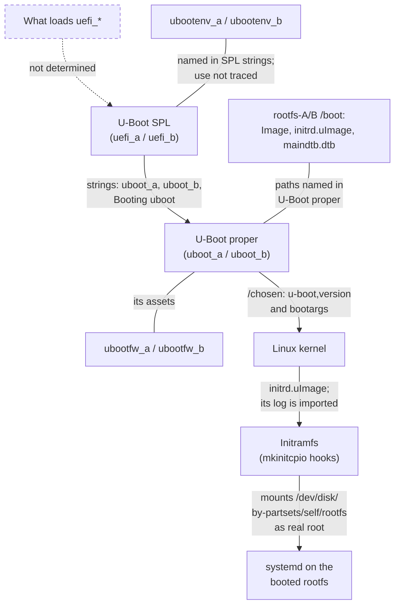
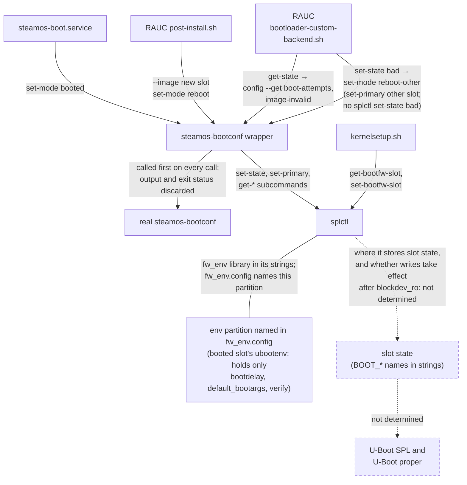
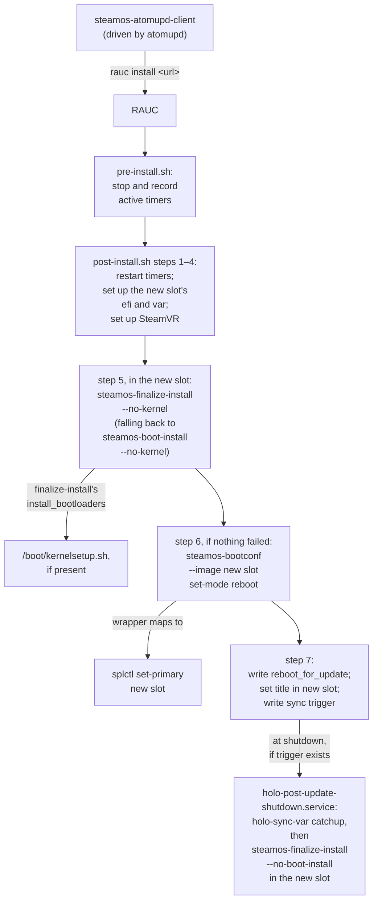
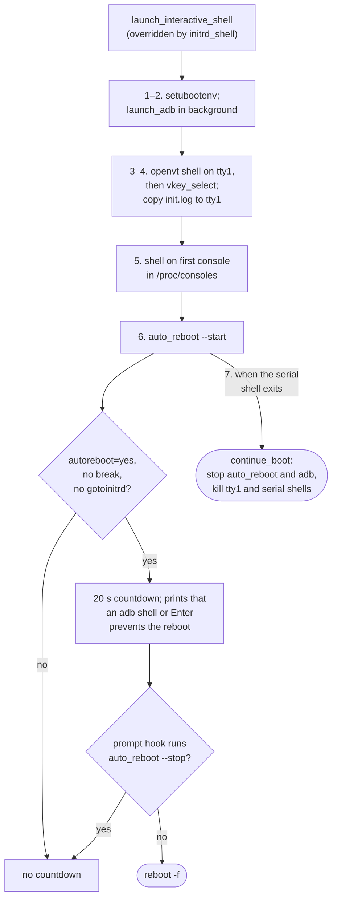

# Boot sequence and bootloader

This page covers what can be seen of the headset's boot path from a shell, up to the point where userspace takes over ([Services → How a boot reaches VR](services.md#how-a-boot-reaches-vr)).

The bootloader binaries were never executed or modified. Facts about them come from these sources: `strings` on the files in `/boot`, the scripts that ship around them, and what they leave behind (`/proc/cmdline`, `/proc/device-tree/chosen`, the initramfs log), plus one read-only root pass (`fw_printenv` and directory listings, see [Methodology](methodology.md)). A string shows that a name or message exists in a binary. It doesn't show when or how the code behind it runs. Where behavior wasn't observed, the page says so and links to [Not determined](#not-determined).

**Tag: Internal.** All of the Deckard-specific boot code is Valve's. Upstream pieces are tagged where they appear.

## What matters

- **The chain is U-Boot, not UEFI.** U-Boot SPL (in `uefi_a/b`) loads U-Boot proper (in `uboot_a/b`), which boots the kernel and a mkinitcpio initramfs from the booted rootfs's `/boot`. `/sys/firmware/efi` doesn't exist. ([Boot components](#boot-components))
- **There are two kinds of A/B slot.** The OS slot (`rootfs`, `efi` and `var`, grouped as [partsets](#partsets)) is passed to the kernel as `rauc.slot=`. `kernelsetup.sh` and `splctl` track the boot-firmware slot separately. ([Boot firmware package](#boot-firmware-package))
- **`splctl` manages slot state.** `/usr/bin/steamos-bootconf` is a wrapper that maps onto it. The slot variable names (`BOOT_ORDER`, `BOOT_STATE_A/B`, …) appear in bootloader and `splctl` strings, but the U-Boot environment that `fw_printenv` reads holds only `bootdelay`, `default_bootargs` and `verify`. Both tools have write subcommands, so don't run either to explore. ([U-Boot environment and slot state](#u-boot-environment-and-slot-state))
- **Updates go from atomupd to RAUC to a post-install script.** RAUC uses a custom bootloader backend, and `post-install.sh` makes the new slot primary with `splctl set-primary`. No update was watched while it ran. ([Updates](#updates-rauc-atomupd-and-the-slot-switch))
- **Bootloader settings reach Linux as files.** ADB mode, factory mode and the boot menu's "Repair Steam Installation" show up as properties under `/proc/device-tree/chosen/`, and services test whether those files exist. ([Device-tree flags](#device-tree-flags-from-the-bootloader))
- **Much of the flash is read-only after boot.** LUNs 1–3 (boot firmware, U-Boot and `/persist`) are read-only at the block layer. `/` is mounted `rw` but carries the btrfs `ro` property. dm-verity is built into the kernel but not in use. ([Read-only LUNs](#read-only-luns), [Root filesystem](#root-filesystem-read-only-flag-and-dm-verity))
- **Valve publishes U-Boot and `splctl` source as source packages.** Packages aren't listed for every build, but the U-Boot commit from SteamOS 0.4.5 (stable, checked later) is in a newer package's git mirror. The GitLab repositories named in the package metadata aren't publicly reachable. Upstream U-Boot supports the SoC but has no Frame board. ([Source availability](#source-availability))

**Contents**

1. [Boot components](#boot-components)
2. [Storage layout](#storage-layout)
3. [Boot firmware package](#boot-firmware-package)
4. [U-Boot SPL](#u-boot-spl)
5. [U-Boot proper](#u-boot-proper)
6. [Boot intentions, boot menu and reboot reasons](#boot-intentions-boot-menu-and-reboot-reasons)
7. [Boot splash images](#boot-splash-images)
8. [U-Boot environment and slot state](#u-boot-environment-and-slot-state)
9. [Marking a boot good](#marking-a-boot-good)
10. [Updates: RAUC, atomupd and the slot switch](#updates-rauc-atomupd-and-the-slot-switch)
11. [Device-tree flags from the bootloader](#device-tree-flags-from-the-bootloader)
12. [Initramfs](#initramfs)
13. [Root filesystem, read-only flag and dm-verity](#root-filesystem-read-only-flag-and-dm-verity)
14. [Userspace timing](#userspace-timing)
15. [Source availability](#source-availability)
16. [Interpretation](#interpretation) (verification and secure-boot state)
17. [How to inspect this yourself](#how-to-inspect-this-yourself)
18. [Not determined](#not-determined)

## Boot components

**Tag: Internal.**

| Component | Where it is | Evidence |
|---|---|---|
| Boot firmware images | LUN 1 partitions other than `uefi_a/b` (see [Storage layout](#storage-layout)) | `/boot/bootfw.tar.xz` from `deckard-boot-firmware` ("Deckard second-stage bootloader and firmware"), written by `kernelsetup.sh` |
| U-Boot SPL (secondary program loader) | `uefi_a` / `uefi_b` | `uefi.fw` in the tarball contains `U-Boot SPL 2025.07-rc3`, `uboot_a`, `uboot_b`, `Booting uboot` |
| U-Boot proper | `uboot_a` / `uboot_b`. Its environment is in `ubootenv_a/b` and its assets are in `ubootfw_a/b`. | `/boot/uboot.img`, a FIT (Flattened Image Tree) image containing `U-Boot 2025.07-rc3 … for deckard board` |
| Kernel, device tree, initramfs | `/boot` on the booted `rootfs-A` / `rootfs-B` | U-Boot proper contains `/boot/Image`, `/boot/initrd.uImage` and `/boot/maindtb.dtb`. Those files exist in the booted rootfs's `/boot`. |
| systemd | the same rootfs | `systemd-analyze` |

The `/chosen` device-tree node the kernel received carries `u-boot,version` (`2025.07-rc3-…`). Its `bootargs` has the same tokens as `/proc/cmdline`, which match U-Boot proper's [command-line format string](#kernel-command-line). What loads the `uefi_*` image wasn't determined.

The same chain as a diagram. Arrows are hand-offs, labelled with their evidence. Plain lines link a component to names found in strings or the partition table. The dotted link is not determined. None of it was traced at runtime.



The `steamos-efi` package ("Stage 1 bootloader for SteamOS 3+") installs `steamcl.efi`. `/sys/firmware/efi` doesn't exist on the headset. See [U-Boot proper's EFI strings](#efi-strings).

## Storage layout

**Tag: Internal.**

sysfs shows four SCSI logical units (LUNs 0–3) under the UFS (Universal Flash Storage) host `1d84000.ufshc`. Partition names (GPT labels):

| LUN | Partitions | Notes |
|---|---|---|
| 0 | `esp`, `efi-A`, `efi-B`, `rootfs-A`, `rootfs-B`, `var-A`, `var-B`, `home` | `esp`/`efi-*` are vfat, `rootfs-*` btrfs, `var-*` and `home` ext4 (`lsblk`) |
| 1 | `xbl_a/b`, `xblconfig_a/b`, `shrm_a/b`, `aop_a/b`, `aopconfig_a/b`, `cpucp_a/b`, `cpucpconfig_a/b`, `tz_a/b`, `devcfg_a/b`, `hyp_a/b`, `uefi_a/b`, `uefisecapp_a/b`, `keymaster_a/b`, `qupfw_a/b` | One partition pair per image in `bootfw.tar.xz` |
| 2 | `uboot_a/b`, `ubootenv_a/b`, `ubootfw_a/b`, `bootenv`, `bootenvb`, `uefivarstore`, `cdt`, `ddr`, `xblramdump`, `toolsfv`, `adpd` | `kernelsetup.sh` writes `uboot_*`, `ubootenv_*` and `ubootfw_*`. The role of the others wasn't determined. |
| 3 | `syspersist` | ext4, mounted read-only at `/persist` (`/etc/fstab`) |

<a id="read-only-luns"></a>**Read-only LUNs.** The initramfs hook `blockdev_ro` runs `blockdev --setro` on `/dev/sdb*`, `/dev/sdc*` and `/dev/sdd*`. Those disk names are hardcoded in the hook. Its comment says this "prevents accidental `sudo dd if=/dev/zero of=/dev/sdd` from wiping out your device configuration or bootloader" and that `sudo blockdev --setrw` undoes it. After boot, the disks and partitions on LUNs 1–3 report `ro` = `1` in sysfs.

### Partsets

SteamOS groups the LUN 0 partitions into *partsets*, exposed as symlinks under `/dev/disk/by-partsets/`:

| Partset | Contains |
|---|---|
| `A`, `B` | `efi`, `rootfs`, `var` for that slot |
| `self` | the booted slot's `efi`, `rootfs`, `var` |
| `other` | the non-booted slot's `efi`, `rootfs`, `var` |
| `shared` | `esp`, `home` |
| `all` | every partition above, by label |

The definitions are text files under `SteamOS/partsets/` on the slot's `efi-A`/`efi-B` partition (the "slot's efi partition" from here on, mounted at `/efi`). In a later read-only pass run as root, `/efi/SteamOS/partsets/` held `A`, `B`, `all`, `shared`, `other` and `self`. Each line is `<name> <partuuid>`, as parsed by the initramfs `partsets` hook. The hook turns them into udev rules in `/run/udev/rules.d/90-steamos-partsets-*.rules`. Rules for `other` set `UDISKS_IGNORE=1`. The hook's comment reads "ignore the "other" partitions, so they don't know up in dolphin" [sic]. `/usr/bin/steamos-partsets` generates the files.

## Boot firmware package

**Tag: Internal.**

`deckard-boot-firmware` installs:

| File | Contents |
|---|---|
| `bootfw.tar.xz` | `aop.fw`, `aopconfig.fw`, `cpucp.fw`, `cpucpconfig.fw`, `devcfg.fw`, `hyp.fw`, `keymaster.fw` (0 bytes), `qupfw.fw`, `shrm.fw`, `tz.fw`, `uefi.fw`, `uefisecapp.fw` (0 bytes), `xbl.fw`, `xblconfig.fw` |
| `uboot.img` | FIT image with a `firmware-1` (U-Boot) and an `fdt-1` (`sm8650-deckard`) entry, each with a `crc32` hash |
| `ubootfw.img` | EROFS (Enhanced Read-Only File System) image. Names in it: `logo.bmp.gz`, `logo_battery_low.bmp.gz`, `logo_console.bmp.gz`, `default.vrfont`, `default.vrterminal`, `dead_battery_recovery.bin`, `adsp_lite_sm8650.mbn` |
| `uboot.env` | Default U-Boot environment, 0x1f000 bytes. It sets `bootdelay=2`, `verify=n` and `default_bootargs=loglevel=3 rd.log=console rd.log=file id_aa64mmfr0.ecv=1`. |
| `ubootrelease.txt` | The U-Boot version string |
| `kernelsetup.sh` | The installer for the above ([Bootloader and firmware updates](#bootloader-and-firmware-updates)) |

`kernelsetup.sh` tracks a firmware slot (`a`/`b`) separately from the OS slot. It finds the active firmware slot by trying these in order:

1. `splctl get-bootfw-slot`
2. A "legacy BIOS bootable" GPT attribute on partition 1 or 2 of `/dev/sdb`
3. A partition type GUID. The script's comment calls it "a magic parttype uuid that the qcom ROM PBL boot loader searches for to find the XBL_SC".

U-Boot proper also contains `making slot %c active`, `slot_%c is already active` and `Error: gpt is corrupted in xbl partition`.

## U-Boot SPL

**Tag: Internal.**

`uefi.fw` contains `U-Boot SPL 2025.07-rc3` and `qcom_spl_board_init`. Behavior not observed. Its strings cover the U-Boot environment, slot choice and boot counting, the firmware slot, loading U-Boot proper, USB boot, front-panel buttons, a cleanup path and battery power. The full list is below.

<details markdown="1">
<summary>SPL strings, grouped by topic</summary>

- **Environment:** `ubootenv_a`, `ubootenv_b`, `Failed to read env partition (%ld)`, `Failed to read env_alt partition (%ld)`, `env written OK`, `env_alt written OK`
- **Variable dump:** `Environment Variables:` followed by `- BOOT_ORDER   = '%s'`, `- BOOT_COUNT_A = '%s'`, the same for `BOOT_COUNT_B`, `BOOT_STATE_A/B`, `BOOT_VALID_A/B`, `BOOT_FORCE_USB*`, `BOOT_FORCE_SLOT` and `BOOTED_FW_SLOT`
- **Slot choice:** `BOOT_TARGET`, `BOOT_ORDER set to A as primary`, `BOOT_ORDER set to B as primary`, `Invalid BOOT_ORDER (%s), default to 'A B'`
- **Forced slot:** `BOOT_FORCE_SLOT=%s`, `Overriding BOOT_TARGET to A`, `Overriding BOOT_TARGET to B`
- **Boot count:** `Boot count on target slot is %d`, `boot count not iterated`
- **Firmware slot:** `BOOT_FW_SLOT`, `BOOTED_FW_SLOT`, `check_for_boot_firmware_slot_change, ret = %d`, `Boot firmware changed`, `rebooting!`
- **Loading U-Boot:** `uboot_a`, `uboot_b`, `uboot partition with name %s not found`, `Booting uboot`
- **USB:** `BOOT_FORCE_USB set in environment, going to try to boot from USB`, `/uboot/u-boot.img`, `Forcing USB boot`, `%s: usb: FOUND MATCH [%s %s %s]`
- **Device-tree handoff:** `u-boot,spl-boot-device`, `%s: could not add u-boot,spl-boot-device property`, `u-boot,spl-usb-boot-vendor/product/serial`
- **Buttons:** `Select button pressed`, `Vol- button pressed`, `Vol+ button pressed`, `Power button pressed`, `total button state = %d`, `why are you hitting all of the buttons?`
- **Cleanup:** `uboot cleanup: reset ddr partition`, `uboot cleanup: reseting [sic] reboot reason to none`, `uboot cleanup: reseting [sic] uboot env slot: %s`, `uboot cleanup: done. Rebooting`
- **Power:** `Battery: %d mV`, `Charger: %s`, `PON Reason = 0x%0X` (PON: power-on, as reported by the PMIC, or power management IC)

</details>

U-Boot proper has the matching strings `u-boot,spl-boot-device`, `Booted on slot '%s'` and `No u-boot,spl-boot-device, considering A slot`.

## U-Boot proper

**Tag: Internal** for Valve's board code (`board/qualcomm/deckard/…`, `cmd/splctl.c`). **Tag: Public (upstream).** for U-Boot itself.

### What it loads

U-Boot proper contains these paths. The `/boot` ones exist in the booted rootfs's `/boot`. The binary also contains btrfs code symbols (`btrfs_read_fs_root`, `btrfs_lookup_path`), the partition names `rootfs-A`, `rootfs-B`, `system0` and `system1`, and `Trying old rootfs partition names...`.

| String | On the headset |
|---|---|
| `/boot/Image` | Symlink to `Image-<kernel version>` from `linux-72-deckard`. `file` reports "Linux kernel ARM64 boot executable Image". |
| `/boot/dtbqcom/sm8650-%s.dtb`, `/boot/dtbqcom/%s`, `/boot/maindtb.dtb` | `dtbqcom` → `dtbs/<version>/qcom/`. `maindtb.dtb` → `sm8650-mp.dtb`. The directory also has `sm8650-ev1` … `sm8650-dv2` variants. The binary also contains `EEPROM_BOARD` and `fdtfile`. Selection order wasn't determined. |
| `/boot/initrd.uImage` | The initramfs ([Initramfs](#initramfs)) |
| `vrfonts.img`, `Failed to load initrd overlay` | `predistort_images.sh` writes `vrfonts.img` to `/esp/efi/SteamOS/` ([Boot splash images](#boot-splash-images)) |

The binary contains `**********   ATTEMPTING TO BOOT KERNEL ********`, `booti ${kernel_addr_r} ${ramdisk_addr_r} ${fdtcontroladdr}` (`booti` is U-Boot's command for booting an arm64 `Image`) and `**********   KERNEL BOOT FAILED. RESETTING. ********`.

### Kernel command line

U-Boot proper contains this format string:

```
%s %s %s %s init=/sbin/init rauc.slot=%c noresume rootwait earlycon %s
```

`/proc/cmdline` matches it. With whitespace collapsed, it reads:

```
steamos.efi=PARTUUID=<partuuid> loglevel=3 rd.log=console rd.log=file id_aa64mmfr0.ecv=1 init=/sbin/init rauc.slot=<A|B> noresume rootwait earlycon
```

This is the only table of these parameters in the notes; [Kernel](kernel.md#kernel-command-line) links here. "Standard" means an upstream kernel or mkinitcpio parameter, described by its upstream meaning.

| Parameter | Where it comes from | What it relates to on the headset |
|---|---|---|
| `steamos.efi=PARTUUID=<partuuid>` | U-Boot proper (strings `steamos.efi=PARTUUID=`, `part uuid %s %d:%d efi_uuid`) | The PARTUUID of the booted slot's `efi-A`/`efi-B` partition. The initramfs `partsets` hook waits up to 10 s for it, mounts it at `/run/efi` and builds the partset udev rules from the files on it ([Initramfs](#what-runs-in-order)). |
| `loglevel=3` | Same tokens as `default_bootargs` in `/boot/uboot.env` | Standard: the kernel's console log level |
| `rd.log=console rd.log=file` | `default_bootargs` | Standard (mkinitcpio): initramfs logging. `rd.log=file` makes `init_functions` write `/run/initramfs/init.log`, which `steamos-initrd-log-import.service` copies into the journal ([Initramfs](#what-runs-in-order)). |
| `id_aa64mmfr0.ecv=1` | `default_bootargs` | Standard (arm64): overrides the ECV field of the CPU ID register `ID_AA64MMFR0_EL1`. Why it's set wasn't determined. |
| `init=/sbin/init` | Literal in the format string | Standard: the program the kernel starts as PID 1 |
| `rauc.slot=<A\|B>` | Format string (`rauc.slot=%c`) | The booted OS slot. The `partsets` hook writes `/etc/fw_env.config` from it, `kernelsetup.sh` reads it to pick its target slot, and `splctl` contains the string. `rauc.service` passes its own `--override-boot-slot` from `steamos-bootconf this-image` ([Updates](#updates-rauc-atomupd-and-the-slot-switch)). |
| `noresume` | Literal | Standard: don't resume from a hibernation image |
| `rootwait` | Literal | Standard: wait for the root device to appear |
| `earlycon` | Literal | Standard: early boot console. With no argument, the kernel takes it from `/chosen/stdout-path`, which is present. |

There's no `root=`, `ro` or `rw`. The initramfs sets the root device itself ([Initramfs](#initramfs)).

- Related strings in U-Boot proper: `efi-A`, `efi-B`, `WARNING: unable to determine steamos_efi_arg!  Falling back to root=PARTLABEL=%s`, `default_bootargs`, `temp_bootargs`, `WARNING: failed to clear temp_bootargs from persistent env`.
- Which variable fills each `%s` wasn't determined.

### U-Boot's `splctl` command

U-Boot proper has a built-in `splctl` command (`cmd/splctl.c`). Its help text:

```
set-state [A/B] [good/bad] - SPL set partition state
set-primary [A/B] - SPL set primary partition
force-usb    - SPL force booting from usb
env - SPL print env
```

Near it, the binary also contains `set-bootfw-slot`, `set-uboot-poweroff-reason`, `force-slot`, `BOOT_FORCE_SLOT`, `BOOT_FORCE_USB`, `BOOT_FW_SLOT`, `BOOT_STATE_A`, `BOOT_STATE_B` and `UBOOT_POWEROFF_REASON`.

<a id="efi-strings"></a>
### EFI strings

U-Boot proper contains `enable-efi`, `deckard_bootefi`, `Attempting to boot with EFI!`, `bootefi bootmgr` and `EFI: Couldn't find EFI variable store partition!` (LUN 2 has a `uefivarstore` partition). `/sys/firmware/efi` is absent on the headset.

Two script comments also mention EFI booting:

- `/usr/bin/steamos-bootconf`: "so that we have the actual bootconf files put there in anticipation of switching to the EFI module"
- The `factory_reset` initramfs hook: "NOTE: If using steamos-efi, we'd need to replace the chainloader here."

## Boot intentions, boot menu and reboot reasons

**Tag: Internal.**

These strings are all in U-Boot proper. Behavior not observed beyond what the quoted command strings set.

**Boot intentions.** The intention names are `Start userspace`, `Charge and wait`, `Boot menu`, `Boot from USB`, `Fastboot`, `Console wait`, `Bootloader (hold)` and `EDL (emergency download)`. The other intention strings are in the collapsed list at the end of this section.

**Boot menu** (`Deckard Boot Menu`). Entries with their command strings:

| Entry | Command string |
|---|---|
| `Current   %s-%c-%s-%s` | `setenv slottarget current` |
| `Previous  %s-%c-%s-%s` | `setenv slottarget previous` |
| `Boot from USB`, `USB: %s %s [%d GB]` | `setenv slottarget usb` (with `usbboottarget %d`) |
| `Repair Steam Installation` | `setenv slottarget current && setenv steamreset 1` |
| `Erase User Data` | `setenv slottarget current && setenv factoryreset 1` |
| `ADB mode` / `ADB mode [enabled]` | `setenv adb-mode 1` / `setenv adb-mode 0` |
| `Battery Ship Mode` | `setenv shipmode 1` |

The device-tree flags with matching names are in [Device-tree flags](#device-tree-flags-from-the-bootloader).

**Reboot reasons.** `REBOOT_COMMAND_REASON_{RECOVERY,BOOTLOADER,EDL,FASTBOOT,USB,INITRD}` and `NONE`.

<details markdown="1">
<summary>Raw strings: wait to boot, boot intention, menu actions, reboot reasons and others</summary>

**Wait to boot.** `********** deckard_wait_to_boot **********`, `Starting ADSP...` (ADSP: a DSP, or digital signal processor), `set wait_to_boot led color: %s`, `Battery: %d%% PDO: %uV @ %umA %s ~%dW`, `Started auto-poweroff timer (%d s)`, `Cancelled auto-poweroff timer`, `Auto Power-Off Initiated`. In the same group: `booted_slot`, `splctl set-state A good`, `splctl set-state B good`, `Could not figure out booted slate before poweroff` [sic].

**Boot intention.** `set boot intention global state`, `pon_reason includes button press, continuing to boot` (also `… reset …` and `… warm reset …`), `Select button pressed. Boot intention: boot menu`, `boot intention: cannot boot, battery not ready`, `switching image to BOOT_INTENTION_BOOT_MENU`.

**Boot menu, related strings:**

- **Slot labels:** `load %s %s 0x%x /etc/os-release -1`, `No valid os-release file found in A, using defaults`, `VERSION_ID`, `BUILD_ID`
- **Factory reset:** `factory reset: creating file in /efi/steamos/factory-reset/factoryreset.cfg`, `do_factory_reset`
- **Ship mode:** `do_shipmode_enter`
- **Menu actions:** `deckard_bootmenu_handle_actions`, `slottarget %s`, `Selected current target. do nothing`, `splctl force-slot A`, `splctl force-slot B`, `splctl force-usb`, `resetting...`

**Reboot reasons.** `reboot command reason: REBOOT_COMMAND_REASON_…` (the names above). Also `user issued 'reboot bootloader' detected`, and the same for `recovery`, `fastboot`, `edl`, `usb` and `initrd`.

**Other strings:** `fastboot -l 0x880000000 -s 0x10000000 usb 0`, `break=premount`, `setting bootdelay to 0, hit j key to interrupt boot`, and the console names `serial`, `usbacm`, `vidconsole`.

</details>

## Boot splash images

**Tag: Internal.**

`deckard-boot-images.service` runs `/usr/lib/deckard-boot-images/predistort_images.sh` ([services](services.md#hardware-and-power)). Per the script:

1. For each bundled `logo*.png` (`logo`, `logo_battery_low`, `logo_console`), run `vrcalib /over` to compose it over `bg.png`.
2. Run `vrcalib /predistort /persist/device_config.json` on the result.
3. Write `<name>.bmp.gz` to `/esp/efi/SteamOS/`.
4. Write `default.vrfont` and `default.vrterminal` (`vrcalib /maketerminal`).
5. Pack `default.vrfont` and `default.vrterminal` into `vrfonts.img`, a zstd-compressed cpio laid out as `usr/lib/firmware/…`.
6. Skip any output whose input hashes (kept in `.hashes/`) haven't changed.

A file with the same name in `~/.config/steamos/boot-images/` replaces the bundled image.

U-Boot proper contains `logo.bmp.gz`, `logo_battery_low.bmp.gz`, `logo_error.bmp.gz`, `logo_console.bmp.gz`, `logo_usb.bmp.gz`, `Found primary image %s, in load_source %d`, `Found fallback image %s, in load_source %d`, `ERROR: Unable to find image`, `/efi/steamos/%s` and `/uboot/ubootfw`. Neither the script nor `ubootfw.img` provides `logo_error` or `logo_usb`.

In a later read-only pass run as root, `/esp/efi/SteamOS/` on the shared `esp` partition held `logo.bmp.gz`, `logo_battery_low.bmp.gz`, `logo_console.bmp.gz`, `default.vrfont`, `default.vrterminal`, `vrfonts.img` and `.hashes`: the script's outputs. That directory is U-Boot proper's `/efi/steamos/%s` path taken from the root of `esp`, which is vfat, so the different capitalization doesn't matter. U-Boot reading the files from there wasn't traced.

`/proc/device-tree/chosen/simple-framebuffer` describes a 4320×2160 `a8r8g8b8` framebuffer.

## U-Boot environment and slot state

**Tag: Internal.**

The slot-state variable names in the table below appear in the SPL, in U-Boot proper and in `splctl`. They weren't found in the environment that Linux tools read, though:

- `/etc/fw_env.config` names the booted slot's `ubootenv_<slot>` partition. The `ubootenv_*` partitions are `root:disk` mode 0660, so `fw_printenv` fails as `steamos`.
- In a later read-only pass run as root, `fw_printenv` listed only three variables in that partition: `bootdelay`, `default_bootargs` and `verify`. Their values weren't recorded. None of the `BOOT_*` or `BOOTED_*` variables were there.

Where `splctl` actually stores slot state wasn't determined ([Not determined](#not-determined)).

**Where the variable names appear.** "SPL" is `uefi.fw`, "U-Boot" is `uboot.img`, and "`splctl`" is `/usr/bin/splctl`. The role column is only what strings show.

| Variable | Appears in | Role (from strings) |
|---|---|---|
| `BOOT_ORDER` | SPL, U-Boot, `splctl` | SPL: `BOOT_ORDER set to A as primary`, `Invalid BOOT_ORDER (%s), default to 'A B'`. `splctl`: `fw_setenv BOOT_ORDER "A B"`, `fw_setenv BOOT_ORDER "B A"`, `fw_printenv -n BOOT_ORDER` |
| `BOOT_COUNT_A/B` | SPL, `splctl` | SPL: listed in the variable dump. Otherwise not determined. |
| `BOOT_A_LEFT`, `BOOT_B_LEFT` | `splctl` | `fw_printenv -n BOOT_A_LEFT`, `fw_setenv BOOT_A_LEFT 3`, `fw_setenv BOOT_A_LEFT 0` (and B). Not determined. |
| `BOOT_STATE_A/B` | SPL, U-Boot, `splctl` | U-Boot `splctl` help: `set-state [A/B] [good/bad]` |
| `BOOT_VALID_A/B` | SPL, `splctl` | Not determined |
| `BOOT_TARGET` | SPL | `Overriding BOOT_TARGET to A` |
| `BOOT_FORCE_SLOT` | SPL, U-Boot | SPL: `Overriding BOOT_TARGET to A/B`. Otherwise not determined. |
| `BOOT_FORCE_USB`, `BOOT_FORCE_USB_VENDOR/PRODUCT/SERIAL` | SPL, U-Boot | SPL: `BOOT_FORCE_USB set in environment, going to try to boot from USB` |
| `BOOT_FW_SLOT` | SPL, U-Boot, `splctl` | Named alongside `set-bootfw-slot` (U-Boot) and `check_for_boot_firmware_slot_change` (SPL) |
| `BOOTED_FW_SLOT` | SPL, `splctl` | Not determined |
| `UBOOT_POWEROFF_REASON` | U-Boot | Named alongside `set-uboot-poweroff-reason` |
| `default_bootargs` | SPL, U-Boot | Default value in `uboot.env` ([Kernel command line](#kernel-command-line)) |
| `temp_bootargs` | U-Boot | `WARNING: failed to clear temp_bootargs from persistent env` |
| `slottarget`, `factoryreset`, `steamreset`, `adb-mode`, `shipmode` | U-Boot | Set by boot-menu command strings ([Boot menu](#boot-intentions-boot-menu-and-reboot-reasons)) |

The `steamos-bootconf` wrapper has this comment: "SteamDeck counts up, so any failed boot attempt is considered bad. We count down and consider running out of boot attempts as bad." It doesn't say which variable that refers to.

Three things write `/etc/fw_env.config`, always as `/dev/disk/by-partlabel/ubootenv_<slot>    0x0000    0x1f000`:

- the initramfs `partsets` hook, from `rauc.slot=`
- `setubootenv.service`, by matching `/dev/disk/by-partsets/self/rootfs` against `A` and `B`
- the initramfs recovery shell (it runs `setubootenv`)

Only the booted slot's environment partition is configured.

### `splctl`

**Don't run it to explore.** It doesn't treat `--help` as a help flag: run that way earlier in this project, it printed nothing and exited 0 ([methodology](methodology.md#incident-running-unknown-binaries-with---help)).

`/usr/bin/splctl` (package `deckard-uboot-splctl`, "Deckard second-stage bootloader controller") is a statically linked binary. Its strings include U-Boot environment-library messages such as `Error: can't write fw_env to flash`. Subcommands found in its strings: `get-state`, `get-current`, `get-valid`, `get-primary`, `get-boot-count`, `get-bootfw-slot`, `set-state`, `set-primary`, `set-bootfw-slot`. It also contains `rauc.slot=`.

### `steamos-bootconf` wrapper

`steamos-efi` ships two files named `steamos-bootconf`:

- the real binary at `/usr/lib/steamos-efi/steamos-bootconf`, which handles bootconf files (per-slot boot configuration files). `post-install.sh` runs `steamos-bootconf create --conf-dir /esp/SteamOS/conf …`, a subcommand only the real binary implements. In the root pass, `/esp/SteamOS/conf/` held `A.conf` and `B.conf`.
- a bash wrapper at `/usr/bin/steamos-bootconf`, which maps the same command line onto `splctl`.

The wrapper first passes every invocation to the real binary, discarding its output and exit status. Then:

| `steamos-bootconf …` | Maps to |
|---|---|
| `this-image` | Compares `findmnt /` with `/dev/disk/by-partsets/{A,B}/rootfs` and prints `A` or `B` |
| `selected-image` | `splctl get-primary` |
| `list-images` | `+ A` / `+ B`, with `*` on the booted one |
| `[--image X] set-mode reboot` | `splctl set-primary X` |
| `[--image X] set-mode reboot-other` | `splctl set-primary <the other slot>` |
| `set-mode booted` | `splctl set-state <booted slot> good` |
| `config --get boot-attempts` | `1` if `splctl get-boot-count` prints `0`, else `0` |
| `config --get image-invalid` | `0` if `splctl get-state` prints `good`, else `1` |
| `config --set state <v>` | `splctl set-state <slot> <v>`. The `splctl` mapping handles no other key. |
| `dump-config` | Per slot: `splctl get-boot-count`, `get-state` and `get-valid`. Then `get-primary` and `get-bootfw-slot`. |

Two details of the script:

- Inside `config`, the `--image` branch sets `TARGET_SLOT` to the literal string `--image`. Only a leading `--image`, before the subcommand, selects a slot.
- The `splctl` mapping ignores `--set image-invalid …`. The real binary still receives it.

At every boot, `steamos-dump-info.service` writes the real binary's `dump-config` (`boot-attempts`, `boot-count`, `image-invalid` per slot) to the kernel log. After a `splctl info:` line it also writes the wrapper's `dump-config`.

## Marking a boot good

**Tag: Internal.**

`steamos-boot.service` ("SteamOS Boot Registration") runs `/usr/bin/steamos-bootconf set-mode booted`. Through the wrapper, that becomes `splctl set-state <booted slot> good`. The unit's ordering is:

- `After=graphical.target` and `Requisite=graphical.target`
- no ordering on the gamescope or SteamVR session units ([services](services.md#how-a-boot-reaches-vr))
- `ConditionPathExists=/efi/SteamOS`

On the headset, `journalctl -b -u steamos-boot` shows `Starting SteamOS Boot Registration...` and `Finished SteamOS Boot Registration.`, and `systemctl show` reports `Result=success`, `ExecMainStatus=0`. By then, LUN 2 (which holds the `ubootenv_*` partitions) is [read-only at the block layer](#read-only-luns). Where the `splctl` write goes, and whether it takes effect, wasn't determined.

**RAUC's view of a slot.** `bootloader-custom-backend.sh get-state` prints `bad` when the wrapper reports `boot-attempts` ≥ 1 or `image-invalid` > 0. Otherwise it prints `good`. Through the wrapper, `boot-attempts` is `1` only when `splctl get-boot-count` prints `0`, and `image-invalid` is `1` whenever `splctl get-state` isn't `good`.

**Marking a slot bad.** The backend's `set-state <slot> bad` runs `steamos-bootconf --image <slot> set-mode reboot-other --set image-invalid 1`. The wrapper's mapping turns that into `splctl set-primary <other slot>` only. It doesn't call `splctl set-state … bad`.

What the bootloader does with a count of `0` or a `bad` state wasn't determined ([Not determined](#not-determined)).

Who touches slot state, and through which command:



In short: `steamos-boot.service`, RAUC's `post-install.sh` and RAUC's `bootloader-custom-backend.sh` all go through the `steamos-bootconf` wrapper. The wrapper first passes each call to the real binary, discarding its output and exit status, then maps it onto `splctl`; marking a slot bad becomes `splctl set-primary <other slot>` and never `splctl set-state … bad`. `kernelsetup.sh` calls `splctl` directly for the firmware slot. `/etc/fw_env.config` names the booted slot's `ubootenv` partition, but that partition held only `bootdelay`, `default_bootargs` and `verify`. Where `splctl` stores slot state, whether its writes take effect after `blockdev_ro`, and what U-Boot SPL and U-Boot proper do with that state wasn't determined.

## Updates: RAUC, atomupd and the slot switch

**Tag: Public (upstream).** for RAUC's D-Bus API ([dbus → RAUC](dbus.md#rauc-depengutronixrauc)). **Tag: Internal.** for the configuration and hook scripts.

No update was watched while it ran. This section is what the configuration and scripts contain.

`steamos-atomupd-client` (driven by [atomupd](dbus.md#os-updates-comsteampoweredatomupd1)) runs `rauc install <url>` (`client.py`). `/etc/rauc/system.conf` sets:

- `compatible=steamos-aarch64`, `bootloader=custom`, `activate-installed=false`
- slots `rootfs.0` (`bootname=A`, `device=/dev/disk/by-partsets/A/rootfs`, `type=raw`) and `rootfs.1` (`bootname=B`, `…/B/rootfs`)
- a `[casync]` section (casync: content-addressable sync) with `use-desync=true` and the seed `/var/lib/steamos-atomupd/rootfs.caibx`
- handlers `/usr/lib/rauc/bootloader-custom-backend.sh`, `pre-install.sh` and `post-install.sh`

`rauc.service` starts `/usr/lib/rauc/rauc-override.sh`, which runs `rauc --mount=/run/rauc --override-boot-slot="$(steamos-bootconf this-image)" service`.

What the handler scripts do:

1. **`pre-install.sh`**
   - Logs a warning if the bundle's rootfs UUID equals the running one.
   - Removes `/run/steamos-atomupd/reboot_for_update` and `holo-booted-slot-sync-trigger`.
   - Stops every active systemd timer, recording them in `/run/rauc/active-timers`.
2. **`post-install.sh`**
   1. Restarts the recorded timers.
   2. Mounts `/dev/disk/by-partsets/other/efi`. If `SteamOS/partsets` is missing there, it copies `all` and `shared` and writes `self`/`other` with the slots swapped. It creates `/esp/SteamOS/conf/<new slot>.conf` with the real `steamos-bootconf create`, and copies `$RAUC_UPDATE_SOURCE/roothash` (if present) to `SteamOS/roothash`.
   3. Runs `mkfs.ext4` on the new slot's `var` (keeping its label). It mounts that under the new rootfs, runs `/usr/lib/steamos/holo-sync-var all`, and copies the bundle's `rootfs.img.caibx` to `/var/lib/steamos-atomupd/rootfs.caibx` there.
   4. Runs `steamvr setpathdefault` if `steamvr path` isn't `/opt/steamvr` or `/home/steamos/work/MainSteamVR`, then `steamvr enable`.
   5. Runs `steamos-chroot --partset <new slot> -- steamos-finalize-install --no-kernel`, falling back to `steamos-boot-install --no-kernel`.
   6. If nothing failed, runs `steamos-bootconf --image <new slot> set-mode reboot`, which the wrapper maps to `splctl set-primary <new slot>`. The comment above it: "Mark the new partition valid, otherwise it will not boot".
   7. Writes `<buildid>-<version>` to `/run/steamos-atomupd/reboot_for_update`, runs `steamos-bootconf config --set title <label>` inside the new slot, and writes the booted slot to `/run/steamos-atomupd/holo-booted-slot-sync-trigger`.

When that trigger file exists, `holo-post-update-shutdown.service` runs at shutdown. It runs `holo-sync-var catchup` into the new slot's `var`, then `steamos-finalize-install --no-boot-install` (or `holo-finalize-install`) inside the new slot.

The same flow as a diagram. It follows the scripts; no update was watched while it ran. Step numbers are `post-install.sh`'s.



`/usr/lib/rauc/atomic-update-keep.conf` lists the `/etc` paths kept across an update, with drop-ins in `/etc/atomic-update.conf.d/*.conf`.

### Bootloader and firmware updates

`steamos-finalize-install`'s `install_bootloaders` runs `/boot/kernelsetup.sh` if that file exists, and returns. The script reads `rauc.slot=` from `/proc/cmdline`. Its target slot is the other one, or the booted one with `--sameslot`. It only proceeds if `/dev/disk/by-partlabel/rootfs-A` exists and `vrdevice_path model` is `EV3`, `DV1`, `DV2` or `MP`. Then:

1. For `uboot_<target>`, `ubootfw_<target>` and `ubootenv_<target>`, it compares the partition's leading bytes with `uboot.img`, `ubootfw.img` and `uboot.env`. If they differ, it runs `blockdev --setrw`, writes the file with `dd`, and restores the read-only flag. For `ubootenv_<target>`, the file is the three-variable default environment.
2. It runs `sgdisk` commands whose comments name EV2/EV3/DV1 layouts: delete a `spare` partition, rename a duplicate `keymaster_a` to `keymaster_b`, add `qupfw_a`/`qupfw_b`.
3. It compares each image in `bootfw.tar.xz` with the active firmware slot's partitions. If any differ, it writes the mismatched images to the other firmware slot, reads them back, and on success runs `splctl set-bootfw-slot <other>`.
4. If the slot's efi partition has no `SteamOS/partsets/self`, it runs `steamos-partsets /efi/SteamOS/partsets`.

## Device-tree flags from the bootloader

**Tag: Internal.**

U-Boot proper contains `u-boot,charger`, `u-boot,display`, `u-boot,factory-mode`, `u-boot,adb-mode`, `u-boot,pon-trigger-smpl`, `u-boot,steamreset`, `u-boot,oldrootfssupport` and `bootwrapper,version`, each next to a `WARNING: could not set …` message. Consumers test whether the file exists.

| Property | Related strings | Read by |
|---|---|---|
| `u-boot,version` | U-Boot version string | Nothing found |
| `bootwrapper,version` | `boot-wrapper-version`, `Boot Wrapper version: %d` | Nothing found |
| `u-boot,adb-mode` | Menu sets `adb-mode`. The adbd drop-in comment: "Enabling adb mode in the bootloader creates this file". | `adbd.service` (drop-in `adbd.service.d/adbd.conf`). A drop-in with the same conditions exists at `adbd-init.service.d/adbd.conf`, but there's no `adbd-init.service`. |
| `u-boot,factory-mode` | `Factory mode: %d`. Drop-in comment: "Enabling factory mode in the bootloader creates this file" | `adbd.service` condition, and `ADB_FORCE_ROOT_PATH` ("The bootloader will create this to force us into root mode") |
| `u-boot,steamreset` | Menu sets `steamreset` | `/usr/share/deckard/steamvr_first_init.sh` (`steamvr.service` `ExecStartPre`): if present and `/tmp/steamreset_done` doesn't exist, runs `steam-health-check --repair-now`, deletes `~/.config/openvr` and the OpenXR `active_runtime.json`, and touches `/tmp/steamreset_done` |
| `u-boot,charger`, `u-boot,display`, `u-boot,pon-trigger-smpl`, `u-boot,oldrootfssupport` | Names only | No reader found in `/usr/lib/systemd`, `/usr/bin`, `/usr/lib/steamos`, `/usr/share/deckard`, `/usr/lib/deckard*`, `/usr/lib/udev`, `/usr/lib/initcpio` |
| `u-boot,disable-adb` | Not in U-Boot proper's strings | `adbd.service`: `ConditionPathExists=!` |
| `u-boot,disable-ncm` | Not in U-Boot proper's strings | `usb-ncm-gadget@.service`: `ConditionPathExists=!` |
| `simple-framebuffer` | `simple-framebuffer`, `WARNING: could not enable simple-frambuffer [sic] %s.` | Not checked |
| `bootargs` | — | Same tokens as `/proc/cmdline` |
| `linux,initrd-start`, `linux,initrd-end`, `stdout-path` | — | Not checked |

USB networking (`usb-ncm-gadget@.service`) has only two conditions: the developer-mode marker `/etc/systemd/system/adbd.service.d/steamos-devkit-enabled`, and the absence of `u-boot,disable-ncm`. `u-boot,adb-mode` and `u-boot,factory-mode` don't enable it.

U-Boot proper also contains `board-info: published %d of %d EEPROM fields`. `/proc/device-tree/board-info/` exists, and its property names include `board_revision`, `strap_revision`, `unit_sn`, `mpcba_sn` and `strap_sn`. The files are mode `0444`, so any local user can read them ([security notes](security-notes.md)).

## Initramfs

**Tag: Public (upstream).** for mkinitcpio ("Modular initramfs image creation utility") and its stock hooks. **Tag: Internal.** for the SteamOS/Deckard hooks.

### How it's built

- `/etc/mkinitcpio.conf` sets `HOOKS=(base udev autodetect microcode modconf kms keyboard keymap consolefont block filesystems fsck)`. It has `base` and `udev` and no `systemd` hook.
- `/etc/mkinitcpio.conf.d/steamos.conf` appends `blockdev_ro partsets initrd_shell factory_reset etc_overlay deckard_fw`. It adds `splctl`, `fw_printenv`, `fw_setenv`, `bash`, `strace`, `zstd` and `lsblk` ("useful inside of the initrd for recovery purposes") and the regulatory database files.
- `/etc/mkinitcpio.d/linux-72-deckard.preset` passes `-S autodetect,consolefont,kms,keyboard,microcode` and writes to `/tmp`.
- The post hook `/usr/lib/initcpio/post/deckard-uimage` runs `mkimage -A arm64 -O linux -T ramdisk -C none` into `/boot/initrd.uImage`. `file` reports "u-boot legacy uImage, … RAMDisk Image (Not compressed)".
- `deckard_fw` adds `qupv3fw.elf`, `dsm_param.bin`, `default.vrfont` and `default.vrterminal`.

### What runs, in order

From the imported initramfs log (`journalctl -b -u steamos-initrd-log-import`):

| Phase | Hook | Script contents / log lines |
|---|---|---|
| early | `udev`, `initrd_shell` | `initrd_shell` logs `launch_interactive_shell overridden` |
| main | `udev`, `keymap` | Stock |
| main | `partsets` | Writes `/etc/fw_env.config` for `ubootenv_<rauc.slot>`. Waits up to 10 s for the `steamos.efi=` device and mounts it at `/run/efi`. Generates the partset udev rules, then sets `root=/dev/disk/by-partsets/self/rootfs` and waits for it. |
| mount | (stock) | `ERROR: device '' not found. Skipping fsck.`, then `:: mounting '/dev/disk/by-partsets/self/rootfs' on real root` |
| late | `blockdev_ro` | [Read-only LUNs](#read-only-luns) |
| late | `initrd_shell` | Calls `launch_interactive_shell` if `gotoinitrd=yes` |
| late | `factory_reset` | Mounts `/dev/disk/by-partlabel/esp` at `/esp` and checks for `efi/steamos/factory-reset/*.cfg` |
| late | `etc_overlay` | Mounts `self/var` at `/new_root/var`. Mounts `/etc` as an overlay with the image's `/etc` as lower, `/var/lib/overlays/etc/{upper,work}`, and `index=off,metacopy=off`. |

`rd.log=file` makes `init_functions` open `/run/initramfs/init.log` (`exec 6>/run/initramfs/init.log`). `steamos-initrd-log-import.service` (`ConditionPathExists=/run/initramfs/init.log`) copies that file into the journal with `cat`. Its `ExecStopPost=` lines delete the file and `/run/initramfs`.

### Recovery shell

`initrd_shell` replaces `launch_interactive_shell`. Its comment says it starts `adbd`, opens a shell on the VR console, and "automatically reboots the system in the event of transient errors, after waiting ~20 seconds." The function:

1. Runs `/usr/lib/deckard-hw-support/setubootenv`.
2. Starts `launch_adb` in the background. It sources `adb_env` (vendor `0x28de`, product `0x2460`, `USB_GADGET_PRODUCT_NAME="Steam Frame"`, gadget `g1`, serial `<hostname> (initrd)`, `ADB_ALLOW_ROOT=true`). Then it loops: while `/tmp/run_adb` exists, it sets up the gadget and FunctionFS and runs `adbd`. The udev rule `00-adbd-restart.rules` touches `/tmp/run_adb` when a `typec_partner` device is added, and removes it and kills `adbd` when one is removed.
3. Runs `openvt` with a shell on `/dev/tty1`, then `/usr/lib/initcpio/vkey_select`. The comment says "simulate a select key press to turn on the display". `vkey_select` contains `/dev/uinput` and `virtual-select`.
4. Copies `/run/initramfs/init.log` to `/dev/tty1`.
5. Starts a shell on the first console in `/proc/consoles`.
6. Runs `auto_reboot --start "<reason>"`. Unless `break` or `gotoinitrd` is set, or `autoreboot` isn't `yes`, it counts down 20 seconds and runs `reboot -f`. It prints that an adb shell, or Enter on a USB keyboard or serial console, prevents this. The shell profile (`etc_profile`, installed as `/etc/profile`) calls `auto_reboot --stop` from its prompt hook. The prompt is `(initrd:<cwd>)`.
7. When the serial shell exits, runs `continue_boot`. It stops `auto_reboot`, removes `/tmp/run_adb` and `/tmp/wait_for_adb`, stops the gadget, kills `adbd`, and kills the `tty1` and serial shells.

The same steps as a diagram. They run whenever `launch_interactive_shell` is called, for example by the late `initrd_shell` hook when `gotoinitrd=yes`. Numbers match the list above.



### Factory reset

`steamos-factory-reset-config` writes `*.cfg` files to `/esp/efi/steamos/factory-reset/`. U-Boot proper contains `factory reset: creating file in /efi/steamos/factory-reset/factoryreset.cfg`, the same directory taken from the root of the `esp` partition. That U-Boot writes it there wasn't traced.

When the `factory_reset` hook finds a `.cfg` file on the `esp` partition, it:

1. Runs `blockdev --setrw /dev/sd*`.
2. Runs `mke2fs -t ext4` on `var-A`, `var-B` and `home` (`home` with `-O casefold`).
3. Runs `dd if=/dev/zero` over `ubootenv_a` and `ubootenv_b`.
4. Runs `rm -rf /esp/efi/steamos`.
5. Runs `reboot -f`.

## Root filesystem, read-only flag and dm-verity

**Tag: Internal.**

- `/proc/mounts` lists `/` as the btrfs `rootfs-A` or `rootfs-B` partition, mounted `rw`. `btrfs property get / ro` prints `ro=true`. `/etc/fstab` has no `/` entry.
- `/sys/block` has no `dm-*` entries, and nothing in `/proc/mounts` comes from `/dev/mapper`.
- `/var` is the slot's `var-A`/`var-B` (ext4), mounted by `etc_overlay`. `/etc` is the overlay above. `/home`, `/root`, `/srv` and the `steamos-offload.target` mounts are on the shared `home` partition ([services → filesystem mounts](services.md#filesystem-mounts)).
- `/efi` and `/esp` are systemd automounts (`umask=0077`, `x-systemd.idle-timeout=1min`). As `steamos`, listing them fails with "Permission denied". Their contents as root are in [Partsets](#partsets), [Boot splash images](#boot-splash-images) and [the `steamos-bootconf` wrapper](#steamos-bootconf-wrapper).
- **dm-verity.** `/proc/config.gz` has `CONFIG_DM_VERITY=y`, `CONFIG_DM_VERITY_VERIFY_ROOTHASH_SIG=y`, `CONFIG_DM_VERITY_FEC=y`, and `CONFIG_DM_INIT` not set. No file in `/usr/lib/initcpio/hooks` or `install` mentions `verity` or `roothash`, and neither the SPL nor U-Boot proper does. `/usr/bin/steamos-verity` uses `/dev/disk/by-partsets/self/verity`, which no partset contains, and checks for `/dev/mapper/root`. `post-install.sh` copies a bundle's `roothash` to the new slot's `SteamOS/roothash` if one exists.
- **`steamos-readonly`** runs `mount -o remount,rw /` before reading its arguments, even for `status`. The comment above the line says to remove it once a Deckard U-Boot merge request is merged. `steamos-verity` calls `steamos-readonly`. To check the flag, use `btrfs property get / ro` instead.

## Userspace timing

**Tag: Internal.**

- `systemd-analyze time` prints only `kernel` and `userspace`, with no firmware, loader or initrd figures.
- `systemd-analyze critical-chain` and `systemd-analyze blame` show the chain and the slowest units. Results vary with developer mode, and the chain with developer mode off wasn't captured.
- `steamos-boot.service` runs after `graphical.target` ([Marking a boot good](#marking-a-boot-good)). The VR session is covered in [Services → How a boot reaches VR](services.md#how-a-boot-reaches-vr).

## Source availability

**Tag: Internal.**

Checked on 2026-11-21, with the headset on SteamOS 0.4.5 (stable), not the 0.5.9 beta the rest of this page describes. Installed-package details are from 0.4.5 ([Methodology](methodology.md#source-availability-check)).

- **`splctl`'s source is published.** Valve's [source directory](https://holo-packages.steamos.cloud/archlinux-deckard-hotfixes/source/) has a source package with the same tag as the installed `splctl`.
- **The 0.4.5 U-Boot commit is in a newer package's git mirror.** No `deckard-uboot` package matches the installed version, but the git mirror in a newer one lists the 0.4.5 build's commit. Whether it holds that commit's full tree wasn't checked.
- **No `deckard-boot-firmware` package is listed.** On 0.5.9 that's the package that installs U-Boot.
- **Upstream U-Boot supports the SoC** but has no Frame board ([In upstream U-Boot](#in-upstream-u-boot)).

[Kernel → Source availability](kernel.md#source-availability) covers the kernel and describes the source directory and the other places checked.

On 0.4.5, `deckard-boot-firmware` isn't installed. `/boot/bootfw.tar.xz`, `/boot/uboot.env` and `/boot/uboot_ev3.img` belong to `deckard-uboot`, which has the same package description: "Deckard second-stage bootloader and firmware".

| Installed package (0.4.5) | License field | License files | Source package listed |
|---|---|---|---|
| `deckard-uboot` 20260908.1-2 | `GPL-2.0+`, `BSD`, `OFL-1.1` | `OFL.txt` only | Not this version. There are eight newer packages, 20261012.2-2 to 20261119.1-1. |
| `deckard-uboot-splctl` 20260128.3-2 | `GPL-2.0+`, `no-source-release` | None | `20260128.3-6`: same tag, newer package release |

- **What the source packages contain.** Nothing in them was built or run.
  - `deckard-uboot-splctl-20260128.3-6` (110 KB, read whole) has a PKGBUILD (`license=('GPL-2.0+')`) and a bare git repository with the tag `20260128.3`.
  - Of `deckard-uboot-20261119.1-1` (340 MiB), only the first 34 MB was read. It has a PKGBUILD (`license=('GPL-2.0+' 'BSD' 'OFL-1.1')`) and a bare git mirror (`+refs/*:refs/*`) of `deckard/deckardos/u-boot`. That mirror's pack index lists commit `bb0a2a01cb6d`, the hash in the 0.4.5 version string, and its root tree object. Whether the mirror holds that commit's complete tree wasn't checked.
- **`deckard-uboot` vs `deckard-boot-firmware`.** Comments in the 20261119.1-1 PKGBUILD say the package installs intermediate files under `/usr/lib/u-boot/`, which must be further wrapped and deployed, and that a typical user device installs `deckard-boot-firmware` instead. How the two packages relate on 0.4.5, where `deckard-uboot` owns `/boot/bootfw.tar.xz`, wasn't determined.
- **Installed package URLs (0.4.5).**
  - `deckard-uboot` gives `https://gitlab.steamos.cloud/deckard/deckardos/u-boot/-/tree/$_srctag`, with a literal, unexpanded `$_srctag`.
  - `deckard-uboot-splctl` gives `https://gitlab.steamos.cloud/deckard/deckardos/deckard-uboot-splctl/-/tree/20260128.3`.
  - Anonymous GitLab API requests for both projects return `404 Project Not Found`, which GitLab returns for private and missing projects alike.
- **Version string.** On 0.4.5, `/boot/ubootrelease.txt` and `/proc/device-tree/chosen/u-boot,version` both read `2025.07-rc3-00634-gbb0a2a01cb6d`. The 0.5.9 build's full string wasn't recorded.
- **Third-party mirror.** [evlaV/deckard-u-boot](https://github.com/evlaV/deckard-u-boot) on GitHub isn't Valve's and wasn't reviewed. The only check made was that it contains commit `bb0a2a01cb6d`.

### In upstream U-Boot

**Tag: Public (upstream).** On U-Boot's GitHub mirror, [`u-boot/u-boot`](https://github.com/u-boot/u-boot/tree/c1958b5f6cce), branch `main` at `c1958b5f6cce` (2026-11-19) has generic SM8650 support: `configs/qcom_sm8650_defconfig` and SM8650 clock, pin-control and interconnect drivers. It has no Frame board:

- No path in the tree contains `deckard`. The only Valve board in its device-tree copy is the Steam Link.
- There's no `cmd/splctl.c`.
- U-Boot's copy of the Linux device trees (`dts/upstream/src/arm64/qcom/`) doesn't include `sm8650-valve-deckard.dts`. Linux added that file in v7.4-rc1 ([Kernel → In mainline Linux](kernel.md#in-mainline-linux)).

## Interpretation

*This section is interpretation, not observation. It combines the facts above with general knowledge and may be wrong.*

**Verification and secure-boot state.** Taken together, the files show integrity checks after the Qualcomm firmware stage, but no visible signature enforcement. That isn't proof that none exists: whether anything checks signatures on the SPL, U-Boot proper or the kernel is still [not determined](#not-determined).

- **Qualcomm stage.** `xbl`, `tz` and `hyp` are Qualcomm's usual boot chain, which on most Qualcomm devices is verified by the boot ROM. Nothing here shows whether that's enforced on the headset.
- **U-Boot stage.** The FIT entries in `uboot.img` carry `crc32` hashes, and no signature is mentioned. The initramfs is a legacy uImage. The default environment sets `verify=n`, which in upstream U-Boot turns off image checksum checks, and `verify` is one of the three variables in the live environment. These guard against corruption, not tampering.
- **Root filesystem.** The kernel supports dm-verity, but no verity device exists, and the `verity` partset that `steamos-verity` expects is missing. The `roothash` copy in `post-install.sh` looks like groundwork for a feature this build doesn't use.
- **Kernel.** Module signing is built but not enforced, and lockdown is `none` ([Kernel → build options](kernel.md#build-options-worth-knowing)).
- **Updates.** RAUC bundles may still be signature-checked. This page doesn't record RAUC's keyring settings, so that's open.

The overall picture is a device that trusts what's on its own flash. Protection comes mainly from read-only flags and A/B fallback, not cryptographic verification. That fits a developer-friendly configuration, or one still being finished.

## How to inspect this yourself

These commands only read. All but the two `sudo` lines work as the `steamos` user. The `busctl` line is the exception: if RAUC isn't running, a property read starts `rauc.service`, which runs `steamos-bootconf this-image`. Hence the `is-active` guard. `/proc/cmdline`, `/proc/device-tree/chosen/bootargs`, `dmesg` and `/proc/device-tree/board-info` contain PARTUUIDs and serial numbers, so redact before sharing.

```sh
# Boot files and bootloader versions
ls -l /boot
cat /boot/ubootrelease.txt /proc/device-tree/chosen/u-boot,version; echo
tar tvf /boot/bootfw.tar.xz
file /boot/initrd.uImage /boot/uboot.img /boot/ubootfw.img
file -L /boot/Image

# Strings from the bootloaders (nothing executed)
strings -n 5 /boot/uboot.img | grep -E 'BOOT_|splctl|u-boot,|bootmenu|logo'
tar xOf /boot/bootfw.tar.xz --wildcards '*uefi.fw' | strings -n 5 | grep -E 'BOOT_|uboot'
strings /usr/bin/splctl | grep -E '^(get|set)-|BOOT_'

# Default U-Boot environment (the package file, not the live partition)
tail -c +5 /boot/uboot.env | tr '\0' '\n' | grep -a '='

# Partitions, partsets, read-only flags
lsblk -o NAME,SIZE,FSTYPE,PARTLABEL,MOUNTPOINTS
ls -l /dev/disk/by-partsets/*/
grep . /sys/block/sd?/ro

# Command line (redacted) and bootloader flags
sed -E 's/PARTUUID=[^ ]+/PARTUUID=<redacted>/' /proc/cmdline
ls /proc/device-tree/chosen/

# Initramfs config and log
cat /etc/mkinitcpio.conf.d/steamos.conf
ls /usr/lib/initcpio/hooks /usr/lib/initcpio/install
journalctl -b -u steamos-initrd-log-import -o cat

# Root filesystem
for m in / /var /etc; do findmnt "$m"; done
btrfs property get / ro

# As root, still read-only: the environment fw_env.config points at, and the boot partitions
sudo fw_printenv
sudo ls -A /efi/SteamOS/partsets /esp/efi/SteamOS /esp/SteamOS/conf

# Update plumbing
cat /etc/rauc/system.conf /usr/lib/rauc/*.sh /usr/bin/steamos-bootconf /boot/kernelsetup.sh
systemctl is-active --quiet rauc && \
  busctl get-property de.pengutronix.rauc / de.pengutronix.rauc.Installer BootSlot

# Boot registration and timing
systemctl cat steamos-boot.service
journalctl -b -u steamos-boot -o cat
systemd-analyze time
systemd-analyze critical-chain
```

Don't run these to look around:

| Command | Reason |
|---|---|
| `splctl` | Has `set-*` subcommands that write the U-Boot environment. Doesn't treat `--help` as a help flag. |
| `steamos-bootconf` | Passes every call to the real binary first, and its `set-mode` and `config --set` call `splctl set-*` |
| `steamos-readonly`, `steamos-verity` | Run `mount -o remount,rw /` first |
| `fw_setenv` | Writes the U-Boot environment |
| `kernelsetup.sh`, `steamos-finalize-install`, `steamos-boot-install` | Write bootloader partitions and slot state |
| `steamos-partsets`, `steamos-factory-reset*` | Write partset files or factory-reset requests |

## Not determined

These weren't settled by reading files and logs, including in the later read-only pass run as root:

- What loads the `uefi_*` image, and what runs before it
- How the SPL and U-Boot proper behave: slot choice, boot counting, what happens at a count of `0` or a `bad` state, button combinations, and the USB and "uboot cleanup" paths. Only their strings were read.
- Where `splctl` stores slot state. The `BOOT_*` and `BOOTED_*` names in its strings weren't in the environment `fw_printenv` reads, which held only `bootdelay`, `default_bootargs` and `verify`.
- The values of `bootdelay`, `default_bootargs` and `verify` in that environment, and what `BOOT_COUNT_*`, `BOOT_*_LEFT`, `BOOT_VALID_*` and `BOOTED_FW_SLOT` mean
- What `splctl set-primary` changes
- Whether `splctl set-state … good` from `steamos-boot.service` takes effect after `blockdev_ro` has run
- How the SPL's `env` and `env_alt` copies relate to `ubootenv_a` and `ubootenv_b`
- Which variables fill the command-line format string's `%s` fields, and when the `root=PARTLABEL=` fallback is used
- The order U-Boot proper tries device-tree files in
- Whether U-Boot proper reads and writes `/efi/steamos/…` on the `esp` partition, where files with those names are
- What `reboot initrd` does, and where `break=premount` is used
- The role of `bootenv`, `bootenvb`, `uefivarstore`, `cdt`, `ddr`, `xblramdump`, `toolsfv` and `adpd`
- Whether any signature check covers the SPL, U-Boot proper or the kernel
- What reads `u-boot,charger`, `u-boot,display`, `u-boot,pon-trigger-smpl` and `u-boot,oldrootfssupport`, and what creates `u-boot,disable-adb` and `u-boot,disable-ncm`
- What happens during an actual update. None was watched while it ran. Later installs show up in the RAUC journal, but only its success lines were read ([Methodology](methodology.md#source-availability-check)).
- Which `deckard-boot-firmware`, `deckard-uboot` and `deckard-uboot-splctl` versions the 0.5.9 build had, including its full U-Boot version string, and whether any listed source package matches them
- Whether the U-Boot mirror in the `deckard-uboot` source package holds the 0.4.5 commit's complete tree

---

*Part of [Steam Frame developer notes](https://github.com/lostpanda85/frame-docs) by [lostpanda85](https://github.com/lostpanda85). MIT licensed: if you reuse or quote this, please credit lostpanda85 and link back to the repository.*
