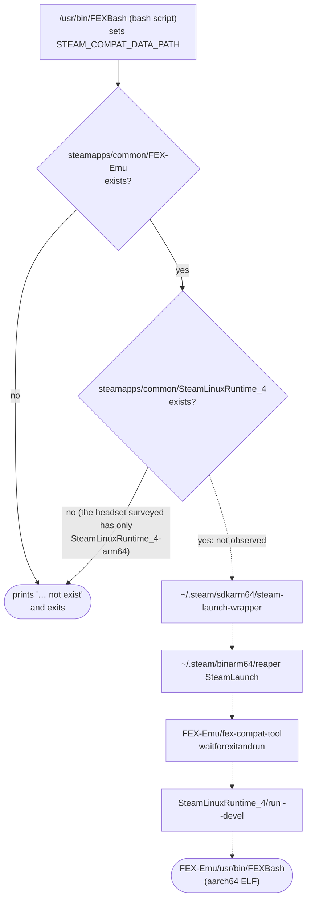

# Running other software

The headset is aarch64 (`uname -m`). This page covers what's on the headset for running other software: FEX for x86 Linux and Windows programs, Proton, the Steam Linux Runtime containers, Lepton for Android games, podman, Flatpak and Wine's `ntsync`.

Most of these pieces aren't OS packages. FEX, Proton, Lepton and the Steam Linux Runtime are Steam tools in `~/.local/share/Steam/steamapps/common/`; each has an `appmanifest_<id>.acf` in `steamapps`, like games. The OS ships the parts they depend on: guest graphics drivers, Vulkan layers, podman and the kernel features.

Only directory names, text files and scripts were read. No compatibility tool, container or emulated program was run while writing this page.

## What matters

- **No system FEX and no binfmt_misc registrations.** `pacman -Q` lists no FEX package, and no interpreter is registered in `/proc/sys/fs/binfmt_misc/`. FEX is on the headset as Steam's `FEX-Emu` tool, whose entry point is `fex-compat-tool`. ([FEX](#fex))
- **Proton is an ARM64 build.** The installed tool is `Proton 11.0 (ARM64)`, with an aarch64 `wine` and FEX-named DLLs (`libarm64ecfex.dll`, `libwow64fex.dll`). ([Proton](#proton))
- **Lepton runs Android games in rootless podman.** Its root filesystem is LineageOS 18.1 (Android 11), and its README says it runs as a non-root user. **Every `lepton` command changes state, even `help`**: it can run `podman system migrate` and start the user's `podman.service`. ([Lepton](#lepton-android-games), [Verbs](#verbs))
- **Guest drivers come from the OS under `/usr/share/guestos/`.** `fex-mesa/` holds x86 Mesa for FEX, and `android/` holds the Android Mesa and Vulkan layers that Lepton bind-mounts. ([Guest root filesystem](#guest-root-filesystem), [Android pieces in the OS](#android-pieces-in-the-os))
- **podman and Flatpak are installed; distrobox and toolbox aren't.** ([Containers](#containers-podman), [Flatpak](#flatpak))

## At a glance

| Piece | Where it comes from | Version seen | Section |
|---|---|---|---|
| FEX (x86 emulator) | Steam tool "FEX" (app 3127680), installed in `FEX-Emu/` | `FEX-2607-76-g37265b1` | [FEX](#fex) |
| x86 guest root filesystem with Mesa | OS packages `deckard-mesa-linux-x86_64`, `deckard-mesa-linux-deps-x86_64` | Mesa `26.3.0_devel+git6a15f899` | [Guest root filesystem](#guest-root-filesystem) |
| Proton | Steam tool `Proton 11.0 (ARM64)`, app 4628740 | `proton-11.0-2e-arm64` | [Proton](#proton) |
| Steam Linux Runtime 4 (aarch64) | Steam tool `SteamLinuxRuntime_4-arm64`, app 4185400 | `4.0.20261021.265997` | [Steam Linux Runtime](#steam-linux-runtime) |
| Steam Linux Runtime 2 (soldier) | Steam tool `SteamLinuxRuntime_soldier`, app 1391110 | `2.0.20261021.266042` | [Steam Linux Runtime](#steam-linux-runtime) |
| Steam Linux Runtime 1 (scout) | Steam tool `SteamLinuxRuntime`, app 1070560 | `1.0.20261021.266054` | [Steam Linux Runtime](#steam-linux-runtime) |
| Lepton (Android games) | Steam tool `Lepton`, app 3029110 | `v3.0.5` | [Lepton](#lepton-android-games) |
| Android guest drivers and layers | OS packages `deckard-mesa-android-aarch64`, `deckard-vulkan-layers-android-aarch64`, `renderdoc-android-apks` | see section | [Android pieces in the OS](#android-pieces-in-the-os) |
| podman | OS package `podman` | 5.8.0 | [Containers](#containers-podman) |
| Flatpak | OS package `flatpak` | 1.16.3 | [Flatpak](#flatpak) |
| `ntsync` | Kernel, `CONFIG_NTSYNC=y` | | [Wine and ntsync](#wine-and-ntsync) |

App IDs come from the `appmanifest_<id>.acf` file whose `installdir` names each directory. The other directories under `steamapps/common` are games and aren't listed here.

## FEX

**Tag: Public (upstream)** for FEX itself; **Internal** for how Valve packages it.

### No system FEX, no binfmt_misc registrations

- `pacman -Q` lists no FEX package. `FEXInterpreter`, `FEXLoader`, `FEXServer`, `FEXConfig`, `FEXRootFSFetcher` and `FEXGetConfig` aren't on `PATH`.
- `/proc/sys/fs/binfmt_misc/` contains only `register` and `status`, and `status` reads `enabled`. No interpreter is registered, so the kernel doesn't hand x86 ELF files to FEX on its own. `/etc/binfmt.d` and `/usr/lib/binfmt.d` are empty. The journal shows `systemd-binfmt.service` ("Set Up Additional Binary Formats") skipped because no trigger condition was met.
- The kernel has `CONFIG_BINFMT_MISC=y`. `CONFIG_COMPAT` is not set, so the kernel doesn't run 32-bit Arm programs either (`/proc/config.gz`).

### The FEX-Emu Steam tool

FEX is installed by Steam into `~/.local/share/Steam/steamapps/common/FEX-Emu/`:

| File | What it is |
|---|---|
| `VERSIONS.txt` | `FEX describe FEX-2607-76-g37265b1` |
| `toolmanifest.vdf` | `"commandline" "/fex-compat-tool %verb% --"`, `"compatmanager_layer_name" "fex"`, `"use_tool_subprocess_reaper" "1"` |
| `emulator.json` | `emulator_v0`: `emulated_architectures` `x86_64-linux-gnu`, `i386-linux-gnu`; `required_architectures` `aarch64-linux-gnu`; `argv` `./usr/bin/FEX`; `server_argv` `./usr/bin/FEXServerManager`; `main_argv` `./FEXCompatTool` |
| `fex-compat-tool` | Python script; Steam's entry point (verbs `run` and `waitforexitandrun`) |
| `FEXCompatTool` | aarch64 ELF |
| `ConfigTemplate.json` | FEX config template (below) |
| `unshare.py` | Python helpers for `unshare(CLONE_NEWUSER)` and `CLONE_NEWNS` with a one-user uid/gid map |
| `usr/bin/` | `FEX`, `FEXServer`, `FEXServerManager`, `FEXpidof`, `FEXBash`, `FEXOfflineCompiler`, `FEXGetConfig` (aarch64 ELF) |
| `usr/lib/aarch64-linux-gnu/fex-emu/HostThunks/` | `libEGL-host.so`, `libGL-host.so`, `libasound-host.so`, `libcuda-host.so`, `libdrm-host.so`, `libvulkan-host.so`, `libwayland-client-host.so` |
| `usr/share/fex-emu/GuestThunks/` | The matching `*-guest.so` libraries, plus `libVDSO-guest.so`. A `GuestThunks_32` directory and `ThunksDB.json` sit beside it. |
| `usr/lib/aarch64-linux-gnu/gdb/` | `libFEXGDBReader.so` |
| `rootfs/` | Empty |

### What `fex-compat-tool` does

Read from the script:

1. Exits with "No compat data path?" unless `STEAM_COMPAT_DATA_PATH` is set.
2. Sets `FEX_PORTABLE=1` (the comment says it stops FEX checking system directories like `/usr/share/fex-emu`), `tu_override_uncached_as_cache_coherent=true` (unless already set), `STEAM_COMPAT_MACHINE_ARCHITECTURE=aarch64-linux-gnu` and `STEAM_COMPAT_EMULATOR=<tool dir>/emulator.json` ("Tell PV where to find the description file").
3. Redirects its own output to `/tmp/fex-compat-tool-<pid>.log`, unsets `LD_PRELOAD`, and runs `printenv` into that log.
4. Picks the guest root filesystem: `STEAM_COMPAT_GRAPHICS_PROVIDER` if set, otherwise `/usr/share/guestos/fex-mesa`, and sets `STEAM_COMPAT_GRAPHICS_PROVIDER` to its `graphics_provider.json`.
5. Writes `$STEAM_COMPAT_DATA_PATH/fex-emu/Config.json` from `ConfigTemplate.json`. The template sets `X87ReducedPrecision` `1`, `ProfileStats` `1`, `RootFS` to the guest root filesystem, and `ThunkHostLibs`/`ThunkGuestLibs` to the thunk directories above.
6. Unless `FEX_APP_CONFIG` is set, writes a per-launch app config to `/tmp/fex-app-config-<pid>.json` and deletes it on exit. `STEAM_FEX_TSOENABLED` and `STEAM_FEX_MULTIBLOCK` set `TSOEnabled` and `Multiblock`. `STEAM_COMPAT_FEX_CONFIG`, if present, overrides them and sets the `ThunksDB` `GL` and `Vulkan` entries, matching the substrings `TSOEnabled:1`, `Multiblock:1`, `ThunksDB_GL:1` and `ThunksDB_Vulkan:1`.
7. Runs `<tool dir>/usr/bin/FEX` with the original command line.

### Guest root filesystem

**Tag: Internal.** The x86 libraries FEX runs against live in `/usr/share/guestos/fex-mesa/`, which two OS packages fill:

| Package | Description (`pacman -Qi`) | Contents |
|---|---|---|
| `deckard-mesa-linux-x86_64` | "An open-source implementation of the OpenGL specification, FEX x86_64 build" | x86_64 and i386 Mesa under `usr/lib` and `usr/lib32` (`file`: "x86-64" and "Intel i386"); Vulkan ICD manifests `freedreno_icd.x86_64.json` and `freedreno_icd.x86.json`; the implicit layer `VkLayer_MESA_vram_report_limit.json`; Freedreno tools in `usr/bin` (`cffdump`, `crashdec`, `replay`, `rddecompiler`, `computerator`, `generate_rd`, `pps-producer`, `qrisc-asm`, `qrisc-disasm`) |
| `deckard-mesa-linux-deps-x86_64` | "Bundle of dependencies needed for FEX mesa rootfs shard" | 8,254 files: libraries in `usr/lib` and `usr/lib32`, `usr/bin`, `usr/share`, and an `etc` with `arch-release` |

Both packages are `aarch64` packages (`Architecture : aarch64`) that carry x86 files. `graphics_provider.json` in that directory maps `x86_64-linux-gnu` to `/usr/lib` and `/usr/lib/dri`, and `i386-linux-gnu` to `/usr/lib32` and `/usr/lib32/dri`.

### `/usr/bin/FEXBash`

**Tag: Internal.** `/usr/bin/FEXBash` belongs to `steamos-customizations-deckard`. It's a bash script, not FEX's own binary. It exports `STEAM_COMPAT_DATA_PATH=$XDG_RUNTIME_DIR/fex-tmp/`, checks that `~/.steam/steam/steamapps/common/FEX-Emu` and `…/SteamLinuxRuntime_4` exist (printing `<path> not exist` and exiting if not), then runs this chain:

```
~/.steam/sdkarm64/steam-launch-wrapper -- \
  ~/.steam/binarm64/reaper SteamLaunch -- \
  FEX-Emu/fex-compat-tool waitforexitandrun -- \
  SteamLinuxRuntime_4/run --devel -- /usr/bin/sh -c FEX-Emu/usr/bin/FEXBash "$@"
```

On the headset surveyed, `steamapps/common` had `SteamLinuxRuntime_4-arm64` but no `SteamLinuxRuntime_4`, so the script would stop at its second check. It wasn't run.



### FEX config locations

| Path | Written by |
|---|---|
| `<tool dir>/ConfigTemplate.json` | Shipped with the tool |
| `$STEAM_COMPAT_DATA_PATH/fex-emu/Config.json` | `fex-compat-tool`, on every launch |
| `/tmp/fex-app-config-<pid>.json` | `fex-compat-tool`, per launch, unless `FEX_APP_CONFIG` is set |
| `$STEAM_COMPAT_DATA_PATH/proton-fex-config.json` | Proton (`proton` script, `fex_config_file`), unless `FEX_APP_CONFIG` is set. Proton also sets `FEX_APP_CONFIG_LOCATION` to its own `share/fex-emu/`. |
| `/tmp/fex-compat-tool-<pid>.log` | `fex-compat-tool`'s log, including the `printenv` output |

`~/.fex-emu` and `~/.config/fex-emu` didn't exist.

## x86 Steam and the Steam client's runtimes

**Tag: Internal.**

The Steam client itself is native. `~/.local/share/Steam/steamrtarm64/steam`, `steamwebhelper` and `reaper` are aarch64 ELF files (`file`). The [select_steam.sh wrapper](services.md#which-steam-and-which-steamvr) looks for `steamrtarm64/steam`, or `linuxarm64/steam` as a legacy layout.

<details markdown="1">
<summary>What's in the Steam directory</summary>

| Directory | Contents |
|---|---|
| `steamrtarm64/` | The client: `steam`, `steamwebhelper`, `reaper`, `steamclient.so`, `steamui.so`, `libcef.so`, `steamcmd`, `streaming_client`, `fossilize_replay`, `gldriverquery`, `vulkandriverquery`, the overlay (`gameoverlayui`, `gameoverlayrenderer.so`, `steamoverlayvulkanlayer.so`), SDL3, FFmpeg libraries, `libopenvr_api.so`, `libVkLayer_khronos_validation.so`, SwiftShader (`libvk_swiftshader.so`) and a `pv-runtime/` directory |
| `steamrtarm64/pv-runtime/steam-runtime-steamrt/` | An aarch64 Steam Runtime: `os-release` says "Steam Runtime 3c (steamrt3c)", library directory `aarch64-linux-gnu`, depot `3c.0.20261103.268067`, pressure-vessel `0.20261103.0` |
| `linuxarm64/` | `steam-launch-wrapper`, `pw-audio-namespace`, `steamclient.so`, `crashhandler.so`, `steamerrorreporter` |
| `steamrt64/` | `pv-run.sh` and a `pv-runtime/steam-runtime-steamrt/` with four `steamrt3c_platform_*` versions, whose library directories are `i386-linux-gnu` and `x86_64-linux-gnu`. `pv-run.sh`'s usage text shows `pv-run.sh -- ./steam`, `--interactive -- /bin/bash` and `--sdk -- gdb ./steam`. |
| `androidarm64/` | `libsteamclient.so`, `libsteamnetworkingsockets.so`, `libtier0_s.so`, `libvstdlib_s.so`, `steamservice.so`, `libc++_shared.so` |
| `legacycompat/` | Windows files: `Steam.dll`, `SteamService.exe`, `steamclient.dll`, `steamclient64.dll`, `GameOverlayRenderer64.dll`, `iscriptevaluator.exe` |
| `compatibilitytools.d/LegacyRuntime/` | A compatibility tool named `scout_ldlp` ("Legacy runtime 1.0", alias `scout_legacy`, `"unlisted" "2"`) whose `scout-legacy` script is `exec "$@"` |

</details>

`ubuntu12_32/`, `ubuntu12_64/`, `linux32/` and `linux64/` don't exist. `RUNSTEAM.sh` still creates `~/.steam/bin32`, `bin64`, `sdk32` and `sdk64` symlinks to them, with the comment that they "allow SteamVR to find libsteam_api.so, as well as native linux games that are run through FEX". On the headset surveyed those four links point at missing directories. `RUNSTEAM.sh` also sets `STEAM_RUNTIME_LIBRARY_PATH` by running `FEX-Emu/fex-compat-tool run -- ubuntu12_32/steam-runtime/run.sh --print-steam-runtime-library-paths` when the FEX tool is installed, and falls back to a fixed list otherwise.

`steam.service` sets `STEAM_COMPAT_TOOL_MAPPINGS=546560 100 steamrt4-any`, under the comment "Remove when no longer necessary" ([Services catalog → VR session (user units)](services.md#vr-session-user-units)).

## Proton

**Tag: Public (upstream)** for Proton and Wine; **Internal** for the ARM64 build.

`steamapps/common/Proton 11.0 (ARM64)/`:

- `version`: `proton-11.0-2e-arm64`
- `toolmanifest.vdf`: `"commandline" "/proton %verb%"`, `"require_tool_appid" "4185400"` (the `SteamLinuxRuntime_4-arm64` tool), `"use_sessions" "1"`
- `files/bin-arm64/`: `wine`, `wineserver`, `msidb`
- `files/lib/`: `aarch64-linux-gnu`, `arm64ec-w64-mingw32`, `i386-w64-mingw32`, `x86_64-w64-mingw32`, `vkd3d`, `wine`
- `files/lib/wine/`: `aarch64-unix`, `aarch64-windows`, `i386-windows`, `x86_64-windows`, `dxvk`, `vkd3d-proton`, `nvapi`, `icu`
- `files/lib/wine/aarch64-windows/` includes `libarm64ecfex.dll`, `libwow64fex.dll`, `wow64.dll`, `wow64win.dll` and `xtajit64.dll`
- `files/share/`: `default_pfx_arm64`, `fex-emu`, `openxr`, `wine`, `fonts` and others

The `proton` script reads the same `STEAM_FEX_TSOENABLED`, `STEAM_FEX_MULTIBLOCK` and `STEAM_COMPAT_FEX_CONFIG` variables as `fex-compat-tool`. Steam's graphics defaults file sets `PROTON_USE_PREPOPULATED_PREFIX=1` ([Developer workflow → The graphics environment file](developer-workflow.md#the-graphics-environment-file)).

## Steam Linux Runtime

**Tag: Public (upstream).**

| Directory | `toolmanifest.vdf` | Versions (`VERSIONS.txt`) | Contents |
|---|---|---|---|
| `SteamLinuxRuntime_4-arm64` | `compatmanager_layer_name` `container-runtime`, `filter_exclusive_priority` `4` | depot and `steamrt4` `4.0.20261021.265997`, pressure-vessel `0.20261007.0` | `steamrt4_platform_…/` (`os-release`: "Steam Runtime 4", library directory `aarch64-linux-gnu`), `pressure-vessel/` (its `pressure-vessel-wrap` is aarch64), `_v2-entry-point`, `run` |
| `SteamLinuxRuntime_soldier` | `container-runtime`, priority `2` | `soldier` `2.0.20261021.266042`, pressure-vessel and pressure-vessel-arm64 `0.20261007.0` | `soldier_platform_…/`, `pressure-vessel/` (its `pressure-vessel-wrap` is x86-64) and `pressure-vessel-arm64/` (its `pressure-vessel-wrap` is aarch64) |
| `SteamLinuxRuntime` | `scout-in-container`, priority `10`, `require_tool_appid` `1391110` (soldier) | `scout` `1.0.20261021.266054` | `steam-runtime/`, `scout-on-soldier-entry-point-v2`, `run-in-scout-on-soldier` |
| `Steamworks Shared` | | | `_CommonRedist/` |

## Lepton (Android games)

**Tag: Internal.** Lepton is a Steam tool, installed at `steamapps/common/Lepton/`. In the OS image, "Lepton" appears in two strings ([Local sockets and IPC → pidbridge](local-ipc.md#pidbridge)). The tool's `README.md` says what it is:

> **Lepton** is a tool for use with the Steam client which allows games which are exclusive to Android to run on the Linux operating system. **Most users should use Lepton provided by the Steam Client itself.**

The README also says Lepton:

- runs as a non-root user "without requiring any rootful setup or helpers", with every process inside running as that same user
- "is intended to help game developers bring their VR Android games to the Steam Frame"
- mounts graphics drivers, Steam/Steamworks libraries and Vulkan layers ("foveated rendering injector, renderpass optimizer") from the host
- supports `strace`, `gdb`, `lldb`, `renderdoc` and `perfetto`
- "incorporates patches and components from the Waydroid, Anbox, Halium and Hybris projects". The Android root filesystem is GPL-3.0 and the compatibility tool is MIT (`LICENSE.md`, `LICENSES/compat_tool.md`, `LICENSES/image.md`).

### What's in the directory

| Path | What it is |
|---|---|
| `version.txt` | `v3.0.5` |
| `toolmanifest.vdf` | `"commandline" "/lepton %verb% --"`, `"compatmanager_layer_name" "lepton"` |
| `lepton` | The bash entry point. `fauxdroid` is a symlink to it. |
| `liblepton/` | Shell libraries (`mounting.sh`, `networking.sh`, `vulkan_layers.sh`, `debug.sh`, `gdb.sh`, `strace.sh`, `perfetto.sh`, `baking.sh` and others), `lepton.seccomp.json`, an `openvrpaths.vrpath`, `perfetto/system.cfg` and `gpu_only.cfg`, and an `apk_extractor` |
| `images/rootfs/` | The Android root filesystem. `system/build.prop`: `ro.build.version.release=11`, `ro.build.version.sdk=30`, `ro.build.flavor=lineage_lepton_arm64_only-userdebug`, LineageOS 18.1, `ro.product.cpu.abilist=arm64-v8a`. `vendor/` has a `waydroid.prop`. |
| `sysbake/` | A pre-built Android `/data` tree (`app`, `dalvik-cache`, `system`, `user`, `steam_app` and so on). The script has a `sysbake` verb, and `liblepton/` has a `baking.sh`. |

### Verbs

From the script's `help` text: `start`, `shell`, `attach`, `kill`, `kill_all`, `cleanup`, `cleanup_all`, `logcat`, `install_app`, `perfetto`, `ps`, `list_containers`, `bootchart`, `collect_logs`, `help`, `unreal_vr_test`, `sysbake`, `extract`, `start_early_debug`, `gdb_server`, `lldb_server`, `gdb_attach`, `kill_gdb_server`, `kill_lldb_server`. The `case` statement also handles `run`, `exec`, `stop`, `logsetup`, `lldb_attach`, `install_completions`, `apk_info` and `version`.

The help text's example workflow: `lepton start` starts a container with the context name `dev` by default; `lepton ps` lists containers "along with their container IP addresses, and the port forward for adb", "usually 5555", for `adb connect <hostname>:5555`; `lepton attach dev` opens a shell; `lepton install_app dev /path/to/game.apk` installs an APK, with `--renderdoc` for RenderDoc support. When Steam launches a game, the context is `steamlaunch-<SteamAppId>`; app ID `3056000` is special-cased as the `dev` context. None of this was run.

**Every `lepton` command changes state, including `help`.** Before reading its verb, the script checks for a `catatonit` process. If there isn't one and the user's systemd instance is running, it runs `podman system migrate` and starts (or restarts) the user's `podman.service`. It then opens `/tmp/lepton.lock`. Read the script with `cat` instead of running it.

### How it uses podman

From `liblepton/`:

- `--userns=keep-id:uid=0,gid=0 --user 0:0 --group-add keep-groups` (`liblepton.sh`)
- `--network=pasta:…` ("a network type which works without root"), or `--network=none`; the ADB port is `5555` plus a per-container offset (`networking.sh`)
- `--security-opt seccomp=<tool dir>/lepton.seccomp.json` (`mounting.sh`)
- Device nodes passed in when present: `/dev/dri/renderD128` and `card0`, `renderD128` again as `/dev/kgsl-3d0` ("for KGSL blob driver usage"), and `zero`, `null`, `full`, `fuse`, `tty`, `shm`, `snd`, `uhid` ("Necessary for adb"), `net/tun`, `random`, `urandom`. A comment says V4L2 video devices are deliberately not shared, and `video99` is reserved "for screen broadcasting".
- None of the `liblepton` scripts or the `lepton` script mention `binder` or `/dev/kvm`.

The OS side: `/usr/lib/systemd/user/podman.service.d/lepton-podman-timeout.conf` (from `steamos-customizations-deckard`) replaces `ExecStart` with `podman $LOGGING system service --time=0`. Its comment: "Force podman to disable its auto-disable timeout, so that `catatonit -P` doesn't linger after our container has exited, making Steam think that a lepton game is still running." `pidbridge.service` ("Host PID bridge for Lepton containers") is covered in [local IPC](local-ipc.md#pidbridge); no `liblepton` script names `pidbridge`.

### Android pieces in the OS

Three OS packages install into `/usr/share/guestos/android/`, and `mounting.sh` bind-mounts every file under that directory read-only into the container at the same path (`GUESTOS_OVERLAY="/usr/share/guestos/android"`). It skips `XrApiLayer_VALVE_fdm_injection.json` unless the FDM layer is enabled.

| Package | Description | Files |
|---|---|---|
| `deckard-mesa-android-aarch64` | "An open-source implementation of the OpenGL specification, native aarch64 build" | `vendor/lib64/egl/libEGL_mesa.so`, `libGLESv1_CM_mesa.so`, `libGLESv2_mesa.so`; `vendor/lib64/hw/vulkan.freedreno.so`; `vendor/lib64/libgallium_dri.so`, `libgbm_mesa.so` |
| `deckard-vulkan-layers-android-aarch64` | "Vulkan Layers for aarch64 android" (URL names `fdm_injection_layer`) | `vendor/vulkan_layers/libVkLayer_VALVE_fdm_injection.so`, `libVkLayer_fossilize.so`; `vendor/etc/openxr/1/api_layers/implicit.d/XrApiLayer_VALVE_fdm_injection.json` |
| `renderdoc-android-apks` | "Android APKs for renderdoc" | `/usr/share/renderdoc/plugins/android/org.renderdoc.renderdoccmd.arm64.apk`, `vendor/vulkan_layers/libVkLayer_GLES_RenderDoc.so`, `/usr/lib/plugins/android/adb` |

`mounting.sh` mounts the RenderDoc APK into the container's `/vendor/apps_to_install/` when the RenderDoc layer is enabled. `vulkan_layers.sh` names the host layers `libVkLayer_VALVE_rpo.so` and `libVkLayer_VALVE_fdm_injection.so`.

### Binder and KVM

The kernel has binder built in with the device names `anbox-binder`, `anbox-hwbinder` and `anbox-vndbinder`, but no binderfs is mounted and there are no `/dev/binder*` nodes. `/dev/kvm` is mode 666. Both are on the [kernel page](kernel.md#build-options-worth-knowing). How Android's binder IPC works inside a Lepton container wasn't determined.

## Containers (podman)

**Tag: Public (upstream).**

| Item | Observed |
|---|---|
| Packages | `podman` 5.8.0, `crun` 1.26, `conmon` 2.2.1, `catatonit` 0.2.1, `netavark` 1.17.2, `aardvark-dns` 1.17.0, `passt` |
| Not installed | `distrobox`, `toolbox`, `docker`, `buildah`, `skopeo` (`which`) |
| User units | `podman.service` and `podman.socket` were disabled and inactive at survey time |
| System storage | `/etc/containers/storage.conf`: driver `overlay`, `graphroot = "/var/lib/containers/storage"`, `runroot = "/run/containers/storage"`, overlay `mountopt = "nodev"`. `/var/lib/containers` is an offload mount on the home partition ([Services catalog → Filesystem mounts](services.md#filesystem-mounts)). |
| User storage | `~/.local/share/containers` exists; `~/.config/containers` doesn't |
| Registries | `/etc/containers/registries.conf` has no uncommented settings; `registries.conf.d/00-shortnames.conf` is the stock alias list from `containers-common` |
| `/etc/subuid`, `/etc/subgid` | One line each: `steamos:100000:65536`. Neither file belongs to a package. Both are on the update keep list ([developer workflow](developer-workflow.md#where-changes-persist)). |

## Flatpak

**Tag: Public (upstream)** for Flatpak; **Internal** for the Valve units.

- `flatpak --version`: 1.16.3.
- `flatpak remotes`: one remote, `flathub`, system-wide (`https://dl.flathub.org/repo/`), from `/usr/share/flatpak/remotes.d/flathub.flatpakrepo` in the `flatpak` package.
- `flatpak list --runtime` (system, aarch64) included `org.freedesktop.Platform` `25.08`, `org.freedesktop.Platform.GL.default` `25.08` and `25.08-extra`, and `org.freedesktop.Platform.codecs-extra` `25.08-extra`. App-specific extensions are left out here.
- `/var/lib/flatpak` is an offload mount on the home partition ([Services catalog → Filesystem mounts](services.md#filesystem-mounts)).

**`flatpak-modify-flathub-beta.service`** ([services](services.md#boot-updates-and-filesystem)) has the description "Remove flathub beta repo". It runs `flatpak remote-modify --no-enumerate flathub-beta || true`, then touches `/var/lib/flatpak/.flatpak-modify-flathub-beta-once`, and only runs while that marker is missing. It's `static`, nothing in `/usr/lib/systemd` or `/etc/systemd` references it, and its `After=flatpak-workaround.service` names a unit that doesn't exist. The marker was missing, `flathub-beta` wasn't a configured remote, and the journal had no entries for the unit this boot.

**`deckard-chromium-integration`** ("Integration for Chromium/Chrome flatpak configuration") installs Flatpak override files for `org.chromium.Chromium` and `com.google.Chrome` under `/opt/deckard-chromium-integration/flatpak-overrides/`. A tmpfiles rule links them into `/var/run/flatpak/overrides/`. It also installs `/etc/chromium-flags.conf`, `/etc/chrome-flags.conf` and an `org.chromium.Chromium.desktop` file.

## Wine and ntsync

**Tag: Public (upstream).**

- The kernel has `CONFIG_NTSYNC=y`, and `/usr/lib/modules-load.d/ntsync.conf` (from `steamos-customizations-deckard`) contains `ntsync` ([kernel](kernel.md#build-options-worth-knowing)).
- `/dev/ntsync` exists, `root:root`, mode 666.
- There's no system Wine (`which wine wine64` found nothing). The Wine on the headset is Proton's.
- Proton's `files/bin-arm64/wineserver` contains the strings `/dev/ntsync`, `ntsync: up and running.` and `PROTON_NO_NTSYNC`.

## Interpretation

*This section is interpretation, not observation. It combines the facts above with general knowledge and may be wrong.*

**Why these pieces exist.** Most software built for PCs is x86 (Windows or Linux) or, for standalone VR, Android; none of it runs natively on an aarch64 Linux headset without a compatibility layer.

**Terms used above.**

- **Turnip** is Mesa's Vulkan driver for Adreno GPUs; `tu_override_uncached_as_cache_coherent` is one of its driver options.
- **PV** in `fex-compat-tool`'s comment is pressure-vessel, the Steam Linux Runtime's container tool.
- **Thunks** are FEX's pass-through libraries: a guest (x86) stub library forwards calls such as GL or Vulkan to a host (aarch64) library, so that code runs natively instead of being emulated.
- **TSO** (total store ordering) is x86's memory-ordering model. Arm's is weaker, so FEX's `TSOEnabled` option emulates x86 ordering, which costs speed.

**Two FEX paths.** The pieces point to two ways x86 code reaches FEX:

- **Native x86 Linux programs** go through the `FEX-Emu` Steam tool. Steam's compatibility manager runs `fex-compat-tool` as the `fex` layer, and `emulator.json` tells pressure-vessel to run x86 binaries inside the Steam Linux Runtime container through FEX.
- **Windows programs** go through Proton ARM64, an aarch64 Wine using Windows-on-Arm's emulator interfaces. `xtajit64.dll` is the name Windows uses for its x64 emulator, and `libarm64ecfex.dll` and `libwow64fex.dll` look like FEX built as those plug-ins (ARM64EC for 64-bit code, WOW64 for 32-bit).
- **In both cases** the x86 graphics stack is the Mesa Turnip/Freedreno build in `/usr/share/guestos/fex-mesa`, and the FEX thunks can forward GL and Vulkan calls to the native aarch64 driver.

**Why no binfmt_misc.** Without a binfmt registration, running an x86 binary from a shell fails. FEX only runs when something launches it explicitly, which keeps emulation inside Steam's launch path. `/usr/bin/FEXBash` looks like a developer convenience for getting an emulated shell inside that same path, and its `SteamLinuxRuntime_4` path looks out of step with the `SteamLinuxRuntime_4-arm64` tool installed here.

**Lepton.** Lepton is Valve's Android compatibility layer, packaged like Proton: a Steam tool that runs Android games in rootless podman containers, built on Waydroid-style LineageOS images. The `deckard-*-android-aarch64` packages are its host-provided driver and layer overlay, so the GPU driver and Valve's foveation and render-pass layers come from the OS image instead of from each game. The `anbox-*` binder device names suggest binder was planned for, but nothing mounted it here.

## How to inspect this yourself

All of these only read. Don't run `lepton` (any verb starts podman, see [above](#verbs)), `FEXBash`, `fex-compat-tool` or `proton` to look at them; use `cat` and `file`.

```sh
# FEX: packages, binfmt_misc, the OS wrapper and the Steam tool
pacman -Q | grep -i fex
ls /proc/sys/fs/binfmt_misc/; cat /proc/sys/fs/binfmt_misc/status
cat /usr/bin/FEXBash
C=~/.local/share/Steam/steamapps/common
cat "$C/FEX-Emu/VERSIONS.txt" "$C/FEX-Emu/emulator.json" "$C/FEX-Emu/toolmanifest.vdf"
cat "$C/FEX-Emu/fex-compat-tool"
ls /usr/share/guestos/fex-mesa; cat /usr/share/guestos/fex-mesa/graphics_provider.json

# Which compatibility tools are installed (tools only; this filter hides game titles)
ls -1 "$C" | grep -E 'FEX|Proton|SteamLinuxRuntime|Lepton|Steamworks'
cat "$C/Proton 11.0 (ARM64)/version" "$C"/SteamLinuxRuntime*/VERSIONS.txt
ls ~/.local/share/Steam/compatibilitytools.d

# The Steam client's own runtimes
file ~/.local/share/Steam/steamrtarm64/steam
cat ~/.local/share/Steam/steamrtarm64/pv-runtime/steam-runtime-steamrt.version.txt

# Lepton: read, don't run
cat "$C/Lepton/README.md" "$C/Lepton/version.txt"
sed -n '/help)/,/;;/p' "$C/Lepton/lepton"
pacman -Ql deckard-mesa-android-aarch64 deckard-vulkan-layers-android-aarch64 renderdoc-android-apks
systemctl --user cat podman.service

# Containers, Flatpak, ntsync
podman --version; cat /etc/subuid /etc/subgid
flatpak remotes; flatpak list --runtime
systemctl cat flatpak-modify-flathub-beta.service
ls -l /dev/ntsync /dev/kvm; zcat /proc/config.gz | grep -E 'NTSYNC|BINFMT_MISC|CONFIG_COMPAT|BINDER'
```

`podman images`, `podman ps` and the like can create user storage, and weren't run. When you list `steamapps/common`, the other entries are the owner's games; leave them out of anything you post.

## Not determined

- Whether `/usr/bin/FEXBash` works with any tool layout Steam installs (it expects `SteamLinuxRuntime_4`, which wasn't present)
- Which games or apps actually ran under FEX, Proton or Lepton on the headset surveyed, and what Steam's compatibility manager picks for a given app (no game was launched for this page)
- What uses the x86 `steamrt3c` runtime in `~/.local/share/Steam/steamrt64/`
- How Android binder IPC works inside a Lepton container, given that no binder devices exist on the host
- Whether Lepton containers use `pidbridge`, and how
- What contents `sysbake/` and the baked state in `$STEAM_COMPAT_DATA_PATH` have after a real launch
- Whether the Steam client, rather than a manual install, puts Lepton in `steamapps/common` on every headset (the README says most users "should use Lepton provided by the Steam Client itself")
- What pulls in `flatpak-modify-flathub-beta.service`, and whether `flatpak-workaround.service` exists on other builds
- Whether TSO emulation in FEX (`TSOEnabled`) has any hardware support on this SoC

---

*Part of [Steam Frame developer notes](https://github.com/lostpanda85/frame-docs) by [lostpanda85](https://github.com/lostpanda85). MIT licensed: if you reuse or quote this, please credit lostpanda85 and link back to the repository.*
