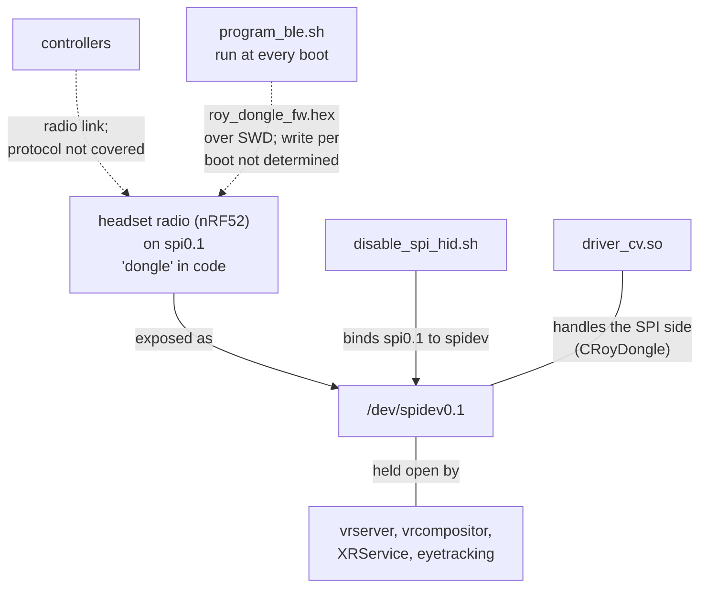

# Controllers

The controllers' file and class names use **Roy** (`CRoyController`, `roy_*` configs, model numbers like `Roy_DV1_Left`). They don't appear to Linux as USB, Bluetooth or HID devices: no USB devices are enumerated, `bluetoothctl devices` lists none, and no `/dev/hidraw*` nodes exist.

This page is built from the files SteamVR ships in `/opt/steamvr/drivers/frame_controller/`, `/opt/steamvr/drivers/frame_hmd/` and `/opt/steamvr/drivers/cv/`, plus strings in `driver_cv.so`. No live controller data (battery levels, firmware versions, serials) is included.

**Tag: Internal**, except the input profile paths, which are **Public** (OpenVR input profile format).

## How they connect

What the files show:

- **A radio on SPI.** `disable_spi_hid.sh` (in `drivers/frame_hmd/resources/firmware/roy/`) prints `Removing spi_hid driver for dongle spi0.1 and binding spi driver`, then binds `spi0.1` to `spidev`. That's `/dev/spidev0.1`: `root:spidev`, mode 664, held open by `vrserver`, `vrcompositor`, `XRService` and `eyetracking`. In `driver_cv.so`, `CRoyDongle::InitializeSpi` and `CRoyDongle::SpiThreadFunc` handle the SPI side.
- **The radio's firmware.** `program_ble.sh`, in the same folder, runs `openocd` with `program roy_dongle_fw.hex preverify verify reset` over SWD (Arm's two-wire debug interface), using SoC GPIO pins (`gpiochip` for `f100000.pinctrl`, lines 51, 50 and 164). Whether it writes on a given boot wasn't determined ([firmware](firmware.md#headset-radio-nrf52)). Its recovery path runs openocd's `nrf52_recover`. `steamvr-program-ble.service` runs it at every boot ([services](services.md#hardware-and-power)). A second image, `roy_dongle_timesync_client_fw.hex`, sits in the same folder.
- **BLE.** The script is named `program_ble.sh`, the service is described as "SteamVR Controller BLE programmer", and `driver_cv.so` contains `CRoyController error: invald ble address` [sic]. (BLE is Bluetooth Low Energy.)
- **Time sync.** `driver_cv.so` log strings include `Controller %s timesync converged …` and `Dongle timestamp offset jump`.
- **Driver layout.** The `frame_controller` driver directory has `"resourceOnly": true` in its manifest: configs, input profiles, icons, render models and firmware. The controller code is in `drivers/cv/bin/linuxarm64/driver_cv.so`.

The chain those files describe, with the file behind each link where there is one:



Don't open `/dev/spidev0.1` yourself while SteamVR is running. Several processes are already sharing it.

## Tracking

Each controller's base config (`resources/config/frame_controller_{left,right}_base.json`) holds:

- `imu`: keys `plus_x`, `plus_z`, `position` (three numbers each)
- `lighthouse_config.modelPoints` / `modelNormals`: 18 entries each. What physical features they correspond to isn't stated in the files.
- `model_number`: `Steam_Frame_Controller_Left` / `_Right`, plus `manufacturer`, `revision` and `tracked_controller_role`

## Controls

From `resources/input/frame_controller_profile.json` (`controller_type: frame_controller`). The left controller has View and a D-pad; the right has Menu and A/B/X/Y. Every control reports touch as well as its main input. The skeleton inputs reference `/skeleton/hand/left` and `/skeleton/hand/right`.

| Input path | Left | Right | Type | Reports |
|---|---|---|---|---|
| `/input/system` | ✓ | ✓ | button | click, touch |
| `/input/view` | ✓ | | button | click, touch |
| `/input/menu` | | ✓ | button | click, touch |
| `/input/dpad_up` / `_down` / `_left` / `_right` | ✓ | | buttons | click, touch |
| `/input/a`, `/input/b`, `/input/x`, `/input/y` | | ✓ | buttons | click, touch |
| `/input/bumper` | ✓ | ✓ | button | click, touch |
| `/input/trigger` | ✓ | ✓ | trigger | value, click, touch |
| `/input/grip` | ✓ | ✓ | trigger | value, click, touch |
| `/input/thumbstick` | ✓ | ✓ | joystick | x/y, click, touch |
| `/input/thumbrest` | ✓ | ✓ | button | touch only; marked `InputValueVisibility_SteamVRInternal` in the profile |
| `/output/haptic` | ✓ | ✓ | vibration | |
| `/input/skeleton/left` / `right` | ✓ | ✓ | skeleton | finger poses |

Poses: `/pose/raw`, `/pose/base`, `/pose/handgrip`, `/pose/tip`, `/pose/gdc2015`, `/pose/openxr_grip` and `/pose/openxr_aim`.

**Mirroring.** The profile's `mirror_mappings` pair left and right controls: View ↔ Menu, and D-pad up/right/down/left ↔ Y/B/A/X.

### Touch and finger sensing

`driver_cv.so` contains more input paths than the public profile lists:

```
/input/capsense/{a,b,x,y,dpad,menu,system,bumper,trigger,grip,thumbstick,thumbrest,ring,pinky}
/input/finger/{index,middle,ring,pinky}
/input/grip/force
```

None of these paths are in `frame_controller_profile.json`.

### The headset's own buttons

`drivers/frame_hmd/resources/input/input_profile.json` (`controller_type: frame_hmd`) lists `/input/system`, `/input/volume_up` and `/input/volume_down`. The profile's only default binding is for `openvr.component.vrcompositor` (`vrcompositor_bindings_frame_hmd.json`).

## How existing games see them

`frame_controller_remapping.json` lists other controller types and how their input paths map onto the Frame controller's. Entries are listed by their `priority` value, highest first. When `simulate_render_model` is true, the app is given that controller's 3D model.

| App's controller type | Priority | `simulate_controller_type` / `simulate_render_model` |
|---|---|---|
| `khr_generic_controller` | 100 | false / false |
| `oculus_touch` | 95 | true / true |
| `pico_controller` | 93 | true / true |
| `knuckles` | 90 | true / true |
| `hand_interaction_ext` | 70 | false / false |
| `vive_controller` | 20 | true / true |
| `khr_simple_controller` | 10 | false / false |

Each entry lists `autoremappings` from the other controller's paths to Frame paths. For `khr_generic_controller`, for example, `/input/primary` maps to A on the right and D-pad down on the left, and `/input/secondary` maps to B on the right and D-pad left and right on the left controller.

`default_bindings` in the profile name these per-app binding files: `half_life_alyx_bindings_frame_controller.json` (plus `_left_` and `_single_` variants), `beat_saber_…`, `arizona_sunshine_vr_remake_…`, `batman_arkham_…`, `chromalab_…`, `accountingplus_…`, `doomvfr_…`, `in_death_legacy_…`, `pixelripped1989_…` and `pixelripped1995_…`. Others cover `steam.client` (`steam_vrgamepad_bindings_frame_controller.json`), `openvr.component.vrcompositor` and `vrlink.client`.

## Pairing and firmware updates

Both go through SteamVR [mailboxes](steamvr.md#mailboxes). The names below come from strings in `driver_cv.so` and from the shipped web UI's JavaScript. Strings show which names exist, not how they fit together, and none of these messages were sent.

### `frame_controller_pairing`

The mailbox name and these message types appear in `driver_cv.so`. The web UI doesn't reference this mailbox.

| Message `type` | Notes |
|---|---|
| `start_pairing`, `stop_pairing` | |
| `update_pairing_state` | Name only. Other field names in `driver_cv.so`: `is_pairing`, `paired_controllers`, `connected_controllers`, `expected_controllers`, `num_controller_slots`. |
| `identify_controller` | Payload unknown. The driver logs `CRoyPairing identify controller '%s' %s`. |
| `disconnect_controller`, `disconnect_all_controllers` | |
| `unpair_controller`, `unpair_all_controllers`, `unpair_disconnected_controllers` | |

Log strings in `driver_cv.so` that mention OOBE: `discovered new %s OOBE controller`, `attempting to connect to Left/Right OOBE controller candidate`, `new bootstrap` and `pairing to OOBE controller`.

### `lighthouse_pairing`

The web UI's pairing code sends `discover_dongles` and `start_pairing` (`{serial, timeoutSeconds: 10, sendStatusUpdates: true}`) to a mailbox called `lighthouse_pairing`. Neither `driver_cv.so` nor `vrserver` contains that name.

### `frame_controller_firmware_update`

This one appears both in `driver_cv.so` and in the web UI, which sends `{type: "update_state"}` and `start_update`.

| Message `type` | Notes |
|---|---|
| `update_state` | Name only. Other field names in `driver_cv.so`: `firmware_update_state`, `readytoupdate`. |
| `start_update` | Takes `{serial_number}` (not `serial`, as in pairing) |
| `identify_controller` | |

`resources/firmware/manifest.vrfirmware` maps hardware IDs to firmware images:

| Hardware ID | Name | Image |
|---|---|---|
| `0x1006010000000000` | Steam Frame DV1 Controller | `Alias`: `0x1006020000000000` |
| `0x1006020000000000` | Steam Frame DV2 Controller | `roy_controller_fw_uc_<version>.bin` |
| `0x1008010000000000` | Steam Frame PV Controller | `Alias`: `0x100a010000000000` |
| `0x100a010000000000`, `0x100a020000000000` | Steam Frame Controller | `roy_controller_fw_c_<version>.bin` |

The `0x1006020000000000` entry uses the `VRCUCBin` key and the `_uc` image; the `0x100a010000000000` entry uses `VRCBin` and the `_c` image. If a controller's firmware is older than the driver's minimum, SteamVR logs `firmware does not meet minimum required version` and `driver_cv.so` also contains `Compositor requires mandatory firmware update (402)`.

## Hardware revisions

`resources/config/` has base configs for these revisions:

| Config | Model number | Model points |
|---|---|---|
| `roy_pocf_*` | `Roy_K2V3_*_CV` | 17 |
| `roy_ev1_*` | `Roy_EV1_*_CV` | 18 |
| `roy_ev1_5_*` | `Roy_EV1.5_*_CV` | 18 |
| `roy_ev2_*` | `Roy_EV2_*` | 18 |
| `roy_ev2_ergo_*` | `Roy_EV2_Playtest_Ergo_*_CV` | 18 |
| `roy_dv1_*` | `Roy_DV1_*` | 18 |
| `frame_controller_dv2_*` | `Steam_Frame_Controller_*` | 18 |
| `frame_controller_*` | `Steam_Frame_Controller_*` | 18 |

## Using the controllers from your own code

- **OpenVR apps**: bind to the `frame_controller` paths above, or to one of the controller types in the remapping table.
- **OpenXR apps**: the runtime is registered at `~/.config/openxr/1/active_runtime.json`. SteamVR has Frame-specific profiles, `/interaction_profiles/valve/frame_controller` and `…/frame_controller_valve` (extension `XR_VALVE_frame_controller_interaction`), and apps' stored bindings for `frame_controller` record `frame_controller_valve` ([OpenXR → interaction profiles](openxr.md#interaction-profiles)). Which profile `xrGetCurrentInteractionProfile` reports for the controller still wasn't determined; the remapping table lists the profiles SteamVR maps from.
- **Inspecting live state**: `vrcmd --dumpsensors` lists tracked devices with their sensor positions, and its device lines include serial numbers, so redact them before sharing. `--pollcontrollers` and `--prop` are also in `vrcmd --help`, but weren't run.
- **The SteamVR web console** is served at `http://127.0.0.1:27062/console/index.html` on the headset.

## Not covered

- The radio protocol between the controllers and the headset
- Controller battery reporting and charging (`driver_cv.so` contains a `battery_capacity` string; no live readings were taken)
- What `roy_dongle_timesync_client_fw.hex` is used for
- Steam Input's own configuration for these controllers inside the Steam client

---

*Part of [Steam Frame developer notes](https://github.com/lostpanda85/frame-docs) by [lostpanda85](https://github.com/lostpanda85). MIT licensed: if you reuse or quote this, please credit lostpanda85 and link back to the repository.*
