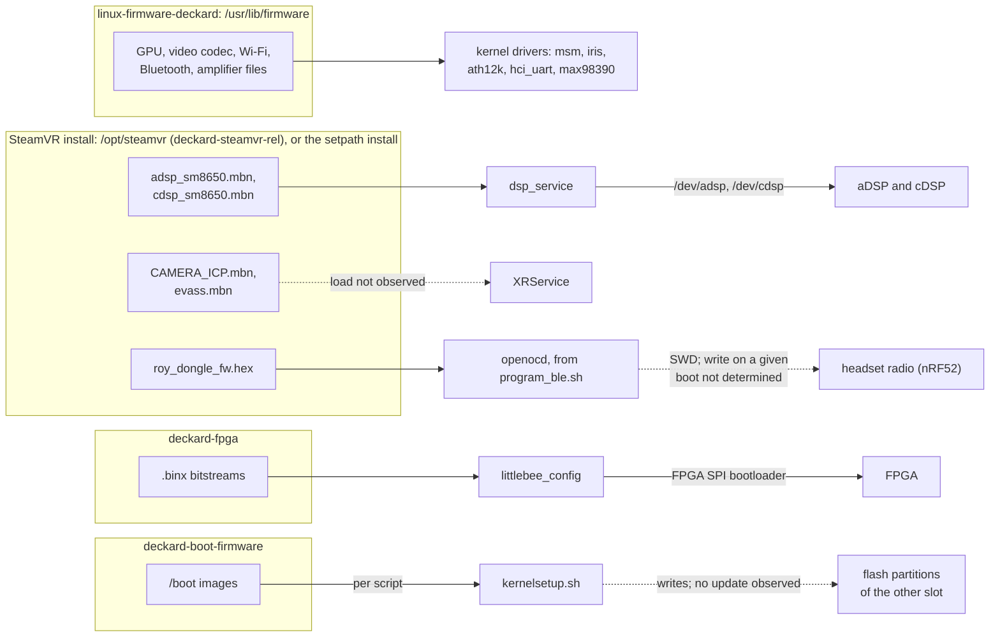
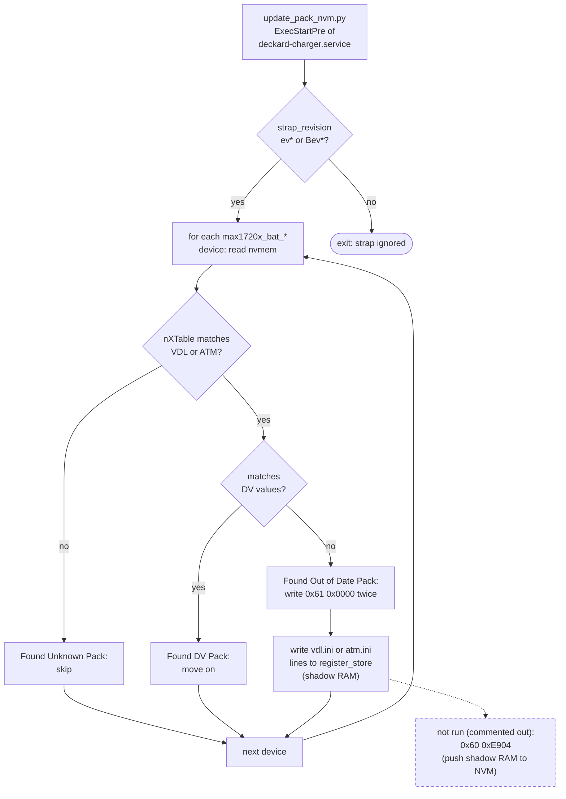

# Firmware

Besides the Linux kernel, the headset loads firmware or parameter files into the GPU, the DSPs, the camera and vision blocks, the video codec, the Wi-Fi/Bluetooth chip, the speaker amplifiers, an FPGA and the controller radio. This page lists each file, the package that installs it, what was observed loading it, and how it gets updated.

Everything here comes from package metadata, file contents, `strings` on binaries, kernel and journal logs, and sysfs on the headset surveyed. No firmware tool was run. Versions are only quoted where the same string is inside a file that ships with the OS. For values a chip reports at runtime, the page says where to read them instead.

The aDSP and cDSP (audio DSP and compute DSP) aren't started through the kernel's remoteproc (remote processor) framework. SteamVR's `dsp_service` boots them from images that ship with SteamVR. `linux-firmware-deckard` also ships aDSP and cDSP images under `qcom/sm8650/`; no kernel log line or running service references them.

## What matters

- **Kernel-loaded firmware comes with OS updates.** Every file in `/usr/lib/firmware` belongs to `linux-firmware-deckard` or `wireless-regdb`. There's no fwupd, and `jupiter-biosupdate` is a stub that exits 0. ([Update paths](#update-paths))
- **SteamVR boots the DSPs, not the kernel.** `/sys/class/remoteproc/` is empty. `dsp_service` (root) loads `adsp_sm8650.mbn` and `cdsp_sm8650.mbn` from the SteamVR install through `/dev/adsp` and `/dev/cdsp`. ([aDSP and cDSP](#adsp-and-cdsp))
- **Camera and vision firmware also ships with SteamVR.** `CAMERA_ICP.mbn` and `evass.mbn` are named only in `XRService`'s strings, and no load was observed. ([Camera ICP and EVA/CVP](#camera-icp-and-evacvp))
- **The FPGA is loaded at every boot and after every resume.** The bitstream is a Gowin GW1N-2 `csi_agg_…_passthru` image, chosen from the board model. ([FPGA bitstreams](#fpga-bitstreams))
- **The headset radio is programmed from the SoC.** `program_ble.sh` runs `openocd` against the nRF52 over SWD at every boot. Whether it writes the flash each time wasn't determined. ([Headset radio](#headset-radio-nrf52))
- **Read runtime versions from the logs, and redact them.** Versions are in `dmesg` and the `dsp_service` journal. `dmesg` also contains serial numbers and the Wi-Fi MAC address. ([Runtime versions](#runtime-versions-where-to-read-them))

## Overview

| Component | Firmware file(s) | Package | Loaded by |
|---|---|---|---|
| SoC boot chain | `/boot/bootfw.tar.xz` (14 images) | `deckard-boot-firmware` | See [boot](boot.md) |
| U-Boot and its assets | `/boot/uboot.img`, `ubootfw.img`, `uboot.env` | `deckard-boot-firmware` | See [boot](boot.md) |
| aDSP | `adsp_sm8650.mbn` | `deckard-steamvr-rel` | `dsp_service`, through `/dev/adsp` |
| cDSP | `cdsp_sm8650.mbn` | `deckard-steamvr-rel` | `dsp_service`, through `/dev/cdsp` |
| EVA / CVP | `evass.mbn` | `deckard-steamvr-rel` | Named in `XRService`'s strings; a load wasn't observed |
| Camera ICP | `CAMERA_ICP.mbn` (identical copy in `/usr/lib/firmware/`) | `deckard-steamvr-rel`, `linux-firmware-deckard` | Named in `XRService`'s strings; a load wasn't observed |
| GPU | `gen70900_sqe.fw`, `gmu_gen70900.bin` | `linux-firmware-deckard` | `msm` kernel driver |
| Video codec | `vpu33_4v.mbn` | `linux-firmware-deckard` | `iris` kernel module |
| Wi-Fi | `ath12k/WCN7850/hw2.0/` | `linux-firmware-deckard` | `ath12k` kernel module |
| Bluetooth | `qca/hmtbtfw20.tlv`, `qca/hmtnv20.bin` | `linux-firmware-deckard` | `hci_uart` (QCA) |
| Speaker amplifiers | `dsm_param*.bin` | `linux-firmware-deckard` | `max98390` driver; file chosen by `soundsetup.sh` |
| Wireless regulatory database | `regulatory.db`, `regulatory.db.p7s` | `wireless-regdb` | Declared by `cfg80211`; a load wasn't observed in the log |
| FPGA | `/usr/lib/deckard-fpga/images/*.binx` | `deckard-fpga` | `littlebee_config`, from `deckard-fpga.service` |
| Battery fuel-gauge settings | `/usr/share/deckard-charger/{atm,vdl}.ini` | `deckard-charger` | `update_pack_nvm.py`, from `deckard-charger.service` |
| Headset radio (nRF52) | `roy_dongle_fw.hex` | `deckard-steamvr-rel` | `openocd`, from `steamvr-program-ble.service` |
| Controllers | `roy_controller_fw_{c,uc}_<version>.bin` | `deckard-steamvr-rel` | Update path named in `driver_cv.so` strings and the SteamVR web UI; not exercised |

The main load paths as a diagram, grouped by the package the image comes from. Dotted edges mark steps that weren't observed:



How each group gets updated is under [Update paths](#update-paths).

## The firmware loader

**Tag: Public (upstream).** Read from `/proc/config.gz` and sysfs:

| Setting | Value |
|---|---|
| `CONFIG_FW_LOADER` | `y` |
| `CONFIG_EXTRA_FIRMWARE` | `""` |
| `CONFIG_FW_LOADER_USER_HELPER` | not set |
| `CONFIG_FW_LOADER_COMPRESS` | not set |
| `CONFIG_FW_CACHE` | `y` |
| `CONFIG_FW_UPLOAD` | not set |
| `CONFIG_FW_LOADER_DEBUG` | `y` |
| `/sys/module/firmware_class/parameters/path` | empty |

`/lib` is a symlink to `usr/lib`, so `/lib/firmware` and `/usr/lib/firmware` are the same directory. It contains no symlinks, no compressed files and no `updates/` subdirectory. Every file in it belongs to either `linux-firmware-deckard` (119 files) or `wireless-regdb` (2 files). Nothing under it points into `/tmp` or `/opt`.

The initramfs is built by mkinitcpio. `/etc/mkinitcpio.conf.d/steamos.conf` adds `regulatory.db` and `regulatory.db.p7s` (`FILES+=`) and the `deckard_fw` hook (`HOOKS+=`). That hook, `/usr/lib/initcpio/install/deckard_fw` from `deckard-hw-support` ("This hook adds deckard firmware"), adds four files: `qcom/sm8650/qupv3fw.elf`, `dsm_param.bin`, `default.vrfont` and `default.vrterminal`. See [boot → initramfs](boot.md#initramfs).

## aDSP and cDSP

**Tag: Internal.**

### Not remoteproc

The kernel has remoteproc and the Qualcomm PAS driver built in (`CONFIG_REMOTEPROC=y`, `CONFIG_QCOM_Q6V5_PAS=y`). `modinfo` describes the PAS driver as "Qualcomm Peripheral Authentication Service remoteproc driver", and its aliases include `qcom,sm8650-adsp-pas` and `qcom,sm8650-cdsp-pas`. But `/sys/class/remoteproc/` is empty.

The device-tree nodes `6800000.adsp` and `32300000.cdsp` have the compatible string `qcom,sm8650-hexagon` and no `firmware-name` property. Both are bound to the platform driver `dsp-sm8650` (`/sys/bus/platform/devices/{6800000.adsp,32300000.cdsp}/driver`), whose module is `hexagon_baremetal` (`/sys/module/hexagon_baremetal`). The kernel image's strings give its source file as `drivers/soc/qcom/hexagon-baremetal.c`. The driver creates two misc devices:

| Node | Owner | Mode |
|---|---|---|
| `/dev/adsp` | `root:root` | `crw-------` |
| `/dev/cdsp` | `root:cdsp` | `crwxrw----` |

The kernel image also contains the file names `adsp.mbn`, `adsp.mdt`, `adsp_dtb.mdt`, `cdsp.mbn`, `cdsp_dtb.mbn` and `cdsp_dtb.mdt`. `linux-firmware-deckard` ships `adsp.mbn`, `adsp_dtb.mbn`, `cdsp.mbn` and `cdsp_dtb.mbn` under `/usr/lib/firmware/qcom/sm8650/`, plus `adspr.jsn`, `adsps.jsn`, `adspua.jsn`, `battmgr.jsn` and `cdspr.jsn`. No kernel log line on the headset surveyed names any of them.

### How `dsp_service` boots the DSPs

`dsp_service.service` ("DSP Manager Service", from `deckard-steamvr-rel`) runs `/usr/share/deckard/select_steamvr.sh drivers/cv/bin/linuxarm64/dsp_service` as root. The unit has `ConditionPathExists=/dev/adsp`, `Restart=always` and `StartLimitBurst=0`.

Its journal (`journalctl -u dsp_service`) shows, in order:

1. `Detected platform type: SM8650`
2. `Initializing SM8650 aDSP`, `aDSP program loaded`, `Booting ADSP`, `ADSP boot success`
3. `Initializing SM8650 cDSP`, `cDSP program loaded`, `Booting CDSP`, `CDSP boot success`
4. `ADSP version: <n>` and `CDSP version: <n>`
5. `Starting service main loop...`

The file names in its strings are `adsp_sm8650.mbn` and `cdsp_sm8650.mbn`. Other strings include `/proc/device-tree/model`, the platform names `SM8250`, `SM8650 POC-F`, `SM8650 EV1` and `SM8650`, and `FATAL ERROR: Mismatch detected between the ADSP program version (%lu) and the dsp_service version (%lu). Please make sure that compatible binaries have been deployed. Aborting.` (and the same for CDSP).

An abstract socket `@dsp_service` is listening (`ss -xl`; its owner isn't visible without root). `dsp_service`'s strings include `IMU Streaming`, `CDSP Operations`, `Audio Streaming`, `CDSP Gazenet` and `ET Camera Streaming`, and messages naming hardware threads for "IMU", "ET camera" and "Audio Filter" and a cDSP "gazenet" thread.

The journal also contains lines prefixed `[aDSP]`, including `[CHARGER] Init successful`, `[CHARGER] Entering main loop` and `[AUDFLT] dsp_ap: init`. Other aDSP lines are tagged by sensor: `[OV6211]` (`Bringing cameras out of reset`, `Starting streaming.`) and `[ICM42688]` (`IMU streaming started`). These are part of the eye-tracking pipeline on [OpenXR → eye tracking](openxr.md#eye-tracking-foveation-hands-and-passthrough).

`slpi_sm8250.bin`, in the same directory, appears in the strings alongside `Initializing SM8250 SLPI` and `/dev/dsp`. `file` reports it as plain data.

### Suspend and resume

`systemd-inhibit --list` shows a `delay` inhibitor for `sleep` held by `dsp_service`, with the reason "dsp_service needs to clean DSP hardware interfaces". Its strings also include `Received systemd suspend notification. Shutting down hardware threads and DSPs.`, `Shutting down cDSP`, `Booting cDSP after system resume`, `aDSP charger task failed to reach the IDLE state %.2f after system resume. USB-charging issues might occur.`, and two shell commands:

```
echo "c400000.spmi:pmic@7:typec@2b00" > /sys/bus/platform/drivers/qcom,pmic-typec/unbind
echo "c400000.spmi:pmic@7:typec@2b00" > /sys/bus/platform/drivers/qcom,pmic-typec/bind
```

### Which images are opened

`dsp_service`'s strings carry bare file names, and `select_steamvr.sh` changes into the tool's own directory before it runs it (`cd "$(dirname "${TOOL_PATH}")"`). The tool path comes from `steamvr path --ignore-pending`, with `/opt/steamvr` as the fallback. The path actually opened wasn't observed. `steamvr apply-setpath` restarts `dsp_service` ([SteamVR → running a different build](steamvr.md#running-a-different-steamvr-build)).

`dsp_service.sh`, in the same directory, is a start/stop wrapper that logs to `dsp_service.txt` under the SteamVR log path. The systemd unit doesn't use it.

### `cdsp_setpath`

`/usr/local/bin/cdsp_setpath <image>` (from `deckard-hw-support`) checks that `/lib/firmware/cdsp.bin` is a symlink, then points `/tmp/cdsp.bin` at the image you name and prints the image's SHA-256. A comment says the system-side symlink is "REQUIRED IF YOUR SYSTEM IMAGE DOESNT HAVE THE DSP SYMLINK (ARCTURUS POC-A, ETC)", and the code that would create it is switched off (`SETUP_SYSTEMDSPPATH_IFNEEDED=0`). On this build `/lib/firmware/cdsp.bin` doesn't exist. Per the script's logic, it stops with "System image does not have the expected DSP image path". It wasn't run. Of the files searched, only `XRService` contains a related string (`/cdsp.bin`); how it's used wasn't determined.

## Camera ICP and EVA/CVP

**Tag: Internal.** Nothing in the kernel names the firmware files for these two blocks.

| Block | Device-tree node / compatible | Kernel driver | Node | File named in `XRService` |
|---|---|---|---|---|
| Camera ICP | `ac00000.icp` / `qcom,sm8650-icp` | `icp-sm8650` (`drivers/soc/qcom/icp.c`) | `/dev/icp`, `root:video` 0660 | `CAMERA_ICP.mbn` |
| EVA / CVP | `ab00000.cvp` / `qcom,sm8650-xtensa` | `cvp` | `/dev/cvp`, `root:video` 0660 | `evass.mbn` |

`file` identifies `CAMERA_ICP.mbn`, `evass.mbn` and `/usr/lib/firmware/cvpss.mbn` as 32-bit Tensilica Xtensa ELF files.

`XRService`'s strings include `/dev/icp`, `/dev/cvp`, `[ICP] Failed to open ICP firmware file at path %s`, `[CVP] Could not open firmware file under %s`, `[ICP] Firmware version: %u.%u.%u` and `[ICP] Firmware version %u.%u.%u doesn't match the expected version %u.%u.%u`. `XRService` wasn't running when this check was made, so its open files couldn't be inspected for these images. It was running during the later graphics survey, with the GPU render node open ([graphics → DRM clients](graphics.md#drm-clients)); its firmware files weren't checked then.

The kernel image contains `ICP boot succeeded (firmware version: %u.%u.%u)`; no such line was in the kernel log when checked. The log did contain `cvp ab00000.cvp: cvp_power_on: cvp (eva) powered on`.

`/usr/lib/firmware/CAMERA_ICP.mbn` and `/opt/steamvr/drivers/cv/bin/linuxarm64/CAMERA_ICP.mbn` have the same SHA-256. Which copy `XRService` opens wasn't determined, since only the bare name is in its strings. `cvpss.mbn` differs from `evass.mbn`, and its name doesn't appear in the kernel image's or `XRService`'s strings.

## GPU

**Tag: Public (upstream).**

The GPU is driven by the built-in `msm` DRM driver (userspace drivers and DRM state are on [graphics](graphics.md)). The GPU's GMU node has the compatible string `qcom,adreno-gmu-750.1`. From the kernel log:

- Early in boot: `Direct firmware load for qcom/gen70900_sqe.fw failed with error -2`, then `failed to load gen70900_sqe.fw`.
- A few seconds later: `loaded gen70900_sqe.fw from legacy location`, `loaded gmu_gen70900.bin from legacy location`, then `Loaded GMU firmware v<version>`.
- `Zap shader not enabled - using SECVID_TRUST_CNTL instead`. The GPU's device-tree node has no `zap-shader` child, and no log line names `gen70900_zap.mbn`.

The files exist only at the top level of `/usr/lib/firmware/`; there is no `qcom/gen70900_*` file. `linux-firmware-deckard` also ships `a750_sqe.fw`, `a750_aqe.fw`, `a750_zap.mbn` and `gen70900_aqe.fw`. None of those four names appear in the kernel image's strings. `a750_aqe.fw` and `gen70900_aqe.fw` are byte-identical.

## Wi-Fi and Bluetooth

**Tag: Public (upstream).** Both the Wi-Fi and the Bluetooth drivers report a WCN7850 in the kernel log (`Wi-Fi 7 Hardware name: wcn7850 hw2.0`, `Bluetooth: hci0: setting up wcn7850`). The radios themselves are on [Wi-Fi, Bluetooth and streaming](wireless.md).

### Wi-Fi (`ath12k`)

The Wi-Fi device is on PCIe (`0000:01:00.0`, vendor `0x17cb`, device `0x1107`), driven by the `ath12k` and `ath12k_wifi7` modules. `modinfo ath12k` declares `ath12k/WCN7850/hw2.0/*` and `ath12k/QCN9274/hw2.0/*`. Only the WCN7850 directory ships:

| File | Observed |
|---|---|
| `amss.bin` | Contains `QC_IMAGE_VERSION_STRING=WLAN.IOE_HMT.1.1-00018-QCAHMTSWPL_V1.0_V2.0_SILICONZ-1`, the same `fw_build_id` the driver logs at probe |
| `board_77.bin` | The board file the driver chose |
| `board.bin` | Not chosen on the headset surveyed |
| `m3.bin` | No log line names it |
| `regdb.bin` | No log line names it |
| `Notice.txt` | License notices |

The driver logs `Default bdf name from DTS: board_77.bin` and `Chose default board file of: board_77.bin`. The Wi-Fi device-tree node `wifi@0` has a property `qcom,default-bdf` with that file name, and the `ath12k` module parameter `default_bdf` is empty. `/usr/lib/modprobe.d/ath12k.conf` only sets `rx_reorder_timeout=2,2,2,2`.

The package's `WHENCE` file lists `ath12k/WCN7850/hw2.0/board-2.bin`, which isn't installed, and gives `WLAN.HMT.1.0.c5-00481-QCAHMTSWPL_V1.0_V2.0_SILICONZ-3` as the version, which differs from the string inside the shipped `amss.bin`.

### Bluetooth

Bluetooth is on a UART: `CONFIG_BT_HCIUART_QCA=y`, and `CONFIG_BT_HCIBTUSB` is not set. At setup the driver logs `QCA Downloading qca/hmtbtfw20.tlv`, then `QCA Downloading qca/hmtnv20.bin`, then `QCA FW build version: BTFW.HAMILTON.2.0.1-00257-PATCHZ-1`. That build string is inside `hmtbtfw20.tlv` (TLV: type-length-value). On the headset surveyed, `hci0` was set up twice during boot and downloaded both files each time.

`qca/` also holds `htbtfw10.tlv`, `htbtfw20.tlv`, `htnv10.bin`, `htnv20.bin`, `hpbtfw21.tlv` and `hpnv21.bin`. No log line names them.

## Video codec

**Tag: Internal.**

The codec node `aa00000.video-codec` (compatible `qcom,sm8650-iris`) is driven by the `iris` module (`kernel/drivers/media/platform/qcom/vcodec/iris/iris.ko`, described as "Qualcomm Iris video driver"). At probe it logs `load_fw: vpu33_4v.mbn` and `iris_hfi_core_init(): firmware: ok`. `file` identifies `vpu33_4v.mbn` as Xtensa ELF. The package ships it twice, at `/usr/lib/firmware/vpu33_4v.mbn` and `/usr/lib/firmware/qcom/vpu/vpu33_4v.mbn`, with identical contents.

The driver exposes `/sys/bus/platform/drivers/qcom-iris/aa00000.video-codec/core_state`, which read `CORE_INIT` on the headset surveyed. `iris-driver-rebind.service` (from `deckard-hw-support`, description "iris driver rebind on failure") runs `/usr/lib/deckard-hw-support/iris_driver_rebind` with environment variables pointing at that file and at the driver's `bind` and `unbind` files. The helper's strings include `CORE_DEINIT` and `%s matched CORE_DEINIT, rebinding %s`. The kernel log on the headset surveyed had one `load_fw` line.

## Speaker amplifiers

**Tag: Internal.**

The two speaker amplifiers are MAX98390s on I²C (`6-0038` and `6-003d`, built-in `max98390` driver). At probe each logs `Found Firmware dsm_param.bin`. The rest of the audio stack is on [audio](audio.md).

Later in boot, `deckard-audio-setup.service` runs `/usr/share/deckard-audio-config/soundsetup.sh`. The script reads `audio_module_vendor` from the EEPROM (`eeprom_console get audio_module_vendor`) and picks a parameter file and a `Digital` level:

| `audio_module_vendor` | File | `Digital` |
|---|---|---|
| `Forgrand` | `dsm_param_FG_2018b.bin` | 127 |
| `Olewolff` | `dsm_param_OW_2018b.bin` | 127 |
| `GGEC` (any case) | `dsm_param_GG.bin` | 112 |
| anything else, or unset | none | The script sets `Speaker Left Digital` and `Speaker Right Digital` to 0 and exits |

The script writes the file name to each amplifier's sysfs `firmware` attribute and then writes `load` to its `load` attribute. The kernel then logs `MAX98390 firmware set to <file>` and `Found Firmware <file>`. All four files are 991 bytes.

The script also reads `left_audio_temp`, `left_audio_resistance`, `right_audio_temp` and `right_audio_resistance` from the EEPROM. It divides the temperature by 10. If a resistance is outside 420–664, it substitutes 538 for `Forgrand` or 553 for `Olewolff`. For `GGEC` it uses fixed values instead (`using hard-coded Left RDC Protection, 5.8 Ohms for GGEC`). It writes the results to the ALSA controls `Speaker Left/Right DSM Ambient Temp` and `Speaker Left/Right DSM Rdc`, and then sets `Speaker Left/Right Digital`. If any EEPROM value is missing, it mutes both speakers and exits. A comment at the end says "Remaining mixer settings are sent by UCM. See /usr/share/alsa/ucm2/codecs/sm8250-lpass/".

## Other files in `linux-firmware-deckard`

**Tag: Public (upstream)** for the first table; **Internal** for the Frame-specific files in the second.

| File(s) | Observed |
|---|---|
| `qcom/sm8650/qupv3fw.elf` | Named by the `firmware-name` property of the three `geniqup` nodes and two `dma-controller` nodes in the device tree. Added to the initramfs by `deckard_fw`. No log line names it. Same bytes as `qupfw.fw` in `/boot/bootfw.tar.xz`. |
| `qcom/sm8650/SM8650-MTP-tplg.bin`, `SM8650-QRD-tplg.bin` | The kernel image contains `qcom/%s/%s-tplg.bin` and `tplg firmware loading %s failed %d`. No log line names either file. The sound card registers as `SM8250 LPASS`. |
| `qcom/sm8650/ipa_fws.mbn` | `CONFIG_QCOM_IPA` is not set |
| `rtl_nic/rtl8153*.fw`, `rtl8156*.fw` | Listed in the built-in `r8152` driver's `firmware` fields. That list also names `rtl8157-1.fw` and `rtl8159-1.fw`, which aren't shipped. |
| other `rtl_nic/` files (`rtl8168*`, `rtl8125*`, …) | No `R8169` option appears in `/proc/config.gz`, and no other driver's `firmware` field was found listing them |
| `rtl_bt/` | `CONFIG_BT_HCIBTUSB` and `CONFIG_BT_HCIUART_RTL` are not set |
| `renesas_usb_fw.mem` | The `firmware` field of the `xhci-pci-renesas` module. No Renesas PCI device is present. |
| `LICENCE.*`, `LICENSE.*`, `WHENCE`, `README.md`, `GPL-*`, `Apache-2` | License files and metadata. The package URL is `gitlab.steamos.cloud/deckard/deckardos/linux-firmware`. |

The Frame-specific files at the top level:

| File(s) | Observed |
|---|---|
| `default.vrfont`, `default.vrterminal` | The kernel image contains `vrfont_init`, `vrterminal_init` and `[drm] failed to load vrfont (%d)`. Added to the initramfs by `deckard_fw`. `predistort_images.sh` also generates files with these names from `RobotoMono-Bold.ttf` and packs them into `vrfonts.img` ([boot → boot splash images](boot.md#boot-splash-images)). |
| `i2c_fw.bin`, `spi_fw.bin`, `uart_fw.bin` | Not determined. The names don't appear in the kernel image or the device tree. |
| `CAMERA_ICP.mbn`, `cvpss.mbn` | See [Camera ICP and EVA/CVP](#camera-icp-and-evacvp) |
| `vpu33_4v.mbn` | See [Video codec](#video-codec) |
| `gen70900_*`, `gmu_gen70900.bin`, `a750_*` | See [GPU](#gpu) |
| `dsm_param*.bin` | See [Speaker amplifiers](#speaker-amplifiers) |

`WHENCE` has no entries for any of the files in this second table.

## FPGA bitstreams

**Tag: Internal.** See [hardware → FPGA](hardware.md#fpga) for the device side. `deckard-fpga` installs five bitstreams in `/usr/lib/deckard-fpga/images/`, all 116,137 bytes. `fpga_load.sh` chooses one from `vrdevice_path model` and `vrdevice_path minor_revision`:

| Model | Bitstream |
|---|---|
| `Unknown` | None. The script prints `ERROR: Unknown device model 'Unknown'` and exits 1. |
| `EV1`, minor revision `1` | `csi_agg_deckard_ev1_1_<variant>.binx` |
| `EV1`, other minor revision | `csi_agg_deckard_ev1_<variant>.binx` |
| anything else | `csi_agg_deckard_ev1_1_<variant>.binx`. Comment: "use EV1.1 image for EV2/EV3/DV ( no hardware change )". |

`<variant>` is `vcint` if the first argument is `VCINT` (the script prints "Loading VC Interleaving FPGA image"), and `passthru` otherwise. `deckard-fpga.service` runs `fpga_load.sh` with no argument. Nothing else in the directories searched passes `VCINT`. The fifth file, `csi_agg_dev_passthru.binx`, isn't referenced by `fpga_load.sh`.

Each bitstream file starts with a plain-text header: `Copyright (C)2014-2023 Gowin Semiconductor Corporation`, `File Title: Bitstream file`, `Device: GW1N-2`, `Part Number: GW1N-LV2CS100HC7/I6`, `Device-package: GW1N-2C-WLCSP100H`, `Encryption: OFF`, `SecurityBit: ON`, plus a checksum and a creation time. The loader's journal (`journalctl -u deckard-fpga`) shows `littlebee_config` reading that header (it logs `bistream metadata:` [sic] with `Generated`, `Family` and `Device`), then `Attempting to communicate w/ FPGA SPI bootloader`, `FPGA ID Code = 0120681b, as expected`, and `Sending bitstream file (…) to FPGA`.

`deckard-fpga.service` runs at every boot. Its `ExecStartPre` is `fpga_power_en.sh`, and its `ExecStop` runs `fpga_power_disable.sh`. The unit has `Conflicts=suspend.target`, and `deckard-fpga-resume.service` (`After=suspend.target`) runs `systemctl start deckard-fpga`.

`/usr/local/apps/fpga/` is a set of symlinks back into `/usr/lib/deckard-fpga/`.

## Battery fuel-gauge settings

**Tag: Internal.** These are register settings, not firmware. They're on this page because `update_pack_nvm.py` writes them to the fuel gauge. `deckard-charger.service` runs `/usr/share/deckard-charger/update_pack_nvm.py` as an `ExecStartPre`, every time the service starts. The following comes from reading the script; it wasn't run by hand.

- It reads `strap_revision` from the EEPROM. Unless the value starts with `ev` or `Bev`, it prints `Found <strap> strap, ignoring` and exits.
- For each `/sys/class/power_supply/max1720x_bat_*/device`, it reads the driver's `nvmem` attribute and compares five `nXTable` registers (`0x180`–`0x184`) against two signatures, which the script names "VDL" and "ATM". If neither matches, it prints `Found Unknown Pack` and skips it.
- It then compares a second set of registers against values the script labels "DV". If they match, it prints `Found DV <VDL|ATM> Pack` and moves on.
- Otherwise it prints `Found Out of Date … Pack`. It writes `0x61 0x0000` twice to the max1720x driver's `register_store` attribute (commented "Unlock Write Protection"). Then it writes every `address = value` line from `vdl.ini` or `atm.ini` to `register_store` (commented "Write registers to shadow ram").
- The lines that would write `0x60 0xE904` (commented "Push shadow ram to NVM and restart FG uC") are commented out, with the note: "This kind of works. but will trip the Fuel Gauge twice, and can trigger brownouts".

The script's decisions as a diagram:



To see what your headset does, check `journalctl -u deckard-charger`.

The gauge's device directory (`/sys/class/power_supply/max1720x_bat_7-36/device/`) has `nvmem` and `remaining_nvm_updates` (read-only), `register_read` (root-writable) and `register_store` (root write-only). Its device-tree node is `max17320_primary@36`. Both `.ini` files start with `Device = MAX17320` and cover the same register addresses. Their titles are `EVKIT Configurator Profile Generated on …` (`atm.ini`) and `Export of Non-Volatile Memory for …` (`vdl.ini`). The script reads `remaining_nvm_updates` (NVM: non-volatile memory), but the checks that used it are commented out.

## Headset radio (nRF52)

**Tag: Internal.** Also covered in [controllers](controllers.md#how-they-connect) and [services](services.md#hardware-and-power).

`steamvr-program-ble.service` runs `program_ble.sh` from `/opt/steamvr/drivers/frame_hmd/resources/firmware/roy/` at every boot. The script runs `openocd -f openocd.cfg … -c "init; program roy_dongle_fw.hex preverify verify reset exit"`. `openocd.cfg` uses `adapter driver linuxgpiod`, `transport select swd` (SWD: Serial Wire Debug) and `source [find target/nrf52.cfg]`. A comment in the script says "The nRF SWD and reset lines are on the SM8650 TLMM (gpiochip label f100000.pinctrl, lines nrf_swdio=50, nrf_swclk=51, nrf_reset=164)".

The script captures openocd's output in a variable and doesn't log it. The journal (`journalctl -u steamvr-program-ble`) shows `Attempting flash preverify and program...`, the openocd command line and `Finished SteamVR Controller BLE programmer.`, so whether a write happened on a given boot wasn't determined. If the captured output contains `nRF52 device has AP lock engaged`, the script runs openocd again with `nrf52_recover` before `program`. Its comment says recovery "requires a full erase".

`roy_dongle_timesync_client_fw.hex` sits in the same directory. Nothing found on the headset references it.

## Controllers

**Tag: Internal.** Covered in [controllers](controllers.md#frame_controller_firmware_update). The images are in `/opt/steamvr/drivers/frame_controller/resources/firmware/`, named `roy_controller_fw_c_<version>.bin` (manifest entry `Steam Frame Controller`, key `VRCBin`) and `roy_controller_fw_uc_<version>.bin` (manifest entry `Steam Frame DV2 Controller`, key `VRCUCBin`). `<version>` is a decimal number that matches the `VRCVersion` field in `manifest.vrfirmware`. The mailbox `frame_controller_firmware_update` appears in `driver_cv.so`'s strings and in the SteamVR web UI. No update was run.

## Boot firmware on disk

**Tag: Internal.** The boot flow and partitions are in [boot](boot.md). What's on disk, all from `deckard-boot-firmware`:

| File | Contents |
|---|---|
| `/boot/bootfw.tar.xz` | `aop.fw`, `aopconfig.fw`, `cpucp.fw`, `cpucpconfig.fw`, `devcfg.fw`, `hyp.fw`, `keymaster.fw` (0 bytes), `qupfw.fw`, `shrm.fw`, `tz.fw`, `uefi.fw`, `uefisecapp.fw` (0 bytes), `xbl.fw`, `xblconfig.fw` |
| `/boot/uboot.img` | FIT image; its strings include `U-Boot <version> for deckard board` |
| `/boot/ubootfw.img` | EROFS image. Its file names include the boot logos, `default.vrfont`, `default.vrterminal`, `dead_battery_recovery.bin` and `adsp_lite_sm8650.mbn`. |
| `/boot/uboot.env` | U-Boot environment |
| `/boot/ubootrelease.txt` | The U-Boot version string |
| `/boot/kernelsetup.sh` | The script that writes the images above to flash |

`kernelsetup.sh` only acts if `/dev/disk/by-partlabel/rootfs-A` exists and `vrdevice_path model` is `EV3`, `DV1`, `DV2` or `MP`. It writes `uboot.img`, `ubootfw.img` and `uboot.env` to the `uboot_`, `ubootfw_` and `ubootenv_` partitions of the OS slot that isn't booted, and only when a partition's contents differ from the file. For `bootfw.tar.xz`, it compares every image with the active firmware slot. If any differ, it writes the mismatched images to the other firmware slot, reads them back, and runs `splctl set-bootfw-slot`. It doesn't write `ubootrelease.txt`. Details are in [boot](boot.md#bootloader-and-firmware-updates). This comes from reading the script: no update was installed during the survey, so it wasn't observed running ([boot](boot.md)).

Several images contain a `QC_IMAGE_VERSION_STRING=…` you can read with `strings`. On the build surveyed, `xbl.fw` has `BOOT.MXF.2.1-01945-LANAI-1`, `tz.fw` and `hyp.fw` have `TZ.XF.5.0-00000`, and `aop.fw` has `AOP.HO.5.0-00773-LANAI_E-1`. `uefi.fw` contains the strings `uboot-spl` and `spl_load_image_fat`; [boot](boot.md) covers it as U-Boot SPL.

`uboot.img` contains `Starting ADSP...`, `ADSP runstate %s -> %s`, `Charge and wait`, `Fast Charge Enabling` and `/uboot/ubootfw`, and `ubootfw.img` contains `Dead Battery Recovery - Version: %s`. How U-Boot uses `adsp_lite_sm8650.mbn` wasn't determined. See [boot](boot.md) for U-Boot's boot intentions.

## Update paths

**Tag: Internal.**

- **Package files.** Everything in `/usr/lib/firmware`, the FPGA bitstreams, the fuel-gauge `.ini` files and the files in `/boot` are package files. No separate updater for them was found on the headset. The `/boot` images reach flash only through `kernelsetup.sh`, which `steamos-finalize-install` runs. `/usr/lib/rauc/post-install.sh` calls `steamos-finalize-install` ([boot](boot.md#bootloader-and-firmware-updates)).
- **SteamVR.** The DSP, ICP, EVA, radio and controller firmware are files in the SteamVR install: `/opt/steamvr` from `deckard-steamvr-rel`, or whichever install `steamvr setpath` selects.
- **`jupiter-biosupdate`.** SteamOS Manager's `UpdateBios` method ([D-Bus](dbus.md)) runs the script set in `/usr/share/steamos-manager/platform.toml` (`[update_bios] script = "/usr/bin/jupiter-biosupdate"`, args `--auto`). `/usr/bin/jupiter-biosupdate` and `/usr/bin/steamos-polkit-helpers/jupiter-biosupdate` are the same four-line script from `steamos-customizations-deckard`. Its comment reads "We don't do bios updates in this script, we do it in our kernelsetup.sh", and it runs `exit 0`.
- **`steamos-firmware-update`** (same package) calls `fwupdmgr` for a hard-coded list of GUIDs. Its comments name Lenovo devices and "Fremont System Firmware". It runs `jupiter-biosupdate` when the DMI board vendor is `Valve` and the board name is `Jupiter` or `Galileo`. It reads `/sys/class/dmi/id/`, which doesn't exist on the headset, and `fwupdmgr` isn't installed. Per the script's logic, it prints "No updates configured for this vendor" and exits 0. It wasn't run.
- **No fwupd.** There's no `fwupdmgr`, no `/usr/lib/fwupd`, and `CONFIG_FW_UPLOAD` is not set. `qmi-firmware-update` (from `libqmi`) is installed; nothing found calls it.

## Runtime versions: where to read them

The hardware or the firmware reports these at runtime, so the values aren't listed here. All of them were readable as `steamos`; the debugfs entry is readable through the `perf` group, since `/sys/kernel/debug` is `root:perf` mode 0750.

**`dmesg` also contains the headset's serial numbers** (lines from `steamos-dump-info`, starting `SteamOS System Info:`), and the ath12k probe prints the Wi-Fi MAC address. Filter before sharing.

| Component | Where |
|---|---|
| GPU GMU | `dmesg \| grep 'GMU firmware'` |
| Wi-Fi | `dmesg \| grep -E 'ath12k.*(fw_version\|bdf\|board)'` |
| Bluetooth | `dmesg \| grep 'Bluetooth: hci0: QCA'` |
| aDSP / cDSP programs | `journalctl -u dsp_service \| grep -E '(ADSP\|CDSP) version'` |
| Camera ICP | `dmesg \| grep 'ICP boot'` (no such line was present when checked) |
| Fan controller | `dmesg \| grep slg4ax46073v-fan` (logs `version` at probe) |
| Fuel gauge | `dmesg \| grep max1720x` (logs `IC version` at probe) |
| `qcom_socinfo` image entries | `/sys/kernel/debug/qcom_socinfo/<image>/name` (`boot`, `tz` and `tme` had values; the rest were empty) |
| FPGA bitstream | `journalctl -u deckard-fpga` |

On the build surveyed, `qcom_socinfo/boot/name` and `qcom_socinfo/tz/name` matched the `QC_IMAGE_VERSION_STRING`s inside `xbl.fw` and `tz.fw` above, with an index prefix (`00:`, `01:`).

## How to inspect this yourself

All of these commands are read-only:

```sh
# Who owns what
find /usr/lib/firmware -type f -exec pacman -Qoq {} + | sort | uniq -c
pacman -Ql deckard-boot-firmware deckard-fpga deckard-charger

# Loader settings and initramfs additions
zcat /proc/config.gz | grep -E 'FW_LOADER|EXTRA_FIRMWARE|FW_CACHE|FW_UPLOAD|REMOTEPROC'
cat /sys/module/firmware_class/parameters/path
ls /sys/class/remoteproc/
cat /usr/lib/initcpio/install/deckard_fw

# Firmware loads in this boot (redact serials and MACs before sharing)
dmesg | grep -iE 'firmware|load_fw|Downloading|bdf|gmu|zap'

# DSP boot log
journalctl -b -u dsp_service | head -40

# Which driver owns the DSP and vision blocks
for d in 6800000.adsp 32300000.cdsp ab00000.cvp ac00000.icp aa00000.video-codec; do
  echo "$d: $(basename "$(readlink /sys/bus/platform/devices/$d/driver)")"
done

# Firmware names in the device tree
find /proc/device-tree -name firmware-name -o -name 'qcom,default-bdf' | \
  while read f; do echo "$f: $(tr '\0' ' ' < "$f")"; done

# Version strings inside shipped images
strings -n 8 /usr/lib/firmware/ath12k/WCN7850/hw2.0/amss.bin | grep QC_IMAGE_VERSION
tar xOf /boot/bootfw.tar.xz xbl.fw | strings -n 8 | grep QC_IMAGE_VERSION
head -c 600 /usr/lib/deckard-fpga/images/csi_agg_deckard_ev1_1_passthru.binx | strings

# SteamVR-side images and manifests
ls -l /opt/steamvr/drivers/cv/bin/linuxarm64/*.mbn
cat /opt/steamvr/drivers/frame_controller/resources/firmware/manifest.vrfirmware
```

Don't run `fpga_load.sh`, `littlebee_config`, `program_ble.sh`, `openocd`, `cdsp_setpath`, `update_pack_nvm.py`, `kernelsetup.sh`, `splctl` or `dsp_service` to explore. The first eight write to hardware, flash or system files according to their source or strings. `dsp_service` is already running as a system service.

## Not determined

- What uses `i2c_fw.bin`, `spi_fw.bin`, `uart_fw.bin` and `cvpss.mbn`
- Whether `XRService` loads `CAMERA_ICP.mbn` and `evass.mbn`, and from which directory
- Which DSP image path `dsp_service` actually opens
- How `XRService` uses the string `/cdsp.bin`
- How U-Boot uses `adsp_lite_sm8650.mbn` and `dead_battery_recovery.bin`, beyond the strings quoted above
- What the aDSP and cDSP programs do beyond the names in `dsp_service`'s strings and journal
- Whether `program_ble.sh` writes the radio's flash on a given boot
- What `roy_dongle_timesync_client_fw.hex` is for
- Whether the `qcom/sm8650/` aDSP and cDSP images in `linux-firmware-deckard` are used anywhere
- What the `VCINT` FPGA variant is, beyond the loader's message "Loading VC Interleaving FPGA image"

---

*Part of [Steam Frame developer notes](https://github.com/lostpanda85/frame-docs) by [lostpanda85](https://github.com/lostpanda85). MIT licensed: if you reuse or quote this, please credit lostpanda85 and link back to the repository.*
