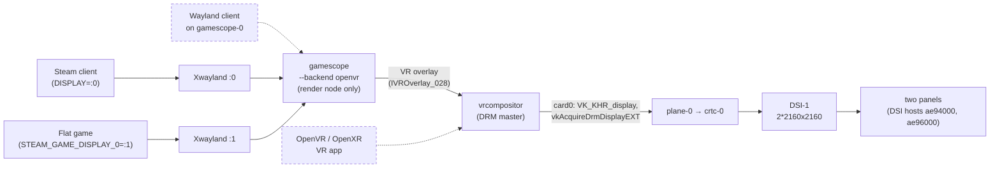

# Graphics, display and input

The headset's GPU is an Adreno 750, driven by the kernel's `msm` DRM driver and by Mesa's Turnip Vulkan driver in userspace. OpenGL and OpenGL ES run on top of Turnip through Zink. SteamVR's `vrcompositor` owns the display. gamescope draws flat apps and the Steam client into SteamVR overlays instead of driving the panels itself. This page covers the Mesa and Vulkan userspace, the DRM/KMS state, the compositing path, and the input, text-input and accessibility stack.

Everything here comes from package metadata, manifest files, `strings` on binaries, sysfs, debugfs (readable through the `perf` group), `/proc`, and two query tools (`vulkaninfo` and `eglinfo -B`) run as the `steamos` user during a normal VR session with no game running. The GPU firmware is covered in [Firmware → GPU](firmware.md#gpu), the panel driver in [Kernel](kernel.md#valve-written-drivers), and the backlight and panel sysfs files in [Hardware access → Display](hardware.md#display).

## What matters

- **Vulkan is the only native GPU driver.** Turnip (`libvulkan_freedreno.so`) reports Vulkan 1.4.362. No Gallium freedreno driver is installed, so OpenGL 4.6 and OpenGL ES 3.2 come from Zink running on Turnip. ([Vulkan](#vulkan), [OpenGL, GLES and EGL](#opengl-gles-and-egl))
- **`vrcompositor` is the DRM master.** It's the only client with master on `card0`, and it allocated the framebuffer on the one active plane. gamescope and Xwayland only open the render node. ([DRM clients](#drm-clients))
- **gamescope outputs to SteamVR, not to KMS.** It runs `--backend openvr`, which its help text describes as "outputs as a VR overlay", with two Xwayland servers: `:0` for Steam and `:1` for games. ([Compositing](#compositing-gamescope-and-xwayland))
- **Both panels are driven through one 4320×2160 connector, `DSI-1`.** It lists seven modes named `2*2160x2160` from 72 to 144 Hz. The kernel boots its own VR text console (`vrconsole`) on it. ([DRM/KMS](#drmkms))
- **Valve ships its own Vulkan and OpenXR layers.** `deckard-vulkan-layers-*` installs an FDM (fragment density map) injection layer, which is registered as an implicit OpenXR API layer, and a "Renderpass Optimizer". ([Valve layers](#valve-vulkan-and-openxr-layers))
- **Mesa is also packaged for Android and for x86 under FEX.** Both builds sit under `/usr/share/guestos/`. Lepton's `mounting.sh` bind-mounts `/usr/share/guestos/android`, and `fex-compat-tool` defaults to `/usr/share/guestos/fex-mesa`. ([Android and FEX builds](#android-and-fex-mesa-builds), [Running other software](compatibility.md))
- **The headset has only four input devices.** They're evdev devices for power, volume down, volume up plus a Select key, and a Hall sensor. SteamVR processes hold all four. The controllers don't appear as input devices. ([Input devices](#input-devices), [Controllers](controllers.md))

## Packages

**Tag: Internal** for the `deckard-*` packages; **Public (upstream)** for the rest. From `pacman -Q` and `pacman -Qi`.

<details markdown="1">
<summary>Graphics and input packages with versions</summary>

| Package | Version | Description / what it provides |
|---|---|---|
| `deckard-mesa-linux-aarch64` | `26.3.0_devel+git6a15f899-6` | "An open-source implementation of the OpenGL specification, native aarch64 build". Provides `mesa`, `mesa-libgl`, `opengl-driver`. |
| `deckard-mesa-linux-x86_64` | same | "…FEX x86_64 build" |
| `deckard-mesa-linux-deps-x86_64` | `20260820-4` | "Bundle of dependencies needed for FEX mesa rootfs shard" (811 MiB installed) |
| `deckard-mesa-android-aarch64` | `26.3.0_devel+git6a15f899-6` | Same description as the aarch64 build |
| `deckard-vulkan-layers-linux-aarch64` | `20261107.1-1` | "Vulkan Layers for aarch64 linux". URL `gitlab.steamos.cloud/deckard/fdm_injection_layer`. |
| `deckard-vulkan-layers-android-aarch64` | `20261107.1-1` | "Vulkan Layers for aarch64 android" |
| `vulkan-icd-loader` | `1.4.309.0-8` | `/usr/lib/libvulkan.so.1.4.309` |
| `vulkan-tools`, `vulkan-headers`, `vulkan-extra-layers`, `vulkan-extra-tools`, `spirv-tools`, `gfxreconstruct` | `1.4.363.0-4` | `vulkaninfo`, the LunarG layers, GFXReconstruct |
| `libdrm` | `2.4.131-1` | |
| `libglvnd` | `1.7.0-3` | EGL/GLX dispatch |
| `mesa-utils` | `9.0.0-7` | `eglinfo`, `glxinfo`, `es2_info` |
| `gamescope` | `3.16.30-4` | |
| `xorg-xwayland` | `24.1.9-1.6` | |
| `wayland` / `wayland-protocols` | `1.24.0-1` / `1.47-1` | |
| `libinput` / `libei` / `seatd` | `1.30.1-1` / `1.5.0-1.3` / `0.9.3-1` | The `libinput` command-line tool isn't installed. |
| `kwin` | `6.6.2-1` | Desktop mode |
| `renderdoc` / `renderdoc-android-apks` | `1.45+git7fa6d123-4` | |
| `mangohud` | `1:0.8.4.r184.ge1430aba-1` | |

</details>

`deckard-mesa-linux-aarch64` conflicts with `mesa` and with a `deckard-mesa-linux-aarch64-assert` variant. Besides the libraries, it installs the freedreno developer tools `cffdump`, `computerator`, `crashdec`, `fdperf`, `generate_rd`, `pps-producer`, `qrisc-asm`, `qrisc-disasm`, `rddecompiler` and `replay`; `libfreedreno_noop_drm_shim.so`; and the Adreno register databases in `/usr/share/freedreno/registers/` (a2xx through a8xx).

## Vulkan

**Tag: Public (upstream).**

The only ICD is `/usr/share/vulkan/icd.d/freedreno_icd.aarch64.json`. It points to `/usr/lib/libvulkan_freedreno.so` with `api_version` 1.4.362. `vulkaninfo` reports:

| Field | Value |
|---|---|
| `deviceName` | `Turnip Adreno (TM) 750` |
| `driverID` / `driverInfo` | `DRIVER_ID_MESA_TURNIP` / `Mesa 26.3.0-devel (git-6a15f899c8)` |
| `apiVersion` / `conformanceVersion` | 1.4.362 / 1.4.0.0 |
| `vendorID` / `deviceID` | `0x5143` / `0x43051401` |
| Instance version | `vulkaninfo` prints 1.4.363; the installed loader file is `libvulkan.so.1.4.309`. The cause of the difference wasn't determined. |
| Memory | One heap, `MEMORY_HEAP_DEVICE_LOCAL_BIT`, 14.33 GiB |
| Queue families | One graphics + compute + transfer + sparse queue; one sparse-binding-only queue |
| DRM nodes (`VK_EXT_physical_device_drm`) | primary 226:0, render 226:128 |
| Limits worth knowing | `maxImageDimension2D` 16384, `maxMultiviewViewCount` 6, `subgroupSize` 128, `shaderFloat64` false |
| Fragment density map | `fragmentDensityMap`, `fragmentDensityMapNonSubsampledImages` and `fragmentDensityMapOffset` true; `fragmentDensityMapDynamic` false; texel size 32×32 to 1024×1024 |

The device exposes 190 extensions. Ones relevant to VR and to the rest of this page:

| Area | Extensions |
|---|---|
| Foveation and density | `VK_EXT_fragment_density_map`, `VK_EXT_fragment_density_map_offset`, `VK_QCOM_fragment_density_map_offset`, `VK_VALVE_fragment_density_map_layered`, `VK_KHR_fragment_shading_rate` |
| Stereo | `VK_KHR_multiview`, `VK_QCOM_multiview_per_view_render_areas`, `VK_QCOM_multiview_per_view_viewports` |
| Display and presentation | `VK_EXT_display_control`, `VK_EXT_present_timing`, `VK_KHR_present_id`/`id2`, `VK_KHR_present_wait`/`wait2`, `VK_EXT_hdr_metadata`, `VK_KHR_swapchain_mutable_format` |
| Buffer sharing | `VK_EXT_image_drm_format_modifier`, `VK_EXT_external_memory_dma_buf`, `VK_EXT_queue_family_foreign` |
| Ray tracing | `VK_KHR_acceleration_structure`, `VK_KHR_ray_query`. `VK_KHR_ray_tracing_pipeline` is absent. |
| Other notable | `VK_EXT_descriptor_buffer`, `VK_EXT_graphics_pipeline_library`, `VK_EXT_host_image_copy`, `VK_EXT_texture_compression_astc_hdr`, `VK_EXT_global_priority`, `VK_QCOM_image_processing`, `VK_QCOM_render_pass_shader_resolve`, `VK_KHR_maintenance1`–`9` |

`VK_EXT_mesh_shader` and any `VK_KHR_video_*` extension are absent.

The instance offers `VK_KHR_display`, `VK_EXT_direct_mode_display`, `VK_EXT_acquire_drm_display`, Wayland, XCB and Xlib surfaces, and `VK_EXT_headless_surface`. With no `DISPLAY` set, `vulkaninfo` found one `VK_KHR_display` display, 4320×2160 with seven modes at 120, 144, 108, 96, 90, 80 and 72 Hz, one opaque plane, and FIFO as the only present mode. Its surface formats are BGRA8 and RGBA8 (UNORM and sRGB) and `A2R10G10B10_UNORM_PACK32`, all `SRGB_NONLINEAR`.

### Layers

From the manifests in `/usr/share/vulkan/`, `/etc/vulkan/` and `~/.local/share/vulkan/`, with owners from `pacman -Qo`. An implicit layer loads into every Vulkan app unless its manifest has an enable variable that isn't set.

| Layer | Kind | Owner | Gate in the manifest |
|---|---|---|---|
| `VK_LAYER_FROG_gamescope_wsi_aarch64` ("Gamescope WSI (XWayland Bypass) Layer") | implicit | `gamescope` | enable `ENABLE_GAMESCOPE_WSI=1`; disable `DISABLE_GAMESCOPE_WSI` |
| `VK_LAYER_MESA_vram_report_limit` ("Limit reported VRAM") | implicit | `deckard-mesa-linux-aarch64` | enable `ENABLE_MESA_VRAM_REPORT_LIMIT=1` |
| `VK_LAYER_fossilize` ("Fossilize capture layer") | implicit | `deckard-vulkan-layers-linux-aarch64` | enable `FOSSILIZE=1` |
| `VK_LAYER_MANGOHUD_overlay_aarch64` | implicit | `mangohud` | enable `MANGOHUD=1` |
| `VK_LAYER_RENDERDOC_Capture` | implicit (`/etc/vulkan`) | `renderdoc` | enable `ENABLE_VULKAN_RENDERDOC_CAPTURE=1`; disable `DISABLE_VULKAN_RENDERDOC_CAPTURE_1_46` |
| `VK_LAYER_VALVE_steam_fossilize_{32,64,arm64}`, `VK_LAYER_VALVE_steam_overlay_{32,64}` | implicit (`~/.local/share/vulkan`) | Steam client (not a package) | enable `ENABLE_VK_LAYER_VALVE_steam_*_1=1` |
| `VK_LAYER_VALVE_fdm_injection` ("FDM injection") | explicit | `deckard-vulkan-layers-linux-aarch64` | none |
| `VK_LAYER_VALVE_rpo` ("Renderpass Optimizer") | explicit | `deckard-vulkan-layers-linux-aarch64` | none |
| `VK_LAYER_LUNARG_api_dump`, `_monitor`, `_screenshot` | explicit | `vulkan-extra-layers` | none |
| `VK_LAYER_LUNARG_gfxreconstruct` | explicit | `gfxreconstruct` | none |

The Steam client's user-level manifests point into `~/.local/share/Steam/ubuntu12_32`, `ubuntu12_64` and `steamrtarm64`. There's an arm64 fossilize layer but no arm64 Steam overlay layer.

The Steam process's environment has `ENABLE_GAMESCOPE_WSI=1`, so processes that inherit it load the gamescope WSI layer. From `/proc/<pid>/maps`, `libVkLayer_FROG_gamescope_wsi_aarch64.so` and `libvulkan_freedreno.so` were mapped in `steam`, `steamwebhelper`, `vrwebhelper`, `vrcompositor`, `XRService`, `v4l2cam` and `xdg-desktop-portal-kde`. No process had the FDM injection or RPO layer mapped.

## Valve Vulkan and OpenXR layers

**Tag: Internal.**

`deckard-vulkan-layers-linux-aarch64` installs three Vulkan layer libraries, the `fossilize-*` tools (`bench`, `convert-db`, `disasm`, `list`, `merge-db`, `opt`, `prune`, `rehash`, `replay`, `synth`), and two OpenXR API layer manifests.

**FDM injection.** One library, `libVkLayer_VALVE_fdm_injection.so`, is registered three times:

| Manifest | Name | Notes |
|---|---|---|
| `/usr/share/vulkan/explicit_layer.d/VkLayer_VALVE_fdm_injection.json` | `VK_LAYER_VALVE_fdm_injection` | Explicit Vulkan layer |
| `/usr/share/openxr/1/api_layers/implicit.d/XrApiLayer_VALVE_fdm_injection.json` | `XR_APILAYER_VALVE_fdm_injection` | Implicit OpenXR layer. `disable_environment` is `DISABLE_VULKAN_FDM_INJECTION_LAYER`. The enable key is written `_enable_environment`, with a leading underscore. |
| `/usr/share/openxr/1/api_layers/explicit.d/XrApiLayer_VALVE_fdm_injection.json` | `XR_APILAYER_VALVE_fdm_injection` | Same content, explicit |

The library's strings include:

- OpenXR names `XR_FB_foveation`, `XR_FB_foveation_configuration`, `XR_FB_foveation_vulkan`, `XR_META_foveation_eye_tracked`, `xrGetFoveationEyeTrackedStateMETA`, and hooks for `xrCreateApiLayerInstance`, `xrCreateSwapchain` and `xrEnumerateSwapchainImages`
- Vulkan names `VK_EXT_fragment_density_map` and `VK_EXT_fragment_density_map_offset`, and hooks for `CreateDevice`, `CreateImageView`, `CreateGraphicsPipelines`, `CmdBeginRenderPass2` and `CmdBeginRendering`
- Option descriptions: "Enable FDM injection", "Use high preset for FDM" (and medium, low), "Always use HIGH preset for FDM images", "Apply y-flip to eye tracking", "Disable fdm offsets", "Disable layered fdm", "Use zero density for out-of-view tiles", "Synthesize fdm (for replay)", "Record calls for replay tests (FDM_RECORD_PATH sets the file or directory)"
- Upper-case names `FDM_DEBUG`, `FDM_RECORD_PATH`, `FDM_SWAPCHAIN_SIZE`, `FOVE_LEVEL`
- Source path `../fdm_injection_layer/src/fdm_injection_layer.c`

**Renderpass Optimizer.** `libVkLayer_VALVE_rpo.so` comes from the same source tree (`../fdm_injection_layer/src/rpo.c`, `rpo_general.c`). Its option strings include "Disable renderpass reordering", "Disable deleting empty renderpasses", "Do not merge renderpasses with mismatched depth", "Don't optimize multisampled renderpasses down to single-sampled", "Enable detection/deletion of y-flip renderpasses" and "Disable clamping renderpass load ops". It also contains `rpo single-eye pass`, `RPO_DEBUG`, `Loaded RPO: %s`, and Mesa NIR and SPIR-V debug names (`MESA_SPIRV_DEBUG` and others).

## OpenGL, GLES and EGL

**Tag: Public (upstream).**

`/usr/lib/dri/` holds 39 driver names. All of them, including `zink_dri.so`, are symlinks to `libdril_dri.so`. There's no `msm_dri.so` or `kgsl_dri.so`. GLX goes through `libGLX_mesa.so`, EGL through the glvnd vendor file `/usr/share/glvnd/egl_vendor.d/50_mesa.json`, and GBM through `/usr/lib/gbm/dri_gbm.so`.

`eglinfo -B` over SSH (no session environment) gives the same result on the GBM, surfaceless and device platforms. The Wayland and X11 platforms failed to initialize there because no display was set.

| Item | Value |
|---|---|
| EGL | 1.5, vendor "Mesa Project", client APIs `OpenGL OpenGL_ES` |
| Renderer | `zink Vulkan 1.4(Turnip Adreno (TM) 750 (MESA_TURNIP))` |
| OpenGL core / compatibility | 4.6, GLSL 4.60 |
| OpenGL ES | 3.2, GLSL ES 3.20 |

In the session, the version reported to apps is lower. See the next section.

### Mesa environment in the session

**Tag: Internal.** Five user units load `EnvironmentFile=/usr/share/deckard/mesavars.sh` (package `deckard-steamvr-session`): `gamescope-session`, `steam`, `steamvr`, `steamvr-plasma` and `steamvr-v4l2cam` (`grep -l mesavars /usr/lib/systemd/user/*.service`). Its comment reads "global switches we apply to essentially all processes to ensure that mesa/zink/turnip are trotting down the happy path". It sets:

| Variable | Value | File's comment |
|---|---|---|
| `MESA_GL_VERSION_OVERRIDE` | `4.3` | "Ensure we are using GL v4.3" |
| `MESA_GLSL_VERSION_OVERRIDE` | `430` | |
| `VRCOMPOSITOR_TU_DEBUG` | `sysmem,preempt` | "Tell vrcompositor to use these parameters" |

Commented-out lines set `VK_ICD_FILENAMES` to the aarch64, x86_64 and x86 freedreno ICDs and `MESA_LOADER_DRIVER_OVERRIDE=zink`. The comment above the ICD line says the x86 variants "exist within the fex rootfs, it shims them in". The Steam and Xwayland processes have all three variables set. `vrcompositor`'s strings contain `TU_DEBUG`.

## Android and FEX Mesa builds

**Tag: Internal.** Five packages own `/usr/share/guestos/` (`pacman -Qo`): `deckard-mesa-android-aarch64`, `deckard-vulkan-layers-android-aarch64` and `renderdoc-android-apks` install under `android/`, and `deckard-mesa-linux-x86_64` and `deckard-mesa-linux-deps-x86_64` under `fex-mesa/`. A search of `/usr/lib/systemd`, `/usr/bin`, `/usr/lib/steamos` and `/etc` found nothing that references that directory. The consumers are Steam tools outside those paths: Lepton's `mounting.sh` bind-mounts `/usr/share/guestos/android` into its containers, and FEX's `fex-compat-tool` defaults to `/usr/share/guestos/fex-mesa` ([Running other software](compatibility.md)).

**Android (`/usr/share/guestos/android/vendor/`).**

| Package | Files |
|---|---|
| `deckard-mesa-android-aarch64` | `lib64/egl/libEGL_mesa.so`, `lib64/egl/libGLESv1_CM_mesa.so`, `lib64/egl/libGLESv2_mesa.so`, `lib64/hw/vulkan.freedreno.so`, `lib64/libgallium_dri.so`, `lib64/libgbm_mesa.so` |
| `deckard-vulkan-layers-android-aarch64` | `vulkan_layers/libVkLayer_VALVE_fdm_injection.so`, `vulkan_layers/libVkLayer_fossilize.so`, `etc/openxr/1/api_layers/implicit.d/XrApiLayer_VALVE_fdm_injection.json` |
| `renderdoc-android-apks` | `vulkan_layers/libVkLayer_GLES_RenderDoc.so`, plus RenderDoc's Android APKs in `/usr/share/renderdoc/plugins/android/` |

The kernel has Android binder built in with `anbox-*` device names, but no binderfs is mounted ([The kernel → Build options worth knowing](kernel.md#build-options-worth-knowing)). No Waydroid, LXC or Anbox package is installed.

**x86 under FEX (`/usr/share/guestos/fex-mesa/`).** `deckard-mesa-linux-x86_64` installs a full Mesa tree for `usr/lib` (x86_64) and `usr/lib32` (i386): the same DRI symlink set, `libvulkan_freedreno.so`, GBM, EGL, GLX, the VRAM-limit layer, `liblua`, ICD files `freedreno_icd.x86_64.json` and `freedreno_icd.x86.json`, and the freedreno tools. Its `graphics_provider.json` declares `graphics_provider_v0` with root `./` and `dri`, `fallback_library_paths` and `gconv` paths for `x86_64-linux-gnu` and `i386-linux-gnu`. `deckard-mesa-linux-deps-x86_64` (URL `gitlab.steamos.cloud/holo/holo`) adds the libraries that tree depends on. `FEXBash` belongs to `steamos-customizations-deckard` ([Running other software → `/usr/bin/FEXBash`](compatibility.md#usrbinfexbash)).

## DRM/KMS

**Tag: Public (upstream)** for the `msm` driver and the standard DRM files; **Internal** for `vrconsole`, the panel debugfs files and the udev rules.

### Devices and permissions

| Node | Mode | Source |
|---|---|---|
| `/dev/dri/card0` (`platform-ae01000.display-controller-card`) | `crw-rw-rw-+` `root:video`, ACL `user:steamos:rw-` | `99-gpu-permissions.rules` (`deckard-hw-support`) sets mode 666; `60-ddcutil-i2c.rules` tags DRM cards `uaccess` |
| `/dev/dri/renderD128` | `crw-rw-rw-` `root:render` | `99-gpu-permissions.rules`, `50-udev-default.rules` |
| `/dev/udmabuf` | `root:video` 0660 | `99-steamvr.rules` (`deckard-steamvr-rel`) |
| `/dev/dma_heap/system` | `root:root` 0600 | |

There's one DRM device: `msm dev=ae01000.display-controller` (debugfs `name`), driver `msm_dpu`, compatible `qcom,sm8650-dpu`. The kernel log shows `Initialized msm 1.13.0 for ae01000.display-controller on minor 0` and `bound 3d00000.gpu (ops a3xx_ops)`, so the GPU and the display controller share it. Both DSI hosts are bound (`bound ae94000.dsi`, `bound ae96000.dsi`). The GPU's devfreq device `3d00000.gpu` uses `simple_ondemand` with 12 steps from 231 to 903 MHz.

### Connectors and modes

| Connector | Status | Modes (`/sys/class/drm/card0-*/modes`) |
|---|---|---|
| `DSI-1` | connected, enabled | `2*2160x2160_120`, `_144`, `_108`, `_96`, `_90`, `_80`, `_72` |
| `Writeback-1` | unknown, disabled | none |

`/sys/kernel/debug/dri/0/DSI-1/output_bpc` reads 0 and `vrr_range` reads `Min: 0` / `Max: 0`.

### Atomic state

From `/sys/kernel/debug/dri/0/state` during the session:

- **`crtc-0`** is active with mode `"2*2160x2160_144"`: pixel clock 1402720 kHz, 4320×2160 active, htotal 4448, vtotal 2190. It uses four layer mixers (`lm[0]`–`lm[3]`) on one control path (`ctl` 0). The resource map shows four pingpong blocks and four DSC (display stream compression) blocks assigned to it.
- **`crtc-1`** is disabled.
- **`plane-0`** is the only plane in use, out of ten (`plane-0` to `plane-9`). Its framebuffer is `allocated by = vrcompositor`, format `XR24`, modifier `0x500000000000001`, 4320×2160. The driver splits it over two source pipes (`sspp_8`, `sspp_9`) in parallel multirect mode, as four 1080×2160 rectangles.
- **`DSI-1`** is on `crtc-0`, `colorspace=Default`.

### DRM clients

From `/sys/kernel/debug/dri/0/clients` (`dev` 0 is `card0`, 128 is `renderD128`):

| Process | Nodes | Master |
|---|---|---|
| `vrcompositor` | `card0` and `renderD128` | **yes**, on `card0` |
| `steam` | `card0` and `renderD128` | no |
| `gamescope-wl` (gamescope) | `renderD128` only | no |
| `Xwayland` ×2 | `renderD128` only | no |
| `XRService`, `v4l2cam`, `vrwebhelper`, `steamwebhelper`, `xdg-desktop-portal-kde` | `renderD128` only | no |

`internal_clients` lists one in-kernel client, `drm_vrconsole`.

`vrcompositor`'s strings include `VK_KHR_display`, `VK_EXT_acquire_drm_display`, `vkAcquireDrmDisplayEXT`, `VK_EXT_display_control`, `VK_EXT_fragment_density_map`, `set_vsync_to_photons_offset` and `panel_id`. It links `libdrm.so.2`.

### The VR text console (`vrconsole`)

The kernel config has `CONFIG_DRM_CLIENT_VRCONSOLE=y`, `CONFIG_DRM_CLIENT_DEFAULT="vrconsole"` and `CONFIG_DRM_FBDEV_EMULATION` not set. The built-in module metadata describes `drm_client_lib` as "DRM VR VT console", with the parameter `active` "Choose which drm client to start, default is vrconsole". At boot, the kernel logs `Console: switching to colour vrconsole 80x24` and `drm_vrconsole: found 4320x2160/17280 format AR24 little-endian (0x34325241) framebuffer`.

### debugfs files

`/sys/kernel/debug/dri/0/` (also reachable as `dri/128/` and `dri/ae01000.display-controller/`) holds the upstream `msm` files plus a few others. Only `name`, `clients`, `internal_clients`, `state`, `DSI-1/output_bpc` and `DSI-1/vrr_range` were read for this page. Files of note:

| Path | Owner, mode | Notes |
|---|---|---|
| `DSI-1/panel/` (`panel_available`, `panel_info`, `panel_mfg_info`, `panel_read`, `panel_write`, `panel_vsync_to_photons_usec`) | `root:video`, 0660 | Made group-writable by `99-backlight.rules` (`deckard-hw-support`). Not read. |
| `debug/cac_blob`, `debug/cac_update` | `root:perf`, 0770 | Not read. `debug/cac_enable` is root-only. |
| `bcl_throttle`, `bcl_throttle_accum`, `bcl_throttle_cnt`, `bcl_throttle_time` | world-readable | Not read |
| `rd`, `hangrd`, `perf_now`, `gem`, `gem_names`, `gemstat`, `load`, `mm`, `fb`, `framebuffer` | world-readable | Not read |
| `gpu`, `kms` | root, 0400 | |
| `shrink`, `shrink_pid`, `unevictable_pid(s)`, `nolockhack`, `hangcheck_period_ms`, `disable_err_irq` | root, writable | |

`vrdevice_path display_dsi` points at `DSI-1/panel/` ([Hardware access → `vrdevice_path`: the name-to-node map](hardware.md#vrdevice_path-the-name-to-node-map)).

## Compositing: gamescope and Xwayland

**Tag: Internal** for the session scripts and arguments; **Public (upstream)** for gamescope and Xwayland themselves.

`gamescope-session.service` runs `/usr/lib/steamos/gamescope-session` (package `deckard-steamvr-session`; startup order in [Services](services.md#how-a-boot-reaches-vr)). The unit is `Type=notify`, `PartOf=steamvr.service` ("ensures that if SteamVR exits, gamescope-session will also exit"), and `KillMode=mixed` so `SIGTERM` isn't sent to the Xwayland servers. `/usr/bin/gamescope` has the file capability `cap_sys_nice=eip`, and the running process's `CapEff` is `0x800000`.

The running command line, matching the script's arguments for `gamescope-session.target`:

| Argument | gamescope's help text, or the script's comment |
|---|---|
| `--backend openvr` | "use OpenVR backend (outputs as a VR overlay)" |
| `--allow-deferred-backend` | "Allows initting the backend in a deferred way, if it doesn't work immediately" |
| `--xwayland-count 2` | "create N xwayland servers" |
| `--nested-width 1280 --nested-height 720 --output-width 1920 --output-height 1080` | |
| `--virtual-connector-strategy PerAppId` | "Specifies how we should make virtual connectors." |
| `--vr-overlay-key valve.steam.gamepadui.fallback`, `--vr-app-overlay-key valve.steam.desktopgame` | "Sets the SteamVR overlay key to this string" / "…to use for child apps" |
| `--vr-overlay-physical-width 2.67` | "Sets the physical width of our VR overlay in metres" |
| `--vr-overlay-enable-control-bar`, `--vr-overlay-enable-control-bar-keyboard`, `--vr-overlay-enable-click-stabilization`, `--vr-overlay-show-immediately`, `--vr-overlay-icon /usr/share/steamos/steam_icon.png` | "Enables the SteamVR control bar" / "Enables the SteamVR keyboard button on the control bar" / "Enables the SteamVR click stabilization" / "Makes our VR overlay take focus immediately" / "Sets the SteamVR overlay icon to this file" |
| `--vr-session-manager` | |
| `--steam`, `--mangoapp`, `--keep-alive` | "enable Steam integration" / "Launch with the mangoapp (mangohud) performance overlay enabled." / "Keep Gamescope alive even when the primary process has died." |
| `--default-touch-mode 4` | "4: passthrough" |
| `--cursor /usr/share/holo/holo-cursor.png --cursor-hotspot 5,3 --cursor-scale-height 720 --hide-cursor-delay 3000 --max-scale 2 --fade-out-duration 200 --framerate-limit 0` | |
| `-T <runtime dir>/stats.pipe` | "write statistics to path" |
| `-- /usr/lib/steamos/gamescope-onready` | |

Other backends in the help text are `auto` ("autodetect (default)"), `drm`, `sdl`, `headless` and `wayland`, and the strings also list the virtual-connector strategies `SingleApplication` and `PerWindow`. `--vr-session-manager` has no help line; the strings include `Becoming the VR session manager.` The script links `$XDG_RUNTIME_DIR/gamescope-stats` to the stats pipe's directory. The child, `gamescope-onready`, exports the session variables to D-Bus and systemd, runs `xhost +`, sets `Xft.dpi: 144` ("our canonical SteamVR display scale"), then runs `systemd-notify --ready`.

gamescope's strings include `IVROverlay_028`, `COpenVRBackend`, `COpenVRConnector`, `COpenVRPlane`, `COpenVRFb::Import(wlr_dmabuf_attributes*)`, `Forward VR Overlays`, `GAMESCOPE_VROVERLAY_FORWARDING` and `STEAM_GAMESCOPE_VROVERLAY_TARGET`. It links `libdrm`, `libseat`, `libinput`, `libpipewire-0.3`, `libavif` and `libeis`.

### Displays and sockets

| Display / socket | Owner | Who uses it |
|---|---|---|
| X `:0` (`/tmp/.X11-unix/X0`) | `Xwayland :0 -rootless -core -terminate … -noTouchPointerEmulation -force-xrandr-emulation` | Steam, SteamVR and the session helpers (`DISPLAY=:0` in their environments) |
| X `:1` (`X1`) | Second `Xwayland` with the same flags | Games: Steam's environment has `STEAM_GAME_DISPLAY_0=:1` and `STEAM_MULTIPLE_XWAYLANDS=1`. No process had `DISPLAY=:1` during the survey. |
| `/run/user/1000/gamescope-0` | gamescope (Wayland) | Steam's environment has `GAMESCOPE_WAYLAND_DISPLAY=gamescope-0`. No process had `WAYLAND_DISPLAY` set. |
| `/run/user/1000/gamescope-0-ei` | gamescope (libei/EIS) | `ss -xlp` shows both Xwayland processes holding it. Steam has `LIBEI_SOCKET=gamescope-0-ei`. |

<details markdown="1">
<summary>Other session variables in Steam's environment</summary>

Other session values in Steam's environment: `XDG_SESSION_TYPE=x11` (`start-gamescope-session`: "SDDM sets this to wayland but apps using Gamescope must use x11"), `XDG_CURRENT_DESKTOP=gamescope`, `XCURSOR_THEME=steam`, `XCURSOR_SIZE=256`, `vk_xwayland_wait_ready=false`, `SDL_VIDEO_MINIMIZE_ON_FOCUS_LOSS=0`, and the capability flags `STEAM_GAMESCOPE_HDR_SUPPORTED`, `_VRR_SUPPORTED`, `_NIS_SUPPORTED`, `_FANCY_SCALING_SUPPORT`, `_DYNAMIC_FPSLIMITER` and `STEAM_USE_MANGOAPP`, all `1`. The full list of names passed on is in `/usr/lib/steamos/gamescope-env-list`. gamescope's own `/proc/<pid>/environ` and `fd` aren't readable as `steamos`.

</details>

### How a flat app reaches the panels



### Desktop mode

`/usr/share/wayland-sessions/plasma.desktop` ("Plasma (Wayland)") runs `start-gamescope-session plasma-session.target`. `plasma-session.target` also requires `gamescope-session.service`. For any target other than `gamescope-session.target`, the script runs gamescope with nested and output size 1920×1080, `--vr-overlay-key` set from `GAMESCOPE_OVERLAY_KEY` (default `valve.plasma.desktopmode`) and `--xwayland-force-touch-pointer-emulation`. `gamescope-onready` then starts `steamvr-plasma.service` (`startplasma-wayland`, `kwin` 6.6.2) and waits on it. Desktop mode wasn't running during the survey, so how KWin attaches to gamescope wasn't observed.

## Panel and backlight

**Tag: Internal.** The panel driver and sysfs files are listed in [Kernel](kernel.md#valve-written-drivers) and [Hardware access → Display](hardware.md#display). New here:

- `/sys/class/backlight/ae94000.dsi.0` has `type` `raw` and `max_brightness` 459. Besides the standard files it has `pulse_offset_rows` (root-writable) and `scale` (reads `unknown`).
- `99-backlight.rules` (`deckard-hw-support`) makes `brightness` group-writable for `video` and does the same, recursively, for the `DSI-1/panel` debugfs directory.
- `vrserver`, `vrcompositor`, `XRService` and `eyetracking` hold `brightness` and `max_brightness` open.
- At boot the panel driver logs which panel variant it detected and each panel's factory gamma values. Those values are per unit; don't post them.

## Input devices

**Tag: Public (upstream)** for evdev and uinput; **Internal** for the udev rules and the processes using them.

From `/proc/bus/input/devices`, with key codes decoded against `/usr/include/linux/input-event-codes.h`:

| Node | Name | Reports | Held by (`/proc/*/fd`) |
|---|---|---|---|
| `event0` | `pmic_pwrkey` | `KEY_POWER` | `steamos-powerbuttond`, `vrserver`, `vrcompositor`, `XRService`, `eyetracking` |
| `event1` | `pmic_resin` | `KEY_VOLUMEDOWN` | `vrserver`, `vrcompositor`, `XRService`, `eyetracking` |
| `event2`, `js0` | `als31300` (Hall sensor; [kernel](kernel.md#other-frame-specific-drivers-in-the-tree)) | `ABS_X`, `ABS_Y`, `ABS_Z`, `ABS_MISC` | same four |
| `event3` | `gpio-keys` | `KEY_VOLUMEUP`, `KEY_SELECT` | same four |

`/proc/bus/input/handlers` lists `kbd`, `sysrq`, `leds`, `joydev`, `evdev`, `qcom_pon_combo_timer_handler` and `input_switch`. `event0`, `event1` and `event3` are attached to `qcom_pon_combo_timer_listener`. The `KEY_SELECT` key matches the U-Boot string "Select button pressed. Boot intention: boot menu" ([Before you poke around → Recovery](safety.md#recovery)).

There were no uinput-created devices, no `hidraw` nodes, and no mouse, keyboard or gamepad devices. The controllers reach SteamVR over SPI, not as input devices ([Controllers](controllers.md)). No readable process had `/dev/uinput` open.

**Permissions.** `event0`–`event3` are `root:input` 0660, and `event0` also has an ACL from `70-steamos-power-button.rules` (`steamos-powerbuttond`). `/dev/uinput` is `root:input` 0664 with an ACL `user:steamos:rw-`. Three rules apply to it: `60-steam-input.rules` (`steam-devices`) and `70-steam-input.rules` (`deckard-steam-rel`) tag it `uaccess`, and `99-steamvr.rules` sets mode 0664, group `input`. `60-steam-input.rules` also grants `uaccess` to `hidraw` and USB devices from Valve (`28de`) and a list of third-party controller vendors. The `steamos` user is in the `input` group ([Permissions](permissions.md)).

**libei.** gamescope serves an EIS (emulated input) socket at `gamescope-0-ei`. Its strings include the `eis_*` server calls and "Successfully initialized libei for input emulation!" / "Initializing libei failed, XTEST will not be available!". Both Xwayland servers hold the socket.

## Text input and IME

**Tag: Internal** for the session wiring; **Public (upstream)** for IBus.

- `ibus-gamescope.service` (`deckard-steamvr-session`, `Requires=gamescope-session.service`) runs `ibus-daemon -r --panel=disable --emoji-extension=disable` and owns `org.freedesktop.IBus`. `ibus-portal` (`org.freedesktop.portal.IBus`) and `ibus-dconf` run alongside it. The running engine process was `ibus-engine-simple`.
- Installed engines (`/usr/share/ibus/component/`): `anthy`, `hangul`, `pinyin`, `table` (with `ibus-table-cangjie-lite`), `simple`.
- `gamescope-session` exports `QT_IM_MODULE=xim` and `GTK_IM_MODULE=xim`. Its comment says the Steam IM modules "result in double presses due to the filter logic behaving slightly weird", so `xim` is the default for now. Steam's environment has no `XMODIFIERS`.
- `steam-im-modules` (`jupiter.20240131-6`) installs `im-steam.so` (GTK 3) and `steam-qt-keyboard-plugin.so` (Qt 5). GTK's `im-ibus.so`, `im-wayland.so` and `im-xim.so`, and Qt 6's IBus and `qtvirtualkeyboard` plugins, are also present.
- The on-screen keyboard button on gamescope's overlay control bar comes from `--vr-overlay-enable-control-bar-keyboard` ("Enables the SteamVR keyboard button on the control bar").

## Accessibility

**Tag: Public (upstream)** for AT-SPI; **Internal** for SteamOS Manager's screen-reader support.

- The AT-SPI bus is running: `at-spi-bus-launcher`, a `dbus-broker` with `/usr/share/defaults/at-spi2/accessibility.conf`, and `at-spi2-registryd`. `org.a11y.Bus` is on the session bus. `steamwebhelper` runs with `--valve-enable-accessibility`.
- `orca.service` (owned by `steamos-manager`) runs `/usr/bin/orca` with `EnvironmentFile=%t/gamescope-environment`. Neither `/usr/bin/orca` nor `$XDG_RUNTIME_DIR/gamescope-environment` exists on the headset surveyed, and no `orca` package is installed. `libspeechd` and `qt6-speech` are installed.
- SteamOS Manager's interface XML (`/usr/share/dbus-1/interfaces/com.steampowered.SteamOSManager1.xml`) defines `ScreenReader0` and `ScreenReader1`. Both have `Enabled`, `Rate`, `Pitch`, `Volume`, `Mode`, `Voice`, `VoiceLocales` and `TriggerAction`; `ScreenReader1` adds `VoiceLocale`, `GetVoices` and `GetVoicesForLocale`. **Neither interface is exported** on the Frame's `/com/steampowered/SteamOSManager1` object (`busctl --user introspect`; see [D-Bus](dbus.md#steamos-manager)).
- `steamos-manager`'s strings include `orca/user-settings.conf`, the gsetting `org.gnome.desktop.a11y.applications` `screen-reader-enabled`, "Could not stop orca when entering desktop mode", and `TriggerAction` names such as `stop_talking`, `read_next_word`, `move_to_next_heading` and `toggle_mode`.

## Interpretation

*This section is interpretation, not observation. It combines the facts above with general knowledge and may be wrong.*

**Two compositors, one owner of the display.** On a Steam Deck, gamescope is the DRM master and drives the screen. Here SteamVR's `vrcompositor` takes the display directly, as a Vulkan "direct display" (`VK_KHR_display` plus `vkAcquireDrmDisplayEXT`), and gamescope is demoted to a client that turns X11 and Wayland windows into textures for SteamVR overlays. That's why gamescope only needs the render node. The `--virtual-connector-strategy PerAppId` and `--vr-app-overlay-key` options suggest that each flat app gets its own overlay, which is how flat games appear as floating windows in VR.

**GL through Zink.** Valve doesn't ship Mesa's freedreno Gallium driver, so all GL and GLES (Xwayland's glamor, Chromium, desktop apps) goes through Zink into Turnip. That gives one GPU driver stack to maintain. The `MESA_GL_VERSION_OVERRIDE=4.3` cap is probably there to steer apps away from GL 4.4–4.6 paths that are slow or unreliable through Zink on this GPU.

**`VRCOMPOSITOR_TU_DEBUG=sysmem,preempt`.** Upstream Turnip's `TU_DEBUG` flags `sysmem` (render directly to memory rather than through the tiler's on-chip memory) and `preempt` (allow GPU preemption) both fit a compositor that has to hit display deadlines while apps render. The variable name suggests `vrcompositor` copies it into `TU_DEBUG` for itself only.

**FDM injection.** A fragment density map tells the GPU to shade some screen regions at lower resolution. The layer appears to add one to OpenXR apps that don't ask for foveation themselves, using the eye-tracked foveation state (`XR_META_foveation_eye_tracked`) to move the dense region with gaze. Because the OpenXR manifest is implicit and its enable key is disabled with an underscore, it would load into every OpenXR app unless `DISABLE_VULKAN_FDM_INJECTION_LAYER` is set. The Renderpass Optimizer looks like a companion that reshapes an app's render passes so they work better on a tiling GPU.

**The `guestos` directory.** [Running other software](compatibility.md) shows Lepton bind-mounting `/usr/share/guestos/android` into its containers and `fex-compat-tool` defaulting to `/usr/share/guestos/fex-mesa` ([above](#android-and-fex-mesa-builds)). These builds would be how Android and x86 apps get the same Turnip driver as native ones.

**Panel debugfs files.** The names `panel_read`, `panel_write` and `panel_mfg_info` under `DSI-1/panel/` suggest raw panel commands and manufacturing data.

**`xhost +`.** `gamescope-onready` disables X access control on `:0`. Any local process (and, if Xwayland listened on TCP, a remote one) can connect to the Steam client's X server. Xwayland is started without `-listen tcp`, so this is local-only on the surveyed build.

## How to inspect this yourself

All of these only read. `vulkaninfo` and `eglinfo -B` query the GPU and the display; they don't render to it or set a mode. Don't run `modetest`, `kmscube` or anything else that takes DRM master or sets a mode while SteamVR is running. The debugfs `rd`, `hangrd`, `gpu` and `perf_now` files, the `DSI-1/panel/*` files and `debug/cac_*` weren't read for this page; what reading them does wasn't checked. The kernel log contains serial numbers and the panels' factory gamma, so filter it before sharing.

```sh
# Packages and files
pacman -Q | grep -E 'mesa|vulkan|gamescope|xwayland|libinput|libei|ibus'
pacman -Ql deckard-mesa-linux-aarch64 deckard-vulkan-layers-linux-aarch64 | grep -v '/$'
ls -l /usr/lib/dri/

# Vulkan
vulkaninfo --summary
ls /usr/share/vulkan/*/ /etc/vulkan/*/ ~/.local/share/vulkan/*/
ls /usr/share/openxr/1/api_layers/*/
cat /usr/share/openxr/1/api_layers/implicit.d/XrApiLayer_VALVE_fdm_injection.json

# GL/EGL
eglinfo -B
cat /usr/share/deckard/mesavars.sh

# DRM/KMS
ls -l /dev/dri /dev/dri/by-path
for c in /sys/class/drm/card0-*; do echo "$c $(cat $c/status) $(tr '\n' ' ' < $c/modes)"; done
cat /sys/kernel/debug/dri/0/name /sys/kernel/debug/dri/0/clients /sys/kernel/debug/dri/0/internal_clients
cat /sys/kernel/debug/dri/0/state
zcat /proc/config.gz | grep -E 'DRM_CLIENT|DRM_MSM|FBDEV'
dmesg | grep -E 'vrconsole|\[drm\] Initialized|bound .*(gpu|dsi)'

# Which processes have GPU libraries and layers loaded
for p in /proc/[0-9]*; do
  m=$(grep -oE '[^/ ]*(libVkLayer[^/ ]*|libvulkan_freedreno\.so|libgallium[^/ ]*)$' $p/maps 2>/dev/null | sort -u | tr '\n' ' ')
  [ -n "$m" ] && echo "$(cat $p/comm): $m"
done

# Session and compositor
systemctl --user cat gamescope-session.service ibus-gamescope.service
cat /usr/lib/steamos/gamescope-session /usr/lib/steamos/gamescope-onready
tr '\0' ' ' < /proc/$(pgrep -x gamescope-wl)/cmdline; echo
pgrep -a Xwayland
ss -xlp | grep -E 'gamescope|X11'

# Input
cat /proc/bus/input/devices /proc/bus/input/handlers
ls -l /dev/input /dev/uinput; getfacl /dev/uinput
grep -l uinput /usr/lib/udev/rules.d/*

# Accessibility
busctl --user introspect com.steampowered.SteamOSManager1 /com/steampowered/SteamOSManager1 | grep ScreenReader
grep -n 'ScreenReader' /usr/share/dbus-1/interfaces/com.steampowered.SteamOSManager1.xml
```

## Not determined

- Whether the implicit FDM injection OpenXR layer is active in a running OpenXR app, and which of its options are on by default
- How `vrcompositor` uses `VRCOMPOSITOR_TU_DEBUG`, beyond `TU_DEBUG` appearing in its strings
- Why `vulkaninfo` reports instance version 1.4.363 with a 1.4.309 loader
- How gamescope hands frames to `vrcompositor` beyond the `IVROverlay_028` and dmabuf-import strings, and how many overlays a running flat game creates
- Whether any process uses the `gamescope-0` Wayland socket in VR mode, and how KWin attaches to gamescope in desktop mode
- Why `steam` holds the primary node (`card0`) open
- What the `qcom_pon_combo_timer_handler` and `input_switch` input handlers do
- What the `DSI-1/panel/*`, `debug/cac_*` and `bcl_throttle*` debugfs files contain, and what the backlight's `pulse_offset_rows` and `scale` control
- Whether Steam Input creates uinput devices when a game runs (none existed during the survey)
- Whether the screen-reader interfaces are absent by configuration or by build, and whether Orca can be installed

---

*Part of [Steam Frame developer notes](https://github.com/lostpanda85/frame-docs) by [lostpanda85](https://github.com/lostpanda85). MIT licensed: if you reuse or quote this, please credit lostpanda85 and link back to the repository.*
