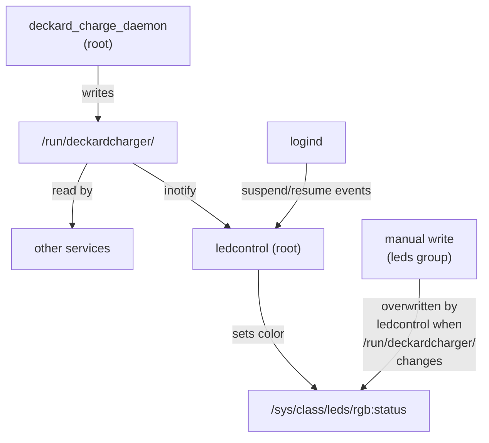

# Hardware access

The Frame is built on a Qualcomm SM8650 (`/sys/devices/soc0/machine` reports a string of the form `SM8650 <board revision> 4slam 2et`). Most hardware is reachable through ordinary Linux interfaces: hwmon, IIO, LED class devices, V4L2 and spidev. The trick is knowing which node is which. Valve ships a small helper for exactly that.

The `steamos` user is in the `video`, `render`, `input`, `audio`, `leds`, `cdsp`, `spidev`, `perf`, `gpiod` and `fpga` groups (plus `wheel`; see [permissions](permissions.md)). Udev rules in `/usr/lib/udev/rules.d/99-*.rules` give those groups access to the matching device nodes, so a lot of this works without root.

Unless a section says otherwise, everything on this page is **Internal**: plain Linux interfaces, but the specific paths and helpers are Valve's and can change.

## `vrdevice_path`: the name-to-node map

**Tag: Internal.** Valve's battery, codec and FPGA scripts call this helper to find hardware. `/usr/local/bin/vrdevice_path <key>` prints the device node or sysfs file for a named piece of hardware, and many of Valve's other helpers are one-line wrappers around it. Run it with no arguments to list the keys. Paths as resolved on the headset surveyed:

| Key | Path |
|---|---|
| `model` | Board stage string from the EEPROM. `fpga_load.sh` checks it for `EV1` and `Unknown`. Prints a value, not a path. |
| `board_revision`, `minor_revision` | Board revision values from the EEPROM |
| `imu` | `/dev/imu` |
| `imu_raw` | `/dev/spidev20.0` |
| `cdsp`, `adsp` | `/dev/cdsp` |
| `camera_left` / `camera_control_left` | `/dev/video1` / `/dev/v4l-subdev15` |
| `camera_right` / `camera_control_right` | `/dev/video2` / `/dev/v4l-subdev14` |
| `camera_names` | `passthrough_right passthrough_left slam_left slam_right upper_left upper_right` |
| `camera_v4l_subdev <name>` | `/dev/v4l-subdev28`–`33`, in the order above |
| `video_encode` / `video_decode` | `/dev/video23` / `/dev/video22` (hardware codec) |
| `prox_sensor` | `/sys/bus/iio/devices/iio:device2/in_proximity_raw` |
| `battery_voltage_now` | `/sys/bus/iio/devices/iio:device0/in_voltage_pm8550b_vbat_sns_chgr_input` |
| `battery_current_now` | `/sys/bus/iio/devices/iio:device0/in_current_pm8550b_ichg_fb_input` |
| `battery_power_now`, `battery_power_avg`, `battery_power_avg_recent` | `/sys/bus/iio/devices/iio:device1/power_*` |
| `battery_avg_start`, `battery_avg_stop`, `battery_avg_running` | `/sys/bus/iio/devices/iio:device1/{start,stop,timer_state}` |
| `battery_capacity` | `/run/deckardcharger/battery_percent` |
| `usb_voltage`, `usb_current` | IIO channels on `iio:device0` |
| `usb_charger_online`, `usb_charger_type` | Type-C port power supply (`tcpm-source-psy-…`) |
| `pon_reason` | PMIC power-on reason |
| `fpga_spidev` | `/dev/spidev1.0` |
| `display_panel` | `/sys/bus/mipi-dsi/devices/ae94000.dsi.0` |
| `display_dsi` | `/sys/kernel/debug/dri/ae01000.display-controller/DSI-1/panel` |
| `scene_illum_ir_led` | `/sys/class/leds/mp3317-scene-illum-ir` |
| `eeprom` | `/usr/lib/deckard-eeprom/eeprom_console` |

Some quirks:

- The script doesn't check whether a path exists. `imu` (`/dev/imu`) and `imu_raw` (`/dev/spidev20.0`) can point at nodes that aren't present, so check before opening anything.
- The key for camera interfaces is spelled `camera_inferface` in the script, and it returned "Unknown device" for every camera.
- `cdsp` and `adsp` both resolve to `/dev/cdsp`. That's what the script returns, not a typo here.
- `eeprom` returns the path of a tool, not a device.

## Battery and charging

### Helper commands

**Tag: Internal.** All of these are short shell scripts in `/usr/bin` that print a number:

| Command | Unit |
|---|---|
| `battery_capacity` | percent |
| `battery_voltage` | mV |
| `battery_current` | mA |
| `battery_power` | mW (voltage × current) |
| `battery_power_avg`, `battery_power_avg_recent` | from the averaging IIO device |
| `battery_power_avg_now` | starts averaging, waits 250 ms, prints, stops |
| `battery_avg_start` / `battery_avg_stop` / `battery_avg_running` | control the averaging timer (start/stop need write access) |
| `battery_delta` | the value of `…/typec@2b00/balancing/delta`, or "missing driver" if that file doesn't exist |
| `battery_charger_type` | USB charger type |
| `usb_voltage`, `usb_current` | mV, mA at the USB-C input |

### `/run/deckardcharger/`

**Tag: Internal.** `deckard_charge_daemon` (root) publishes a summary here that other services read. It's the simplest way to get charge state:

| File | Example |
|---|---|
| `battery_percent` | Percent, with one decimal place |
| `battery_status` | `Full`, `Charging`, `Discharging`, … |
| `ac_status` | Whether external power is connected (e.g. `Connected`) |
| `typec_contract` | USB-PD contract, as `Valid=<0\|1>, Voltage=<mV>mV, Current=<mA>mA` |
| `secs_until_battery_full` | Seconds |
| `secs_until_shutdown_request` | Seconds |
| `power_event` | |
| `vr_state` | e.g. `Running`. Owned by `steamos`; `ledcontrol` chowns it (its strings include `Could not chown /run/deckardcharger/vr_state`). |
| `BAT0` | symlink to `/sys/class/power_supply/max1720x_bat_7-36/` |

## Status LED

**Tag: Internal.** The RGB status LED is `/sys/class/leds/rgb:status` (a multicolor LED with `multi_intensity` and `hw_pattern`). `deckard-led-control.service` runs `/usr/bin/ledcontrol` as root. It watches `/run/deckardcharger/` with inotify, listens to logind for suspend/resume, and picks a color from this set:

```
OFF  WHITE  DIM_WHITE  BRIGHT_WHITE  WHITE_THROB
DIM_GREEN  YELLOW  BRIGHT_YELLOW  YELLOW_THROB  RED
```

The `leds` group can write every LED class device, so you can drive the LED yourself, but `ledcontrol` sets it again whenever the files in `/run/deckardcharger/` change. **Don't run `/usr/bin/ledcontrol` by hand.** It ignores arguments and starts a second copy of the daemon (see [methodology](methodology.md#incident-running-unknown-binaries-with---help)).

How charge state reaches the LED:



Other LED class devices: `mp3317-backlight-left`, `mp3317-backlight-right` and `mp3317-scene-illum-ir` (`vrdevice_path scene_illum_ir_led` points at the last one).

## Power rails

**Tag: Internal.** Three MAX34417 power monitors are exposed through hwmon, each with four channels:

| hwmon name | Channels |
|---|---|
| `max34417_9_12` | `apc0`, `apc2`, `apc1`, `nsp1` |
| `max34417_9_1a` | `gfx`, `nsp2`, `bob`, `unused` |
| `max34417_9_10` | `vph`, `s1c`, `s3c`, `s6c` |

The comments in Valve's `power_rail_monitor` describe these as Kryo APC0–2 cores, Tensor Processor NSP1/NSP2, GFX power, VPH power, BOB, and the S1C/S3C/S6C sub-regulation rails.

```bash
for h in /sys/class/hwmon/hwmon*; do
  case "$(cat $h/name)" in max34417*)
    paste <(cat $h/power*_label) <(cat $h/power*_input) ;;
  esac
done
```

`power_rail_monitor` (Python) does this with nicer names. Its comments list separate channel orders for boards labeled EV2 and EV3. `measurement_mode` on each device is writable by the `perf` group. `deckard_power_monitor` (root, every 2 s) is the system's own logger.

## Thermals and the fan

There are about 55 hwmon devices. Most are SoC thermal zones (`cpu*_thermal`, `gpuss_*_thermal`, `nsp*_thermal`, `ddr_thermal`, `camera*_thermal`, PMIC temperatures). IIO device 0 also has temperature channels named `in_temp_pcba_at_fan_exhaust_input`, `…_at_heat_sink_fins_input`, `…_at_wifi_input`, `…_at_flash_input` and `…_at_40pin_connector_input`.

The fan is on hwmon device `slg4ax46073v` (`fan1_input`, `pwm1`, `pwm1_enable`). `/usr/bin/fanspeed` is a small tool for it:

```sh
fanspeed -p        # print RPM and PWM
sudo fanspeed -s 50   # fixed duty cycle in percent, 0–100 (pwm1 is root-only)
```

The control loop is `deckard-fan-control.service` (`/usr/share/deckard-fan-control/fancontrol.py`, root). Its config, `deckard-config.yaml`, sets `fan_min_speed: 30`, `fan_charging_min_speed: 40`, `fan_max_speed: 55` and `fan_min_time_on: 90`, plus `A/B/C_quad_control` and `A/B_ff_control` coefficients. Its first `devices` entry is `cpu7_middle_thermal` (`type: ffquad`, `T_threshold: 45`, `max_temp: 95`).

Thermal zones, trip points and cooling devices are on [power → thermal zones](power.md#thermal-zones).

To set the PWM yourself, stop the daemon first with `sudo systemctl stop deckard-fan-control`, and start it again when you're done. The daemon writes `pwm1` on every control cycle (`fancontrol.py`), so a manual setting won't hold while it runs.

## Cameras

Six cameras show up as V4L2 sub-devices, named by `vrdevice_path camera_names`: `passthrough_left`, `passthrough_right`, `slam_left`, `slam_right`, `upper_left` and `upper_right`. No eye-tracking camera appears as a V4L2 or I²C device. `dsp_service`'s journal tags aDSP camera messages `[OV6211]` (`Bringing cameras out of reset`, `Starting streaming.`), as part of the eye-tracking pipeline ([OpenXR → eye tracking](openxr.md#eye-tracking-foveation-hands-and-passthrough)).

A bound driver doesn't mean a working sensor. At boot the `og01a1b` and `og0ve10` drivers log `…_set_power_on: failed to enable power` and `Failed to get chip ID for <camera>`, yet all four stay bound and their `v4l-subdev` nodes exist ([kernel → boot-time quirks](kernel.md#boot-time-quirks)). Check `dmesg` before assuming a sub-device has a sensor answering behind it.

While SteamVR runs, `XRService` holds `/dev/media0`, the sub-devices for `passthrough_left` and the four `slam_*`/`upper_*` cameras, and several `/dev/video*` capture nodes. `v4l2cam` holds `/dev/video99`, and `steamwebhelper` holds the hardware decoder node `/dev/video22`.

`/dev/video99` is a v4l2loopback device (`modprobe v4l2loopback video_nr=99 card_label=SteamVR exclusive_caps=1` in `steamvr-v4l2loopback.service`). It's listed as "SteamVR" in `v4l2-ctl --list-devices`, is readable by the `video` group, and is held open by `v4l2cam` (`--output=99`). What it carries wasn't captured.

## Other sensors

| Sensor | Where |
|---|---|
| Proximity (Vishay VCNL4040, `vcnl4000` driver) | IIO `iio:device2`, `in_proximity_raw`. `prox_sensor_val` prints it. No process holds the IIO device node open; read it through sysfs. What reads it is on [power → proximity sensor](power.md#proximity-sensor). |
| Hall sensor (ALS31300) | input device `als31300` (an evdev `/dev/input/event*` node plus a joystick node). SteamVR's CV driver searches `/dev/input/event*` for a device named `als31300` in its `CHmdDirectDeviceControl` code. What it measures isn't stated. |
| Buttons | input devices `gpio-keys`, `pmic_pwrkey`, `pmic_resin` |
| PMIC ADC | IIO `iio:device0`. Voltages, currents and board temperatures. |

## FPGA

**Tag: Internal.** `deckard-fpga.service` loads a bitstream at boot (`/usr/lib/deckard-fpga/fpga_load.sh`), and `deckard-fpga-resume.service` reloads it after suspend ([services](services.md#hardware-and-power)). The FPGA is reached over `/dev/spidev1.0` (the `fpga_spidev` key in `vrdevice_path`) and programmed with a tool called `littlebee_config`.

`/usr/lib/deckard-fpga/images/` has five bitstreams, and each contains the strings `GW1N-2`, `GW1N-2C-WLCSP100H` and `GW1N-LV2CS100HC7`:

| File | Selected by `fpga_load.sh` when |
|---|---|
| `csi_agg_deckard_ev1_1_<variant>.binx` | `vrdevice_path model` is `EV1` with `minor_revision` 1, or any model other than `EV1`/`Unknown` |
| `csi_agg_deckard_ev1_<variant>.binx` | `model` is `EV1` with another minor revision |
| `csi_agg_dev_passthru.binx` | never referenced by the script |

`<variant>` is `passthru` by default, or `vcint` when the script is run as `fpga_load.sh VCINT`. The loader logs which one it loads (`journalctl -u deckard-fpga`): "Loading passthru FPGA image" or "Loading VC Interleaving FPGA image". More detail is in [firmware](firmware.md).

`/usr/lib/deckard-fpga/` also contains `cam_setup`, `cam_status`, `fpga_power_en.sh`, `fpga_power_disable.sh`, `pulse_room_led`, `read_reg`, `write_reg`, `reset_fpga` and `reset_cam_stats.sh`. None of these were run.

## Interpretation

*This section is interpretation, not observation. It combines the facts above with general knowledge and may be wrong.*

**A plausible camera architecture.**

- **Six cameras Linux can see, in three pairs.** Two passthrough cameras (`arcimx616`) and four tracking cameras: `slam_*` (`og01a1b`) and `upper_*` (`og0ve10`). The SoC's machine string ends in `4slam 2et`, which reads like "four SLAM cameras, two eye-tracking cameras": the four tracking cameras plus a pair the kernel doesn't see.
- **The FPGA as a camera aggregator.** The bitstreams are named `csi_agg`, and the other variant is "VC Interleaving". MIPI CSI-2 can carry several streams over one link using virtual channels (VCs), so the FPGA probably sits between some sensors and the SoC's camera inputs and merges their streams. The default, `passthru`, would forward them unchanged. Which cameras go through it isn't known. The `cam_setup` and `cam_status` tools beside the loader fit that.
- **XRService as the vision pipeline.** It holds `/dev/media0`, the tracking-camera sub-devices and capture nodes, and its strings name the camera ICP and EVA firmware ([firmware](firmware.md#camera-icp-and-evacvp)). It likely runs tracking and passthrough on the SoC's camera and vision blocks.
- **Eye tracking off the V4L2 path.** `dsp_service` has "ET Camera Streaming" and a cDSP "gazenet" thread ([firmware](firmware.md#adsp-and-cdsp)), and `eyetracking` runs with `-b CDSP`. The eye cameras are probably read and processed on the cDSP. OmniVision's OV6211 is a small sensor often used for eye tracking, and the aDSP's `[OV6211]` log tag ([above](#cameras)) names it, so the unbound `ov6211` and `ov6710` drivers ([kernel](kernel.md#other-frame-specific-drivers-in-the-tree)) may be left over from hardware that routed eye cameras through Linux. [OpenXR → eye tracking](openxr.md#eye-tracking-foveation-hands-and-passthrough) has the logged pipeline.

## EEPROM

**Tag: Internal.** `/usr/lib/deckard-eeprom/eeprom_console` (not on `PATH`) reads and writes the headset's EEPROM data. The tool groups it into four logical sections (`bootloader`, `core`, `vrcal`, `strap`), and the kernel exposes three EEPROM device nodes (listed below).

```sh
E=/usr/lib/deckard-eeprom/eeprom_console
$E help
$E get board_revision
$E print_all > ~/eeprom-backup.txt   # contains serials and MACs; keep it private
```

Readable items include `board_revision`, `board_minor`, `imu_rev`, `unit_config`, `ipd_min`, `ipd_max`, `prox_near`/`mid`/`far`, `prox_noise`, `diplexer`, `strap_revision`, `audio_module_vendor`, plus serial numbers for the unit, board, fan, heat pipes and audio modules, and the Wi-Fi/BLE MAC addresses.

The EEPROM also has `device_config`, `xrservice` and `eyetracking` items: compressed copies of the calibration files kept in `/persist`. `/usr/lib/deckard-hw-support/restore-calibration` uses them (`verify`, `backup [file]`, `restore-from-eeprom [--force]`).

**Don't run `reset`, `lock`, `unlock` or `upgrade` unless you have a backup.** Per `eeprom_console help`, they act on the `bootloader`, `core`, `vrcal` and `strap` sections.

The raw EEPROMs are on I²C at `/sys/bus/i2c/devices/{7-0050,7-0051,9-0050}/eeprom`. A udev rule (`99-eeprom.rules`) makes these mode 666, so any local user can read or write them. The matching nvmem nodes under `/sys/bus/nvmem/devices/` (`core_v2_eeprom5`, `strap_eeprom3`, `strap_v2_eeprom4`) stay root-only.

`vrconfig_serial` prints the unit serial (EEPROM first, then the SoC serial). Don't post its output publicly.

## Expansion port 5 V

`/sys/bus/platform/drivers/reg-valve_5v_exp/exp_vout_5v/control/enable` is chowned to `steamos` by udev (mode 644, so `steamos` can write it). The regulator's driver describes itself as "Valve 5V Expansion Regulator". `/persist` also has a file for it, `exp_5v_out_enable` (key `exp5v`; see [SteamVR → /persist](steamvr.md#per-device-config-in-persist)).

## Display

The panels are on DSI (`ae94000.dsi.0`). `displays_turn_off_drm_master` uses `modetest` to take DRM master and blank them, using a `4320x2160` mode on `DSI-1`. The `video` group can write the backlight brightness and `gamma_black_mode` on the DSI device. `/dev/dri/card0` and `renderD128` are mode 666. During a VR session `vrcompositor` is the DRM master; the connector, modes and DRM state are on [graphics → DRM/KMS](graphics.md#drmkms), and the backlight on [graphics → panel and backlight](graphics.md#panel-and-backlight).

---

*Part of [Steam Frame developer notes](https://github.com/lostpanda85/frame-docs) by [lostpanda85](https://github.com/lostpanda85). MIT licensed: if you reuse or quote this, please credit lostpanda85 and link back to the repository.*
