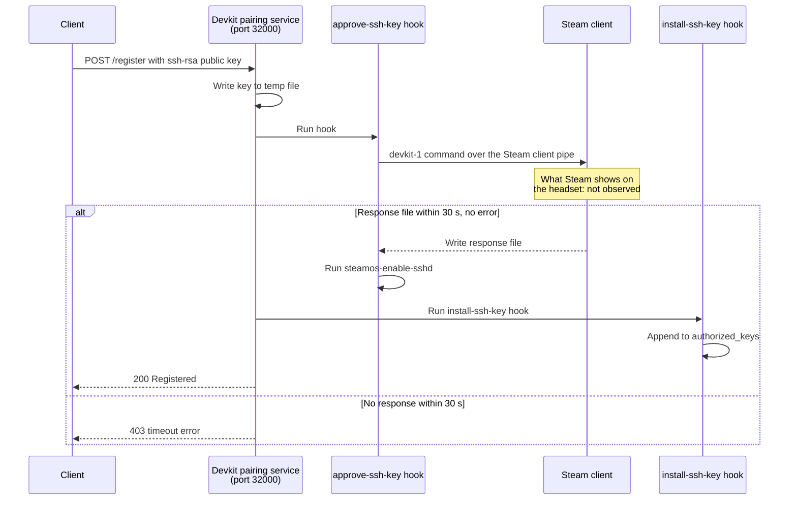
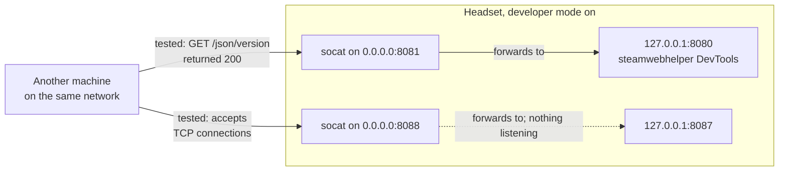

# Network services

This is what was listening on a Frame with developer mode turned on. With developer mode off, most of the LAN-facing entries go away (see [what developer mode enables](permissions.md#developer-mode)). Three TCP ports still accepted connections from other machines ([below](#port-map)).

## Port map

| Port | Proto | Bound to | Process | What it is | From another machine | Tag |
|---|---|---|---|---|---|---|
| 22 | TCP | all | `sshd` | SSH | Open | Public |
| 3389 | TCP | all | `xrdp` | Remote desktop (RDP); starts a KDE Plasma X11 session | Open | Public |
| 8080 | TCP | 127.0.0.1 | `steamwebhelper` | Chromium DevTools for the Steam client UI | Closed or filtered | Internal |
| 8081 | TCP | all | `socat` | Forwards LAN → 8080 | Open; `/json/version` returned 200 | Internal |
| 8087 | TCP | 127.0.0.1 | — | Target of the 8088 forwarder ("Portforward SteamVR CEF remote debug port"). Nothing was listening on it. | Not tested | Internal |
| 8088 | TCP | all | `socat` | Forwards LAN → 8087, where nothing was listening | Accepts TCP connections | Internal |
| 27036 | TCP+UDP | all | `steam` | Steam client, listening on all interfaces | TCP open, also with developer mode off; UDP not tested | Internal |
| 27062 | TCP | 127.0.0.1 | `vrserver` | SteamVR web server and mailbox WebSocket | Closed or filtered | Internal |
| 32000 | TCP | all | `python` | SteamOS devkit pairing service | Open; `/properties.json` returned 200 | Public |
| 47317 | TCP | 127.0.0.1 | `gpu-trace` (root) | XML-RPC control for GPU/perf tracing | Closed or filtered | Internal |
| 16385 | TCP | all | the kernel (no process holds the socket) | Accepts connections, doesn't answer HTTP. See [port 16385](#port-16385). | Open, also with developer mode off; no response to HTTP `GET` | Unknown |
| random high ports | TCP | 127.0.0.1 | `steam` | Steam client internals. Ports change every session (HTTP 404 on `/`). | Not tested | Internal |
| 5353 | UDP | all | `systemd-resolved`, `avahi-daemon`, `steamwebhelper` | mDNS. Three separate responders share the port. | Not tested | Public |
| 5355 | TCP+UDP | all | `systemd-resolved` | LLMNR | TCP open with developer mode off; UDP not tested | Public |
| 53, 67 | UDP | `usb0`, `wlanap` | `dnsmasq` | DNS/DHCP for USB networking and the headset's own Wi-Fi hotspot | Not tested | Internal |

The "From another machine" column comes from a Mac on the same Wi-Fi network as the headset, with developer mode on except where a cell says otherwise, using TCP connects and HTTP `GET` requests only. Every tested TCP port bound to all interfaces accepted connections, and every tested port bound to 127.0.0.1 was closed or filtered.

**With developer mode off.** A TCP connect scan of all 65,535 ports from the same Mac, run after developer mode was turned off, found three ports open: 5355 (LLMNR), 16385 (kernel-owned socket) and 27036 (Steam). Every other port was closed: the headset replied that nothing was listening. That includes 22, 3389, 8081, 8088 and 32000. Some ports gave no reply when probed in bulk; a sample of them, rechecked one at a time, were all closed. UDP wasn't scanned. Scans started right after the switch got no reply at all from most ports. Three repeat rounds and a full rescan a few minutes later gave the result above.

The firewall (`firewalld`, zone `public` on `wlan0`) allows SSH plus **every port from 1024 to 65535**, TCP and UDP. So the firewall permits LAN connections to any service listening on all interfaces above port 1023. The `usb0` and `wlanap` interfaces sit in the `nm-shared` zone.

---

## Devkit pairing service (port 32000)

**Tag: Public.** This is Valve's `steamos-devkit-service` (MIT license header in the source). It registers an mDNS service and installs SSH keys once the running Steam client approves them. It's a plain Python `http.server`. It's reachable from other machines on the network: from another machine on the same Wi-Fi network (developer mode on), port 32000 accepted connections and `GET /properties.json` returned 200.

It advertises itself over mDNS through `systemd-resolved`:

- Service type: `_steamos-devkit._tcp`
- Port: `32000`
- TXT records: `txtvers=1`, `login=<user>`, `settings=<json>`, `devkit1=devkit-1`

### `GET /properties.json`

Returns the same data as the TXT record.

```sh
curl http://<frame-ip>:32000/properties.json
```
```json
{
  "txtvers": 1,
  "login": "steamos",
  "settings": "{}",
  "devkit1": ["devkit-1"]
}
```

### `GET /login-name`

Returns the user name that SSH keys get installed for, as plain text. On a stock Frame that's `steamos`.

### `GET /?command=ping`

Returns `pong`. Any other `command` value gets a 404.

### `POST /register`

Asks to install an SSH public key. The body is the public key line itself, and it has to be an `ssh-rsa` key. Ed25519 and ECDSA keys are rejected by the validator. The key is limited to 64 KB. The `approve-ssh-key` hook puts the key's comment field (the third space-separated field) into the request text it sends to Steam: `Development host at IP <ip> key: '<comment>'`.

```sh
ssh-keygen -t rsa -b 4096 -f ~/.ssh/id_rsa_frame     # if you don't have an RSA key
curl --data-binary @"$HOME/.ssh/id_rsa_frame.pub" http://<frame-ip>:32000/register
ssh -i ~/.ssh/id_rsa_frame steamos@<frame-ip>
```

What happens next:

1. The key is written to a temp file.
2. The `approve-ssh-key` hook sends a `devkit-1` command to the running Steam client over its pipe (see [Steam client pipe](local-ipc.md#steam-client-pipe)), then waits up to 30 seconds for Steam to write a response file.
3. If the response file appears and doesn't carry an error, the hook runs `steamos-enable-sshd`. The service then runs the `install-ssh-key` hook, which appends the key to `~/.ssh/authorized_keys`. That's for `steamos` by default, or for each user in `[Users] ShellUsers` if a config file sets it.

What Steam shows on the headset while it decides wasn't observed.

The same flow as a sequence. It covers the success and timeout cases; other responses are in the table below.



Responses:

| Status | Body | Meaning |
|---|---|---|
| 200 | `Registered` | Key installed |
| 403 | `{"error": "Steam is not running"}` | Steam client not up |
| 403 | `{"error": "timeout - Steam did not respond to the pairing request"}` | Steam didn't write a response file within 30 seconds |
| 403 | `{"error": "Failed to write the ssh key"}` | Body didn't validate (wrong key type, bad base64, too long) |
| 500 | hook output | Key install script failed |

Configuration is read from `/etc/steamos-devkit/steamos-devkit.conf`, `/usr/share/steamos-devkit/steamos-devkit.conf` or `~/.config/steamos-devkit-service/steamos-devkit-service.conf`. None of them exist on a stock unit. The recognised keys are `[Settings] Port`, `[Settings] ForcePublishInterval` and `[Users] ShellUsers`.

The hooks live in `/usr/share/steamos-devkit/hooks/`: `approve-ssh-key`, `install-ssh-key` and `devkit-1-identify`. `devkit-1-identify` prints a JSON blob with the hostname, machine ID, DMI fields and so on, and the service uses it to pick its mDNS name. Apart from a `devkit_utils/` helper, there are no other hooks: only pairing and identify, nothing that deploys builds, and none writes to `~/devkit-game` ([developer workflow](developer-workflow.md#running-your-own-steam-client)).

---

## Chromium DevTools (8080/8081 and 8087/8088)

**Tag: Internal.** Steam's command line includes `-cef-enable-debugging` ([services](services.md#vr-session-user-units)), and `steamwebhelper` (Chromium) listens on `127.0.0.1:8080`, answering the DevTools `/json/version` and `/json/list` endpoints. This was observed with developer mode on. Whether Steam's command line has that flag with developer mode off wasn't observed.

In developer mode, the systemd unit `steam-web-debug-portforward.service` runs `socat` to expose port 8080 on `0.0.0.0:8081`. A second unit, `steamvr-web-debug-portforward.service` ("Portforward SteamVR CEF remote debug port"), forwards 8088 → 8087.

Tested from another machine on the same Wi-Fi network, with developer mode on:

- **8081** accepted connections, and `GET /json/version` returned 200. DevTools answers from other machines through this forwarder.
- **8088** accepted TCP connections, but it's only a forwarder: nothing was listening on its target, `127.0.0.1:8087`.
- **8080** itself was closed or filtered. It's bound to 127.0.0.1.

The two forwarders side by side:



The standard DevTools endpoints work:

```sh
curl http://<headset-ip>:8081/json/version
curl http://<headset-ip>:8081/json/list
```

Target titles in `/json/list` include `SteamVR - valve.steam.gamepadui.bar`, `SteamVR - Keyboard` and `SteamVR - Notifications`, plus a `SharedJSContext` page at `https://steamloopback.host/routes/library/home`.

There's no authentication on these ports. See [security notes](security-notes.md#on-the-network).

---

## SteamVR web server (27062)

**Tag: Internal.** `vrserver` runs an HTTP + WebSocket server on `127.0.0.1:27062`. SteamVR's own UI (the dashboard, settings and controller binding pages) is served from here and talks back to `vrserver` over the WebSocket. From another machine on the same network, port 27062 was closed or filtered.

- `GET /console/index.html` loads without credentials. It's SteamVR's web console.
- Everything else (`/dashboard/`, `/app/...`, `/input/...` and so on) returns `401` unless the request carries the server's secret, either as a `secret=` query parameter or an `x-steamvr-secret` header. The server logs `Rejecting request which did not contain the secret` when that happens.

This survey found no way for third-party code to obtain the secret. The `vrcmd --mailboxcmd` route that Valve's own shell helpers use is rejected by this build's `vrcmd` (see [SteamVR mailboxes](steamvr.md#mailboxes)).

The HTTP routes referenced by the shipped web UI include:

```
/app/list.json  /app/getinfo  /app/getsettings  /app/setsettings  /app/image
/app/resetsettings  /app/resetallresolutionscales
/input/getactions.json  /input/getstate.json  /input/gettrackerbindings.json
/input/loadbindingfromurl.json  /input/savebinding.action  /input/selectconfig.action
/input/deleteconfig.action  /input/pulsehaptics.action  /input/settrackerbinding.action
/input/submitworkshopbinding.action
/console_command.action  /console_ping.action
```

The WebSocket protocol is described in [SteamVR → mailboxes](steamvr.md#mailboxes).

---

## gpu-trace XML-RPC (47317)

**Tag: Internal.** `/usr/bin/gpu-trace` is a Python script with a Valve MIT license header. Its source refers to gpuvis (a `--no-gpuvis` option, and the comment "gpuvis currently only support file version 6"). On the headset it runs as a root daemon (`gpu-trace --daemon`) and takes commands over XML-RPC on `localhost:47317`. From another machine on the same network, port 47317 was closed or filtered.

| Method | Returns | Does |
|---|---|---|
| `start()` | `True` | Start ftrace (and `perf record` if available) |
| `stop()` | `True` | Stop tracing |
| `capture()` | `{"ftracepath", "perftracepath"?, "retcode"}` | Snapshot the trace ring to temp files and return their paths |
| `getTracingStatus()` | bool | Whether tracing is running |
| `cleanup()` | | Delete temp files |
| `exit()` | `True` | Shut the daemon down |

The `gpu-trace` command itself is the normal client, so you rarely need raw XML-RPC:

```sh
gpu-trace --start
# ... reproduce the hitch ...
gpu-trace --capture -o /tmp/trace.zip
gpu-trace --stop
```

The command's full option list is on [developer workflow → gpu-trace](developer-workflow.md#gpu-trace).

---

## Remote desktop (3389)

**Tag: Public.** `xrdp` is installed and enabled in developer mode. Its `/etc/xrdp/startwm.sh` launches `startplasma-x11`, so an RDP login gets a KDE Plasma X11 session. Log in as `steamos` with its password (set one with `passwd` if you haven't). From another machine on the same network, port 3389 accepted TCP connections.

---

## Port 16385

**Tag: Unknown.** A TCP socket on port 16385 is bound to all interfaces. From another machine on the same network it accepted connections with developer mode on and with it off, and an HTTP `GET` got no response. `steamos-devkit-mode` doesn't touch it.

A read-only root pass on the headset found that it belongs to the kernel:

- `sudo ss -tlnpe` shows the socket with uid 0, the root cgroup and inode 8737.
- A scan of every `/proc/*/fd` found no process holding that socket inode.

Which kernel code serves it wasn't determined.

---

## USB networking and ADB

**Tag: Internal.** The USB-C port runs a USB gadget. In the running system, NCM is added when the developer-mode marker file exists (unless the bootloader sets `u-boot,disable-ncm`). ADB is added when that marker exists or the bootloader sets `u-boot,adb-mode` or `u-boot,factory-mode` under `/proc/device-tree/chosen/` (unless it sets `u-boot,disable-adb`). Separately, the initramfs recovery shell starts its own `adbd` regardless of developer mode ([security notes](security-notes.md)):

- **NCM ethernet** on `usb0`. Plug the Frame into a PC and you get a point-to-point link with fixed addresses, set by `/usr/share/deckard/usb-ncm-dnsmasq.sh`: the Frame is **`10.86.200.233`** and your PC is given `10.86.200.234` by DHCP (on a /29). `sshd` listens on all interfaces, which includes `usb0`. `usb0` is in the `nm-shared` firewall zone, which also opens ports 1024–65535.
- **ADB**: `adbd` from Android platform-tools, running as `steamos`. Its drop-in sets `ADB_USER=steamos`, `ADB_ALLOW_ROOT=true`, and `ADB_FORCE_ROOT_PATH` pointing at a bootloader factory-mode flag. ADB wasn't tested from a PC.

The USB gadget base (`usb-gadget.target`, from systemd, plus `usb-gadget.service` and `usb-gadget-init.service`) always runs. ADB (`adbd-pre`, `adbd`, `adbd-post`) and NCM (`usb-ncm-gadget@usb0`, `usb-ncm-dnsmasq@usb0`) are conditional on the marker file `/etc/systemd/system/adbd.service.d/steamos-devkit-enabled`, which developer mode creates. ADB also starts if the bootloader sets `u-boot,adb-mode` or `u-boot,factory-mode`; NCM doesn't. Full list in [services](services.md#networking-and-connectivity).

---

## The Frame's own Wi-Fi hotspot

**Tag: Internal.** The Frame runs a soft access point on `wlanap`, at the same time as its normal Wi-Fi client connection on `wlan0`. `steamclient.so` references `softapmanager` and `softapcmd` and contains the class names `CRemoteClientSoftAP` and `CRemoteClientPairWifiAP`. `hostapd` and `dnsmasq` are driven by `softapmanager`, and they're covered in [local IPC](local-ipc.md#soft-ap-manager). Its default search plan starts with an `hbs6` mode (see [local IPC](local-ipc.md#control-socket)). The radio, the `hostapd`/`dnsmasq` processes and PC streaming are on [Wi-Fi, Bluetooth and streaming](wireless.md#the-headsets-own-access-point).

---

*Part of [Steam Frame developer notes](https://github.com/lostpanda85/frame-docs) by [lostpanda85](https://github.com/lostpanda85). MIT licensed: if you reuse or quote this, please credit lostpanda85 and link back to the repository.*
