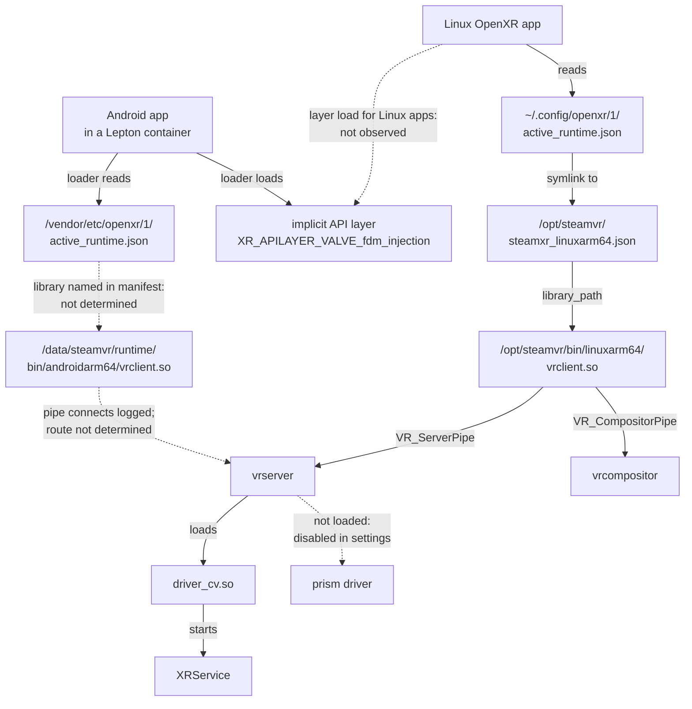

# OpenXR and the VR runtime

SteamVR is the headset's OpenXR runtime as well as its OpenVR runtime. This page covers what an OpenXR app sees: how the runtime is registered, which extensions and interaction profiles it lists, the API layers installed, and what's visible of eye tracking, foveated rendering, hand tracking, passthrough, display timing and tracking.

Everything here comes from files in `/opt/steamvr` and the OS packages, `strings` on the binaries, key names in JSON files, and generic lines from the logs in `~/.local/share/Steam/logs` and the journal. No OpenXR app, SteamVR tool or test binary was run for this page. The SteamVR build is `deckard-steamvr-rel r26655409+24cb4748`; `vrserver` logs its version as 2.19.3. How SteamVR starts and where it lives are in [SteamVR on the Frame](steamvr.md).

## What matters

- **SteamVR is the only registered runtime, and no OpenXR loader package is installed.** `~/.config/openxr/1/active_runtime.json` points at `/opt/steamvr/steamxr_linuxarm64.json`. `pacman -Qs openxr` finds nothing. SteamVR bundles its own `libopenxr_loader.so`. ([Registration](#runtime-registration), [The loader](#the-loader))
- **The arm64 runtime has a table of 52 extensions.** It includes eye gaze, hand tracking, Meta's eye-tracked foveation, display refresh rate control, space warp and frame synthesis, plus four `XR_VALVE_*` extensions. No passthrough extension is in it. ([Extensions](#extensions))
- **Valve installs an implicit OpenXR API layer.** `XR_APILAYER_VALVE_fdm_injection` comes from `deckard-vulkan-layers-linux-aarch64`. Its strings are about Vulkan fragment density maps and foveation centers. Android apps' loader logs show it loading. ([API layers](#api-layers))
- **OpenXR apps run on the same OpenVR stack.** The runtime translates an app's suggested bindings into OpenVR binding files, and the Frame controller has its own profile, `/interaction_profiles/valve/frame_controller`. ([Interaction profiles](#interaction-profiles))
- **Android apps get an Android build of the runtime.** Lepton (Valve's Android-container Steam tool, see [running other software](compatibility.md)) logs show APKs being installed into a container whose OpenXR loader reads `/vendor/etc/openxr/1/active_runtime.json`. ([Android apps](#android-apps-lepton))
- **The display offers 72 to 144 Hz.** `vrcompositor` lists seven modes, and every OpenXR app log on the headset surveyed shows a recommended image size of 1728×1728. ([Display and timing](#display-refresh-rate-and-timing))

## Runtime registration

**Tag: Public (upstream).** The loader manifest format and search paths are Khronos's. The files:

| Path | What's there |
|---|---|
| `~/.config/openxr/1/active_runtime.json` | Symlink to `/opt/steamvr/steamxr_linuxarm64.json` |
| `/etc/openxr/1/active_runtime.json` | Not present on the headset surveyed (`/etc/openxr` doesn't exist) |
| `/opt/steamvr/steamxr_linuxarm64.json` | The runtime manifest, owned by `deckard-steamvr-rel` |

The manifest:

```json
{
        "file_format_version" : "1.0.0",
        "runtime" :
        {
                "name": "SteamVR",
                "VALVE_runtime_is_steamvr" : true,
                "library_path" : "bin/linuxarm64/vrclient.so"
        }
}
```

Two scripts create the links:

- `/usr/share/deckard/steamvr_first_init.sh` runs before every SteamVR start (its comment: "We run it before every steamvr launch"). Under the comment "Ensure we have an OpenXR active runtime json", it runs `ln -vs /opt/steamvr/steamxr_linuxarm64.json ~/.config/openxr/1/active_runtime.json`. When the bootloader's `steamreset` flag is set, it deletes the link first ([boot](boot.md#device-tree-flags-from-the-bootloader)).
- `steamvr apply-setpath` points both the user link and `/etc/openxr/1/active_runtime.json` at the new install's `steamxr_linuxarm64.json` ([SteamVR on the Frame → Running a different SteamVR build](steamvr.md#running-a-different-steamvr-build)). The `/etc` link only exists once a different path has been applied.

`/opt/steamvr` also ships manifests for other architectures. They're not registered anywhere on the headset:

| Manifest | `library_path` | `file` reports |
|---|---|---|
| `steamxr_linux64.json` | `bin/linux64/vrclient.so` | x86-64 ELF |
| `steamxr_linux32.json` | `bin/vrclient.so` | i386 ELF |
| `steamxr_win64.json` | `bin\vrclient_x64.dll` | PE32+ (x86-64) DLL |
| `steamxr_win32.json` | `bin\vrclient.dll` | PE32 (i386) DLL |

`/opt/steamvr/bin/androidarm64/` holds another `vrclient.so` and `libopenxr_loader.so`, with no manifest beside them in `/opt/steamvr` (see [Android apps](#android-apps-lepton)).

## The loader

**Tag: Public (upstream).**

- No system loader. `pacman -Qs openxr` returns nothing, and there's no `libopenxr_loader*` under `/usr/lib`.
- SteamVR bundles one at `/opt/steamvr/bin/linuxarm64/libopenxr_loader.so` (and an Android one in `bin/androidarm64/`). Its strings include `XR_RUNTIME_JSON`, `XR_API_LAYER_PATH`, `XR_ENABLE_API_LAYERS`, `XR_LOADER_DEBUG`, the `XDG_CONFIG_*`/`XDG_DATA_*` variables, `/etc/xdg`, and `Looking for active_runtime.aarch64.json or active_runtime.json`. Its exported functions include `xrLocateSpaces`. No version string was found in it.
- `bin/linuxarm64/helloxr` is a build of the OpenXR SDK's `hello_xr` (its strings include `/data/src/thirdparty/openxr/sdk-source/src/tests/hello_xr/`). `readelf -d` shows it needs `libopenxr_loader.so` with `RUNPATH` `$ORIGIN`, so it uses the bundled loader. It wasn't run.
- `vrclient.so` exports `xrNegotiateLoaderRuntimeInterface`. Next to its extension table is the string `SteamVR/OpenXR`.

**Runtime version.** The Android guest's loader logs `RuntimeInterface::LoadRuntime succeeded loading runtime … using interface version 1 and OpenXR API version 1.1`. What `xrGetInstanceProperties` returns as `runtimeVersion` wasn't determined. `/opt/steamvr/bin/version.txt` holds a build number, and `vrserver.txt` starts with `vrserver 2.19.3 startup with PID=…, config=…, runtime=/opt/steamvr, arch=linuxarm64`.

## Extensions

**Tag: Public (upstream)** for the `KHR`, `EXT`, `FB`, `META`, `HTC`, `HTCX`, `MND` and `MNDX` extensions; **Internal** for the four `XR_VALVE_*` ones, which have no published definition on the device.

`strings -t x` on `/opt/steamvr/bin/linuxarm64/vrclient.so` shows 52 extension names at a fixed spacing of 0x98 bytes. Reading the bytes around each one (`od`) shows the 32-bit value `2` 16 bytes before each name and a small integer 128 bytes after it. That integer is listed as the version below.

| Area | Extensions (version) |
|---|---|
| Graphics APIs | `XR_KHR_vulkan_enable` (10), `XR_KHR_vulkan_enable2` (4), `XR_KHR_opengl_enable` (12), `XR_KHR_opengl_es_enable` (10), `XR_MNDX_egl_enable` (2), `XR_META_vulkan_swapchain_create_info` (1), `XR_MND_headless` (3) |
| Composition | `XR_KHR_composition_layer_cylinder` (4), `XR_KHR_composition_layer_depth` (6), `XR_KHR_visibility_mask` (2), `XR_FB_composition_layer_image_layout` (1), `XR_FB_swapchain_update_state` (3), `XR_EXT_frame_composition_report` (4) |
| Frame pacing and performance | `XR_FB_space_warp` (2), `XR_EXT_frame_synthesis` (1), `XR_FB_display_refresh_rate` (1), `XR_META_recommended_layer_resolution` (1), `XR_META_performance_metrics` (2), `XR_KHR_convert_timespec_time` (1), `XR_VALVE_timing_utils` (1), `XR_VALVE_app_space_delta_pose` (1) |
| Foveation | `XR_FB_foveation` (1), `XR_FB_foveation_vulkan` (1), `XR_FB_foveation_configuration` (1), `XR_META_foveation_eye_tracked` (1) |
| Spaces and presence | `XR_KHR_locate_spaces` (1), `XR_EXT_local_floor` (1), `XR_EXT_stationary_reference_space` (1), `XR_EXT_uuid` (1), `XR_EXT_view_configuration_views_change` (1), `XR_EXT_user_presence` (1) |
| Input and actions | `XR_KHR_binding_modification` (1), `XR_EXT_dpad_binding` (1), `XR_VALVE_analog_threshold` (2), `XR_EXT_active_action_set_priority` (1), `XR_EXT_palm_pose` (3), `XR_EXT_conformance_automation` (3), `XR_EXT_render_model` (1), `XR_EXT_interaction_render_model` (1), `XR_EXT_interaction_profile_battery_state_display` (1) |
| Controller profiles | `XR_KHR_generic_controller` (1), `XR_VALVE_frame_controller_interaction` (1), `XR_EXT_hp_mixed_reality_controller` (1), `XR_HTC_vive_cosmos_controller_interaction` (1), `XR_HTC_vive_focus3_controller_interaction` (2), `XR_HTC_vive_wrist_tracker_interaction` (1), `XR_HTCX_vive_tracker_interaction` (3) |
| Eyes and hands | `XR_EXT_eye_gaze_interaction` (2), `XR_EXT_hand_tracking` (4), `XR_EXT_hand_tracking_data_source` (1), `XR_EXT_hand_joints_motion_range` (1), `XR_EXT_hand_interaction` (2) |

The grouping is this page's, not Valve's.

**Other builds.** The x86-64 `bin/linux64/vrclient.so` contains the same set of lowercase-suffixed extension names. The Android `bin/androidarm64/vrclient.so` adds `XR_KHR_android_create_instance` and lacks `XR_KHR_convert_timespec_time`. `XR_EXT_win32_appcontainer_compatible` occurs once in the arm64 library, outside the table.

**Not in the table.** `XR_FB_passthrough`, `XR_HTC_passthrough`, `XR_META_environment_depth`, `XR_KHR_composition_layer_cube`, `XR_KHR_composition_layer_equirect2`, `XR_FB_composition_layer_alpha_blend`, `XR_EXT_debug_utils` and `XR_KHR_loader_init` don't appear as strings in `vrclient.so`. The library does contain structure-type and result names for many extensions it doesn't list (for example `XR_TYPE_ENVIRONMENT_DEPTH_IMAGE_META` and `XR_ERROR_FEATURE_REQUIRED_PASSTHROUGH_FB`), so a type name in the strings isn't evidence of support.

**Dependency checks.** `vrclient.so` contains error strings that enforce extension dependencies, such as `xrCreateInstance error: attempted to enable XR_FB_foveation without enabling required XR_FB_swapchain_update_state` and `xrCreateInstance error: attempted to enable EXT_DPAD_BINDING_EXTENSION without enabling required KHR_BINDING_MODIFICATION_EXTENSION.`, plus `xrCreateInstance error: extension unsupported %s`.

**What apps asked for.** Each OpenXR app writes `~/.local/share/Steam/logs/xrclient_<app>.txt`, which logs `xrCreateInstance: Application is requesting the following extensions:` and the list. Across the logs on the headset surveyed, requests included `XR_FB_foveation`, `XR_FB_foveation_configuration`, `XR_META_foveation_eye_tracked`, `XR_EXT_eye_gaze_interaction`, `XR_EXT_hand_tracking`, `XR_FB_display_refresh_rate` and `XR_VALVE_frame_controller_interaction`. A process named `steam` (`xrclient_steam.txt`) also creates an OpenXR instance, requesting only `XR_KHR_vulkan_enable`.

## Interaction profiles

**Tag: Public (upstream)** for the profile paths; **Internal** for the two `valve/frame_controller*` paths.

`vrclient.so` contains 19 interaction-profile paths (`strings | grep /interaction_profiles/`).

<details markdown="1">
<summary>The 19 interaction-profile paths</summary>

```
/interaction_profiles/khr/simple_controller
/interaction_profiles/khr/generic_controller
/interaction_profiles/valve/index_controller
/interaction_profiles/valve/frame_controller
/interaction_profiles/valve/frame_controller_valve
/interaction_profiles/htc/vive_controller
/interaction_profiles/htc/vive_pro
/interaction_profiles/htc/vive_cosmos_controller
/interaction_profiles/htc/vive_focus3_controller
/interaction_profiles/htc/vive_tracker_htcx
/interaction_profiles/htc/vive_wrist_tracker
/interaction_profiles/oculus/touch_controller
/interaction_profiles/oculus/go_controller
/interaction_profiles/microsoft/motion_controller
/interaction_profiles/microsoft/xbox_controller
/interaction_profiles/hp/mixed_reality_controller
/interaction_profiles/google/daydream_controller
/interaction_profiles/ext/eye_gaze_interaction
/interaction_profiles/ext/hand_interaction_ext
```

</details>

The strings after `/interaction_profiles/valve/frame_controller` include right-hand `x`, `y`, `menu`, `bumper` and `shoulder` inputs and left-hand `dpad_up/down/left/right`, `view`, `bumper` and `shoulder` inputs, each with `/click` and `/touch`. The input names match the [controller profile](controllers.md#controls).

**How OpenXR bindings become OpenVR bindings.** When an app suggests bindings, the runtime writes OpenVR binding files to `~/.config/openvr/config/openxr/`, named `steam.app.<appid>_<controller_type>_<n>_binding.json`, plus `auto-remapping_fromBinding.json` and `auto-remapping_toBinding.json`. Each file has `category: "openxr"` and a `name` of the form `Bindings from OpenXR for <type>`. Three examples from the headset surveyed:

| `interaction_profile` in the file | `controller_type` | Binding section |
|---|---|---|
| `/interaction_profiles/valve/frame_controller_valve` | `frame_controller` | per-action-set `sources`, `poses`, `haptics` |
| `/interaction_profiles/ext/eye_gaze_interaction` | `frame_hmd` | `eyetracking` |
| `/interaction_profiles/ext/hand_interaction_ext` | `hand_interaction_ext` | `sources`, `poses` |

App logs show the translation as `Translating path: /interaction_profiles/oculus/touch_controller /user/hand/right/input/squeeze/value` and similar. Related strings in `vrclient.so`: `Skipping bindings for interaction profile %s because we don't know it`, `Unable to translate requested openxr binding %s to an openvr equivalent` and `Warning: Dpad bindings can only be added to a single action set.`

Which profile `xrGetCurrentInteractionProfile` reports for the Frame controller wasn't determined, so the open question in [controllers](controllers.md#using-the-controllers-from-your-own-code) stays open. The binding files show that `frame_controller_valve` is the path recorded when an app's bindings were stored for `frame_controller`.

## API layers

**Tag: Public (upstream)** for the layer manifest format; **Internal** for Valve's layer.

| Manifest | Layer name | Library | Package |
|---|---|---|---|
| `/usr/share/openxr/1/api_layers/implicit.d/XrApiLayer_VALVE_fdm_injection.json` | `XR_APILAYER_VALVE_fdm_injection` | `libVkLayer_VALVE_fdm_injection.so` | `deckard-vulkan-layers-linux-aarch64` |
| `/usr/share/openxr/1/api_layers/explicit.d/XrApiLayer_VALVE_fdm_injection.json` | same | same | same |
| `/usr/share/openxr/1/api_layers/explicit.d/XrLayer_gfxreconstruct.json` | `XR_APILAYER_LUNARG_gfxreconstruct` | `libVkLayer_gfxreconstruct.so` | `gfxreconstruct` |
| `/usr/share/guestos/android/vendor/etc/openxr/1/api_layers/implicit.d/XrApiLayer_VALVE_fdm_injection.json` | `XR_APILAYER_VALVE_fdm_injection` | `libVkLayer_VALVE_fdm_injection.so` | `deckard-vulkan-layers-android-aarch64` |

`/etc/openxr`, `~/.config/openxr/1/api_layers` and `~/.local/share/openxr` don't exist.

### `XR_APILAYER_VALVE_fdm_injection`

The implicit manifest:

```json
{
    "file_format_version": "1.0.0",
    "api_layer": {
        "name": "XR_APILAYER_VALVE_fdm_injection",
        "library_path": "libVkLayer_VALVE_fdm_injection.so",
        "api_version": "1.1",
        "implementation_version": "1",
        "description": "FDM injection",
        "_enable_environment": "ENABLE_VULKAN_FDM_INJECTION_LAYER",
        "disable_environment": "DISABLE_VULKAN_FDM_INJECTION_LAYER"
    }
}
```

The same library is also a Vulkan layer, `VK_LAYER_VALVE_fdm_injection` (`/usr/share/vulkan/explicit_layer.d/VkLayer_VALVE_fdm_injection.json`). The package also installs `VK_LAYER_VALVE_rpo` ("Renderpass Optimizer") and an implicit `VK_LAYER_fossilize`. The package URL is `gitlab.steamos.cloud/deckard/fdm_injection_layer`.

From `strings` on `/usr/lib/libVkLayer_VALVE_fdm_injection.so`:

- OpenXR hooks: `fdm_injection_xrCreateApiLayerInstance`, `fdm_injection_xrCreateSession`, `fdm_injection_xrDestroySession`, `fdm_injection_xrCreateSwapchain`, `fdm_injection_xrEnumerateSwapchainImages`, `fdm_injection_xrDestroySwapchain`.
- Extension names: `VK_EXT_fragment_density_map`, `VK_EXT_fragment_density_map_offset`, `VK_VALVE_fragment_density_map_layered`, `XR_FB_foveation`, `XR_FB_foveation_configuration`, `XR_FB_foveation_vulkan`, `XR_FB_swapchain_update_state`, `XR_META_foveation_eye_tracked`, and the message `FDM: xrGetFoveationEyeTrackedStateMETA failed!`.
- Exported entry points: `fdm_injection_IsEnabled`, `fdm_injection_SetDeviceFDM`, `fdm_injection_SetFoveationCenters`, `fdm_injection_GetDepthForColor`, `fdm_injection_GetDepthFormatForColorFd`, `fdm_injection_SetDepthTargetFd`, `fdm_injection_WantsArrayTextures`.
- Environment variable names: `FDM_DEBUG`, `FDM_RECORD_PATH`, `FDM_SWAPCHAIN_SIZE`, `FOVE_LEVEL`, `LAYERED`, `RPO_DEBUG`.
- Option descriptions (the option keys weren't found next to them): `Enable FDM injection`, `Use low/medium/high preset for FDM`, `Always use LOW/MEDIUM/HIGH preset for FDM images`, `Disable fdm offsets`, `Disable layered fdm`, `Use zero density for out-of-view tiles`, `Apply y-flip to eye tracking`, `Record calls for replay tests (FDM_RECORD_PATH sets the file or directory)`, `Synthesize fdm (for replay)`.

Where it was seen in use:

- `vrclient.so` contains the library's file name and all seven exported entry-point names, plus `fdm_injection layer found: depth entry points %s, array textures %s`. Logs from OpenVR apps (`vrclient_<app>.txt`) contain `fdm_injection layer found: depth entry points available`.
- `vrcompositor.txt` logs `Enabling eEXTFragmentDensityMap support!` and `Enabling eEXTFragmentDensityMapOffset support!`.
- In Lepton logs, the Android loader logs `ApiLayerInterface::LoadApiLayers succeeded loading layer XR_APILAYER_VALVE_fdm_injection using interface version 1 and OpenXR API version 1.1` and `LoaderInstance::CreateInstance succeeded with 1 layers enabled`, and the layer logs `fdm_injection: XR layer loaded` and `fdm_injection: added swapchain size …`. The launcher also logs `VK_INSTANCE_LAYERS requests: 'VALVE_fdm_injection'`.
- For native Linux OpenXR apps, no log line showing the OpenXR layer loading was found.

## OpenVR driver model

**Tag: Internal.** OpenXR apps go through the same `vrserver`, drivers and `vrcompositor` as OpenVR apps. The app logs record `vrclient type=VRApplication_OpenXRInstance`, and apps that render log `xrCreateSession: Creating session for steam.app.<appid>` and `Changing app type from VRApplication_OpenXRInstance to VRApplication_OpenXRScene`. `vrclient.so` also contains `Another scene application is already running. SteamVR only supports one OpenXR or OpenVR scene application running at a time.`

Drivers in `/opt/steamvr/drivers/`:

| Driver | Manifest | Contents |
|---|---|---|
| `cv` | `resourceOnly: false`, `alwaysActivate: false`, `hmd_presence: ["28DE.2300"]` | `driver_cv.so`, `XRService`, `dsp_service`, the DSP/ICP/EVA images, `libArcturusPerception.so`, `libmediapipe_linux_arm64.so`, `libonnxruntime_linux_arm64.so`; ONNX models and debayer shaders in `resources/` |
| `frame_hmd` | `resourceOnly: true` | `frame_hmd_additional.vrsettings`, the headset's input profile, radio firmware scripts |
| `frame_controller` | `resourceOnly: true` | Controller configs, profiles, render models, firmware ([controllers](controllers.md)) |
| `htc`, `indexcontroller`, `indexhmd` | `resourceOnly: true` | Resources only |
| `prism` | `redirectsDisplay: true`, `resourceOnly: false` | Empty `bin/`; `driver_prism.enable: false` in its settings |
| `deckard`, `oculus` | no manifest | Radio firmware scripts (`deckard`), Touch input profiles and animations (`oculus`) |

From `vrserver.txt`: `Loaded server driver cv (IServerTrackedDeviceProvider_…) from /opt/steamvr/drivers/cv/bin/linuxarm64/driver_cv.so`, then `driver cv implements interfaces IVRSettings_… ITrackedDeviceServerDriver_… IVRDisplayComponent_… IVRDriverDirectModeComponent_… IVRCameraComponent_… IServerTrackedDeviceProvider_… IVRWatchdogProvider_…`, and `Not loading driver prism because it is disabled in settings`.

The headset and both controllers are activated by `cv`. Every tracked-device activation line in `vrserver.txt` and `vrserver.previous.txt` reads `Driver 'cv' started activation of tracked device with serial number …` (four lines across the two files, none from another driver). The `cv:` lines around them include `driver_cv: Activating CCVTrackedHmdDriver (XRService)`, `Model number: Steam_Frame_Controller_Left` and `Model number: Steam_Frame_Controller_Right`. Tracking comes from `XRService`, which `driver_cv` starts ([below](#tracking-pipeline-and-spaces)).

**Where the defaults come from.** `driver_cv.so` contains `{frame_hmd}/frame_hmd_additional.vrsettings` (and `{indexhmd}/additional.vrsettings`), and `vrserver` contains `Prop_AdditionalDeviceSettingsPath_String`. Most Frame-specific defaults quoted on this page are in `frame_hmd_additional.vrsettings`. The others are in `drivers/cv/resources/settings/default.vrsettings` and the generic `resources/settings/default.vrsettings`.

**Two OpenXR compositor paths.** `vrclient.so` has source paths `/data/src/vrclient/openxr_compositor_openvr.cpp` and `openxr_compositor_prism.cpp`, classes `CSxrCompositorPrism` and `CSxrSwapchainPrism`, and a setting name `usePrism` (which settings section it reads wasn't determined). `bin/linuxarm64/libprism.so` and `vrprismhost` ship too; `libprism.so`'s source paths include `motionestimation.cpp`, `motionsmoothing.cpp` and `framehallucination.cpp`. With the prism driver not loaded, the session path observed in the logs goes through `vrcompositor` (`CIPCPipe::ConnectPipe(VR_CompositorPipe_…)`).



## Eye tracking, foveation, hands and passthrough

**Tag: Internal** for the settings and implementation; **Public (upstream)** for the OpenXR extension and profile names.

| Feature | OpenXR exposure | Settings (file) | Other evidence |
|---|---|---|---|
| Eye gaze | `XR_EXT_eye_gaze_interaction` (2); `/interaction_profiles/ext/eye_gaze_interaction` with `/user/eyes_ext/input/gaze_ext/pose` | `allowEyeTracking: true`, `eyeTrackingRateMin: 15.0`, `eyeTrackingRateMax: 90.0`, `eyeDataRecordToDisk: false` (`frame_hmd_additional.vrsettings`) | Listed below the table |
| Foveated rendering | `XR_FB_foveation`, `XR_FB_foveation_vulkan`, `XR_FB_foveation_configuration`, `XR_META_foveation_eye_tracked` (all 1) | `gazeDepMipgenEnable: true`, `gazeDepEyeToHeadEnable2: false`, `gazeDepEyeToHeadDist: 3.6` (`frame_hmd_additional.vrsettings`); `highlightFoveatedArea`, `preferredFoveatedAngle` (key names in `default.vrsettings`) | `vrcompositor` strings: `DrawSceneFoveated`, `Foveated Sharpening`, `VS_FOVEATED`, `gazeDepReprojectEnable2`. The [FDM layer](#xr_apilayer_valve_fdm_injection). |
| Hand tracking | `XR_EXT_hand_tracking` (4), `XR_EXT_hand_tracking_data_source` (1), `XR_EXT_hand_joints_motion_range` (1), `XR_EXT_hand_interaction` (2); `vrclient.so` has `xrCreateHandTrackerEXT` | none found | `driver_cv.so`: `CHandAnimEvaluator`, `IHandPoseLogic`, `/skeleton/hand/left`, `/skeleton/hand/right`. `libmediapipe_linux_arm64.so` has strings like `hand_rect_from_palm_detection` and `single_hand_landmarks`, but no other binary in `/opt/steamvr` names that library. |
| Passthrough | No passthrough extension. The only environment-blend-mode-like string near `xrEnumerateEnvironmentBlendModes` is `OPAQUE`. | `camera.enableCamera: true`, `camera.roomView: 2`, `camera.autoLowerPassthroughResolution: 1`, `camera.AllowBubbleInImmersiveApps: true`, `dashboard.allowPassthroughPortalManager: false` (`frame_hmd_additional.vrsettings`) | Listed below the table |
| User presence | `XR_EXT_user_presence` (1) | `driver_cv.disableProxSensor: false`, `proxSensorThresholdMultipleConst`, `proxSensorNoiseExponentConst` (`frame_hmd_additional.vrsettings`) | Proximity sensor in [Hardware access → Other sensors](hardware.md#other-sensors) |

**Eye gaze, other evidence:**

- Bound to `frame_hmd`'s `eyetracking` section ([above](#interaction-profiles)).
- `driver_cv.so` strings: `CEyeTrackingMmapServer`, `driver_hmd/eyetracking`, `eyeTrackingDominantEyeOnly`.
- `vrserver.txt`: `cv: Request eye tracking framerate: …`.

**Passthrough, other evidence:**

- Internal interface `IVRCameraPassthroughInternal_001` in `vrclient.so` and `vrcompositor`.
- `vrcompositor.txt`: `PassthroughQualityManager initialized`, `[CTrackedCamera] Finished creating camera roomview. (Success)` and `[CTrackedCamera] : Augmented passthrough geometry updated.`

**The eye-tracking pipeline, as logged.**

- `dsp_service`'s journal (`journalctl -u dsp_service`) shows clients requesting `ET Camera Streaming`, `CDSP Gazenet`, `CDSP Operations` and `IMU Streaming`, and `[cDSP][INFO]Starting main cDSP-HW… for gazenet`.
- aDSP messages are tagged by sensor: `[aDSP][INFO][OV6211]` (`Bringing cameras out of reset`, `Camera initialization done. Awaiting streaming start.`, `Starting streaming.`) and `[aDSP][…][ICM42688]` (`IMU streaming started`). That's the camera name the [hardware interpretation](hardware.md#interpretation) guessed from the unbound kernel driver.
- `eyetracking.txt` logs `HMD on, starting eye tracking`, `CStereoAdspCams: Set framerate …`, `CEyePoseUKF L: Bootstrapped`, and `CGazeEstimatorCdsp: Failed to grab cdsp input buffer: …`.
- It also logs a running user calibration: `Usercal click accepted: …`, `Accept usercal …`, `Usercal solve …`, and rejections such as `Reject usercal: Fixation limit exceeded`, `Reject usercal: Click too slow` and `Reject usercal: No mouse-up`. The `Usercal terms:` line names `click`, `stereo`, `overlay` and `vor` terms.
- The calibration file `/persist/eyetracking.json` (world-readable, mode 644) has key groups `etCamCalib.left`, `etCamCalib.right` (`fx`, `fy`, `cx`, `cy`, `nx`, `ny`, `dist`, `headFromCamera`), `etCamCalib.ipdSensor` and two `ipdData` entries. Only key names were read.

## Display, refresh rate and timing

**Tag: Internal** for the compositor logs and settings; **Public (upstream)** for `XR_FB_display_refresh_rate` and the view configuration calls apps read these values through.

From `vrcompositor.txt`, numbers as logged:

```
Headset is using direct mode
Looking for direct display through Vulkan WSI
width from mode prop = 4320
height from mode prop = 2160
7 modes on display:
 - 0: 432P@120.000008Hz
 - 1: 432P@144.000000Hz
 - 2: 432P@108.000008Hz
 - 3: 432P@96.000008Hz
 - 4: 432P@90.000008Hz
 - 5: 432P@80.000000Hz
 - 6: 432P@72.000000Hz
Using Facet Renderer
ScanoutScaling ENABLED
New result of GetRecommendedRenderTargetSize for current app: 1728x1728
```

It also logs `Request to change refresh to …Hz (hmdsupport:1 graphicsdevicesupport:1)`, `Selected display mode […]`, `Updated HMD Prop_DisplayFrequency_Float to …`, and `Preferred refresh rate for 'vrlink.client' is 90.00Hz`.

Every `xrclient_*.txt` on the headset surveyed logs `[SteamVR] XrViewConfigurationView recommendedImageRect: 1728 1728` and `maxImageRect: 8192 8192`. `frame_hmd_additional.vrsettings` sets `perfCriteriaResolutionVerified: 1728`.

Settings in `frame_hmd_additional.vrsettings` (`steamvr` section unless noted):

| Key | Value |
|---|---|
| `defaultPerAppRefreshRate` | 72.0 |
| `unifiedPerAppRefreshRateAndThrottling` | true |
| `perfCriteriaDesiredFrameRate` | 72 |
| `powersaveRefreshRate`, `powersaveResolution`, `powersaveFovScale` | 72, 1440, 0.92 |
| `recommendedResolutionMultiplierMin` / `Max` | 0.45 / 2.5 |
| `motionSmoothing` | false |
| `appMotionVectors`, `fvtaa` | true, true |
| `useFacetRenderer`, `enableScanoutScaling`, `enableAchromaticDistortion` | true, true, true |
| `enableHmdLatencyHidingDisplayOffset` | true |
| `driver_cv.vsyncToPhotonsMS` | 12.85 |
| `vrlink.client.preferredRefreshRate` | 120 |

The user's `~/.config/openvr/config/steamvr.vrsettings` has `steamvr.preferredRefreshRate` and `steamvr.motionSmoothing` keys (values not read).

**Valve timing extensions.** `vrclient.so` has `xrBeginTimingUtilsLabelVALVE`, `xrEndTimingUtilsLabelVALVE` and `xrInsertTimingUtilsLabelVALVE` (`XR_VALVE_timing_utils`), and `xrSetAppSpaceDeltaPoseVALVE` (`XR_VALVE_app_space_delta_pose`). The latter has two log strings: `XR_VALVE_app_space_delta_pose: first xrSetAppSpaceDeltaPoseVALVE (displayTime %ld%s, nearZ %.3f, farZ %.3f)` and `… nothing published for display time %ld; the app is correlating with the wrong frame (pass XrFrameEndInfo::displayTime, or set the LAST_WAIT_FRAME flag).` Their structure types are `XR_TYPE_TIMING_UTILS_LABEL_INFO_VALVE` and `XR_TYPE_APP_SPACE_DELTA_POSE_SET_INFO_VALVE`; `XR_VALVE_analog_threshold` uses `XR_TYPE_INTERACTION_PROFILE_ANALOG_THRESHOLD_VALVE`. There's no `/usr/include/openxr`, and no `.h`, `.md`, `.txt` or `.json` file under `/usr/include`, `/usr/share/doc` or `/opt/steamvr` names either extension. `vrcmd --help` lists `--set-vsync-to-photons-offset-ms` and `--predictiontime` ([methodology](methodology.md#vrcmd-options)); neither was run.

**Display calibration keys.** `/persist/device_config.json` is world-readable (mode 664). Only key names were read. The values are per-unit calibration and serials.

<details markdown="1">
<summary>Key names in <code>/persist/device_config.json</code></summary>

The file's top-level keys are `device_class`, `device_pid`, `device_vid`, `device_serial_number`, `manufacturer`, `model_number`, `revision`, `display_edid`, `display_frequency`, `expected_bases`, `expected_controllers`, `head`, `cv.cad_from_cal`, `device` (`eye_target_width_in_pixels`, `eye_target_height_in_pixels`, `first_eye`, `last_eye`, `num_windows`) and `tracking_to_eye_transform`. That last one has two entries, each with `distortion`, `distortion_red`, `distortion_blue`, `inverse_distortion`, `intrinsics`, `eye_to_head`, `grow_for_undistort`, `undistort_r2_cutoff` and `display_serial_number`.

</details>

## Tracking pipeline and spaces

**Tag: Internal** for the tracking pipeline; **Public (upstream)** for the reference space types.

- `driver_cv`'s default `trackingSource` is `cameras` (`drivers/cv/resources/settings/default.vrsettings`). `frame_hmd_additional.vrsettings` sets `driver_cv.infraredEmittersMode: 2` and `driver_cv.controllerTracking3: "alternate"`.
- `driver_cv` starts `XRService`. `vrserver.txt` logs `[XRServiceManager] XRService is not running`, `Trying to start service for the first time` and `Service is now active.`, and `XRService`'s command line includes `--wasStartedByDriverCV` ([SteamVR on the Frame → Process overview](steamvr.md#process-overview)). `XRService` has an OpenVR action manifest, `drivers/cv/resources/xrservice_actions.json`, with trigger, pose, haptic and system-button actions.
- `XRService`'s strings include the source path `…/arcturus-xr/basalt/src/vi_estimator/landmark_creator.cpp` and embedded JSON with keys such as `relocalizerPreset`, `handoffCovarianceFromVIOToImuFallback`, `useHandDataForFallback` and `palmPoseMeasurementParams`. `VIO` in these names and in the log lines below stands for visual-inertial odometry (VIO).
- `vrserver.txt` periodically prints `cv: [CCVStatsTracker] Tracking stats:` with keys including `NumSwitchesToVIO`, `NumSwitchesToXRServiceFallback6DoF`, `NumSwitchesToXRServiceFallback3DoF`, `NumSwitchesToSteamVRFallback3DoF`, `NumVioResets`, `NumUniverseRelocalizations`, `NumUniverseRestoreFailures`, `MeanVIOFrameToPredLatencyMs`, `MeanTrackingTimeLastMinMs`, `CurXRServiceMemoryUseInMB` and `TrackingCamTemp`.
- Universe changes are logged as `Switching to a new universe since XRService switched from the fallback world to VIO tracking world … without a universe relocalization` and `Switch to a new chaperone universe (default floor height without bounds)`.

Files, names only:

| File | Key names or contents |
|---|---|
| `/persist/xrservice.json` (mode 664) | `cameras[]` (four entries: `intrinsics`, `extrinsics`, `cropRegion`, `width`, `height`, `imageCircleDiameterInDeg`, `mtf50`, `temperature`, `serial`, …), `imus[]` (one entry: `bias_accel`, `bias_gyro`, `scaleFactors_*`, `imuToCamTimeOffset`, `samplingRateInHz`, …), `cad.cameras[]`, `cad.imus[]`, `metadata` |
| `~/.config/openvr/config/chaperone_info.vrchap` | `universes[]` with `universeID`, `time`, `play_area`, `collision_bounds`, `seated`, `standing`; `version`, `jsonid` |
| `~/.config/openvr/config/cv/xrservice/` | `XRServiceSettings.json` (`xrSessionSettings.lightSourceFrequencyEstimate`), `serializedmap/persistent_world_<id>.pb`, `IMUBiasHistoryForExpSLAM.json`, `sensorRigCalibrationHistoryForExpSLAM.json`, `controllerCalibration/controllerFromImuHistory/` |
| `~/.config/openvr/config/cv/<serial>/config.json` | Not read |
| `~/.config/openvr/config/cv/lighthousedb.json` | Path named in `vrserver.txt` (`lighthousedb path …`); not present in the directory listing |

**OpenXR spaces.** `XR_EXT_local_floor` and `XR_EXT_stationary_reference_space` are in the table. Settings paths in `vrclient.so`: `/openxr/driver_provided_stationary_reference_space/enabled`, `…/origin_from_raw` and `…/uuid`. `default.vrsettings` has an `XRStationaryReferenceCache` section (`currentUUID`, `currentUniverseId`), and the user settings file has `XRStationaryReferenceCache.driverCVStationarySpace`. Recentering is turned into OpenXR events: `VREvent_SeatedZeroPoseReset: Sending XR_TYPE_EVENT_DATA_REFERENCE_SPACE_CHANGE_PENDING for XR_REFERENCE_SPACE_TYPE_LOCAL.`, and the standing reset sends it for `XR_REFERENCE_SPACE_TYPE_STAGE` and `XR_REFERENCE_SPACE_TYPE_LOCAL_FLOOR_EXT`.

**Other OpenXR settings.** `default.vrsettings` has one key in its `openxr` section, `metaUnityPluginCompatibility: 0`. App logs print `[SteamVR] Meta plugin compatibility conditions: 0 0 0 0`.

## Android apps (Lepton)

**Tag: Internal.** Lepton is a Steam tool that runs Android games in podman containers ([Running other software → Lepton (Android games)](compatibility.md#lepton-android-games)). The launcher logs in `~/.local/share/Steam/logs/lepton-steamlaunch-<appid>.log` show what it does. Generic lines from them:

```
Lepton v3.0.5 (rootfs v3.0.3) starting up
Setting APP_PATH to …/steamapps/common/<game>/<game>.apk
VK_INSTANCE_LAYERS requests: 'VALVE_fdm_injection'
Enabled vulkan layer 'libVkLayer_VALVE_fdm_injection.so'
Waiting for boot...
Boot complete!
Installing …/<game>.apk...
Performing Streamed Install
```

The same logs then carry the Android log. The OpenXR loader inside the container logs:

```
getActiveRuntimeCursor: Querying URI: content://org.khronos.openxr.runtime_broker/openxr/1/abi/arm64-v8a/runtimes/active
getActiveRuntimeCursor: Querying URI: content://org.khronos.openxr.system_runtime_broker/openxr/1/abi/arm64-v8a/runtimes/active
Could access neither the installable nor system runtime broker.
RuntimeManifestFile::FindManifestFiles - using global runtime file /vendor/etc/openxr/1/active_runtime.json
RuntimeInterface::LoadRuntime succeeded loading runtime defined in manifest file /vendor/etc/openxr/1/active_runtime.json using interface version 1 and OpenXR API version 1.1
```

and the runtime logs `vrclient: container: set VR_OVERRIDE to /data/steamvr/runtime/` and `xrNegotiateLoaderRuntimeInterface bRunningInAppContainer: 1`. A native backtrace in one log names `/data/steamvr/runtime/bin/androidarm64/vrclient.so`.

The Android runtime writes its log to the host's log directory as `xrclient_<package>.txt`. Its startup line reads `… startup with PID=…, config=/data/steamvr/config, runtime=/data/steamvr/runtime/, arch=androidarm64`, it loads settings from `/data/steamvr/config/steamvr.vrsettings`, and it logs `CIPCPipe::ConnectPipe(VR_ServerPipe_…)` and `ConnectPipe(VR_CompositorPipe_…)`.

On the host, `/usr/share/guestos/android/vendor/` holds Mesa (`vulkan.freedreno.so`, `libEGL_mesa.so`), the Vulkan layers and the OpenXR implicit layer manifest. It has no `active_runtime.json`.

## Interpretation

*This section is interpretation, not observation. It combines the facts above with general knowledge and may be wrong.*

- **The 52-entry table is what `xrEnumerateInstanceExtensionProperties` returns.** 0x98 bytes is the size of `XrExtensionProperties` on a 64-bit build (type, `next` pointer, a 128-byte name, a version), and 2 is `XR_TYPE_EXTENSION_PROPERTIES`. The version numbers would be each extension's `extensionVersion`. Whether some entries are filtered at runtime (for example eye gaze when eye tracking is off) can't be told from the file.
- **The FDM layer is on by default.** The OpenXR loader only honors `enable_environment`; the leading underscore in `_enable_environment` hides it, so the implicit layer loads for every app unless `DISABLE_VULKAN_FDM_INJECTION_LAYER` is set. "FDM" is Vulkan's fragment density map, a way to shade parts of a render target at lower resolution. The layer would add eye-tracked foveated rendering to apps that don't do it themselves: it watches swapchains, adds a density map to their render passes, and takes foveation centers from SteamVR (`fdm_injection_SetFoveationCenters` is looked up by `vrclient.so`). On Linux, `/usr/share` is in the default `XDG_DATA_DIRS`, so the bundled loader would find the implicit manifest; that a Linux app actually loaded it wasn't seen in the logs.
- **The display is two 2160×2160 panels driven as one 4320×2160 mode.** "432P" looks like a label built from the 4320 width. 1728 is 0.8 × 2160.
- **Eye tracking runs mostly off the CPU.** The OV6211 eye cameras stream through the aDSP, a "gazenet" network runs on the cDSP, and the `eyetracking` process filters the result and refines a per-user calibration from moments when the user is likely looking at a known point (a click on a UI element, an overlay, a stereo target, the vestibulo-ocular reflex). Apps reach it through `XR_EXT_eye_gaze_interaction` as an input on the HMD device.
- **Hand data is probably controller-based.** The controllers sense finger positions ([Controllers → Touch and finger sensing](controllers.md#touch-and-finger-sensing)), and `XR_EXT_hand_tracking_data_source` exists to tell apps whether joints come from a controller. The MediaPipe hand-landmark graph in `libmediapipe_linux_arm64.so` suggests camera hand tracking exists or is planned, but nothing seen loads it.
- **Tracking is camera-based visual-inertial odometry.** Basalt is an open-source VIO library; `XRService` builds on it with four tracking cameras and one IMU (the counts in `/persist/xrservice.json`) and falls back to IMU-only (3DoF) or a degraded 6DoF mode when VIO is lost.
- **Passthrough is a compositor feature, not an app feature.** With no OpenXR passthrough extension and only an opaque blend mode string, apps can't request passthrough through OpenXR on this build. SteamVR draws it itself as "room view".
- **Prism is a newer compositor that isn't switched on.** Its source names (render graph, motion estimation, frame hallucination) and the matching OpenXR compositor backend suggest a replacement for `vrcompositor`, shipped disabled.
- **Lepton is Valve's Android container.** It boots an Android image, installs a Steam game's APK, and points the Android OpenXR loader at an Android build of `vrclient.so` mounted at `/data/steamvr/runtime`. The broker lookups would fail if the container has no Khronos runtime broker app installed, which would explain the fallback to the global runtime file.

## How to inspect this yourself

All read-only. Don't run `helloxr`, `hellovr_sdl`, `trackingtest`, `vrprismhost` or `XRService` to explore; use `strings`.

```sh
# Registration and manifests
ls -l ~/.config/openxr/1/ /etc/openxr/1/ 2>&1
cat /opt/steamvr/steamxr_linuxarm64.json
pacman -Qs openxr; pacman -Qo /opt/steamvr/steamxr_linuxarm64.json

# API layers
find /usr/share/openxr /etc/openxr ~/.config/openxr ~/.local/share/openxr \
     /usr/share/guestos/android/vendor/etc/openxr -name '*.json' 2>/dev/null \
  | while read f; do echo "== $f"; cat "$f"; done

# Extension table with versions (offset of each name, then the uint32 128 bytes later)
V=/opt/steamvr/bin/linuxarm64/vrclient.so
strings -t x "$V" | grep -E ' XR_[A-Z0-9]+_[a-z0-9_]+$' | head -52 |
while read off name; do
  printf '%-50s %s\n' "$name" "$(od -An -tu4 -j $((0x$off + 128)) -N4 "$V")"
done

# Interaction profiles
strings "$V" | grep -o '/interaction_profiles/[a-z0-9_/]*' | sort -u

# Drivers and settings
for m in /opt/steamvr/drivers/*/driver.vrdrivermanifest; do echo "== $m"; cat "$m"; done
cat /opt/steamvr/drivers/frame_hmd/resources/frame_hmd_additional.vrsettings
jq '.openxr, .XRStationaryReferenceCache' /opt/steamvr/resources/settings/default.vrsettings

# Calibration files: key names only (values are per-unit)
for f in device_config xrservice eyetracking; do
  jq -r 'paths(scalars)|map(tostring)|join(".")' /persist/$f.json | sed -E 's/\.[0-9]+/.N/g' | sort -u
done

# Logs (redact serials, app IDs and package names before sharing)
cd ~/.local/share/Steam/logs
grep -h -A1 'requesting the following extensions' xrclient_*.txt
grep -hE 'modes on display|432P@|recommendedImageRect' vrcompositor.txt xrclient_*.txt | sort | uniq -c
grep -h 'OpenXR-Loader' lepton-steamlaunch-*.log | sort | uniq -c
journalctl -b -u dsp_service -o cat | grep -oE '\[(aDSP|cDSP)\]\[[A-Z]+\]\[[A-Za-z0-9_]+\]' | sort | uniq -c
```

`vrserver.txt` names each tracked device by serial (`Driver 'cv' started activation of tracked device with serial number …`, `Active HMD set to cv.…`), and `~/.config/openvr/config/cv/` and `~/.config/openvr/config/roy/` contain directories and files named after serials. Redact them before posting.

## Not determined

- What `xrGetInstanceProperties` reports as the runtime name and version, and whether any extension in the table is withheld at runtime
- Which interaction profile `xrGetCurrentInteractionProfile` reports for the Frame controller, and how `/interaction_profiles/valve/frame_controller` and `…/frame_controller_valve` differ
- Whether native Linux OpenXR apps load `XR_APILAYER_VALVE_fdm_injection`, and what the layer's option keys are
- Which settings section `usePrism` is read from, and what turns the prism path on
- What `xrEnumerateEnvironmentBlendModes` returns
- Where hand-tracking joint data comes from, and what uses `libmediapipe_linux_arm64.so`
- Where the Android guest's `/vendor/etc/openxr/1/active_runtime.json` and `/data/steamvr/runtime` come from, and how the guest's IPC pipes reach the host's `vrserver`
- How the per-app refresh rate is chosen between `defaultPerAppRefreshRate`, `preferredRefreshRate` and an app's `xrRequestDisplayRefreshRateFB` call
- What the OpenXR runtime does with `metaUnityPluginCompatibility`

---

*Part of [Steam Frame developer notes](https://github.com/lostpanda85/frame-docs) by [lostpanda85](https://github.com/lostpanda85). MIT licensed: if you reuse or quote this, please credit lostpanda85 and link back to the repository.*
