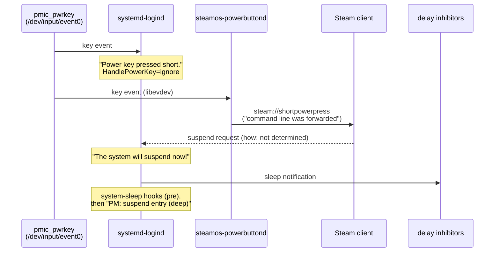

# Power, suspend and thermals

This page covers how the headset sleeps and wakes, who gets a say before it does, what the power button does, how the kernel handles heat, and how CPU and GPU clocks are governed. Battery and charging state, power rails, the fan and the status LED are on [hardware](hardware.md); this page links there instead of repeating them.

Everything here comes from sysfs and procfs reads, config files, `systemd-inhibit --list`, logind's D-Bus properties, `strings` on binaries and the journal on the headset surveyed. The headset wasn't suspended, and no power setting was changed.

## What matters

- **Suspend is deep.** `/sys/power/mem_sleep` selects `deep`, and every suspend in the journal logged `PM: suspend entry (deep)`. ([Sleep states](#sleep-states))
- **The kernel has no hibernation, but logind lists it.** `CONFIG_HIBERNATION` isn't set and `/sys/power/disk` doesn't exist, yet logind's `SleepOperation` includes `hibernate` and `suspend-then-hibernate`. ([Sleep states](#sleep-states))
- **The power key goes to Steam, not logind.** logind has `HandlePowerKey=ignore`, and `steamos-powerbuttond` sends presses to the Steam client as `steam://shortpowerpress`. ([logind](#logind-and-sleep-configuration), [Power button](#power-button))
- **Seven processes hold sleep inhibitors, all `delay`, none `block`.** ([Sleep inhibitors](#sleep-inhibitors))
- **The only in-kernel throttling is GPU devfreq at 95 °C.** CPU thermal zones have only a 110 °C critical trip, and the fan is driven from userspace. ([Thermal zones](#thermal-zones))
- **The CPU governor is `schedutil`, set at login; the GPU runs 231–903 MHz under `simple_ondemand`.** ([CPU and GPU frequency](#cpu-and-gpu-frequency))

## Sleep states

**Tag: Public (upstream).**

| Source | Value |
|---|---|
| `/sys/power/state` | `freeze mem` |
| `/sys/power/mem_sleep` | `s2idle [deep]` (deep is selected) |
| `/sys/power/disk` | doesn't exist |
| `/proc/config.gz` | `CONFIG_SUSPEND=y`, `CONFIG_PM_SLEEP=y`, `CONFIG_PM_WAKELOCKS=y`, `# CONFIG_HIBERNATION is not set` |
| `/sys/power/pm_async`, `sync_on_suspend`, `freeze_filesystems` | `1`, `1`, `0` |
| `/sys/power/pm_freeze_timeout` | `20000` |
| `/sys/power/wake_lock` | empty |

The journal's suspend cycles all logged `Performing sleep operation 'suspend'...` followed by `PM: suspend entry (deep)`. The kernel has no hibernation support, yet logind's `SleepOperation` property lists `suspend-then-hibernate`, `suspend` and `hibernate`, and `hibernate-prepare.service` ("Prepare Temporary Hibernation Swap", `WantedBy=hibernate.target`) runs `hibernate-swap-helper.sh create` ([services](services.md#boot-updates-and-filesystem)). Swap is `/dev/zram0` plus the 1 GB `/home/swapfile` (`/proc/swaps`).

Devices whose `power/wakeup` is `enabled`:

| Device (under `/sys/devices/platform/soc@0/`) | What it is |
|---|---|
| `c400000.spmi:pmic@0:pon@1300:pwrkey` | Power key |
| `c400000.spmi:pmic@0:rtc@6100` and its `alarmtimer` | PMIC real-time clock |
| `c400000.spmi:pmic@7:charger@2600/power_supply/pm8550b-charger` | Charger |
| `c400000.spmi:pmic@7:typec@2b00/power_supply/tcpm-source-psy-…` | USB-C port |
| `ac0000.geniqup/a88000.i2c/i2c-7/7-0036/power_supply/max1720x_bat_7-36` | Battery fuel gauge |
| `1c00000.pcie/…/0000:01:00.0/mhi0` | The Wi-Fi chip's MHI bus ([Wi-Fi](wireless.md#wi-fi-chip-and-driver)) |
| `c228000`, `c229000`, `c22a000` `.thermal-sensor` | SoC temperature sensors |

### CPU idle

`/sys/devices/system/cpu/cpuidle/current_driver` is `psci_idle` and the governor is `menu`. Each CPU has two states, `WFI` (latency 1 µs) and a power-collapse state:

| CPUs | Second state | Description | Latency |
|---|---|---|---|
| 0–4 | `cpu-sleep-0-0` | `silver-rail-power-collapse` | 1300 µs |
| 5, 6 | `cpu-sleep-1-0` | `gold-rail-power-collapse` | 1900 µs |
| 7 | `cpu-sleep-2-0` | `gold-plus-rail-power-collapse` | 1850 µs |

## logind and sleep configuration

**Tag: Public (upstream)** for logind; **Internal** for the drop-in.

`systemd-analyze cat-config systemd/logind.conf` shows one active setting, from `/etc/systemd/logind.conf.d/10-logind-no-powerbutton.conf` (owned by `deckard-hw-support`):

```ini
# Tell `systemd` not to bother with the powerbutton, `powerbuttond` will handle it.
[Login]
HandlePowerKey=ignore
```

`systemd-analyze cat-config systemd/sleep.conf` shows only `/etc/systemd/sleep.conf` (owned by `systemd`), with every setting commented out. logind's properties on the system bus:

| Property | Value |
|---|---|
| `HandlePowerKey` | `ignore` |
| `HandleSuspendKey` | `suspend` |
| `HandleLidSwitch` | `suspend` |
| `IdleAction` | `ignore` |
| `IdleActionUSec` | 1800000000 (30 min) |

logind logs `Watching system buttons on /dev/input/event0 (pmic_pwrkey)` and `Power key pressed short.`

## Power button

**Tag: Internal.** `steamos-powerbuttond.service` is a user unit ("Power Button daemon for SteamOS") from the `steamos-powerbuttond` package (3.2+git4403691c-5). It runs `/usr/lib/hwsupport/steamos-powerbuttond`, an aarch64 ELF ([services](services.md#vr-session-user-units)). The unit has:

- `Requisite=steamvr.service`
- `ExecCondition=/bin/bash -c '[[ $(vrdevice_path model) != EV1 ]]'`, under the comment "Do NOT run powerbuttond on an EV1, because it only has a single button, and we don't want it to " (the comment ends there)

How it finds the button:

- The package's hwdb file, `/usr/lib/udev/hwdb.d/70-steamos-power-button.hwdb`, has an entry under the comment `#deckard` matching `evdev:name:pmic_pwrkey:*`. Most other entries match DMI vendors of PC handhelds.
- `udevadm info /dev/input/event0` shows `STEAMOS_POWER_BUTTON=1` and tags `power-switch`, `uaccess` and `seat`. The rule `70-steamos-power-button.rules` gives such devices `MODE="0660"` and `TAG+="uaccess"`.
- The daemon logs `Found power button device at /dev/input/event0`; `/sys/class/input/event0/device/name` is `pmic_pwrkey`.

The binary's strings include `libevdev`, `short`, `long`, `steam://%spowerpress`, `%s/.steam/steam/steamrtarm64/steam`, `submitting %s power press to steam`, `skipping power button push since we are already suspending or still actively resuming`, and `org.freedesktop.login1.Manager`.

One short press, as the journal recorded it:



A press during resume logged `skipping power button push since we are already suspending or still actively resuming`. What a long press does on the Steam side wasn't observed.

## Sleep inhibitors

**Tag: Public (upstream)** for the inhibitor mechanism; **Internal** for most of the holders. `systemd-inhibit --list` in a normal VR session (all `delay`, none `block`):

| Who | Process | What | Why (as registered) |
|---|---|---|---|
| NetworkManager | `NetworkManager` (root) | sleep | "NetworkManager needs to turn off networks" |
| Realtime Kit | `rtkit-daemon` (root) | sleep | "Demote realtime scheduling and stop canary." |
| UPower | `upowerd` (root) | sleep | "Pause device polling" |
| dsp_service | `dsp_service` (root) | sleep | "dsp_service needs to clean DSP hardware interfaces" |
| led-control | `ledcontrol` (root) | shutdown:sleep | "Set status LED before sleep" |
| XRService | `XRService` (`steamos`) | sleep | "XRService needs to clean hardware interfaces" |
| vrserver | `vrserver` (`steamos`) | sleep | "Driver standby" |

`vrserver`'s strings include `PrepareForSleep`, `[CSystemSleepNotifier] Failed to match PrepareForSleep.`, `Failed to acquire %s inhibitor: %s`, `Steam reports host suspend imminent; fading to %.0f%% over %.1fs, then to black over %.1fs` and `Steam reports host suspend cancelled; fading in over %.1fs`. `dsp_service`'s suspend handling (shutting the DSPs down, re-binding the USB-C port driver after resume) is on [Firmware → Suspend and resume](firmware.md#suspend-and-resume). `ledcontrol` logs `led-control received process_logind_sleep_event (suspend)` and `(resume)` ([Hardware access → Status LED](hardware.md#status-led)).

## System-sleep hooks

**Tag: Internal.** `/usr/lib/systemd/system-sleep/` holds five files; `/etc/systemd/system-sleep/` doesn't exist. Two of the scripts say they are "designed to be invoked by systemd-sleep" with `<pre|post>` and the sleep mode as arguments.

| File | Package | Mode | What it does (from its contents) |
|---|---|---|---|
| `00-ledcontrol.sh` | `deckard-led-control` | `0644` (not executable) | Creates `/run/deckardcharger`, empties `power_event`, then writes `suspend` there on `pre` and `resume` on `post` |
| `50-softapcmd-refresh-on-resume.sh` | `softapmanager` | `0755` | On `post`, logs "System resume: refreshing softap" and runs `softapcmd delayrefresh` ([local IPC](local-ipc.md#control-socket)) |
| `ath12k-irq-respread.sh` | `steamos-customizations-deckard` | `0755` | On `pre`, saves the effective CPU of every IRQ whose `/proc/interrupts` name matches `ITS-PCI-MSI` to `/run/irq-respread.state`. On `post`, writes each saved CPU back to `/proc/irq/<n>/smp_affinity_list` if it changed. |
| `hibernate-post.sh` | `steamos-customizations-deckard` | `0755` | Only after `hibernate`: runs `hibernate-swap-helper.sh cleanup` and `steamos-bootconf --set boot-attempts 0` |
| `modules-reload.sh` | `steamos-customizations-deckard` | `0755` | Only if `/home/deck/.force-ath11k-reload` exists: unloads `ath11k-pci` on `pre` and reloads it on `post` |

The comment at the top of `ath12k-irq-respread.sh` gives its reason: "Deep suspend hot-unplugs CPUs 1-7, so every IRQ migrates to CPU0 … On resume only *managed* IRQs are moved back … Non-managed MSIs such as ath12k's 16 vectors stay on CPU0 until reboot, and so does all of their NET_RX work." The journal on the headset surveyed has `irq-respread: saved … IRQs matching 'ITS-PCI-MSI'` and `irq-respread: moved … IRQs, 0 failed` lines, and `System resume: refreshing softap`, once per resume. No `00-ledcontrol.sh` output is logged, since the script doesn't print anything.

Other units tied to suspend: `deckard-fpga.service` has `Conflicts=suspend.target`, and `deckard-fpga-resume.service` restarts it afterwards ([Firmware → FPGA bitstreams](firmware.md#fpga-bitstreams)).

## Thermal zones

**Tag: Public (upstream).** Values are from `/sys/class/thermal/`. There are 48 thermal zones. All use the `step_wise` policy and are `enabled` (`available_policies`: `power_allocator user_space step_wise`; `CONFIG_THERMAL_DEFAULT_GOV_STEP_WISE=y`). Trip points, in °C:

| Zones | passive | hot | critical |
|---|---|---|---|
| `cpu0`, `cpu1`, and `cpu2`–`cpu7` `-top`/`-bottom` (plus `cpu7-middle`) `-thermal` | | | 110 |
| `aoss0`–`2`, `cpuss0`–`3`, `video`, `ddr`, `camera0`/`1`, `nsphvx0`/`1`, `nsphmx0`–`3`, `modem3` `-thermal` | | 110 | 115 |
| `gpuss-0`–`4-thermal` | 95 | 110 | 115 |
| PMIC zones: `pm8010-m`/`-n`, `pm8550`, `pm8550b`, `pm8550vs-c`/`d`/`e`/`g`, `pm8550ve` `-thermal` | 95 | 115 | |
| `max1720x_bat_7-36` (battery) | | | (no trip points) |

Cooling devices:

| Device | Type | `max_state` | Bound to a zone? |
|---|---|---|---|
| `cooling_device0`–`3` | `cpufreq-cpu0`, `-cpu2`, `-cpu5`, `-cpu7` | 17, 31, 28, 31 | No |
| `cooling_device4` | `devfreq-3d00000.gpu` | 11 | Yes: each `gpuss-*` zone's trip 0 (passive, 95 °C) |
| `cooling_device5` | `ath12k_thermal` | 100 | No |

So the only in-kernel throttling binding is GPU devfreq on the GPU zones. CPU zones have only a critical trip. The fan is driven from userspace by `deckard-fan-control`, whose config's first device entry is `cpu7_middle_thermal` ([Hardware access → Thermals and the fan](hardware.md#thermals-and-the-fan)).

## CPU and GPU frequency

**Tag: Public (upstream)** for the interfaces; **Internal** for the values SteamOS sets. The governor and frequency caps are also exposed through SteamOS Manager's `CpuScaling1`, `GpuPerformanceLevel1` and `PerformanceProfile1` interfaces ([D-Bus APIs → `PerformanceProfile1`](dbus.md#performanceprofile1)).

| cpufreq policy | CPUs | Driver | Governor | Hardware range |
|---|---|---|---|---|
| `policy0` | 0–1 | `qcom-cpufreq-hw` | `schedutil` | 364.8 MHz – 2.2656 GHz |
| `policy2` | 2–4 | `qcom-cpufreq-hw` | `schedutil` | 499.2 MHz – 3.1488 GHz |
| `policy5` | 5–6 | `qcom-cpufreq-hw` | `schedutil` | 499.2 MHz – 2.9568 GHz |
| `policy7` | 7 | `qcom-cpufreq-hw` | `schedutil` | 480 MHz – 3.0528 GHz |

- The kernel's default governor is `performance` (`CONFIG_CPU_FREQ_DEFAULT_GOV_PERFORMANCE=y`). At login, the user unit `steamos-scheduler.service` applies `GOVERNOR=schedutil` and `SCHEDULER=lavd` from `/etc/default/steamos-scheduler` ([services](services.md#vr-session-user-units)).
- `/sys/devices/system/cpu/cpufreq/boost` is `0`.
- GPU: `/sys/devices/platform/soc@0/3d00000.gpu/devfreq/3d00000.gpu` uses `simple_ondemand` (available: `userspace performance simple_ondemand`), 231–903 MHz in 12 steps. The UFS controller (`1d84000.ufshc`) is the only other devfreq device, also `simple_ondemand`.
- SteamOS Manager logged `Can't add GpuPowerProfile1 interface: No GPU power profile driver configured` at session start.

## Battery and low-battery handling

**Tag: Public (upstream).** Charge state, the charger daemon's `/run/deckardcharger/` files and the fuel gauge are on [Hardware access → Battery and charging](hardware.md#battery-and-charging) and [Firmware → Battery fuel-gauge settings](firmware.md#battery-fuel-gauge-settings).

UPower 1.91.1 runs with `/etc/UPower/UPower.conf` (owned by `upower`; `UPower.conf.d/` holds only a README): `UsePercentageForPolicy=true`, `PercentageLow=20.0`, `PercentageCritical=5.0`, `PercentageAction=2.0`, `CriticalPowerAction=HybridSleep`. The power supplies it can see are `max1720x_bat_7-36`, `pm8550b-charger` and the USB-C port's `tcpm-source-psy-…`.

## Proximity sensor

**Tag: Internal.** The sensor is a VCNL4040 on IIO `iio:device2` ([Hardware access → Other sensors](hardware.md#other-sensors)). What reads it, as far as files and strings show:

- **SteamVR's CV driver.** `driver_cv.so` contains `vrdevice_path prox_sensor`, `/usr/lib/deckard-eeprom/eeprom_console get prox_far`, ` [CHmdDirectDeviceControl] Proximity sensing enable: proxfar %d `, ` [CHmdDirectDeviceControl] Proximity sensing disabled (cannot read proxfar)`, `Device JSON: Overriding proximityEnable to %d (%s)` and the input path `/proximity`. `vrserver` contains `UpdateProximitySensorStates`, `k_EButton_ProximitySensor` and `Prop_ContainsProximitySensor_Bool`.
- **`proxmicmute`.** An OpenVR client that sets the capture volume of `VA_DEC0` and `VA_DEC1` on `hw:0`. It contains no IIO path ([Audio → Proximity-based mic mute](audio.md#proximity-based-mic-mute)).
- **`prox_sensor_val`**, a shell script that `cat`s the first `in_proximity_raw` under `/sys/bus/iio/devices/`.

`driver_cv.so` also has standby strings (`[CCVTrackedHmdDriver] in StateStandby`, `Device %s powering off upon entering standby.`). Whether taking the headset off leads to standby, display-off or suspend wasn't observed.

## Interpretation

*This section is interpretation, not observation. It combines the facts above with general knowledge and may be wrong.*

- **Steam is the power policy.** logind is told to ignore the power key and idle, and the button daemon forwards presses to Steam as a URL. With `HandlePowerKey=ignore`, logind would take no action on the press it logs, and with `IdleAction=ignore` the 30-minute `IdleActionUSec` would go unused. Steam decides whether a press means suspend, a menu or a power-off. The same daemon and hwdb file serve the PC handhelds listed in it, so the Frame likely shares the Steam Deck-style flow.
- **Thermal management is mostly in userspace.** With CPU cooling devices unbound, CPU temperature is held by the fan daemon and by the frequency caps in SteamOS Manager's performance profiles. The kernel only steps in for the GPU at 95 °C and at critical trips.
- **`00-ledcontrol.sh` may be dead.** systemd-sleep generally runs only executable hooks. `ledcontrol` also holds its own logind inhibitor and gets suspend and resume events directly, so the LED may not need the hook at all.
- **`proxmicmute` gets proximity through SteamVR.** It's an OpenVR client with no IIO path, so its proximity information would come from SteamVR's events rather than from the sensor directly.
- **Hibernate leftovers.** The hibernate helper, `hibernate-post.sh` and `modules-reload.sh` (which names `ath11k-pci` and `/home/deck`) look like Steam Deck pieces carried over in `steamos-customizations-deckard`.

## How to inspect this yourself

All read-only. Don't use `systemctl suspend`, `echo mem > /sys/power/state`, `fanspeed -s` or `steamosctl set-*` to explore.

```sh
cat /sys/power/state /sys/power/mem_sleep
ls -l /usr/lib/systemd/system-sleep/
systemd-analyze cat-config systemd/logind.conf systemd/sleep.conf
systemd-inhibit --list
busctl get-property org.freedesktop.login1 /org/freedesktop/login1 \
  org.freedesktop.login1.Manager HandlePowerKey IdleAction SleepOperation
journalctl -g 'PM: suspend|irq-respread|refreshing softap'   # all boots; add -b for this one
journalctl --user -b -u steamos-powerbuttond

# Thermal zones, trip points and which cooling device each zone uses
cd /sys/class/thermal
for z in thermal_zone*; do
  printf '%s:' "$(cat $z/type)"
  for t in $z/trip_point_*_type; do printf ' %s=%s' "$(cat $t)" "$(cat ${t%_type}_temp)"; done
  echo
done
for c in cooling_device*; do echo "$c $(cat $c/type) max=$(cat $c/max_state)"; done

# CPU and GPU governors
grep . /sys/devices/system/cpu/cpufreq/policy*/scaling_governor
cat /sys/devices/platform/soc@0/3d00000.gpu/devfreq/3d00000.gpu/governor
```

## Not determined

- How Steam asks for suspend after a power-button press (a logind call, SteamOS Manager, or something else)
- What a long press does
- What `CriticalPowerAction=HybridSleep` does on a kernel without hibernation, and whether `deckard_charge_daemon`'s `secs_until_shutdown_request` ([hardware](hardware.md#rundeckardcharger)) or UPower acts first
- Whether `00-ledcontrol.sh` runs (it isn't executable)
- Whether removing the headset leads to standby, display-off or suspend, and after how long
- Why the `cpufreq` cooling devices aren't bound to any thermal zone, and what throttles the CPUs before 110 °C, if anything
- What the `ath12k_thermal` cooling device is used for

---

*Part of [Steam Frame developer notes](https://github.com/lostpanda85/frame-docs) by [lostpanda85](https://github.com/lostpanda85). MIT licensed: if you reuse or quote this, please credit lostpanda85 and link back to the repository.*
