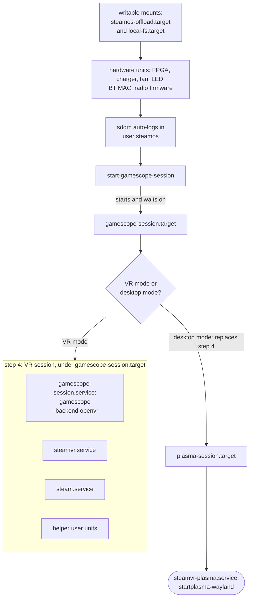
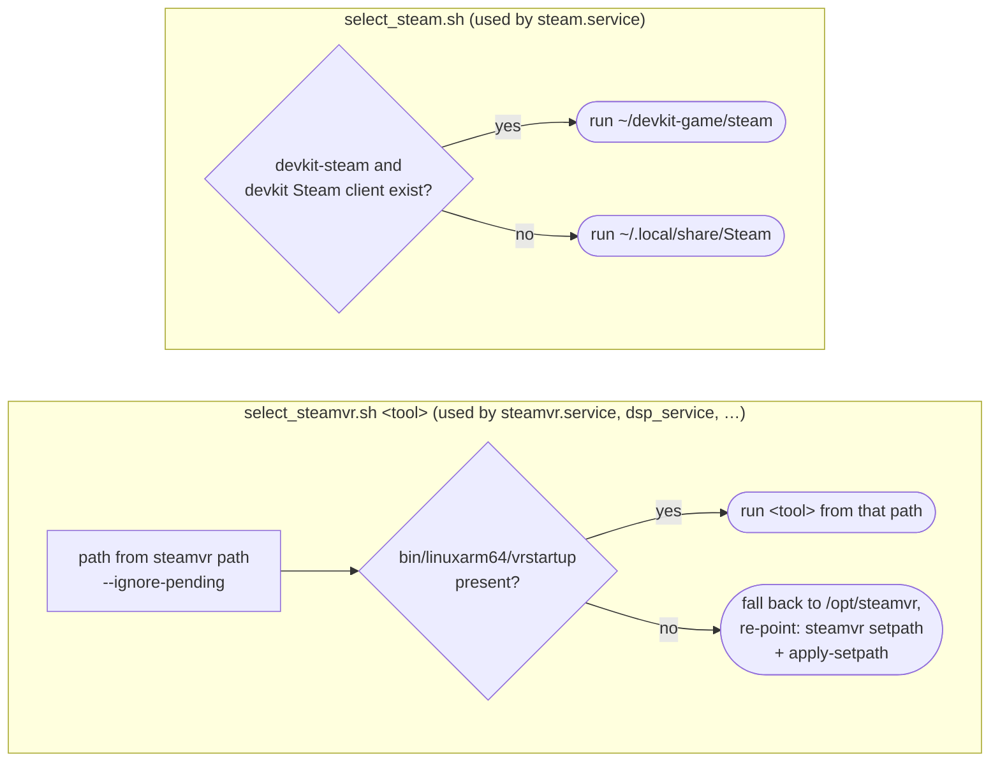

# Services catalog

This is every systemd unit on the Frame that comes from a Valve, SteamOS or Frame-specific package. That's 84 units: 49 system services and targets, 15 mounts (14 filesystem mounts plus ADB's FunctionFS), and 20 user-session units. Generic Arch/KDE/systemd units aren't counted, though a few (`sshd`, `xrdp`) are mentioned where developer mode switches them.

**Tag: Internal.** All of these are Valve's own plumbing. Unit names and behavior can change between OS builds.

On this page, "unit" always means a systemd unit. The hardware is "the headset".

**Reading the State column.** It describes what the headset was doing in VR mode, with developer mode on:

- **running**, **ran at boot**, **inactive**: what the unit was doing at the time
- **a target name** (e.g. `suspend.target`): the unit only runs when that target is reached
- **developer mode**: only runs while developer mode is on
- **a condition** (e.g. "when `/home/swapfile` doesn't exist"): the unit's `Condition*=` line, which skips it otherwise
- **D-Bus activated**: started on demand when something calls its bus name

A unit can show as "disabled" in `systemctl` and still be running. That happens when another unit pulls it in with `Wants=`/`Requires=`, when udev starts it (`SYSTEMD_WANTS`), when it's D-Bus activated, or when a script starts it explicitly.

To list the units on your own headset:

```bash
for f in /usr/lib/systemd/{system,user}/*.{service,target,mount,automount}; do
  [ -f "$f" ] && printf '%s\t%s\n' "$(pacman -Qoq "$f" 2>/dev/null)" "$f"
done | grep -E '^(deckard|steamos|steam|atomupd|softap|pidbridge|gpu-trace|scx|usb-gadget|android|rauc|xdg-desktop-portal-(holo|gamescope))'
```

### Working with these units

- **Inspect**: `systemctl cat <unit>` shows the unit file and drop-ins. `journalctl -b -u <unit>` shows this boot's log. Add `--user` to both for session units.
- **Pause for testing**: `sudo systemctl stop <unit>`, then `start` it again; a reboot also restores it. Don't `disable` or `mask` hardware units like the fan or charger daemons.
- **Restart the VR session**: use `steamvr restart` (or `stop`/`start`), not `systemctl --user stop steam` or `gamescope-session`.
- **Persisting changes**: `sudo systemctl edit <unit>` writes a drop-in under `/etc/systemd/system/`, which lives in the `/etc` overlay ([filesystem mounts](#filesystem-mounts) describes how that's carried across updates).
- **Developer mode wins**: turning developer mode back on re-enables the units it controls, even if you disabled them yourself.

## How a boot reaches VR

1. **Early boot.** The initramfs `etc_overlay` hook mounts the slot's `/var` and the `/etc` overlay. `steamos-offload.target` and `local-fs.target` pull in the other writable mounts (see [Filesystem mounts](#filesystem-mounts)).
2. **Hardware bring-up.** The FPGA bitstream is loaded; the charger, fan and LED daemons start; the Bluetooth MAC is set from the EEPROM; and the controller radio firmware is checked. The Wi-Fi MAC unit is disabled, and how `wlan0` gets its address wasn't checked. See [Hardware and power](#hardware-and-power).
3. **Login.** `sddm` logs the `steamos` user in automatically and runs `start-gamescope-session gamescope-session.target`, which starts that user target and waits on it.
4. **VR session.** `gamescope-session.service` starts gamescope with `--backend openvr`. `steamvr.service` and `steam.service` hang off the same target, along with the helpers in [VR session](#vr-session-user-units).

Desktop mode replaces step 4 with `plasma-session.target` and `steamvr-plasma.service` (`startplasma-wayland`).

The same sequence as a diagram. It mirrors the numbered steps above: arrows follow the steps, not unit dependencies.



### Which Steam and which SteamVR?

Two Valve wrapper scripts decide which binaries the session runs. Both are worth knowing if you're testing your own builds.

- **`/usr/share/deckard/select_steam.sh`** (used by `steam.service`): if `~/devkit-game/devkit-steam` exists and `~/devkit-game/steam/` contains a Steam client (`steamrtarm64/steam`), it runs that one. Otherwise it runs `~/.local/share/Steam`. More on sideloading a client: [developer workflow](developer-workflow.md#running-your-own-steam-client).
- **`/usr/share/deckard/select_steamvr.sh <tool> [args]`** (used by `steamvr.service`, `dsp_service`, `steamvr-proxmicmute`, `steamvr-v4l2cam` and the BLE programmer): runs `<tool>` from whatever `steamvr path --ignore-pending` returns. If that install is missing `bin/linuxarm64/vrstartup`, it falls back to `/opt/steamvr` and re-points the system at it (`steamvr setpath` + `apply-setpath`). See [SteamVR → running a different build](steamvr.md#running-a-different-steamvr-build).

How each script picks its binaries:



---

## Hardware and power

| Unit | Runs | State | What it does |
|---|---|---|---|
| `deckard-charger.service` | `ExecStartPre`: `ln -sfn /run/deckardcharger /run/vpower` and `/usr/share/deckard-charger/update_pack_nvm.py`; `ExecStart`: `/usr/bin/deckard_charge_daemon` (root) | running | Publishes charge state to `/run/deckardcharger/` ([details](hardware.md#rundeckardcharger)). `update_pack_nvm.py` is covered in [firmware](firmware.md). |
| `deckard-power-monitor.service` | `/usr/bin/deckard_power_monitor --interval-ms 2000` (root) | running | Samples the MAX34417 power rails every 2 s |
| `deckard-fan-control.service` | `/usr/share/deckard-fan-control/fancontrol.py --run` (root) | running | Fan control loop. Config in `deckard-config.yaml` ([details](hardware.md#thermals-and-the-fan)). |
| `deckard-led-control.service` | `/usr/bin/ledcontrol` (root) | running | Sets the status LED from charge and VR state ([details](hardware.md#status-led)) |
| `deckard-typec-logger.service` | `typec-logger-wrapper.sh` → `tcpmread` (root) | running | Copies the USB-C port manager's debugfs log (`/sys/kernel/debug/usb/tcpm-*/log`) into the journal |
| `deckard-fpga.service` | `/usr/lib/deckard-fpga/fpga_load.sh` | ran at boot | Runs `fpga_load.sh`, which picks a `csi_agg_*.binx` bitstream by board revision and programs it with `littlebee_config` ([details](hardware.md#fpga)) |
| `deckard-fpga-resume.service` | `systemctl start deckard-fpga` | `suspend.target` | Reloads the FPGA after suspend |
| `deckard-audio-setup.service` | `/usr/share/deckard-audio-config/soundsetup.sh` | ran at boot | Configures the speaker amplifiers from per-headset audio-module data in the EEPROM (vendor, resistance, temperature). An out-of-range resistance is replaced with a vendor default. If setup fails, it mutes the speakers. It also re-creates the PipeWire filter-chain and LADSPA plugin links ([audio](audio.md#boot-time-setup-soundsetupsh)). |
| `deckard-boot-images.service` | `/usr/lib/deckard-boot-images/predistort_images.sh` (root) | ran at boot | Runs SteamVR's `vrcalib` (`/over` to compose each logo onto a background, then `/predistort` with `/persist/device_config.json`) and writes the results to `/esp/efi/SteamOS/*.bmp.gz`. For each image name (`bg.png`, `logo*.png`) it uses `/home/steamos/.config/steamos/boot-images/<name>` if that file exists, otherwise the bundled one. |
| `iris-driver-rebind.service` | `/usr/lib/deckard-hw-support/iris_driver_rebind` | running | Watches the Qualcomm "iris" video codec driver. Its log string reads `%s matched CORE_DEINIT, rebinding %s`. |
| `steam-video-codec-setup.service` | two `ln -fs` commands | ran at boot | Symlinks `/dev/video-dec0` → `/dev/video22` and `/dev/video-enc0` → `/dev/video23` (the hardware codec). Steam's `libcef.so` and `steamui.so` contain these names. |
| `set-bluetooth-mac-address.service` | `set_mac_addresses.sh --bluetooth` | ran at boot (triggered by the `hci0` device) | Sets the Bluetooth address from the EEPROM (`mac_addr_ble`) with `btmgmt` |
| `set-wifi-mac-address.service` | `set_mac_addresses.sh --wifi` | inactive | Sets `wlan0`'s address from the EEPROM (`mac_addr_wifi`). Its `Description=` wrongly says "Bluetooth". |
| `steamvr-program-ble.service` | `select_steamvr.sh drivers/frame_hmd/resources/firmware/roy/program_ble.sh` | ran at boot | Runs `program_ble.sh`: `openocd … -c "init; program roy_dongle_fw.hex preverify verify reset exit"` over SWD on SoC GPIOs ([controllers](controllers.md#how-they-connect)) |
| `dsp_service.service` | `select_steamvr.sh drivers/cv/bin/linuxarm64/dsp_service` (root) | running | Ships with SteamVR's computer-vision driver. Unit description: "DSP Manager Service". |
| `steamvr-v4l2loopback.service` | `modprobe v4l2loopback video_nr=99 card_label=SteamVR exclusive_caps=1` | ran at boot | Creates the v4l2loopback device `/dev/video99` (label "SteamVR") |
| `gpu-trace.service` | `/usr/bin/gpu-trace --daemon` (root) | running | GPU/perf trace daemon ([RPC](network-services.md#gpu-trace-xml-rpc-47317)). Runs whether or not developer mode is on. |
| `steamvr-set-kernel-thread-priorities.service` | `/usr/share/deckard/set_kernel_thread_priorities.sh` | ran at boot | Sets real-time priorities (values 99, 80 and 8 in the script) and CPU affinity for kernel threads matched by name: `*-iris`, `*-soundwire`, `ring0`, `ring1`, `gpu-worker`, `crtc_event*`, `card0-crtc*`, `spi0`, and the UFS IRQ thread |

The charger daemon's strings also reference `/sys/class/power_supply/mp2652-charger/` and `/sys/class/power_supply/northgate-hotswap/` (with `charge_from_int` and `enable_cross_charger`). Neither appears unless the matching kernel driver probes successfully ([kernel → hot-swap driver](kernel.md#other-frame-specific-drivers-in-the-tree)).

## Boot, updates and filesystem

| Unit | Runs | State | What it does |
|---|---|---|---|
| `atomupd.service` | `/usr/lib/atomupd-daemon` | running (D-Bus activated) | OS update daemon ([D-Bus API](dbus.md#os-updates-comsteampoweredatomupd1)) |
| `rauc.service` | `/usr/lib/rauc/rauc-override.sh` → `rauc service` | running (D-Bus activated) | A/B image installer. The wrapper passes `--override-boot-slot` with the current slot. |
| `setubootenv.service` | `/usr/lib/deckard-hw-support/setubootenv` | ran at boot | Writes `/etc/fw_env.config` so `fw_printenv`/`fw_setenv` point at the U-Boot environment partition for the booted slot (`ubootenv_a` or `ubootenv_b`) |
| `steamos-boot.service` | `steamos-bootconf set-mode booted` | ran at boot | Marks the current slot good: `set-mode booted` runs `config --set state good`, which calls `splctl set-state <slot> good` ([boot](boot.md)) |
| `steamos-post-update.service` | `/usr/lib/steamos/steamos-post-update` | when `/var/lib/steamos-atomupd/system-updated` exists | First-boot-after-update tasks, then clears `/var/lib/steamos-atomupd/system-updated` |
| `holo-post-update-shutdown.service` | `/usr/lib/steamos/holo-post-update-shutdown` | `shutdown.target`, when `/run/steamos-atomupd/holo-booted-slot-sync-trigger` exists | Cleanup at shutdown after an update |
| `steamos-finish-oobe-migration.service` | `/usr/lib/steamos/steamos-finish-oobe-migration` | when `/home/doorstop` or `/home/steamvr` is a directory | Unit description: "Finish migration from OOBE build" |
| `steamos-create-homedir.service` | `/usr/lib/steamos/steamos-create-homedir 1000` | ran at boot | Unit description: "Create UID 1000 homedir on first boot/after factory reset" |
| `steamos-offload.target` | (mounts) | running | Pulls in `root.mount`, `srv.mount` and the `var-*.mount` units ([filesystem mounts](#filesystem-mounts)) |
| `swapfile.service` | `mkswap --file /home/swapfile --size 1024M` | when `/home/swapfile` doesn't exist | Creates a 1 GB swap file |
| `hibernate-prepare.service` | `hibernate-swap-helper.sh create` | `hibernate.target` | Makes temporary swap space for hibernation |
| `steamos-initrd-log-import.service` | `cat /run/initramfs/init.log` | ran at boot | Copies the initramfs log into the journal |
| `steamos-dump-info.service` | `/usr/bin/steamos-dump-info` | ran at boot | Writes OS build, partition, boot and battery info into the kernel log at boot, including the headset's serial numbers ([security notes](security-notes.md)) |
| `flatpak-modify-flathub-beta.service` | `flatpak remote-modify --no-enumerate flathub-beta \|\| true` | `static`; only while its marker file doesn't exist. Nothing in `/usr/lib/systemd` or `/etc/systemd` references it, and it had no journal entries this boot. | Unit description: "Remove flathub beta repo". Touches `/var/lib/flatpak/.flatpak-modify-flathub-beta-once` afterwards. `flathub-beta` wasn't a configured remote ([details](compatibility.md#flatpak)). |
| `steamos-set-plasma-theme.service` | `/usr/lib/steamos/steamos-set-plasma-theme` | inactive (disabled, no condition) | Sets the default KDE theme for desktop mode |
| `steamos-cfs-debugfs-tunings.service` | `/usr/lib/steamos/steamos-cfs-debugfs-settings` | ran at boot | Tries to write old CFS scheduler tunables in `/sys/kernel/debug/sched/` (`latency_ns`, `min_granularity_ns`, `wakeup_granularity_ns`, `migration_cost_ns`, `nr_migrate`). On this kernel it logs `Not all CFS debugfs settings applied successfuly` [sic] every boot, because some of those knobs no longer exist. |
| `scx.service` | `$SCX_SCHEDULER $SCX_FLAGS` | running | Runs `scx_lavd` (`SCX_SCHEDULER`), a sched_ext scheduler. The unit is disabled and no other unit depends on it. See the note below the table. |
| `dbus-org.freedesktop.resolve1.service` | `systemd-resolved` | running | D-Bus alias for `systemd-resolved`, shipped by the Frame customizations package. The devkit service registers its mDNS record through it. |
| `steamos-manager.service` (system) | `/usr/lib/steamos-manager -r` (root) | running | Root side of SteamOS Manager ([D-Bus](dbus.md#root-interface-internal)). The session side is a user unit with the same name. |

`scx.service`: what starts it wasn't determined. No unit file references it. `steamos-manager` contains the strings `scx.service`, `/usr/bin/scx_lavd` and `Cannot set CPU scheduler to LAVD; scx.service not installed`. At login, the user unit `steamos-scheduler.service` runs `steamosctl set-cpu-scheduler lavd`.

### Filesystem mounts

SteamOS keeps the root filesystem as an A/B image. The writable directories are mounted from other partitions. `systemctl list-dependencies steamos-offload.target` lists `root.mount`, `srv.mount` and the eight `var-*.mount` units. `/home`, `/efi` and `/esp` come from units in `/run/systemd/generator/` wanted by `local-fs.target`, and `/etc` from `/usr/lib/systemd/system/etc.mount`, also wanted by `local-fs.target`.

| Mount | Source | Pulled in by |
|---|---|---|
| `/root`, `/srv`, `/var/log`, `/var/tmp` | the shared home partition | `steamos-offload.target` |
| `/var/cache/pacman`, `/var/lib/flatpak`, `/var/lib/containers`, `/var/lib/docker` | the shared home partition | `steamos-offload.target` |
| `/var/lib/systemd/coredump`, `/var/lib/steamos-log-submitter` | the shared home partition | `steamos-offload.target` |
| `/home` | the shared home partition (mount option `x-systemd.growfs`) | `local-fs.target` (generated unit) |
| `/efi` | this slot's `efi` partition, automounted | `local-fs.target` (generated unit) |
| `/esp` | the shared EFI system partition (ESP), automounted | `local-fs.target` (generated unit) |
| `/var` | this slot's `var` partition | the initramfs `etc_overlay` hook (`mount /dev/disk/by-partsets/self/var`) |
| `/etc` | overlayfs: the image's `/etc` as the lower layer, `/var/lib/overlays/etc/upper` as the upper | the initramfs `etc_overlay` hook; `etc.mount` is wanted by `local-fs.target` |

The `/etc` overlay's upper layer is in `/var/lib/overlays/etc/upper`, and `/var` is a per-slot partition (`/dev/disk/by-partsets/A/var` and `…/B/var`). During an update, RAUC's `/usr/lib/rauc/post-install.sh` logs "Syncing the var partitions from 'self' to 'other'" and mounts the other slot's root filesystem "because we want to compare the upper /etc". `atomupd-manager simulate-update <build-id>` is described in its `--help` as showing "which /etc files would not be preserved after an update".

## Networking and connectivity

| Unit | Runs | State | What it does |
|---|---|---|---|
| `softapmanager.service` | `/usr/bin/softapmanager` (root) | running | The headset's own Wi-Fi access point. Steam's `steamclient.so` drives it from its Remote Play code (`CRemoteClientSoftAP`) ([details](local-ipc.md#soft-ap-manager), [Wi-Fi](wireless.md#the-headsets-own-access-point)). |
| `usb-gadget.service`, `usb-gadget-init.service` | `/usr/lib/usb-gadget-tools/usb-gadget*.sh start` | running (always) | Set up the USB-C port as a USB device (configfs gadget `g1`). Started via systemd's `usb-gadget.target`; the udev rule `SUBSYSTEM=="udc", TAG+="systemd", ENV{SYSTEMD_WANTS}+="usb-gadget.target"` pulls that target in. |
| `usb-ncm-gadget@usb0.service` | `/usr/share/deckard/usb-ncm-gadget.sh start usb0` | developer mode | Adds a USB Ethernet (NCM) function to the gadget. Gated on the developer-mode marker file; U-Boot can veto it with `u-boot,disable-ncm`. |
| `usb-ncm-dnsmasq@usb0.service` | `usb-ncm-dnsmasq.sh start usb0` → `dnsmasq -C /var/run/dnsmasq_usb0.conf` | developer mode | The script gives `usb0` the address `10.86.200.233/29` and writes the dnsmasq config, which hands out `10.86.200.234` to the PC ([details](network-services.md#usb-networking-and-adb)) |
| `adbd-pre.service`, `adbd.service`, `adbd-post.service`, `dev-usb\x2dffs-adb.mount` | `/usr/lib/android-sdk/platform-tools/adbd` | developer mode (or a bootloader adb/factory flag) | ADB over USB. `adbd-pre` runs `mkdir …/functions/ffs.adb`, and `adbd-post` links it into `configs/c.1`. |

## Developer mode

`steamos-devkit-mode` switches these on and off together ([details](permissions.md#developer-mode)), along with the stock `sshd` and `xrdp` units and the adbd/NCM marker file above.

| Unit | Runs | State | What it does |
|---|---|---|---|
| `steamos-devkit-service.service` | `python …/steamos-devkit-service.py` (as `steamos`) | running | Devkit discovery and SSH-key pairing on port 32000 ([API](network-services.md#devkit-pairing-service-port-32000)) |
| `steam-web-debug-portforward.service` | `socat TCP4-LISTEN:8081,fork TCP4:127.0.0.1:8080` (as `steamos`) | running | Exposes the Steam client's Chromium DevTools port on the LAN (8080 → 8081) |
| `steamvr-web-debug-portforward.service` | `socat TCP4-LISTEN:8088,fork TCP4:127.0.0.1:8087` (as `steamos`) | running | Exposes SteamVR's Chromium DevTools port on the LAN (8087 → 8088) |

## VR session (user units)

These run in the `steamos` user's systemd instance. Inspect them with `systemctl --user`.

| Unit | Runs | State | What it does |
|---|---|---|---|
| `gamescope-session.target` | (target) | running | The VR session. Everything below hangs off it. |
| `gamescope-session.service` | `/usr/lib/steamos/gamescope-session` | running | Starts gamescope with `--backend openvr`, sets the session environment (input methods, cursor theme, stats pipe), and tells systemd when it's ready ([graphics → compositing](graphics.md#compositing-gamescope-and-xwayland)) |
| `steamvr.service` | `select_steamvr.sh bin/linuxarm64/vrcmd --background --waitforquit` | running | Unit description: "SteamVR Launcher" |
| `steam.service` | `select_steam.sh RUNSTEAM.sh` | running | Starts the Steam client (flags: `-deckard -gamepadui -vrgamepadui -steamdeck -steamos3 -cef-enable-debugging`). Running your own client: [developer workflow](developer-workflow.md#running-your-own-steam-client). |
| `steamvr-proxmicmute.service` | `select_steamvr.sh bin/linuxarm64/proxmicmute` | running | Unit description: "SteamVR proximity-based microphone mute service" |
| `steamvr-v4l2cam.service` | `select_steamvr.sh bin/linuxarm64/v4l2cam --output=99` | running | Unit description: "SteamVR v4l2cam forwarder". Holds `/dev/video99` open. |
| `steamvr-logs.service` | `/usr/share/deckard/steamvr_logs_to_journald.py` | running | Copies SteamVR's log files into the journal, so `journalctl --user -u steamvr-logs` shows them |
| `steamos-powerbuttond.service` | `/usr/lib/hwsupport/steamos-powerbuttond` | running | Handles the power button. Logind's own handling is turned off in `10-logind-no-powerbutton.conf` ([power → power button](power.md#power-button)). |
| `steam-notif-daemon.service` | `/usr/bin/steam_notif_daemon` | running | A freedesktop.org notification server. It hands notifications to Steam as `steam://open_xdg_notification/?…` URLs ([D-Bus](dbus.md#notifications)). |
| `pidbridge.service` | `/usr/bin/pidbridge` | running | Host-PID lookup socket for containers ([details](local-ipc.md#pidbridge)) |
| `ibus-gamescope.service` | `ibus-daemon -r --panel=disable --emoji-extension=disable` | running | Unit description: "Wrapper for Ibus" ([graphics → text input](graphics.md#text-input-and-ime)) |
| `xdg-desktop-portal-gamescope.service`, `xdg-desktop-portal-holo.service` | portal backends | running | Portal backends for the interfaces listed under [D-Bus → desktop portals](dbus.md#desktop-portals) |
| `steamos-manager.service` | `/usr/lib/steamos-manager` | running | Session side of SteamOS Manager ([D-Bus](dbus.md#steamos-manager)). Its root side is the system unit of the same name (`steamos-manager -r`). |
| `steamos-scheduler.service` | `steamosctl set-cpu-scaling-governor …; steamosctl set-cpu-scheduler …` | ran at login | Applies `GOVERNOR=schedutil` and `SCHEDULER=lavd` from `/etc/default/steamos-scheduler` |
| `steamos-manager-session-cleanup.service` | `steamosctl clean-temporary-sessions` | ran at login | Unit description: "SteamOS Manager temporary session cleanup" |
| `steamos-manager-configure-cecd.service` | `steamosctl configure-cecd` | inactive | HDMI-CEC setup. The `HdmiCec` interfaces aren't present on the Frame's SteamOS Manager session bus object. |
| `orca.service` | `/usr/bin/orca` | inactive | Screen reader. `steamos-manager` references `orca.service` and the `screen-reader-enabled` setting. `/usr/bin/orca` doesn't exist ([graphics → accessibility](graphics.md#accessibility)). |
| `plasma-session.target`, `steamvr-plasma.service` | `startplasma-wayland` | inactive | Desktop mode |

## Logging and telemetry

| Unit | Runs | State | What it does |
|---|---|---|---|
| `steamos-log-submitter.service` | `python -m steamos_log_submitter.daemon` (as `steamos-log-submitter`) | running | Unit description: "SteamOS log submitter service - sends error logs to Valve". Has `Enabled`, `CollectEnabled` and `SubmitEnabled` switches ([D-Bus](dbus.md#log-submitter-comsteampoweredsteamoslogsubmitter)). |

See also `deckard-typec-logger.service` under [Hardware and power](#hardware-and-power) and `steamvr-logs.service` under [VR session](#vr-session-user-units).

## Not counted

The image also has a handful of unowned unit files in `/etc/systemd/system` (`dbus-org.bluez.service`, `dbus-org.freedesktop.Avahi.service`, `display-manager.service` and so on). They're the usual enablement symlinks created by `systemctl enable`, not custom services.

---

*Part of [Steam Frame developer notes](https://github.com/lostpanda85/frame-docs) by [lostpanda85](https://github.com/lostpanda85). MIT licensed: if you reuse or quote this, please credit lostpanda85 and link back to the repository.*
