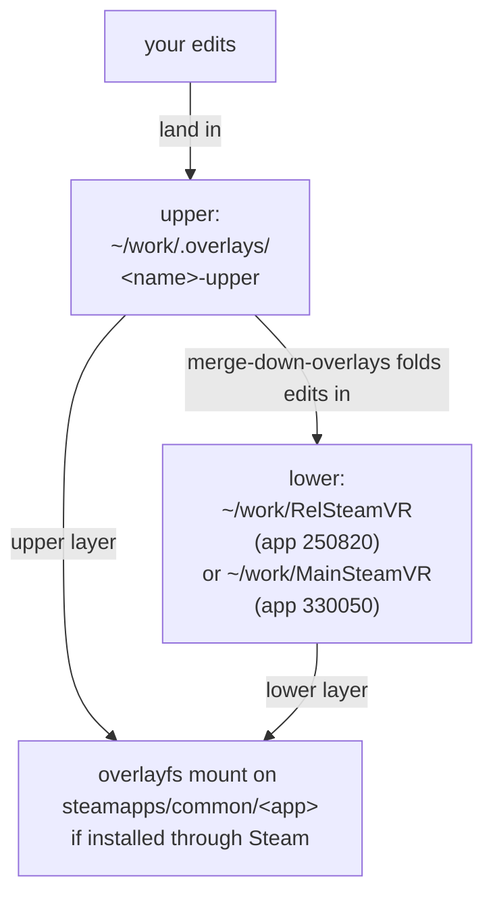
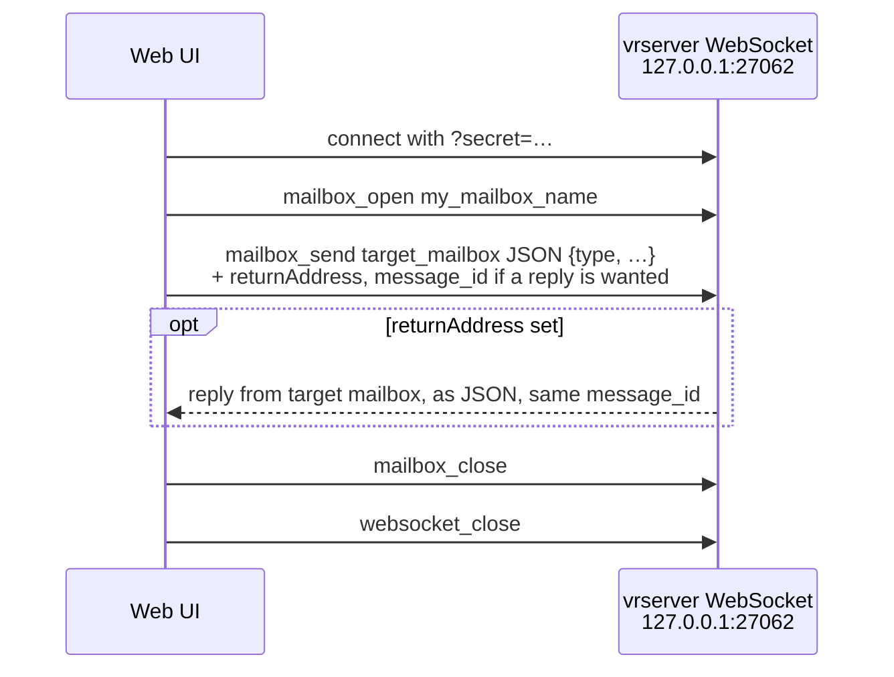

# SteamVR on the Frame

`steamvr.service` and `steam.service` are user units in `gamescope-session.target`, which `sddm` starts at login ([services](services.md#how-a-boot-reaches-vr)). gamescope runs with `--backend openvr`.

The system copy of SteamVR lives in `/opt/steamvr` and belongs to the `deckard-steamvr-rel` OS package (`pacman -Qo /opt/steamvr/bin/linuxarm64/vrserver`).

## Process overview

These are the processes running in a normal VR session. They're listed for orientation, not as interfaces.

| Process | Observed |
|---|---|
| `vrserver` | Listens on 127.0.0.1:27062 and on `@/steamvr/VR_ServerPipe_<pid>` and `@/steamvr/SteamVR_Namespace`; holds `/dev/spidev0.1` |
| `vrcompositor` | Listens on `@/steamvr/VR_CompositorPipe_<pid>`; holds `/dev/spidev0.1`. It's the DRM master on `card0` ([graphics](graphics.md#drm-clients)). |
| `vrdashboard`, `vrwebhelper` | `vrwebhelper` is a Chromium-based helper (`--user-agent-product=SteamVR HTML`) |
| `vrcmd --background --waitforquit` | The process `steamvr.service` starts |
| `XRService` | Command line `--documentsRoot ~/.config/openvr/config/cv/xrservice --wasStartedByDriverCV --connectToSteamVR`. Holds `/dev/media0`, five camera sub-devices and several `/dev/video*` nodes ([hardware](hardware.md#cameras)). |
| `eyetracking` | `/opt/steamvr/tools/eyetracking/bin/linuxarm64/eyetracking -b CDSP -w …/resources/et_dsp_*.weights`. Holds `/dev/spidev0.1`, the `/dev/input/event*` devices and the panel backlight files. |
| `dsp_service` (root) | From `/opt/steamvr/drivers/cv/bin/linuxarm64/`. Unit description: "DSP Manager Service". |
| `proxmicmute` | Unit description: "SteamVR proximity-based microphone mute service" ([audio](audio.md#proximity-based-mic-mute)) |
| `v4l2cam` | `v4l2cam --output=99`; holds `/dev/video99`. Unit description: "SteamVR v4l2cam forwarder". |
| `steamvr_logs_to_journald.py` | Unit description: "SteamVR log scraper for journald integration" |

## Finding the runtime

**Tag: Public.** Apps find SteamVR the standard ways (OpenXR details are on [OpenXR and the VR runtime](openxr.md#runtime-registration)):

- **OpenVR**: `~/.config/openvr/openvrpaths.vrpath` lists `runtime: ["/opt/steamvr"]`, with config in `~/.config/openvr/config` and `~/.local/share/Steam/config`, and logs in `~/.local/share/Steam/logs`. When a new path is applied ([below](#running-a-different-steamvr-build)), `/usr/lib/libopenvr_api.so` is also symlinked to the runtime's copy.
- **OpenXR**: `~/.config/openxr/1/active_runtime.json` → `/opt/steamvr/steamxr_linuxarm64.json`. `apply-setpath` also writes `/etc/openxr/1/active_runtime.json`.

Binaries are under `bin/linuxarm64/` and are native aarch64 ELF files. `/usr/bin/FEXBash` is a Valve bash wrapper from `steamos-customizations-deckard`, not FEX's own binary ([Running other software](compatibility.md#usrbinfexbash)).

## The `steamvr` command

**Tag: Internal**, though it's meant for developers. `/usr/bin/steamvr` is a bash script. Subcommands that need root re-run themselves through `pkexec`. Its polkit action has `implicit any: yes`, so `pkexec` runs it as root without a password from any session, SSH included (checked with `pkcheck`).

| Subcommand | Valve's usage text | What the script does |
|---|---|---|
| `start [path]` | "starts SteamVR, optionally running `setpath <path>` first" | `systemctl start sddm` |
| `stop` | "stops SteamVR" | stops `sddm`, then the user units `steam.service` and `steamvr.service` |
| `restart` | "restarts SteamVR, ensuring that it can be called from SteamVR itself" | re-runs itself under `systemd-run --scope`, then `stop` and `start` |
| `kill` | "kills all steamvr processes" | SIGKILL to `steam`, `steamvr` (user) and `sddm`, `dsp_service`, `pipewire` (system) |
| `enable` | "starts SteamVR automatically at boot and resume (default)" | `systemctl unmask sddm`, then `start` |
| `disable` | "disables starting of SteamVR completely" | `stop`, then `systemctl mask sddm` |
| `status` | (not in usage) | `systemctl --user status gamescope-session.target plasma-session.target steamvr.service steam.service` |
| `path` | "displays the path to SteamVR" | prints the pending path; `--ignore-pending` prints the current one |
| `logpath`, `configpath` | "displays the path to SteamVR's log directory" (both lines say "log") | read `.log[0]` / `.config[0]` from `openvrpaths.vrpath` |
| `setpath <dir>` | "sets SteamVR to run from the specified path" | checks for `bin/linuxarm64/vrpathreg`, writes `~/.config/openvr/steamvr-pending.path` |
| `apply-setpath` | (not in usage) | see [below](#running-a-different-steamvr-build) |
| `setpathdefault`, `getpathdefault` | "sets SteamVR to run from default path" | `setpath /opt/steamvr` / prints `/opt/steamvr` |
| `is-sideloaded` | (not in usage) | exit 0 if the path isn't `/opt/steamvr` and contains `.disable-steamvr-health-check` |
| `cmd …` | "runs vrcmd" | `exec <path>/bin/linuxarm64/vrcmd …` |
| `report` | "creates additional files for the system report" | `vrcmd --send-vrevent 1900` |
| `dspaec 0\|1` | "disables (0) or enables (1) echo cancellation on adsp" | swaps the PipeWire `filter-chain-aec` and `microphone-filter-chain-echo-cancel` symlinks between their `-dsp` and `-cpu` variants, touches or removes `~/.local/state/disable_dsp_aec`, restarts PipeWire. `soundsetup.sh` re-links the `-cpu` variants at every boot; its `disable_dsp_aec` test and its `-dsp` links are commented out ([Audio → Boot-time setup: `soundsetup.sh`](audio.md#boot-time-setup-soundsetupsh), [Audio → Echo cancellation on the aDSP: `steamvr dspaec`](audio.md#echo-cancellation-on-the-adsp-steamvr-dspaec)). |
| `mount-overlays`, `unmount-overlays`, `merge-down-overlays` | (not in usage) | see [below](#running-a-different-steamvr-build) |

### Running a different SteamVR build

`setpath` checks that `<dir>/bin/linuxarm64/vrpathreg` exists and records the path in `~/.config/openvr/steamvr-pending.path`. On the next start, `apply-setpath` (as root) does the following:

1. runs `vrpathreg setthis` from the new install as `steamos`
2. points the OpenXR `active_runtime.json` links and `/usr/lib/libopenvr_api.so` at it
3. links its audio plugins (`vraudiocompositor`, `libphonon`, `audiofilter`) into `/run/ladspa/`
4. restarts `pipewire` and `dsp_service`

The script knows two Steam app IDs: `250820`, which it mounts as `RelSteamVR`, and `330050`, which it mounts as `MainSteamVR`. If either is installed through Steam, its folder under `steamapps/common` becomes an overlayfs mount:

- lower layer: `~/work/RelSteamVR` or `~/work/MainSteamVR`
- upper layer, where your edits land: `~/work/.overlays/<name>-upper`

Your changes stay in the upper layer, separate from Steam's files. `merge-down-overlays` folds them into the lower copy.

The overlay layout:



## vrcmd

**Tag: Internal.** `/opt/steamvr/bin/linuxarm64/vrcmd` (or `steamvr cmd`). Its `--help` prints only option names, with no descriptions. Options used on the headset surveyed: `--dumpsensors` (lists tracked devices and sensor positions) and `--help`. `steamvr report` runs `--send-vrevent 1900`.

`--help` prints only the option names. The full `--help` output is in [methodology](methodology.md#vrcmd-options).

## Mailboxes

**Tag: Internal.** "Mailboxes" are how SteamVR's processes, including its web UI, send each other messages. Each participant registers a named mailbox with `vrserver`. Messages are JSON objects with a `type` field. If the sender wants a reply, it adds `returnAddress` (its own mailbox name) and `message_id`.

### From a shell: not available

`/etc/bashrc.d/vrshortcuts.sh` still calls `steamvr cmd --mailboxcmd web_steam_mailbox 'toggle_voicechat?enable=true'`, but the `vrcmd` shipped in `/opt/steamvr` rejects the option:

```
$ vrcmd --mailboxcmd <mailbox> <message>
ERROR: --mailboxcmd is no longer supported.
For docking overlays to theater mode etc, use --dock-overlay <location> [overlay_key].
For toggling stereo theater mode to theater mode etc, use --toggle-theater-stereo.
```

So the `streaming` shortcut in `vrshortcuts.sh` ([below](#shell-shortcuts)) doesn't work on this build, and the WebSocket below is the only mailbox route found.

### Over the WebSocket

The web UI connects to `ws://127.0.0.1:27062/?secret=<secret>` and sends space-separated text commands:

```
mailbox_open <my_mailbox_name>
mailbox_send <target_mailbox> {"type":"…","returnAddress":"<my_mailbox_name>","message_id":1, …}
mailbox_close
websocket_close
```

Settings pages use a separate `settings_open` / `settings_close` pair on the same socket. Incoming messages arrive as JSON. Replies carry the original `message_id`.

One exchange over the socket, which `vrserver` serves (it listens on 127.0.0.1:27062, see the [process overview](#process-overview)):



Mailbox names seen in the shipped UI: `web_server_mailbox`, `web_steam_mailbox`, `desktopview`, `vrcompositor_systemlayer`, `lighthouse_pairing`, `frame_controller_firmware_update`, `ogs`, `ogs_client`.

Message `type` values seen in the shipped UI include:

```
request_mailbox_registration_notification   (to web_server_mailbox; reply type "mailbox_registered")
request_input_state_updates / cancel_input_state_updates   {device_path}
request_input_in_use_updates / cancel_input_in_use_updates
request_binding_callouts   {app_key, controller_type}
discover_dongles, start_pairing             (lighthouse_pairing)
start_update                                (frame_controller_firmware_update)
request_window_list_update, request_spawn_window_view, request_task_view   (desktopview)
show_or_hide_dashboard_or_frame, relatch_dashboard, focus_panel, defocus_panel
set_eye_tracking_debug_mode, start_eye_server, stop_eye_server, perform_center_eye_cal
vrgamepadui_message, vrlink_dashboard_action_invoked
```

None of these are documented by Valve, and payloads beyond what's shown weren't explored. Expect breakage between SteamVR versions.

## Internal IPC sockets

**Tag: Internal.** Listening abstract Unix sockets seen with `ss -xlp`: `@/steamvr/VR_ServerPipe_<pid>` and `@/steamvr/SteamVR_Namespace` (owned by `vrserver`), `@/steamvr/VR_CompositorPipe_<pid>` (owned by `vrcompositor`), and `@dsp_service` (owner not visible without root).

## Shell shortcuts

**Tag: Internal.** `/etc/bashrc.d/vrshortcuts.sh` is sourced for interactive shells and adds:

| Name | What it does |
|---|---|
| `cdd` | `cd` to the active SteamVR's `bin/linuxarm64` |
| `cdc` | `cd` to the SteamVR config dir |
| `cdl` | `cd` to the SteamVR log dir |
| `cds` | `cd ~/.steam/steam` |
| `streaming start\|stop\|restart` | Runs `steamvr cmd --mailboxcmd web_steam_mailbox 'toggle_voicechat?enable=…'` and `'toggle_videobroadcast?enable=…'`. This `vrcmd` rejects `--mailboxcmd` ([see above](#from-a-shell-not-available)). |
| `video_capture [--no-timestamp] [file.mp4]` | Record to `~/video_captures/` |

## Per-device config in `/persist`

**Tag: Internal.** Device config and calibration live on a separate, normally read-only partition mounted at `/persist`. The two helper scripts that manage it:

- `vrconfig_path <key>` prints the file path for a key.
- `vrconfig_write <key> <file> [message]` (root only) validates the file (JSON for most keys), remounts `/persist` read-write, copies it in, commits it to a git repo inside `/persist`, and remounts read-only.

| Key | File |
|---|---|
| `device` | `device_config.json` |
| `xrservice` | `xrservice.json` |
| `eyetracking` | `eyetracking.json` |
| `foxnet` | `foxnet_device.conf` |
| `exp5v` | `exp_5v_out_enable` |
| `notes` | `notes.txt` |

A root listing of `/persist` (names and modes only; contents weren't read) shows `device_config.json`, `xrservice.json`, `exp_5v_out_enable` and `.gitignore` (all `root:root`, mode 664), `eyetracking.json` (mode 644), a `.git` directory with commit history, and `lost+found`. `foxnet_device.conf` and `notes.txt` weren't present. The directory itself is `root:root`, mode 775. With modes 664 and 644, the files listed are world-readable. The key names in the three JSON files are on [OpenXR and the VR runtime](openxr.md#display-refresh-rate-and-timing) (`device_config.json`), [tracking](openxr.md#tracking-pipeline-and-spaces) (`xrservice.json`) and [eye tracking](openxr.md#eye-tracking-foveation-hands-and-passthrough) (`eyetracking.json`).

Back up `/persist` before touching it (`restore-calibration backup`, see [Before you poke around](safety.md)). It holds your headset's calibration, and the git history inside only helps if the partition itself is intact.

---

*Part of [Steam Frame developer notes](https://github.com/lostpanda85/frame-docs) by [lostpanda85](https://github.com/lostpanda85). MIT licensed: if you reuse or quote this, please credit lostpanda85 and link back to the repository.*
