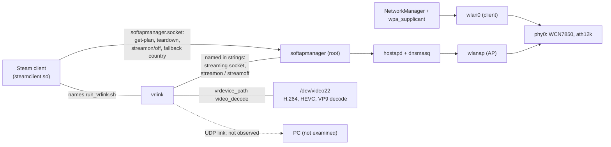

# Wi-Fi, Bluetooth and streaming

The headset has one WCN7850 chip, which `lspci` and the `ath12k` module description name as Qualcomm Technologies: Wi-Fi on PCIe, driven by `ath12k`, and Bluetooth on a UART. The Wi-Fi side runs two networks at once: a normal client connection on `wlan0`, managed by NetworkManager and `wpa_supplicant`, and the headset's own access point on `wlanap`, run by `softapmanager`. `vrlink` (in `/opt/steamvr/tools/vrlink`) contains strings for a UDP link to a PC and a V4L2 decoder found through `vrdevice_path video_decode`; it wasn't run.

Everything here comes from `iw phy`, `iw dev`, `iw reg get`, `nmcli`, `bluetoothctl show`, `lspci`, `modinfo`, sysfs, config files, `v4l2-ctl` format queries and `strings` on binaries. No scan, connection, pairing or radio change was made. MAC addresses, network names, the regulatory country and paired devices are left out on purpose.

## What matters

- **One WCN7850 handles Wi-Fi and Bluetooth.** Wi-Fi is on PCIe, driven by `ath12k`; Bluetooth is on a UART, driven by `hci_uart_qca`. The controllers don't use this Bluetooth controller; they use a separate nRF52 radio. ([Wi-Fi chip and driver](#wi-fi-chip-and-driver), [Bluetooth controller](#bluetooth-controller))
- **Client and access point run at once.** `wlan0` (client, NetworkManager) and `wlanap` (access point, `softapmanager`) were both up on `phy0`. ([Interfaces](#interfaces), [The headset's own access point](#the-headsets-own-access-point))
- **RX reorder timeout is 2 ms on every queue, and Wi-Fi power save is off.** `ath12k.conf` sets the RX reorder timeout to 2 ms on all four queues, and NetworkManager drop-ins turn Wi-Fi power save off; `iw` reported `Power save: off` on both interfaces. ([Wi-Fi chip and driver](#wi-fi-chip-and-driver), [NetworkManager and wpa_supplicant](#networkmanager-and-wpa_supplicant))
- **The radio is 2×2, and 320 MHz is advertised only for AP and mesh on 6 GHz.** `iw phy` shows `TX 0x3 RX 0x3` antennas and two spatial streams; `managed` mode on 6 GHz goes up to 160 MHz. ([What the radio supports](#what-the-radio-supports-iw-phy))
- **PC streaming is known only from `vrlink`'s strings.** They show a UDP link to a PC and a V4L2 decoder found through `vrdevice_path video_decode`. `vrlink` wasn't running, and no streaming session was observed. ([PC streaming](#pc-streaming-vrlink))

## Wi-Fi chip and driver

**Tag: Public (upstream)** for the driver; **Internal** for Valve's module options.

| Item | Value | Source |
|---|---|---|
| Chip | WCN7850 (`Wi-Fi 7 Hardware name: wcn7850 hw2.0`) | kernel log ([firmware](firmware.md#wi-fi-and-bluetooth)) |
| PCI name | `Qualcomm Technologies, Inc WCN785x Wi-Fi 7(802.11be) 320MHz 2x2 [FastConnect 7800] (rev 01)` | `lspci -s 01:00.0` |
| Bus | PCIe `0000:01:00.0`, `PCI_ID=17CB:1107`, with an `mhi0` child | sysfs |
| Driver | `ath12k_wifi7_pci`; modules `ath12k` ("Driver support for Qualcomm Technologies WLAN devices") and `ath12k_wifi7` ("Driver support for Qualcomm Technologies 802.11be WLAN devices") | `/sys/class/net/wlan0/device/uevent`, `lsmod`, `modinfo` |
| Firmware | `ath12k/WCN7850/hw2.0/`, board file `board_77.bin` | [Firmware → Wi-Fi (`ath12k`)](firmware.md#wi-fi-ath12k) |
| `rfkill` | `rfkill1`, type `wlan`, `phy0`, soft and hard unblocked | `/sys/class/rfkill/` |

`modinfo -p ath12k` lists these parameters (descriptions quoted exactly, including the type in parentheses):

| Parameter | Description (from `modinfo -p`) | Value |
|---|---|---|
| `rx_reorder_timeout` | `RX reorder timeout in ms. Use one value for all ACs or four values BE,BK,VI,VO (0 means use driver defaults) Example: set all to 2: rx_reorder_timeout=2 set only VO to 2: rx_reorder_timeout=0,0,0,2 (array of uint)` | `2,2,2,2` |
| `egap` | `<enable>[,<flags>[,<inactivity_ms>[,<wait_ms>]]]: empty fields default (0,0x4,1000,1000). flags: 0x1=PHY error detection, 0x2=by station PS state, 0x4=by inactivity; ms times 1 to 300000 (string)` | `0,0x4,1000,1000` |
| `gtx` | `Green TX, applied as each vdev comes up: -1=BDF default (default), 0=disable, 1=enable (int)` | `-1` |
| `default_bdf` | `Name of BDF file to load if board_id is not set (string)` | empty |
| `mac_addr` | `Override the internal MAC address (format aa:bb:cc:dd:ee:ff) (string)` | empty |
| `ftm_mode` | `Boots up in factory test mode (bool)` | `N` |
| `debug_mask` | `Debugging mask (uint)` | `0` |

`rx_reorder_timeout` comes from `/usr/lib/modprobe.d/ath12k.conf` (owned by `deckard-hw-support`). Its comments explain the history. The first plan was to shorten only the VI (video) queue, "to reduce reorder timeout when transmitting from the dongle -> HMD, where we have restricted retries severely in order to prioritize low-latency video streams. We will tag the vrlink packets as VI (video) when coming out of the dongle." The active line sets all four queues instead: "DISREGARD ALL OF THAT. Instead just set everything to 2ms. We want to avoid head-of-line blocking for all traffic on all interfaces."

The Wi-Fi chip's MHI device is a wakeup source ([power](power.md#sleep-states)), and a sleep hook re-spreads the chip's 16 MSI interrupts after resume ([Power, suspend and thermals → System-sleep hooks](power.md#system-sleep-hooks)). A board temperature channel named `…_at_wifi_input` is on [Hardware access → Thermals and the fan](hardware.md#thermals-and-the-fan).

## What the radio supports (`iw phy`)

**Tag: Public (upstream).** One wiphy, `phy0`.

| Band | Standards and widths | Notes |
|---|---|---|
| Band 1 (2.4 GHz) | HT20/HT40; HE with `HE40/2.4GHz`; EHT MCS map for ≤ 80 MHz | |
| Band 2 (5 GHz) | VHT up to 160 MHz; HE40/HE80 and HE160; EHT maps for ≤ 80 and 160 MHz | Some channels marked "radar detection" |
| Band 4 (6 GHz) | HE40/HE80 and HE160; EHT up to 160 MHz for `managed`, and "320MHz in 6GHz Supported" with a 320 MHz MCS map for `AP` and `mesh point` | |

- **Streams:** `Available Antennas: TX 0x3 RX 0x3`. HE: 1 or 2 streams at MCS 0–11. EHT maps (`0x222222`): max NSS 2 for MCS 0–9, 10–11 and 12–13.
- **Interface modes:** `managed`, `AP`, `monitor`, `P2P-client`, `P2P-GO`, `P2P-device`.
- **Valid combination:** `#{ managed } <= 1, #{ AP, P2P-client, P2P-GO } <= 16, #{ P2P-device } <= 1, total <= 16, #channels <= 2, STA/AP BI must match`.
- **Ciphers:** TKIP, CCMP-128/256, GCMP-128/256, CMAC/CMAC-256, GMAC-128/256.
- **WoWLAN:** wake on disconnect, magic packet, pattern match (up to 22 patterns), GTK rekey failure, network detection (up to 16 match sets); can do GTK rekeying.
- **Extended features include:** `BEACON_PROTECTION`, `BSS_COLOR`, `PUNCT` (preamble puncturing in AP mode), `FILS_STA`, `FILS_DISCOVERY`, `UNSOL_BCAST_PROBE_RESP`, `STA_TX_PWR`, `TXQS`, `POWERED_ADDR_CHANGE`, `CONTROL_PORT_OVER_NL80211`.
- **Commands include** `start_ap`, `channel_switch`, `start_p2p_device`, `remain_on_channel` and `assoc_mlo_reconf`.

`iw dev` showed `txpower 18.00 dBm` on both `wlan0` and `wlanap`, and `iw dev <if> get power_save` returned `Power save: off` on both.

## Regulatory handling

**Tag: Public (upstream)** for the mechanism; **Internal** for Steam's use of it.

- `wireless-regdb` 2026.02.04-3 ships `regulatory.db` and `regulatory.db.p7s`; the initramfs includes both ([Firmware → The firmware loader](firmware.md#the-firmware-loader)).
- `/sys/module/cfg80211/parameters/ieee80211_regdom` holds a two-letter country code. `/usr/lib/modprobe.d/` sets no `cfg80211` options. Where the value comes from wasn't determined.
- `iw reg get` prints the global domain and a separate block for `phy#0 (self-managed)`, with its own rule list. That list uses the flags `DFS`, `NO-OUTDOOR`, `PASSIVE-SCAN`, `AUTO-BW` and per-range `NO-80MHZ`/`NO-160MHZ`/`NO-320MHZ`. The rules themselves aren't reproduced here because they identify the country.
- `cfg80211` also has `cfg80211_block_scans` (value `0`), `cfg80211_disable_40mhz_24ghz` (`N`) and `bss_entries_limit` (`1000`). `softapmanager` contains the path of the first one ([Local sockets and IPC → Streaming socket](local-ipc.md#streaming-socket)).
- `steamclient.so` contains `CRemoteClientSoftAP::OnIPCountry` and the soft-AP command `set-fallback-country-code\t%s`. The soft AP's `get-channels` reply is grouped by what's usable in the current regulatory country ([Local sockets and IPC → Control socket](local-ipc.md#control-socket)).

## Interfaces

| Interface | Type (`iw dev`) | Managed by | Notes |
|---|---|---|---|
| `wlan0` | `managed` | NetworkManager + `wpa_supplicant` | Client connection; firewall zone `public` ([network services](network-services.md#port-map)) |
| `wlanap` | `AP` | `softapmanager` (`hostapd`, `dnsmasq`) | NetworkManager lists it as `unmanaged` (`20-wlanap-unmanaged.conf`); firewall zone `nm-shared` |
| P2P device (no netdev) | `P2P-device` | NetworkManager (`p2p-dev-wlan0`, `wifi-p2p`) | `disconnected` |
| `usb0` | Ethernet (USB NCM) | `usb-ncm-dnsmasq@usb0` | `unmanaged` in NetworkManager ([USB networking](network-services.md#usb-networking-and-adb)) |
| `teql0` | | | `unmanaged`, down |

`wlan0` and `wlanap` were both up on the same `phy0`, which the combination rule above permits (`#channels <= 2`).

## NetworkManager and wpa_supplicant

**Tag: Public (upstream)** for the components; **Internal** for the drop-ins.

| Package | Version | State |
|---|---|---|
| `networkmanager` | 1.52.1-1.5 | active; `nmcli -t general` printed `connected:full:enabled:enabled:missing:enabled:no (guessed)` |
| `wpa_supplicant` | 2:2.10-9.3 | active: `/usr/bin/wpa_supplicant -u -s -O /run/wpa_supplicant` (`BusName=fi.w1.wpa_supplicant1`) |
| `iwd` | 3.11-2 | installed, inactive |
| `hostapd` | 2.11-5.3 | not a running unit; `softapmanager` runs `hostapd /var/run/softap_hostapd.conf` |
| `dnsmasq` | 2.92-1 | run by `softapmanager` for `wlanap` and by `usb-ncm-dnsmasq@usb0` for `usb0` |
| `iw` | 6.17-1 | |

NetworkManager drop-ins:

| File | Owner | Content |
|---|---|---|
| `/usr/lib/NetworkManager/conf.d/10-steamos-defaults.conf` | `steamos-customizations-deckard` | `dns=systemd-resolved`, `iwd-config-path=auto`, `ipv6.ip6-privacy=2`. The `wifi.backend=iwd` lines are commented out under "deckard: not turning this on until we switch to iwd". |
| `/usr/lib/NetworkManager/conf.d/20-connectivity.conf` | `networkmanager` | connectivity check `uri=http://ping.archlinux.org/nm-check.txt` |
| `/usr/lib/NetworkManager/conf.d/20-wlanap-unmanaged.conf` | `steamos-customizations-deckard` | "Tell NetworkManager to not manage wlanap from softapmanager": `unmanaged-devices=interface-name:wlanap` |
| `/usr/lib/NetworkManager/conf.d/30-wifi-no-power-save.conf` | `steamos-customizations-deckard` | "Disable power saving on wifi connections": `wifi.powersave = 2` |
| `/etc/NetworkManager/conf.d/99-valve-wifi-backend.conf` | unowned | `wifi.powersave=2`, `wifi.backend=wpa_supplicant` |

The `99-valve-wifi-backend.conf` path, the keys `wifi.powersave` and `wifi.backend`, and `/etc/systemd/system/iwd.service.d/99-valve-override.conf` appear in `/usr/lib/steamos-manager`'s strings. SteamOS Manager exposes them as `WifiBackend1` and `WifiPowerManagement1` ([D-Bus](dbus.md#wifibackend1-wifipowermanagement1)).

## Bluetooth controller

**Tag: Public (upstream)** for the stack (BlueZ 5.79-1.6); **Internal** for the board wiring.

| Item | Value | Source |
|---|---|---|
| Transport | UART: `/soc@0/geniqup@8c0000/serial@898000/bluetooth`, compatible `qcom,wcn7850-bt` | `/sys/class/bluetooth/hci0/device/uevent` |
| Driver | `hci_uart_qca` | same |
| Firmware | `qca/hmtbtfw20.tlv`, `qca/hmtnv20.bin` | [Firmware → Bluetooth](firmware.md#bluetooth) |
| Address | set from the EEPROM at boot by `set-bluetooth-mac-address.service` | [services](services.md#hardware-and-power) |
| `rfkill` | `rfkill0`, type `bluetooth`, `hci0`, unblocked | `/sys/class/rfkill/` |

`bluetoothctl show` (address and name removed):

| Field | Value |
|---|---|
| `Manufacturer` | `0x001d (29)` |
| `Version` | `0x0d (13)` |
| `Class` | `0x006c0000` |
| `Powered` / `Discoverable` / `Pairable` | `yes` / `no` / `yes` |
| `Roles` | `central`, `peripheral` |
| `Modalias` | `usb:v1D6Bp0246d054F` |
| Advertising | 16 instances; secondary channels `1M`, `2M`, `Coded`; TX power −32 to 11; max advertising and scan response length 251; `CanSetTxPower`, `HardwareOffload` |

<details markdown="1">
<summary>Service UUIDs it advertises</summary>

| UUID name | UUID |
|---|---|
| Audio Source / Audio Sink | `0000110a-…` / `0000110b-…` |
| A/V Remote Control / A/V Remote Control Target | `0000110e-…` / `0000110c-…` |
| Handsfree / Handsfree Audio Gateway | `0000111e-…` / `0000111f-…` |
| PnP Information | `00001200-…` |
| Generic Access Profile / Generic Attribute Profile | `00001800-…` / `00001801-…` |
| Device Information | `0000180a-…` |

(All have the suffix `-0000-1000-8000-00805f9b34fb`.)

</details>

BlueZ config (`/etc/bluetooth/`, all owned by `bluez`): `main.conf` sets `MultiProfile = multiple`, `FastConnectable = true`, `Privacy = device`, `KernelExperimental = 15c0a148-c273-11ea-b3de-0242ac130004`, and `[LE] ScanIntervalSuspend=2240`, `ScanWindowSuspend=224`. `wake-policy.conf` has a `[WakeAllowed]` section with every device class (`Computer`, `Phone`, `LAN/Network`, `Audio/Video`, `Imaging`, `Wearable`, `Toy`, `Health`, `Uncategorized`) set to `false`. `input.conf` and `network.conf` contain only `[General]`. The `bluetooth.service` unit has no drop-ins.

The controllers don't use this Bluetooth controller; they go through a separate nRF52 radio ([Controllers → How they connect](controllers.md#how-they-connect)).

## Bluetooth audio

**Tag: Public (upstream).** PipeWire's BlueZ plugin directory `/usr/lib/spa-0.2/bluez5/` has codec modules for SBC, AAC, aptX, LDAC, LC3, Opus, Opus-G, FastStream, G.722, and HFP CVSD, mSBC, LC3-SWB and LC3-A127. The codec libraries `sbc`, `libfdk-aac`, `libfreeaptx`, `libldac` and `liblc3` are installed. WirePlumber's settings on the headset surveyed: `bluetooth.profile-preference` `quality`, `bluetooth.autoswitch-to-headset-profile` `true`, `bluetooth.use-persistent-storage` `true`; `20-bluetooth.conf` disables `monitor.bluez-midi`. Which codec headphones negotiate wasn't observed.

`microphone-tracker.lua` sets `echo_cancel_fallback_source` and `echo_cancel_fallback_sink` to disabled when the default sink's name starts with `bluez_output` (comment `-- temporary`). See [Audio → `microphone-tracker.lua`](audio.md#microphone-trackerlua).

## The headset's own access point

**Tag: Internal.** `softapmanager` (root, package `softapmanager` 1.2.37-1) runs the access point on `wlanap`. Its control socket, commands, search plan and the `hbs`/`hbs6`/`scs` modes are on [Local sockets and IPC → Soft-AP manager](local-ipc.md#soft-ap-manager); its ports are on [network services](network-services.md#the-frames-own-wi-fi-hotspot).

- **Processes.** `hostapd /var/run/softap_hostapd.conf` (root) and `dnsmasq -k -x /var/run/softap_dnsmasq.pid -C /var/run/softap_dnsmasq.conf … --log-facility /var/log/dnsmasq_ap.log --log-debug` (as `nobody`). The generated config files contain the network name and password and weren't read.
- **Steam's side.** `steamclient.so` opens `/var/run/softapmanager.socket` itself (strings `Error: can't open softapmanager socket`, `softapmanager is replying again`) and contains the commands `get-plan`, `teardown`, `streamon`, `streamoff` and `set-fallback-country-code`. It has a console command, `remote_client_softapcmd <softapcmd args>`, and the classes `CRemoteClientSoftAP` (with `SetPairedSSIDAndPassword`, `UpdateStreamingMode`, `YieldingConnectWithFallbacks`) and `CRemoteClientPairWifiAP` (log `CRemoteClientPairWifiAPResponse sent ssid %s`).
- **The streaming socket.** `vrlink` and `vrlinkquery` (below) both contain the path `/var/run/softapmanager.streaming.socket` ([Local sockets and IPC → Streaming socket](local-ipc.md#streaming-socket)). Next to it in `vrlink` are `streamon`, `streamoff`, `Could not open streaming scan suppression socket` and `Streaming scan suppression socket went down.`
- **After resume** the sleep hook runs `softapcmd delayrefresh` ([power](power.md#system-sleep-hooks)).

## PC streaming: `vrlink`

**Tag: Internal.** Everything here is from files and strings. `vrlink` wasn't running during the survey, and no streaming session was observed.

### Files

`/opt/steamvr/tools/vrlink/` (part of `deckard-steamvr-rel`):

| Path | What it is |
|---|---|
| `bin/linuxarm64/vrlink` | The client (2.5 MB) |
| `bin/linuxarm64/vrlinkquery` | A query tool (0.7 MB) |
| `bin/linuxarm64/run_vrlink.sh` | Sets `TU_DEBUG=gmem` if unset, `VRLINK_SAVE_VIDEO_DATA=0` and `VRLINK_SUBMIT_DELAY_US=6000`, runs `./vrlink "$@"` as a child and forwards `TERM`, `INT`, `HUP` and `QUIT` to it |
| `bin/linuxarm64/run_vrlink_udp.sh` | `./run_vrlink.sh -c "$@"`; its usage line is `./run_vrlink_udp.sh <pc-ip>` (an example address in the original) |
| `bin/linuxarm64/run_vrlink_renderdoc.sh` | Runs `vrlink` with `LD_PRELOAD=/usr/lib/librenderdoc.so` |
| `bin/linuxarm64/run_vrlinkquery.sh` | Runs `vrlinkquery` |
| `resources/` | Shaders (`eye`, `statusshader`, `warpwindowpreview`), icons, `legacy_manifest.json` with default bindings for `knuckles` and `frame_controller` |

`steamclient.so` contains `/tools/vrlink/bin/linuxarm64/run_vrlink.sh`, the option `-vrlinkforceenable`, `k_EVRLinkCapsAvailable`, `k_EVRLinkCapsUnimplemented`, `k_EVRLinkCapsUnknown` and `k_EVRLinkCapsMissingHardwareEncoding`. A polkit action names `/opt/steamvr/tools/vrlink/bin/linuxarm64/stream_mode.sh`, which doesn't exist ([permissions](permissions.md#polkit-what-runs-as-root-without-a-password)).

### What the client's strings show

- **Options:** `-b bind UDP (server)`, `-c <IP> connect to UDP at the IP address`, `-d <device> Control which device the local UDP port is bound to`, `-e steam string`, `-n paired link access point network to be active with "vrlink connect"`, `-f <FILENAME> specify DataLink filename`, `-h Hide Client Debug UI`.
- **Transport:** classes `SVLDataLinkUDP`, `SVLDataLinkTransferUDP` and `SVLDataLinkUber` (`Found primary link %s`, `AddAndInitLinkTransfer %s / PEERED: %s`), `SO_BINDTODEVICE`, IPv6 support, and AES routines (`EVP_aes_128_cbc`, `Key setup failure in transport subsystem`). It also contains the strings `foxnet`, `usb` and `enx`. (`foxnet` is also the name of a `/persist` config key; see [SteamVR on the Frame → Per-device config in `/persist`](steamvr.md#per-device-config-in-persist).)
- **Video decode:** `SVLCodecV4L2` runs the decoder through V4L2 (`V4L2_EVENT_SOURCE_CHANGE`, `DISPLAY_DELAY`, `> 300ms between our last forward progress. Asking remote side for a new IFrame`). It finds the device with `vrdevice_path video_decode`, which resolves to `/dev/video22` ([Hardware access → `vrdevice_path`: the name-to-node map](hardware.md#vrdevice_path-the-name-to-node-map)). A debug string names `test.h265`.
- **Audio:** `SVLClientAudio` connects to PipeWire (`Failed to connect to pipewire. Is pipewire running and XDG_RUNTIME_DIR correct?`) and also has PulseAudio code paths.
- `vrserver` contains `VRLink client disconnected`, `driver_vrlink`, `vrlink.client` and settings such as `/vrlink/steamvr/remoteClientRefreshRate` and `/vrlink/steamvr/remote_roomview_enabled`. `/opt/steamvr/drivers/` on the headset has no `vrlink` driver.

### Hardware codec formats

`v4l2-ctl --list-formats-out` / `--list-formats` (query only):

| Node | Compressed side | Raw side |
|---|---|---|
| `/dev/video22` (decoder, `/dev/video-dec0`) | input: `H264`, `HEVC`, `VP90` | output: `Q08C`, `NV12`, `NV21`, `AB24`, `QC24` |
| `/dev/video23` (encoder, `/dev/video-enc0`) | output: `H264`, `HEVC` | input: `Q08C`, `NV12`, `NV21`, `AB24`, `QC24` |

The codec block and its firmware are on [Firmware → Video codec](firmware.md#video-codec). `steamwebhelper` holds `/dev/video22` open during a normal session ([Hardware access → Cameras](hardware.md#cameras)).



## Interpretation

*This section is interpretation, not observation. It combines the facts above with general knowledge and may be wrong.*

- **A dongle-to-headset link.** The `ath12k.conf` comments speak of streams "from the dongle -> HMD" with retries "restricted severely", and of tagging vrlink packets as video. Together with the soft AP's hidden-SSID `hbs6` plan and the 320 MHz AP capability in 6 GHz, this suggests a PC-side Wi-Fi dongle joins the headset's own access point, so the headset is the AP and the PC is a client.
- **Scan suppression during streaming.** `vrlink` calls the streaming socket its "scan suppression socket", and `softapmanager` references `cfg80211_block_scans`. Background Wi-Fi scans briefly take the radio off-channel, which would cause latency spikes in a stream. Blocking them while streaming would avoid that.
- **The Bluetooth numbers.** In the Bluetooth assigned numbers, company ID 29 (`0x001d`) is Qualcomm and HCI version 13 (`0x0d`) is Core 5.4. Modalias vendor `0x1d6b` is the Linux Foundation, which BlueZ uses for its own device ID.
- **HEVC is the likely stream codec.** The decoder accepts H.264, HEVC and VP9, the encoder H.264 and HEVC, and the only file name in `vrlink` is `test.h265`. HEVC is a reasonable guess for the stream, but it wasn't observed.

## How to inspect this yourself

All read-only. Don't run `iw scan`, `iw … set`, `nmcli … connect`/`modify`, `bluetoothctl scan|pair|connect|power|discoverable`, `softapcmd create|teardown|refresh`, or `vrlink` itself.

```sh
iw dev                      # prints MAC addresses and network names; redact before sharing
iw phy | less
iw reg get                  # reveals your regulatory country
nmcli -t general; nmcli device
bluetoothctl list; bluetoothctl show   # print the controller address and host name
grep . /sys/class/rfkill/rfkill*/{type,name,soft,hard}
lspci -s 01:00.0; modinfo -p ath12k; cat /usr/lib/modprobe.d/ath12k.conf
grep -r . /usr/lib/NetworkManager/conf.d/ /etc/NetworkManager/conf.d/
ls /usr/lib/spa-0.2/bluez5/
ls -lR /opt/steamvr/tools/vrlink
strings -n 4 /opt/steamvr/tools/vrlink/bin/linuxarm64/vrlink | grep -E '^-[a-z] |softapmanager|vrdevice_path'
v4l2-ctl -d /dev/video22 --list-formats-out; v4l2-ctl -d /dev/video23 --list-formats
```

Don't read `/var/run/softap_hostapd.conf`, `/var/run/softap_dnsmasq.conf` or `/etc/NetworkManager/system-connections/` into anything you share; they hold network names and passwords.

## Not determined

- Where `ieee80211_regdom` gets its value at boot, and how Steam's IP-country lookup and `set-fallback-country-code` interact with it
- How `vrlink` uses the streaming socket in practice: when it sends `streamon`/`streamoff`, and what `softapmanager` changes in response
- Which Wi-Fi network a streaming session uses (the client link on `wlan0`, the access point on `wlanap`, or USB), and what the `-n` option's "paired link access point network" is
- Which video codec a PC stream uses; only the decoder's supported formats were read
- What `foxnet` refers to
- What the `egap` and `gtx` driver options do beyond their descriptions
- Which Bluetooth codec is negotiated with headphones, and whether LE Audio is used

---

*Part of [Steam Frame developer notes](https://github.com/lostpanda85/frame-docs) by [lostpanda85](https://github.com/lostpanda85). MIT licensed: if you reuse or quote this, please credit lostpanda85 and link back to the repository.*
